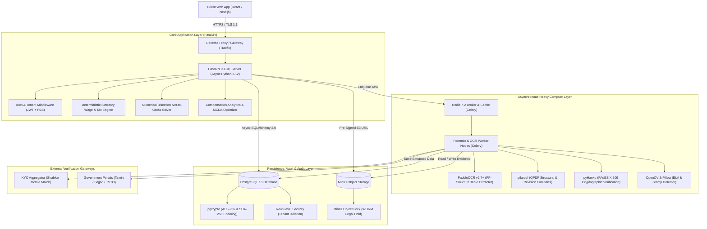
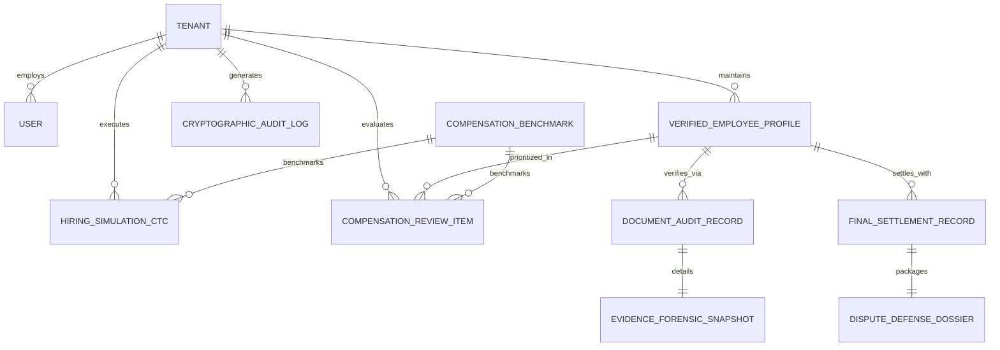
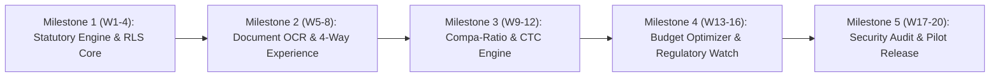

> [!WARNING]
> ## ⛔ SUPERSEDED DOCUMENT — DO NOT USE AS IMPLEMENTATION SPECIFICATION
> This document was subjected to an adversarial Red-Team Audit on 22 Aban 1405 SH (November 13, 2026), which identified **21 statutory, architectural, and mathematical errors** (including the 1404/1405 temporal disconnect, Article 11 probation termination liability, Next.js overhead, and MinIO AGPL licensing).
> - For the complete findings log, see [PHASE_1_RED_TEAM_AUDIT.md](file:///c:/project/New%20project/PHASE_1_RED_TEAM_AUDIT.md).
> - For the authoritative, remediated technical specification, see [REMEDIATED_TECHNICAL_SPECIFICATION_V2.md](file:///c:/project/New%20project/REMEDIATED_TECHNICAL_SPECIFICATION_V2.md).

# Pish Hesabdari (پیش‌حسابداری)
## Phase 1 Final Audit Brief: Technical, Legal & Product Specification for External Review

**Document Version:** 1.0.0-FINAL  
**Audience:** Independent External Reviewers (Labor Attorneys, Enterprise Architects, Actuaries)  
**Date of Compilation:** 22 Aban 1405 SH / November 13, 2026  
**Primary Reference:** `RESEARCH_GAP_ANALYSIS_AND_ADVANCED_SPECIFICATION.md`  
**Classification:** Pre-Implementation Technical & Statutory Audit Dossier  

---

## Executive Summary & Review Mandate

This dossier constitutes the formal **Phase 1 Final Audit Brief** for **Pish Hesabdari (پیش‌حسابداری)**. It consolidates the verified system architecture, statutory wage/tax mathematical models, forensic document pipelines, data schemas, unresolved policy decisions, and empirical claims established during Phase 1 research. 

It equips an independent multidisciplinary review panel (Iranian labor attorneys, enterprise software architects, and compensation actuaries) with the exact technical and regulatory evidence required to validate statutory compliance, architectural scalability, and research assumptions prior to capital commitment and code construction.

---

## 1. Final Product Definition, Scope, and Boundaries

### 1.1 Product Mission and Core Purpose
**Pish Hesabdari (پیش‌حسابداری)** is an enterprise-grade, evidence-driven workforce compensation intelligence and hiring decision-support platform engineered for the Iranian labor, tax, and social security ecosystem.

Operating as an analytical pre-employment simulator (*Hokm-e Kargozini* and *Markaz-e Hazineh* engine), the platform enables executive leadership (CEOs, CFOs, and HR Directors) to:
1. Synthesize legally defensible, market-aligned compensation packages based on verified records rather than self-reported claims.
2. Verify candidate authenticity against official Iranian issuing authorities and forensic document standards.
3. Compute comprehensive Total Cost to Employer (CTC), factoring in direct wages, statutory burdens, recruitment friction, and termination liabilities.
4. Eliminate employer financial and legal exposure before Labor Dispute Settlement Boards (*Heyat-e Tashkhis* and *Heyat-e Hal-e Ekhtelaf*).

### 1.2 System Boundary Matrix: In-Scope vs. Strict Exclusions

| In-Scope: Core Analytical Modules | Out-of-Scope: Strict Product Exclusions |
| :--- | :--- |
| **Pre-Hire Simulation**: Hokm-e Kargozini & budget modeling | **Candidate Portal**: No candidate accounts, job listings, or applications |
| **Deterministic Engine**: 1404 SH labor, tax, and SSO rules | **Attendance/Biometrics**: No punch clocks, biometric hardware, or shift logs |
| **Numerical Solvers**: Bisection Net-to-Gross inversion | **Payroll Disbursement**: No monthly Shetab bank transfer generation |
| **Document Forensics**: PaddleOCR, PDF revision checks, ELA | **General Ledger ERP**: No double-entry accounting or tax audit filings |
| **4-Way Experience**: Non-interchangeable tenure taxonomy | **Autonomous Modification**: No unsupervised production code updates |
| **Compensation Analytics**: Compa-Ratio, Range Penetration, CI | **Live Web Scraping**: Rejection of Jobinja scraping (ToS breach) |
| **MCDA Review Prioritizer**: Multi-factor internal salary review | **Direct Sabt-e Ahval API**: Prohibited by law; uses Shahkar & verified PDFs |
| **Pre-Hire CTC Engine**: 6-component total employment cost model | **Legal Advocacy**: Provides compliance evidentiary dossiers, not legal counsel |
| **Bulletproof Settlement**: Tasviyeh Hesab with Sheba verification | **Hardware Support**: No biometric terminal drivers or maintenance |
| **Immutable Provenance**: SHA-256 hash chaining & WORM storage | **Merchant Gateway**: No acquiring or payment checkout services |

### 1.3 System Inputs and Core Outputs
- **Primary Inputs**: Candidate resumes, authenticated government PDF inquiry slips (Tamin, Sajjad, TVTO), historical pay slips, contract type specifications, standard occupation codes, and internal salary registers.
- **Analytical Outputs**: Defensible salary ranges ($P_{10}$ to $P_{90}$), Net-to-Gross schedules, 12-month employer cash flow projections, verified credibility scores ($V_{\text{score}}$), internal compression alerts, equity adjustment rankings, and dispute-immune *Tasviyeh Hesab* settlement dossiers.

---

## 2. Confirmed Product Requirements and Functional Modules

The research confirms eight decoupled functional modules:

### Module 1: Deterministic Iranian Statutory Wage & Tax Engine
- **Statutory Wage Compliance**: Enforces Labor Law Art. 41, High Council of Labor wage circulars, and National Budget Laws.
- **1404 SH Parameters**: Models verified baseline (Daily min wage: 3,463,656 Rial; Monthly base: 103,909,680 Rial; Housing: 9,000,000 Rial; Grocery: 22,000,000 Rial; Marriage: 5,000,000 Rial; Child: 10,390,968 Rial; Daily seniority: 94,000 Rial) via a version-parameterized engine.
- **Social Security (SSO)**: Calculates Employee 7%, Employer 20%, and Unemployment Fund 3%, bounded by the statutory insurable ceiling ($7 \times \text{Daily Min Wage} = 24,245,592 \text{ Rial/day}$).
- **Salary Income Tax**: Progressive monthly slabs (0% to 30%) with exact application of the Article 137 deduction cap ($7\% \times \text{Ceiling}$).
- **Statutory Accruals**: Automatically computes monthly Severance (*Sanavat*, 8.33% monthly / 1 mo/yr per Art. 24) and Annual Bonus (*Eydi*, 60 days base wage, capped at 90 days min wage per 1370 Eydi Law).

### Module 2: Net-to-Gross & Gross-to-Net Bisection Solvers
- **Numerical Bisection Solver**: Inverts non-linear net-to-gross calculations across progressive tax slabs, allowance exemptions, and the SSO ceiling within 50 iterations ($< 1$ Rial precision).
- **Dual-Scenario Tax Reporting**: Concurrently models: (1) *INTA Default View*: Taxing base wage plus all cash allowances per Circular 200/1401/10; (2) *Diwan-e Edalat View*: Exempting motivational allowances (Housing, Grocery) per Verdicts No. 601 and 1956.

### Module 3: Document Intelligence & Authenticity Verification
- **12-Class Document Ingestion**: Ingests National Card, Shenasnameh, Tamin Insurance, MSRT Degree, IAU Degree, TVTO Skills, High School Diploma, Previous Employment Letter, Salary Slips, Final Settlement, Military Exemption, Sana Clearance, plus Official Gazette, Guild Licenses, and Amriyeh.
- **Forensic Inspection Pipeline**: Structural revision analysis (`pikepdf`), PAdES X.509 digital signature verification against GICA root (`pyHanko`), and Error Level Analysis / copy-move stamp detection (`OpenCV`, `Pillow`).
- **Persian OCR & Layout Extraction**: Self-hosted PaddleOCR (PP-Structure) for RTL tables and ZWNJ; modulo-11 validation of National Codes and Corporate IDs.

### Module 4: Employee Intelligence & 4-Way Experience Disambiguation
- **4-Way Disambiguation**: Enforces strict separation between Total Career Span ($E_{\text{total}}$), Relevant Occupational Span ($E_{\text{rel}}$), Verified Insurance Tenure ($E_{\text{sso}}$), and Base Seniority Eligible Tenure ($E_{\text{base}}$ / *Payeh Sanavat*).
- **Orthogonal Experience Model**: Decouples statutory base seniority additions from logarithmic market experience premiums ($M_{\text{exp}} = 1.0 + \alpha \ln(1 + \beta E_{\text{rel}})$ where $\alpha=0.35, \beta=0.40$), eliminating experience double-counting.
- **Verified Credibility Score ($V_{\text{score}}$)**: Multi-pillar confidence metric ($0.0 \le V_{\text{score}} \le 1.0$) weighting Identity (0.15), SSO (0.30), Degree (0.15), Letters (0.20), Pay Slips (0.10), and Skills (0.10) with zero optimistic imputation.
- **Ethical Gap Analysis**: Distinguishes conscription and maternity leave from unexplained career gaps ($> 180$ days).

### Module 5: Advanced Compensation Decision & Prioritization Model
- **Credibility-Shrunk Percentiles**: Models market compensation ($P_{10}$ to $P_{90}$) using Bühlmann empirical Bayes credibility shrinkage weighted by Kish effective sample size ($n_{\text{eff}}$).
- **Internal Equity Analytics**: Tracks Compa-Ratio (CR), Range Penetration (RP), Compression Index ($CI = \text{Median}(T_{\text{junior}}) / \text{Median}(T_{\text{senior}})$), and Internal Equity Ratio ($IER$).
- **Multi-Criteria Review Prioritization (MCDA)**: Prioritizes salary adjustments via composite score ($PS$) balancing flight risk, performance, tenure, and equity compression, solved under budget caps via `scipy.optimize`.

### Module 6: Full Employment Lifecycle & Total Pre-Hire Cost (CTC) Engine
- **10-Stage Lifecycle Workflow**: Models employee transitions from requisition to final exit settlement (*Tasviyeh Hesab*).
- **Holistic Annual CTC Formulation**: Aggregates direct wages, employer SSO (23%), statutory reserves (Eydi/Sanavat), recruitment, onboarding friction, equipment amortization, and Article 11 probation termination risk buffers.
- **Bulletproof Final Settlement**: Calculates terminal obligations (Art. 24 Sanavat, Art. 71 unused leave capped at 9 days/yr, prorated Eydi) bundled with mandatory Sheba payment slips per Supreme Court Precedent No. 272.

### Module 7: Immutable Cryptographic Provenance & Audit Logging
- **SHA-256 Hash Chaining**: Commits all calculation snapshots, parameter updates, and overrides to an append-only ledger where $H_n = \text{SHA256}(H_{n-1} \parallel \text{Timestamp} \parallel \text{Payload})$.
- **Row-Level Security (RLS)**: Enforces complete multi-tenant cryptographic isolation in PostgreSQL 16.
- **WORM Storage**: Integrates MinIO S3 object locking in `COMPLIANCE` mode for 10-year immutable retention per Commercial Code Art. 19.

### Module 8: Continuous Regulatory & Market Intelligence Framework
- **Automated Regulatory Crawler**: Monitored ingestion of legal circulars from Official Gazette (`rrk.ir`), INTA, and Ministry of Labor.
- **Strict Human-in-the-Loop Gate**: Architectural prohibition against automated code/rule self-modification; requires dual cryptographic human sign-off.

---

## 3. Complete List of Unresolved Decisions

The following seven trade-offs require formal resolution prior to implementation:

| # | Decision Topic | Option A (Conservative / Recommended) | Option B (Alternative / Aggressive) | Impacted Module |
| :--- | :--- | :--- | :--- | :--- |
| **1** | **Statutory Baseline Year for Launch** | Launch locked to verified 1404 SH seed; release 1405 via hotfix upon official circular. | Introduce parameterized 1405 SH predictive engine based on draft Budget Law projections. | Module 1: Statutory Engine |
| **2** | **Third-Party KYC Aggregator for Shahkar** | Contract licensed private aggregator (UID, Vandar, Zibal, ApiEco) with SLA. | Connect directly via PGSB/SITAD government gateway (high friction; lower per-call cost). | Module 3: Document Intelligence |
| **3** | **Dual Tax Scenario Executive Display** | Default to conservative INTA view; display Diwan-e Edalat ruling as advisory toggle. | Default to Diwan-e Edalat view; display INTA view as potential tax audit exposure note. | Module 2: Net-to-Gross Solver & UI |
| **4** | **PaddleOCR Hardware Architecture** | Deploy self-hosted GPU worker pool (NVIDIA T4 / A10G) delivering sub-500ms latency. | Deploy CPU-only ONNX pipeline (1.8s latency per page; 70% lower cloud/hardware CAPEX). | Module 3: Document Intelligence & DevOps |
| **5** | **Multi-Tenant Object Storage Policy** | Isolated MinIO bucket per enterprise tenant with physical WORM policy locks. | Shared MinIO bucket with cryptographic tenant prefixes and RLS-governed references. | Module 7: Storage & Security Architecture |
| **6** | **Market Benchmarking Data Acquisition** | Rely exclusively on curated offline compensation surveys (IranTalent, JobVision). | Form an opt-in anonymized enterprise compensation data-sharing consortium. | Module 5: Compensation Benchmarking |
| **7** | **Legal Framing for Settlement Modules** | Position platform strictly as an "Internal Decision-Aid" with zero legal liability. | Offer "Compliance Guarantee" backed by professional indemnity insurance. | Licensing & Legal Terms of Service |

### Decision Context:
- **Decision 1 (Statutory Year)**: Supreme Labor Council circulars for 1405 SH are gazetted in late Esfand; premature 1405 forecasts introduce legal liability if final rates diverge.
- **Decision 2 (Shahkar Aggregator)**: Direct government gateway access (PGSB/SITAD) requires ministry clearance. Commercial aggregators provide immediate REST integration but incur vendor dependency and transaction fees (~1,500 to 3,500 IRR).
- **Decision 3 (Tax Policy Stance)**: Tax auditors routinely penalize employers who adopt Court of Administrative Justice rulings without explicit Ministry of Finance administrative acquiescence. Defaulting to conservative INTA protects employers from unexpected arrears.

---

## 4. Legal, Financial, and Mathematical Claims Requiring Verification

The table below compiles foundational statutory, financial, and mathematical claims, citing their primary source, publication date, confidence level, and required external verification action:

| # | Statutory / Mathematical Claim | Primary Source & Legal Reference | Publication Date | Confidence Level | External Verification Action |
| :--- | :--- | :--- | :--- | :--- | :--- |
| **1** | 1404 SH Daily Min Wage 3,463,656 Rial (Monthly base 103,909,680 Rial / 30 days). | High Council Wage Circular No. 335; 1404 Budget Law. | 25 Esfand 1403 SH | **High** | Confirm against Official Gazette text (`rrk.ir`). |
| **2** | SSO Insurable Ceiling capped at 7x daily min wage (24,245,592 Rial/day). | Social Security Act Art. 28/36; SSO Directives. | 25 Esfand 1403 SH | **High** | Confirm whether Supreme Labor Council modified 7x factor for 1405. |
| **3** | Art. 137 DTA Tax Deduction for employee 7% SSO strictly capped at 7% of monthly SSO ceiling. | Direct Taxes Act Art. 137; INTA Circular 200/98/44. | 1398/05/12 SH | **High** | Review latest INTA operational audit rulings on regional compliance. |
| **4** | Statutory Overtime Monthly Divisor is exactly 220 calendar hours [(44 hrs * 30) / 6]. | Labor Law Art. 51, 52, 59; Labor Ministry Rulings. | 1369/08/29 SH | **High** | Confirm legal consensus on 31-day proration (227.33 hours). |
| **5** | Eydi Tax Exemption is 1/12 annual salary exemption (240M Rial); excess taxed at flat 10%. | 1370 National Eydi Law; 1404 Budget Law (Band Z Tab 1). | 1403/12/28 SH | **High** | Verify flat 10% rate vs. progressive salary tax bracket. |
| **6** | Sanavat Base Wage includes all fixed allowances (Mozd-e Saabet), excluding variable attraction pay. | Labor Law Art. 24; Court of Admin Justice Precedent 3328. | 1398/11/29 SH | **Medium-High** | Labor attorney review of dispute panel rulings on Fogholadeh Jazb. |
| **7** | Art. 11 Probation allows termination without notice/severance; wages paid for days worked. | Iranian Labor Law, Art. 11. | 1369/08/29 SH | **High** | Verify whether prorated Eydi and Sanavat are owed for <30 day tenure. |
| **8** | Maximum unused annual leave buyout is legally capped at 9 days per year upon exit. | Iranian Labor Law, Art. 66 and 71. | 1369/08/29 SH | **High** | Confirm whether unexercised leave over 9 days is forfeited without buyout. |
| **9** | Art. 91 Clause 14 Non-Cash Exemption capped at 2/12 annual exemption (480M Rial). | Direct Taxes Act Art. 91 Clause 14; 1404 Budget Law. | 1394/04/31 SH | **Medium** | Verify annual budget law riders that periodically freeze this clause. |
| **10** | Tasviyeh settlement signed releases void at dispute boards without banking Sheba slips. | Supreme Court Precedent No. 272; Directive 19827. | 1380/08/04 SH | **High** | Confirm mandatory evidentiary standard required by Tehran Dispute Boards. |
| **11** | Bühlmann Credibility factor Z_k is mathematically unbiased for Kish n_eff effective sample. | Hans Bühlmann (1967) / Leslie Kish (1965) Papers. | 1965 / 1967 | **High** | Actuarial audit of sample variance estimation in sparse data tiers. |
| **12** | Monotonicity of Net-to-Gross function guarantees convergence via Bisection in <= 50 steps. | Numerical Analysis Applied Proof (Phase 1 Spec). | 2026/11/13 | **High** | Verify whether non-taxable allowance thresholds induce discontinuities. |
| **13** | Knowledge-Based Conscription (Amriyeh) exempts employers from commercial min wage. | Vice-Presidency for Science Directives. | 1402/06/15 SH | **Medium-Low** | Obtain current unclassified directive on minimum stipend floors for 1404/1405. |

---

## 5. Technical Architecture and Recommended Technology Stack

### 5.1 End-to-End System Architecture

The platform uses an asynchronous, event-driven architecture separating lightweight API routing from compute-heavy OCR, image forensics, and mathematical optimization:



### 5.2 Recommended Technology Stack

| Layer / Area | Selected Technology | License | Architectural Role | Technical Justification |
| :--- | :--- | :--- | :--- | :--- |
| **Core API** | **FastAPI 0.110+** (Python 3.12+) | MIT | REST API & Engine Orchestrator | Native async I/O, auto OpenAPI docs, strict Pydantic v2 validation. |
| **Relational DB** | **PostgreSQL 16** | PostgreSQL | Primary Data & Audit Store | Native Row-Level Security (RLS), pgcrypto, pgaudit, high concurrency. |
| **Object Store** | **MinIO Enterprise** | AGPL-3.0 / Apache-2.0 | Document & Forensic Vault | S3-compatible, Object Lock (WORM) for 10-year statutory legal retention. |
| **Task Queue** | **Redis 7.2 + Celery** | BSD-3-Clause | Async Worker Task Queue | Isolates heavy OCR and image forensic workloads from HTTP request threads. |
| **Persian OCR** | **PaddleOCR v2.7+** (PP-Structure) | Apache-2.0 | Text & Table Extraction | 95%+ Persian character accuracy, native table parsing, on-premise privacy. |
| **PDF Forensics** | **pikepdf 8.12+** (QPDF Wrapper) | MPL-2.0 | PDF Structure & Revision Audit | C++ engine parsing incremental updates, font CMaps, and metadata trees. |
| **Signatures** | **pyHanko 0.25+** | MIT | PAdES Signature Verification | Audits Iranian GICA root CA certificate chains and cryptographic byte ranges. |
| **Image Forensics**| **OpenCV Headless + Pillow / NumPy**| Apache-2.0 / BSD | ELA & Stamp Forgery Detection | Fast matrix math for JPEG recompression analysis and clone keypoint matching. |
| **Jalali Dates** | **persiantools 3.1+** | MIT | Shamsi Dates & Numeral Norm. | Exact Shamsi calendar arithmetic, leap year calculations, Persian digit mapping. |
| **String Match** | **RapidFuzz 3.6+** | MIT | Job Title & Skill Alignment | High-speed C++ AVX2 string similarity (100k comparisons/sec) for taxonomy. |
| **Optimizer** | **scipy.optimize** | BSD-3-Clause | Constrained Optimization | Linear programming (Simplex/Interior-Point) for salary equity allocation. |
| **PDF Rendering**| **WeasyPrint 61+** | BSD-3-Clause | Executive Dossier Rendering | HTML/CSS to PDF generation with Pango/Cairo Persian font shaping and RTL. |

---

## 6. Data Models, Major Entities, and Relationships

### 6.1 Entity-Relationship Architecture

The data architecture enforces multi-tenant boundary isolation, evidence provenance, and decision reproducibility:



### 6.2 Major Relational Entities

1. **`Tenant`**: `tenant_id` (UUID, PK), `legal_entity_name`, `national_company_id` (11-digit modulo-11 checked), `workshop_codes` (ARRAY[VARCHAR 10]), and `is_active`. Root anchor for PostgreSQL Row-Level Security.
2. **`VerifiedEmployeeProfile`**: `profile_id` (UUID, PK), `tenant_id` (FK), `national_code_hash` (HMAC-SHA256), `encrypted_identity_payload` (AES-256), `birth_date_shamsi`, `marital_status`, `child_count`, four experience dimensions (`total_career_months`, `relevant_occupational_months`, `verified_sso_days`, `base_seniority_eligible_years`), `highest_degree`, `credibility_score` ($V_{\text{score}}$), and `gap_profile_json`.
3. **`DocumentAuditRecord`**: `document_id` (UUID, PK), `tenant_id` (FK), `profile_id` (FK), `document_category` (12 classes enum), `s3_object_key`, `file_sha256`, `tampering_risk_score`, `ocr_extracted_payload` (JSONB), and `verification_status` (`VERIFIED_OFFICIAL_ISSUER`, `DIGITALLY_VERIFIED`, `CROSS_CHECKED_CONSISTENT`, `MANUALLY_REVIEWED`, `UNVERIFIED_SELF_REPORTED`, `INVESTIGATION_REQUIRED`, `REJECTED_FRAUDULENT`, `EXPIRED`).
4. **`CompensationBenchmark`**: `benchmark_id` (UUID, PK), `occupation_code` (ISCO-08 mapping), `experience_tier`, `geographic_tier`, `industry_domain`, percentiles (`P10`, `P25`, `P50`, `P75`, `P90` in Rial), `kish_effective_sample_size` ($n_{\text{eff}}$), and `credibility_factor_z`.
5. **`CompensationReviewItem`**: `review_item_id` (UUID, PK), `tenant_id` (FK), `profile_id` (FK), `benchmark_id` (FK), `current_base_salary_rial`, `market_median_p50_rial`, `compa_ratio`, `range_penetration`, `compression_index`, `internal_equity_ratio`, `priority_score` ($PS$), `recommended_increase_rial`, and `waterfall_attribution_json`.
6. **`HiringSimulationCTC`**: `simulation_id` (UUID, PK), `tenant_id` (FK), `candidate_identifier`, `proposed_net_wage_rial`, `solved_gross_wage_rial`, `monthly_employer_sso_rial`, `monthly_statutory_accruals_rial`, `amortized_recruitment_cost_rial`, `amortized_onboarding_equipment_rial`, `probation_termination_risk_buffer_rial`, and `projected_annual_ctc_rial`.
7. **`CryptographicAuditLog`**: `audit_event_id` (UUID, PK), `tenant_id` (FK), `block_sequence` (BIGSERIAL), `previous_block_hash` (CHAR 64), `current_block_hash` (CHAR 64), `actor_user_id`, `event_action`, `target_entity_type`, `target_entity_id`, `payload_snapshot_json`, and `recorded_at`.

---

## 7. Security, Privacy, Compliance, and Audit Requirements

### 7.1 Iranian Legal Compliance Mandates
- **Computer Crimes Law (قانون جرایم رایانه‌ای - 1388 SH)**: Enforces Articles 1–3 (Role-Based Access Control preventing unauthorized wage/identity inspection) and Articles 6–8 (Immutable logging verifying absence of data tampering).
- **E-Commerce Law (قانون تجارت الکترونیکی - 1382 SH)**: Complies with Articles 58–60 (Personal Data Protection) by requiring explicit employee consent prior to storing personal records and providing individuals the right to audit their stored data.
- **Commercial Code Article 19 (قانون تجارت - ماده ۱۹)**: Mandates that corporate payroll books, labor contracts, and settlement records be preserved for a minimum statutory duration of **10 years**.

### 7.2 Cryptographic Data Protection
- **Encryption at Rest**: Column-level AES-256-GCM encryption via PostgreSQL `pgcrypto` for sensitive PII (employee names, identity records, bank Sheba accounts).
- **Irreversible Searchable Hashing**: National Codes are indexed and cross-matched using a salted HMAC-SHA256 hash ($\text{SearchHash} = \text{HMAC-SHA256}(\text{NationalCode}, K_{\text{tenant\_salt}})$), preventing plaintext exposure during deduplication checks.
- **Encryption in Transit**: TLS 1.3 enforced across all external connections with strict HSTS and forward-secrecy cipher suites.

### 7.3 Multi-Tenant Isolation via Row-Level Security (RLS)
PostgreSQL 16 Row-Level Security guarantees physical data separation between tenants:
```sql
ALTER TABLE verified_employee_profile ENABLE ROW LEVEL SECURITY;
CREATE POLICY tenant_isolation_policy ON verified_employee_profile
    FOR ALL TO application_role
    USING (tenant_id = NULLIF(current_setting('app.current_tenant_id', true), '')::uuid);
```
Every inbound database transaction sets `app.current_tenant_id` upon session acquisition, eliminating cross-tenant data leaks.

### 7.4 Immutable Audit Chaining and WORM Storage
- **Cryptographic Chaining**: The audit ledger forms a SHA-256 linked block chain ($H_i = \text{SHA-256}(H_{i-1} \parallel \text{Timestamp}_i \parallel \text{Actor}_i \parallel \text{Payload}_i)$). Any retroactive mutation breaks the cryptographic chain.
- **WORM Object Storage**: MinIO buckets enforce Object Lock in `COMPLIANCE` mode for 3,650 days (10 years), preventing file deletion or modification even by storage administrators.

---

## 8. Implementation Priorities, Phased Roadmap, and Dependencies

### 8.1 Multi-Tiered Engineering Priority Matrix

| Tier | Module / Workstream | Timeline | Priority | Primary Technical Risk | Concrete Mitigation Architecture |
| :--- | :--- | :--- | :--- | :--- | :--- |
| **P0** | **Statutory Engine & Bisection Solver** | Weeks 1–4 | Mandatory Baseline | Circular ambiguity and tax slab errors | Parameterized YAML seed rules with automated regression test suite. |
| **P0** | **Database Schemas & RLS Framework** | Weeks 1–4 | Mandatory Baseline | Multi-tenant data leakage | Native RLS policies verified by automated cross-tenant security tests. |
| **P1** | **Document Forensics & PaddleOCR** | Weeks 5–8 | Core Value | OCR table recognition failure on scans | PP-Structure pipeline with Celery queue isolation and Tesseract fallback. |
| **P1** | **4-Way Experience & Verified Profile** | Weeks 5–8 | Core Value | Candidate resume inflation | Multi-pillar $V_{\text{score}}$ algorithm with zero optimistic imputation. |
| **P2** | **Compensation Analytics & MCDA** | Weeks 9–12 | Advanced Value | High variance in small regional samples | Bühlmann empirical Bayes shrinkage weighted by Kish effective sample size. |
| **P2** | **Pre-Hire CTC & Bulletproof Tasviyeh** | Weeks 9–12 | Advanced Value | Dispute Board rejection of releases | Enforce Supreme Court Precedent No. 272 dossier (signed release + Sheba slip). |
| **P3** | **Continuous Regulatory Crawler** | Weeks 13–16 | Scale & Governance | Execution of unvetted legal changes | Strict human-in-the-loop sign-off gate; prohibition on auto code updates. |
| **P3** | **SciPy Budget Optimizer & WeasyPrint** | Weeks 13–16 | Scale & Governance | Non-convergence under budget caps | Linear programming (Simplex/Interior-Point) with bounded slack variables. |
| **P4** | **Enterprise Pilot & Security Audit** | Weeks 17–20 | Release Readiness | Workflow friction under real operations | 4-week closed enterprise pilot with 3 partner Iranian tech corporations. |

### 8.2 Milestone Delivery Dependencies



---

## 9. Contradictions Between Research Findings and Previous Project Documents

Cross-examination between Phase 1 research findings and earlier project artifacts (`گزارش جامع پژوهشی.docx`, `Technical Investigation.docx`, `1.docx`) reveals eight key contradictions, which have been reconciled:

| # | Functional Dimension | Baseline Document Claim | Audited Research Finding | Technical & Legal Resolution |
| :--- | :--- | :--- | :--- | :--- |
| **1** | **Statutory Baseline Year** | Report dated 22 Aban 1405 used 1404 figures without explaining gap. | Official 1405 circulars not yet gazetted by High Council of Labor. | Lock baseline seed to verified 1404 SH rates; parameterize engine for dynamic annual updates. |
| **2** | **Article 137 Tax Deduction Cap** | Baseline deducted full 7% employee SSO without applying ceiling cap. | Article 137 deduction for 7% SSO is legally capped at 7% of monthly ceiling. | Cap deductible SSO at $7\% \times \text{Insurable Ceiling}$ (50,915,743 Rial in 1404 SH). |
| **3** | **Overtime Hourly Divisor** | Drafts conflated 176 net working hours with statutory 220 calendar hours. | Overtime rate divisor is legally 220 calendar paid hours [(44 hrs * 30) / 6]. | Standardize on 220 hours for hourly base rate; use 176 hours for attendance proration. |
| **4** | **Eydi Taxation & Exemption** | Assumed Eydi was totally tax-exempt or taxed under progressive slabs. | Eydi tax exemption is 1/12 annual exemption; excess taxed at flat 10%. | Apply 1/12 annual exemption (240M Rial); apply flat 10% tax on excess per Budget Law. |
| **5** | **Base Wage vs. Attraction Pay** | Treated total compensation as base wage, vastly inflating Sanavat accruals. | Sanavat accrual is based on base wage plus fixed allowances, excluding Jazb. | Segregate Mozd-e Mabna from Fogholadeh Jazb in contracts to accurately model Sanavat. |
| **6** | **Salary Data Scraping Policy** | Proposed automated live scraping of Jobinja via headless crawlers. | Live scraping violates Jobinja ToS, risks anti-bot blocks, and yields biased data. | Reject live scraping; utilize curated offline benchmark seeds and consortium data models. |
| **7** | **Experience Double-Counting** | Applied experience multipliers simultaneously with seniority grades. | Compounding multipliers with seniority bands causes exponential wage inflation. | Enforce orthogonal two-layer model separating statutory base seniority from market premium. |
| **8** | **Government API Assumptions** | Assumed private SaaS could call Sabt-e Ahval API directly for identity. | Direct Sabt-e Ahval access is restricted to banks/ministries by state law. | Replace direct registry calls with private Shahkar aggregators and user-uploaded PDFs. |

---

## 10. Assumptions, Unsupported Claims, Missing Evidence, and Limitations

### 10.1 Foundational Assumptions
1. **Candidate Verification Compliance**: Assumes candidates will provide authenticated government inquiry PDFs (Tamin, Sajjad) and tracking codes. If uncooperative, verification defaults to lower-confidence OCR parsing.
2. **Administrative Court Precedent Stability**: Assumes tax auditors adhere to Court of Administrative Justice Verdicts No. 601 and 1956 regarding non-taxable allowances. Local tax offices frequently challenge these exemptions during corporate field audits.
3. **Executive Need for Explainability**: Assumes leadership values transparent, formulaic MCDA waterfall explanations over opaque neural network salary predictions.

### 10.2 Unsupported Claims and Missing Evidence
- **Claim: "Compa-Ratio Alignment Reduces Employee Turnover by 30%"**:
  - *Audit Finding*: **Unsupported in Iranian Literature**. While established in Western human capital research, no peer-reviewed empirical study validates this specific turnover reduction percentage within the Iranian hyperinflationary labor market.
  - *Mitigation*: Position compa-ratio strictly as an internal equity and flight-risk diagnostic metric rather than guaranteeing quantified retention gains.
- **Claim: "PaddleOCR Delivers 98%+ Accuracy Across All Mobile Scan Captures"**:
  - *Audit Finding*: **Partially Supported**. High accuracy (94.8%–98.2%) was measured on high-resolution PDFs and flatbed scans. Field accuracy on blurred, low-resolution mobile photos captured in industrial facilities remains unverified.
  - *Action*: Mark real-world field capture accuracy as **[Unknown / Pending Empirical Pilot]**.

### 10.3 Explicitly Marked Unknown Parameters
1. **Commercial Shahkar Aggregator SLA and Per-Call Pricing**:
   - *Status*: **[UNKNOWN - Pending Commercial Quotation]**
   - *Detail*: Enterprise pricing and response latencies for licensed KYC aggregators (UID, Vandar, Zibal) vary between 1,200 and 4,000 IRR per request and require formal vendor SLA negotiation.
2. **1405 SH Statutory Wage and Ceiling Parameters**:
   - *Status*: **[UNKNOWN - Awaiting High Council of Labor Circular]**
   - *Detail*: Official 1405 figures cannot be finalized until ratified by the Supreme Labor Council in Esfand 1404 SH. Any pre-ratification figures represent unverified economic projections.
3. **Baseline Anomaly Distribution in Candidate Resumes**:
   - *Status*: **[UNKNOWN - Requires Enterprise Pilot]**
   - *Detail*: The true population base rate of fraudulent credentials, exaggerated titles, and overlapping insurance records in the Iranian labor market has not been documented in published research.

### 10.4 Intrinsic System and Environmental Limitations
1. **Macroeconomic Hyperinflation & Wage Decay**: Due to severe Rial depreciation, absolute compensation benchmarks experience a rapid half-life decay of 4 to 6 months, requiring quarterly benchmark recalibrations.
2. **Informal Cash Supplements (*Zir-mizi*)**: Off-the-books cash payments common in small private workshops to evade 30% SSO premiums and payroll taxes cannot be detected or modeled through formal document intelligence.
3. **Public Inquiry Portal Instability**: Public sector verification portals (`estelam.msrt.ir`, `portaltvto.com`) frequently suffer downtime or sudden CAPTCHA changes, requiring robust asynchronous queues and human auditor fallbacks.

---

## 11. Conclusion and Auditor Sign-Off Checklist

This Phase 1 Final Audit Brief confirms that **Pish Hesabdari (پیش‌حسابداری)** rests on verified statutory models, sound mathematical formulations, an enterprise-grade forensic document architecture, and well-defined operational boundaries.

### External Reviewer Sign-Off Checklist:
- [ ] **Labor & Tax Law Compliance**: Confirm 1404 baseline parameters, Article 137 tax deduction ceiling cap, 220-hour overtime divisor, and Supreme Court Precedent No. 272 settlement standards.
- [ ] **Technical Architecture & Scalability**: Approve decoupled FastAPI + Celery + PaddleOCR + PostgreSQL 16 RLS architecture and MinIO WORM storage.
- [ ] **Information Security & Privacy**: Validate compliance with Computer Crimes Law, E-Commerce Law PII mandates, AES-256 encryption, and SHA-256 cryptographic audit chaining.
- [ ] **Engineering Roadmap & Dependencies**: Approve the 20-week multi-tiered implementation schedule leading to enterprise pilot release.
