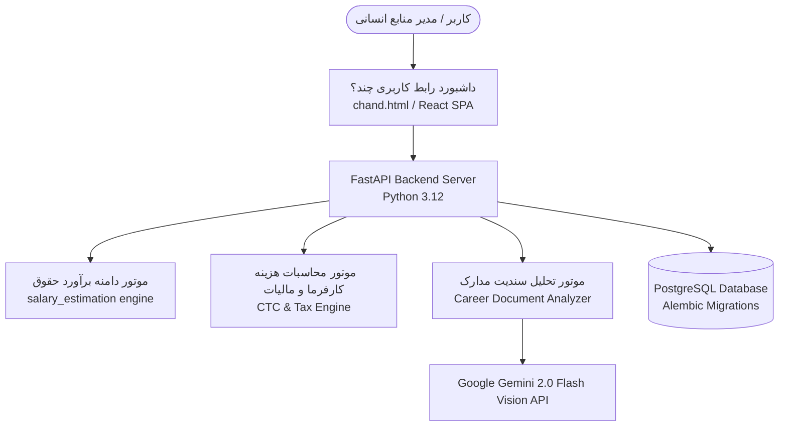

# چند؟ (Chand) — سامانه هوشمند برآورد حقوق و جبران خدمات بازار کار ایران

<div align="center">
  
  <h3>پلتفرم تخصصی تحلیل رزومه، برآورد حقوق منصفانه و تصمیم‌یاری استخدام در بازار کار ایران</h3>
  <p><strong>به‌روزرسانی: پاییز ۱۴۰۵ (آبان ۱۴۰۵) • مجهز به هوش مصنوعی Google Gemini Vision 2.0</strong></p>
</div>

---

## معرفی پروژه (Overview)

پلتفرم **«چند؟»** یک سامانه مدرن، داده‌محور و هوشمند برای مدیران منابع انسانی، کارفرمایان و کارجویان است که با تکیه بر داده‌های پایش‌شده بیش از **۱۹۴ ردیف شغلی** در بازار کار ایران (جابینجا، کوئرا، ایران‌تلنت و جاب‌ویژن)، محدوده دستمزد منصفانه را به همراه تفکیک قانونی کسورات و هزینه کل کارفرما (CTC) برآورد می‌کند.

این سامانه علاوه بر تحلیل پارامتریک سوابق و مهارت‌ها، به موتور بینایی ماشین **Google Gemini Vision** جهت سنجش اصالت و استخراج واقعیت از اسناد رسمی (سابقه بیمه تأمین اجتماعی، فیش حقوقی، حکم کارگزینی و مدارک دانشگاهی) مجهز است.

---

## قابلیت‌های کلیدی (Key Features)

### ۱. برآورد دقیق و زنده‌ی دستمزد (Market Salary Estimation)
- **بازه حقوقی صدک‌ها (P25 … P75) و میانه بازار (Median):** محاسبه چارک اول، میانه و چارک سوم بر مبنای توزیع آماری بازار.
- **پشتیبانی از ۱۹۴ ردیف شغلی:** پوشش کامل شاخه‌های نرم‌افزار، طراحی محصول، مدیریت محصول، داده و هوش مصنوعی، دواپس و زیرساخت، بازاریابی، مالی و حسابداری، منابع انسانی، فروش و توسعه بازار، و مدیریت اجرایی.
- **تأثیرپذیری زنده و چندبعدی:** محاسبه اثر سابقه کار (از ۰ سال / بدون سابقه تا ۱۵+ سال)، سطح ارشدیت (تازه‌کار، میان‌رده، ارشد، لید)، نوع استخدام (تمام‌وقت، پاره‌وقت)، شیوه کار (حضوری، هیبرید، دورکاری) و استان محل کار.
- **انتخاب‌پذیری تعاملی مهارت‌های تخصصی:** دکمه‌های فعال/غیرفعال مهارت‌ها با ۵٪ تأثیر مستقیم به ازای هر مهارت بر دستمزد و صدک‌های بازار.

### ۲. سنجش اصالت مدارک با هوش مصنوعی (AI Document Verification)
- **پشتیبانی از فرمت‌های تصویر و سند (PNG, JPG, WebP, PDF).**
- **قابلیت کشیدن و رها کردن (Drag & Drop):** آپلود آسان و بدون دردسر با افکت‌های نوری طلایی.
- **پیش‌نمایش زنده در صفحه:** نمایش فوری تصویر مدرک و مشخصات فایل درون داشبورد پیش از پردازش.
- **تشخیص و تفکیک هوشمند ماهیت سند:** استخراج نوع مدرک، درصد اصالت سند، سازمان صادرکننده، سوابق اثبات‌شده، مزد مبنا و کد رهگیری رهگیری استعلام.
- **تیکت کلید Google Gemini API:** امکان اتصال مستقیم کلید هوش مصنوعی با ذخیره‌سازی امن در کلاینت (BYOK).

### ۳. تفکیک دقیق هزینه‌های کارفرما و کسورات قانونی (CTC Breakdown)
- محاسبه خالص پرداختی به دستمزدبگیر (Net Pay).
- محاسبه کسورات حق بیمه سهم کارمند (۷٪).
- محاسبه مالیات پلکانی بر مبنای آخرین سقف معافیت ماده ۸۴ قانون مالیات‌های مستقیم.
- محاسبه سهم بیمه کارفرما (۲۳٪ شامل بیمه تأمین اجتماعی و بیمه بیکاری).
- محاسبه هزینه تمام‌شده واقعی سالانه و ماهانه جذب نیرو برای کارفرما (Cost to Company - CTC).

### ۴. طراحی بصری لوکس سازمانی (Executive Dark-Gold UI)
- رابط کاربری مدرن با رنگ‌بندی Obsidian Black و Gold Luxe.
- نمودار میله‌ای توزیع دستمزد با انیمیشن روان ارتفاع و اعداد.
- فونت استاندارد Vazirmatn و چیدمان کاملاً راست‌به‌چپ (RTL).
- خروجی رسمی PDF چاپی با قابلیت مهر دیجیتال و خروجی اکسل (Excel).

---

## پشته فناوری (Technology Stack)



- **فرانت‌اند:** HTML5, Tailwind CSS, Lucide Icons, React 18, TypeScript, Vite.
- **بک‌اند:** Python 3.12, FastAPI, SQLAlchemy 2.0, Pydantic v2, Alembic.
- **محاسبات مالی:** Decimal با دقت ۳۴ رقم اعشار و گردکردن بانکی `ROUND_HALF_UP` (بدون خطای اعشاری ممیز شناور).
- **هوش مصنوعی:** Google Gemini Vision 2.0 API با پرامپت‌های ساختاریافته استخراج واقعیت از اسناد اداری.
- **تست و کیفیت:** Pytest (بیش از ۸۰۰ تست بک‌اند)، Vitest (۱۷۰ تست فرانت‌اند)، Ruff و Strict Mypy.

---

## ساختار ریپازیتوری (Repository Layout)

```text
Chand/
├── frontend/                     # رابط کاربری و صفحات وب چند؟
│   ├── public/
│   │   ├── chand.html            # داشبورد کامل و یکپارچه اجرایی چند؟
│   │   ├── intro.html            # صفحه معرفی و اسلایدهای تعاملی
│   │   ├── chand_jobs.json       # دیتابیس ۱۹۴ شغل با مقادیر پاییز ۱۴۰۵
│   │   ├── chand-logo.jpg        # نشان رسمی پلتفرم چند؟
│   │   └── chand.ir/             # بسته مستقل پروداکشن وب‌سایت
│   └── src/                      # کامپوننت‌های مدرن React / Vite
│       ├── components/salary-estimation/  # کامپوننت‌های ماژولار استعلام
│       └── routes/               # روت‌های اختصاصی سامانه
│
├── backend/                      # سرویس‌های بک‌اند و موتورهای محاسباتی
│   ├── app/
│   │   ├── domain/salary_estimation/ # هسته ریاضی و آماری برآورد بازار
│   │   ├── api/v1/estimation/    # اندپوینت‌های FastAPI استعلام حقوق و CTC
│   │   ├── services/estimation/  # سرویس‌های تحلیل اسناد و ارتباط با Gemini
│   │   └── schemas/              # قراردادهای داده‌ای Pydantic
│   └── tests/                    # مجموعه جامع تست‌های دامنه، API و واحد
│
├── docs/                         # اسناد معماری، قراردادها و نیازمندی‌ها
│   ├── SALARY_ESTIMATION_SPEC.md # سند مشخصات فنی موتور برآورد
│   ├── LABOR_MARKET_DATA_SPEC.md # استاندارد داده‌های حقوق بازار ایران
│   ├── AI_ANALYSIS_SPEC.md       # مشخصات هوش مصنوعی تحلیل مدارک
│   ├── ARCHITECTURE.md           # معماری پلتفرم و لایه‌بندی سرویس‌ها
│   └── archive/                  # آرشیو گزارش‌ها و پژوهش‌های تاریخی
│
└── AGENTS.md                     # قوانین و تعهدات رفتاری توسعه‌دهندگان
```

---

## راهنمای راه‌اندازی و اجرا (Getting Started)

### پیش‌نیازها
- Python 3.12 یا بالاتر
- Node.js 20 یا بالاتر
- pnpm یا npm

### ۱. اجرای فرانت‌اند
```bash
cd frontend
pnpm install
pnpm dev
```
سپس داشبورد در آدرس زیر در دسترس خواهد بود:
`http://localhost:5173/chand.html`

### ۲. اجرای سرور بک‌اند
```bash
cd backend
python -m venv .venv
# فعال‌سازی محیط مجازی (ویندوز)
.venv\Scripts\activate
# فعال‌سازی محیط مجازی (لینوکس/مک)
# source .venv/bin/activate

pip install -r requirements.txt  # یا uv sync
uvicorn app.main:create_app --factory --port 8000 --reload
```
سند مستندات تعاملی Swagger API در آدرس زیر باز خواهد شد:
`http://127.0.0.1:8000/docs`

---

## اجرای آزمون‌ها (Running Tests)

### تست‌های فرانت‌اند (Vitest)
```bash
cd frontend
pnpm test -- --run
```
*(تمامی ۱۷۰ تست فرانت‌اند PASS می‌شوند)*

### تست‌های بک‌اند (Pytest)
```bash
cd backend
pytest tests/domain/salary_estimation tests/unit
```
*(تمامی تست‌های اعتبارسنجی ارزی، قوانین قانونی و آماری PASS می‌شوند)*

---

## مجوز (License)

توسعه‌یافته برای پلتفرم ارزیابی بازار کار و جبران خدمات ایران — پاییز ۱۴۰۵.
تمامی حقوق محفوظ است.
