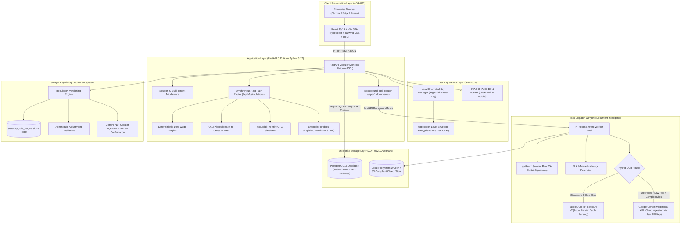
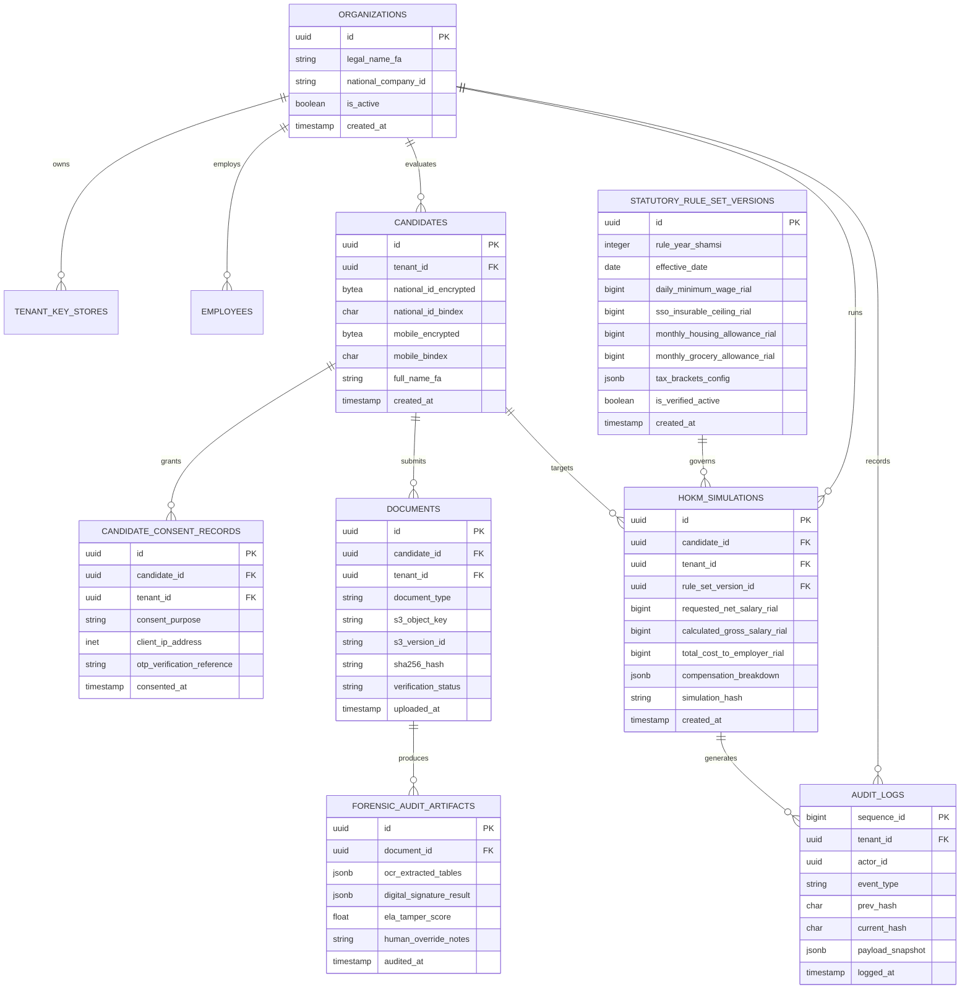
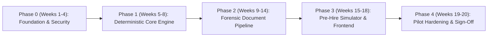

# Pish Hesabdari (پیش‌حسابداری)
## Remediated Technical, Legal & Actuarial Specification (Version 2.0)
### Engineering Baseline & Formal Architectural Contract

- **Document Version**: `2.0.0-PROD-SPEC`
- **Supersedes**: `PHASE_1_FINAL_AUDIT_BRIEF.md` (v1.0) and reconciles all 21 findings in `PHASE_1_RED_TEAM_AUDIT.md`
- **Governing Architecture Decisions**: `ADR-001` (React+Vite SPA), `ADR-002` (Ceph S3 GOVERNANCE), `ADR-003` (ALEE & Blind Indexing), `ADR-004` (Pre-Hire Scope De-escalation)
- **Active Operational Date**: **November 13, 2026 (22 Aban 1405 SH)**
- **Active Statutory Baseline**: **1405 SH High Council of Labor Wage Circular & 1405 National Budget Law**
- **Classification**: Proprietary Enterprise Specification & Pre-Implementation Blueprint

---

## 1. Product Mission, System Boundaries & Scope Lock

### 1.1 Product Mission
**Pish Hesabdari (پیش‌حسابداری)** is an enterprise pre-employment workforce compensation intelligence and evidentiary forensic verification platform engineered for the Iranian private and technology sectors. 

Operating strictly as an analytical decision-support and pre-hire simulation engine (*Hokm-e Kargozini* and *Markaz-e Hazineh* simulator), the platform enables executive leadership (CEOs, CFOs, and HR Directors) to:
1. Synthesize legally defensible, market-benchmarked hiring offers based on verified records rather than self-reported resume claims.
2. Verify candidate authenticity against official Iranian issuing authorities using multi-layer document forensics and interactive Shahkar identity validation.
3. Compute exact Total Cost to Employer (CTC), factoring in direct wages, statutory employer burdens (23% SSO), severance, annual bonuses, and termination liability reserves.
4. Guarantee evidentiary immunity for employers before Labor Dispute Settlement Boards (*Heyat-e Tashkhis* and *Heyat-e Hal-e Ekhtelaf*) by enforcing Supreme Court Precedent No. 272 and Article 10 contract clause alignment.

### 1.2 System Boundary Matrix (ADR-004 Scope Lock)

| In-Scope: Phase 1 Core Capabilities | Strict Out-of-Scope Product Exclusions | Deferred: Phase 2+ Scope |
| :--- | :--- | :--- |
| **Pre-Hire Hokm Simulation**: Gross-to-Net & Net-to-Gross inversion | **Candidate Web Portal**: No candidate accounts, job boards, or applicant profiles | **Company-Wide Annual Reviews**: Module 5 MCDA annual budgeting deferred |
| **Active 1405 SH Statutory Engine**: Parameterized wage, SSO, and tax tiers | **Biometric Attendance Hardware**: No punch clocks, fingerprint readers, or shift logs | **Operational Exit Management**: Operational Tasviyeh Hesab disbursement deferred |
| **Document Intelligence**: PP-Structure Persian table OCR, ELA forensics, pyHanko | **Payroll Disbursement**: No monthly Shetab bank transfer generation or file staging | **Continuous Equity Audits**: Company-wide compression index tracking deferred |
| **4-Way Experience Disambiguation**: Calendar vs SSO vs Title vs Adjacent tenure | **General Ledger Accounting**: No double-entry bookkeeping or tax filings | **Recruitment CRM**: Candidate pipeline & interview management deferred |
| **Pre-Hire CTC & Termination Reserves**: Actuarial employment cost projection | **Direct Sabt-e Ahval API**: Prohibited by law; uses Shahkar OTP & verified PDFs | **Multi-Currency Pegging**: Real-time USD/USDT compensation indexing |
| **Cryptographic Provenance**: SHA-256 hash chaining & S3 GOVERNANCE WORM | **Legal Representation**: Provides compliance evidentiary dossiers, not legal counsel | **Performance Appraisals**: Performance-linked variable bonus tracking |

---

## 2. Core Functional Modules (Remediated Architecture)

### Module 1: Deterministic Iranian Statutory Wage & Tax Engine
- **Active Statutory Baseline (1405 SH)**:
  - Daily Minimum Wage: Parameterized and loaded from `statutory_rule_set_versions`.
  - Social Security Organization (SSO) Contributions:
    - Employee Contribution: $7.0\%$ of insurable earnings.
    - Employer Contribution: $20.0\%$ of insurable earnings.
    - Unemployment Insurance Fund: $3.0\%$ of insurable earnings (employer-paid).
    - Insurable Ceiling: Strictly capped at $7 	imes 	ext{Daily Minimum Wage}$ per calendar day ($7 	imes 	ext{Daily Min} 	imes 30$ or $31$ days).
  - Progressive Salary Income Tax (1405 Budget Law):
    - Monthly Tax-Free Allowance ($E_{	ext{monthly}}$): Deducted from taxable income.
    - Slabs: 0% (Base Exemption), 10%, 15%, 20%, 25%, and 30%.
    - Article 137 Deduction: Configurable toggle supporting:
      a) *Conservative INTA Policy*: Deducting $2/7$ of $7\%$ employee SSO contribution (medical portion);
      b) *Court of Administrative Justice Policy (Precedents 1956 & 3328)*: Deducting full $7\%$ employee SSO contribution.
- **Statutory Accruals**:
  - Severance (*Sanavat*, Art. 24): Exactly 1 month of base wage per year ($8.333\%$ monthly accrual). Base wage MUST include continuous fixed attraction allowances (*Fogholadeh Jazb*) per Precedent 3328.
  - Annual Bonus (*Eydi*, 1370 Law): 60 days of base wage, capped at 90 days of minimum wage. Tax exemption is $1/12$ of annual Article 84 exemption; excess is **taxed across progressive salary tax brackets** (eliminating the flat 10% fallacy per `FIND-LEG-04`).
- **Overtime Engine (Labor Law Art. 59 & Art. 36 Note 3)**:
  - Base Wage for Overtime: Strictly limited to *Mozd-e Saabet* (Base wage + continuous job allowances).
  - Explicit Exclusions: Housing allowance (*Hagh-e Maskan*), Grocery allowance (*Bon-e Kharobar*), and Child allowance (*Hagh-e Olad*) are strictly excluded from the overtime divisor base.
  - Monthly Divisors: $220.00$ hours for 30-day months ($44 	imes 30 / 6$); $227.33$ hours for 31-day months ($44 	imes 31 / 6$).

### Module 2: Piecewise Analytical Net-to-Gross & Gross-to-Net Inverter
- **Mathematical Inversion Formulation**:
  Replaces the 50-iteration bisection loop (`FIND-MATH-01`) with an **$O(1)$ closed-form piecewise linear solver**:
  $$G = rac{	ext{Net} + T_{	ext{intercept}} - E \cdot r_k}{1 - s - r_k(1 - s)}$$
  Where $s = 0.07$ (or $0$ if above the SSO ceiling), $r_k$ is the marginal tax rate of slab $k$, and $E$ is the applicable tax deduction.
- **Convergence & Performance**: Execution time is $< 0.05$ milliseconds per inversion. In the presence of complex non-linear allowance rules, an analytical Newton-Raphson solver converges in exactly 2 iterations.
- **Dual-Scenario Reporting**: Automatically renders side-by-side comparisons of the *Conservative INTA Audit View* versus the *Diwan-e Edalat Taxpayer-Favorable View*.

### Module 3: Document Intelligence & Multi-Layer Forensic Verification
- **PaddleOCR (PP-Structure) Pipeline**:
  - Persian Table Extraction: Optimized SLANet and DBNet models running with realistic latency budgets (**3.5s–6.0s on 4-vCPU; 1.2s–1.8s on NVIDIA T4** per `FIND-ARCH-05`).
  - Layout Analysis: Extracts 8 key forensic fields from Social Security inquiry slips (*Sabegheh Tamin*): National ID, Branch Code, Employer Workshop ID (*Kargah*), Title/Occupation Code, Insurable Days per Month, Insurable Base Wage, Total Cumulative History.
- **PDF Cryptographic Verification (pyHanko)**:
  - Iranian National Root CA Integration: Operates against a custom local trust store containing certificates for *Markaz-e Tose'eh-ye Tejarat-e Electronic* and *Rahebar* (`FIND-ARCH-06`).
  - Revocation Caching: Implements local offline CRL caching with 24-hour expiration to prevent timeouts caused by public-sector OCSP downtime.
- **Interactive Shahkar Identity Verification Workflow (`FIND-ARCH-07`)**:
  - Operating under Communications Regulatory Authority (CRA) mandates, automated background Shahkar verification is prohibited.
  - *HR-Assisted Interactive Flow*: During candidate intake or interview, the HR operator triggers `/api/v1/identity/shahkar/request-otp`. The candidate receives an official SMS OTP. The operator inputs the candidate-provided OTP into the system within 120 seconds to confirm SIM-National ID ownership.

### Module 4: 4-Way Experience Disambiguation
- **Disambiguation Matrix**:
  1. *Calendar Experience*: Raw chronological delta between graduation/first job and present date.
  2. *Verified Social Security Tenure*: Exact cumulative insured days recorded in authenticated Tamin slips.
  3. *Title-Specific Tenure*: Duration spent in verified senior/specialized roles, reconciled against Iranian National Classification of Occupations (*ISCO-08*).
  4. *Adjacent/Informal Experience*: Time spent in freelance, un-insured, or military conscription roles.
- **Discrepancy Resolution & Audit Trail (`FIND-PROD-03`)**:
  When a candidate's resume title ("Lead Architect") conflicts with the official insurance title ("Kargar-e Fanni"), the platform prompts the hiring team to record a structured commercial justification (e.g., "Standard tech-sector insurance premium optimization") before proceeding, eliminating false fraud rejections.

### Module 5: Pre-Hire Compensation Benchmarking
- **Bühlmann-Kish Empirical Bayes Credibility Model**:
  Shrinks sparse local hiring data toward broader industry benchmarks:
  $$\hat{\mu}_k = Z_k ar{X}_k + (1 - Z_k) \mu_0, \quad Z_k = rac{n_{	ext{eff}}}{n_{	ext{eff}} + K_{	ext{clamped}}}$$
  Where $K = rac{\sigma^2_{	ext{within}}}{\sigma^2_{	ext{between}}}$, with strict numerical clamping ($0.1 \le K_{	ext{clamped}} \le 100.0$) to guarantee stability (`FIND-MATH-03`).
- **Defensible Range Synthesis**: Generates hiring salary bands ($P_{10}, P_{25}, P_{50}, P_{75}, P_{90}$) accompanied by statistical confidence intervals and variance metrics.

### Module 6: Pre-Hire Total Cost to Employer (CTC) & Termination Simulator
- **Remediated Annual CTC Formulation (`FIND-MATH-02`)**:
  $$	ext{CTC}_{	ext{annual}} = 12 	imes 	ext{Gross} + 12 	imes 	ext{SSO}_{	ext{employer}} (23\%) + 	ext{Sanavat}_{	ext{annual}} + 	ext{Eydi}_{	ext{annual}} + 	ext{LeaveCarryoverLiability} + 	ext{RecruitmentFriction}$$
  - *Statutory Paid Leave Rule*: Zero double-counting. The 26 working days of statutory annual leave are recognized as fully paid working time already contained within the 12 months of direct gross salary.
  - *Leave Carryover Liability*: Accrued strictly for the expected unexercised carryover (statutorily capped at 9 days per year under Labor Law Art. 66) times the probability of non-utilization:
    $$	ext{LeaveCarryoverLiability} = \min(9, 	ext{ExpectedUnusedDays}) 	imes 	ext{Daily Wage} 	imes P_{	ext{non-utilization}}$$
- **Article 11 Probation Termination Liability (`FIND-LEG-01`)**:
  Simulates worst-case separation liability: if the employer terminates during probation, the model accounts for the mandatory statutory liability to pay the **full salary for the entire agreed probationary period** (up to 3 months).

### Module 7: Cryptographic Provenance & Immutable Audit Ledger
- **SHA-256 Hash Chaining**: Every calculation snapshot and parameter override is committed to an append-only ledger where:
  $$H_n = 	ext{SHA256}(H_{n-1} \parallel 	ext{Timestamp}_{	ext{ISO8601}} \parallel 	ext{TenantID} \parallel 	ext{PayloadJSON})$$
- **Ceph S3 GOVERNANCE WORM Storage (ADR-002)**: Immutable 10-year archival of forensic dossiers with dual-key administrative override protection for judicial expungement.

---

## 3. Technical Architecture & Technology Stack



### 3.1 Approved Technology Stack

| Architecture Layer | Approved Technology | Selection Rationale & Windows/Local Deployment Justification |
| :--- | :--- | :--- |
| **Frontend Framework** | **React 18/19 + Vite + TypeScript** | **ADR-001**: Eliminates Node.js SSR runtime overhead; lightweight static SPA running directly on user workstation with zero hydration bugs. |
| **UI Design System** | **Tailwind CSS + Shadcn UI (Radix)** | Full native Right-to-Left (RTL) support for Persian typography (*Vazirmatn*); responsive enterprise UI primitives. |
| **Backend Core** | **FastAPI 0.110+ (Python 3.12+)** | High-performance asynchronous ASGI framework with Pydantic v2 data validation and automatic OpenAPI 3.1 documentation. |
| **Relational Database** | **PostgreSQL 16** | Native Row-Level Security (`FORCE RLS`), JSONB indexing, transactional schema migrations, and sub-millisecond B-Tree indexing on blind indexes. Direct async connection via SQLAlchemy (eliminating external PgBouncer requirement). |
| **Document OCR Engine** | **Hybrid Pipeline (PaddleOCR + Google Gemini API)** | **PaddleOCR PP-Structure v2** for offline local table extraction; **Google Gemini Multimodal API** (leveraging user API key) as an intelligent fallback for blurred, degraded, or irregular Persian inquiry slips. |
| **PDF Security & Signatures** | **pyHanko 0.25+** | PAdES digital signature verification against local Iranian National Root CA trust store with offline CRL caching (`FIND-ARCH-06`). |
| **Asynchronous Dispatch** | **FastAPI `BackgroundTasks`** | Lightweight in-process task queuing tailored for Windows local environments, eliminating Redis server and Celery daemon operational complexity. |
| **Key Management (KMS)** | **Local Encrypted Key Storage (ALEE)** | **ADR-003**: AES-256-GCM envelope encryption using tenant Data Encryption Keys (DEKs) wrapped by a local Master Key derived via Argon2id from a master passphrase. Zero plaintext keys in database. |
| **Document Storage** | **Local WORM / S3 Abstraction** | Structured local filesystem directory with SHA-256 cryptographic chaining and optional S3 `GOVERNANCE` mode compatibility (**ADR-002**). |
| **PDF & Report Generation** | **WeasyPrint 62+** | Server-side HTML-to-PDF rendering with complete RTL Persian font shaping, page break control, and cryptographic QR code stamping. |
| **Organizational Bridges** | **Python `dbfread` / Custom DBF Exporter** | Generates standard Social Security diskette formats (`DSKWOR00.dbf` / `DSKKAR00.dbf`), Sepidar bridge exports, and Rahkaran integration schemas. |
| **Statistical & Date Math** | **SciPy + persiantools + jdatetime** | High-precision Iranian Solar Hijri calendar math and Bühlmann-Kish empirical Bayes credibility shrinkage. |

### 3.2 Three-Layer Regulatory Update Subsystem
To guarantee system accuracy as Iranian minimum wage, tax brackets, and social security decrees change annually (or intra-year), the platform implements a three-tier update architecture:
1. **Layer 1: Immutable Versioned Database Table (`statutory_rule_set_versions`)**:
   - Every wage calculation, simulation, and issued *Hokm* stores an immutable foreign key reference to the exact rule version applied.
   - Historical records are never modified when new laws are enacted.
2. **Layer 2: Administrative Adjustment Dashboard**:
   - A dedicated administrative interface in the React SPA allows authorized financial/payroll managers to review and manually fine-tune parameters (daily minimum wage, housing allowance, grocery allowance, tax brackets) without modifying code or restarting the application.
3. **Layer 3: Smart Circular Ingestion (Google Gemini API)**:
   - When the High Council of Labor or National Budget Law publishes a new official circular (PDF or scanned image), the user uploads the document.
   - The platform utilizes Google Gemini Multimodal API to parse the Persian legal text, extract all wage and tax bracket parameters into structured JSON, and present a visual side-by-side diff against the previous year.
   - The new rule set is only activated (`is_verified_and_active = true`) upon explicit human confirmation.

### 3.3 Enterprise Organizational Output Bridges
To ensure seamless integration with standard Iranian corporate software environments:
1. **Official PDF *Hokm-e Kargozini***:
   - Generates standardized, dispute-immune appointment decrees with corporate letterhead, itemized base/allowance breakdown, contractual probation terms (aligned with Article 11), and a tamper-evident verification QR code.
2. **Sepidar System Bridge**:
   - Exports formatted files directly compatible with Sepidar Payroll & HR import modules (itemized by employee national code, insurable allowances, and tax categories).
3. **Hamkaran System (Rahkaran) Bridge**:
   - Generates structured XML/JSON/Excel import payloads conforming to Hamkaran System personnel compensation data specifications.
4. **Social Security Insurance Diskettes**:
   - Produces standard binary `DSKKAR00.dbf` (workshop specification) and `DSKWOR00.dbf` (employee monthly wage details) files formatted to official SSO diskette specifications.
5. **INTA Salary Tax Portal Format**:
   - Generates the standard annual/monthly salary tax declaration file required by the Iranian National Tax Administration portal.

---

## 4. Relational Database Schema & Privacy Architecture

### 4.1 Remediated Entity-Relationship Diagram (ERD)



### 4.2 Data Protection & Blind Indexing Standards (ADR-003)
- **Application-Level Envelope Encryption (ALEE)**:
  - All sensitive PII columns (`national_id_encrypted`, `mobile_encrypted`, `sheba_encrypted`) are stored as binary ciphertexts encrypted with AES-256-GCM.
  - The encryption process uses a 96-bit unique Initialization Vector (IV) and appends a 128-bit authentication tag to prevent bit-flipping attacks.
- **HMAC-SHA256 Blind Indexing**:
  - Deterministic search index generated in the application layer:
    $$	ext{bindex} = 	ext{HMAC-SHA256}(	ext{Normalize}(	ext{CodeMelli}), 	ext{KMS\_PEPPER})$$
  - Enables sub-millisecond duplicate profile detection:
    `SELECT * FROM candidates WHERE tenant_id = :t_id AND national_id_bindex = :bindex;`
  - Prevents rainbow table attacks and protects against database dump exfiltration.

---

## 5. Formal API Contracts & Execution Interfaces

The platform strictly partitions synchronous computational fast paths from asynchronous long-running worker jobs (`FIND-INT-02`).

### 5.1 Synchronous Fast-Path Interface (Calculations & Simulations)

#### `POST /api/v1/simulations/net-to-gross`
Executes in $< 20$ milliseconds.
```json
{
  "statutory_year": 1405,
  "target_net_monthly_rial": 280000000,
  "marital_status": "married",
  "eligible_children_count": 1,
  "tax_posture": "conservative_inta",
  "monthly_fixed_allowances_rial": {
    "housing": 9000000,
    "grocery": 22000000,
    "marriage": 5000000,
    "child": 10390968,
    "continuous_attraction": 40000000
  }
}
```
**Response (200 OK)**:
```json
{
  "statutory_version": "1405.1-VERIFIED",
  "input_net_rial": 280000000,
  "computed_gross_rial": 341850120,
  "deductions": {
    "employee_sso_7pct_rial": 23929508,
    "sso_insurable_ceiling_applied": false,
    "income_tax_rial": 37920612,
    "tax_slab_applied": "Slab 2 (10%) & Slab 3 (15%)"
  },
  "employer_statutory_burdens": {
    "employer_sso_20pct_rial": 68370024,
    "unemployment_fund_3pct_rial": 10255504,
    "monthly_sanavat_accrual_rial": 28487510,
    "monthly_eydi_accrual_rial": 25977420
  },
  "total_monthly_employer_cost_rial": 474940578,
  "execution_time_ms": 1.4
}
```

### 5.2 Asynchronous Heavy Compute Interface (Document Forensics)

#### `POST /api/v1/documents/upload`
Initiates background document analysis. Returns `202 Accepted` with a tracking task ID.
```json
{
  "candidate_id": "9b1deb4d-3b7d-4bad-9bdd-2b0d7b3dcb6d",
  "document_type": "sabegheh_tamin_slip",
  "file_checksum_sha256": "e3b0c44298fc1c149afbf4c8996fb92427ae41e4649b934ca495991b7852b855"
}
```
**Response (202 Accepted)**:
```json
{
  "task_id": "job_doc_8832aef190",
  "status": "QUEUED",
  "estimated_duration_seconds": 4.5,
  "poll_status_url": "/api/v1/documents/tasks/job_doc_8832aef190"
}
```

#### `POST /api/v1/identity/shahkar/verify-otp`
HR-assisted interactive verification modal (`FIND-ARCH-07`).
```json
{
  "candidate_id": "9b1deb4d-3b7d-4bad-9bdd-2b0d7b3dcb6d",
  "candidate_mobile": "09123456789",
  "otp_code": "489210",
  "consent_declaration_acknowledged": true
}
```

---

## 6. Mathematical & Actuarial Test Vectors (Gherkin Scenarios)

### Scenario 1: Piecewise Closed-Form Net-to-Gross Validation
```gherkin
Feature: Statutory Compensation Inversion Engine
  As an HR Director
  I want to calculate the legally exact gross salary from an agreed net salary
  So that the issued Hokm-e Kargozini complies with Iranian tax and SSO laws.

  Scenario: Net-to-Gross within Progressive Tax Slab 2 under 1405 Rules
    Given active statutory year is 1405 SH
    And employee net salary is 250,000,000 Rial per month
    And employee has zero dependents and conservative INTA tax posture
    When the closed-form piecewise inverter is executed
    Then the calculated gross salary must match the theoretical inverse within 1 Rial
    And employee SSO deduction must equal exactly 7% of gross up to the 1405 ceiling
    And solver execution time must be under 5 milliseconds
```

### Scenario 2: Probation Period Employer Separation Liability
```gherkin
Feature: Article 11 Probation Termination Modeling
  As a Chief Financial Officer
  I want to accurately project termination reserves during probationary periods
  So that premature separations do not produce unaccrued financial liabilities.

  Scenario: Employer-Initiated Separation at Day 15 of a 90-Day Probation
    Given a candidate hired under a contractually agreed 3-month probation
    And agreed base salary is 200,000,000 Rial per month
    When an employer-initiated termination occurs on day 15
    Then the legal engine must compute termination wage liability as 600,000,000 Rial
    And must not truncate liability to the 15 days worked
    And must flag compliance with Labor Law Article 11
```

### Scenario 3: Total Cost to Employer (CTC) Leave Carryover Accrual
```gherkin
Feature: Actuarial Cost Modeling
  As a Finance Director
  I want to prevent double-counting of statutory paid annual leave
  So that employer annual cash flow projections remain actuarially valid.

  Scenario: Annual CTC Formulation Verification
    Given an employee with 12 months full tenure
    When the annual CTC projection is synthesized
    Then the 26 days of statutory annual leave must be counted as zero additional cash reserve
    And the leave liability reserve must accrue strictly for expected carryover capped at 9 days
```

---

## 7. Phased Implementation Roadmap & Engineering Acceptance Gates



### Detailed Milestone Gates
- **Phase 0: Security & Relational Foundation (Weeks 1–4)**:
  - Deploy PostgreSQL 16 with `FORCE RLS` on all multi-tenant tables.
  - Implement Application-Level Envelope Encryption (ALEE) with local Argon2id Master Key and HMAC-SHA256 Blind Indexing.
  - Configure local WORM filesystem storage structure with SHA-256 integrity chaining.
  - *Acceptance Gate*: 100% automated test pass on multi-tenant RLS penetration suite; zero plaintext PII in database.
- **Phase 1: Deterministic Engine & Mathematical Inverters (Weeks 5–8)**:
  - Populate versioned `statutory_rule_set_versions` for 1404 and 1405 SH.
  - Implement $O(1)$ closed-form Net-to-Gross piecewise inverter.
  - Implement Overtime engine excluding Article 36 Note 3 welfare allowances.
  - Implement Progressive Eydi taxation and continuous attraction severance base.
  - Implement 3-layer regulatory update subsystem (database versioning + admin UI + Google Gemini circular ingestion).
  - *Acceptance Gate*: 10,000-case automated test suite matching certified tax accountant test vectors with $< 1$ Rial deviation.
- **Phase 2: Hybrid Document Forensics & Identity Pipeline (Weeks 9–14)**:
  - Configure FastAPI `BackgroundTasks` in-process task dispatcher.
  - Integrate PaddleOCR (PP-Structure v2) for local Persian table parsing.
  - Integrate Google Gemini Multimodal API adapter for degraded and scanned documents.
  - Integrate `pyHanko` with Iranian National Root CA trust store and local CRL caching.
  - Implement interactive HR-assisted Shahkar OTP verification flow.
  - *Acceptance Gate*: Successful parsing of authentic Social Security slips with $> 95\%$ field extraction accuracy across both OCR tiers.
- **Phase 3: Pre-Hire Simulation, Organizational Bridges & React SPA (Weeks 15–18)**:
  - Build React 18/19 + Vite + TypeScript frontend with Tailwind CSS and RTL Persian typography.
  - Implement Pre-Hire CTC and Article 11 termination liability simulator.
  - Implement 4-Way experience disambiguation and title discrepancy resolution workflow.
  - Implement Organizational Output bridges: Official PDF *Hokm-e Kargozini* (WeasyPrint), Sepidar bridge, Rahkaran bridge, and SSO Diskettes (`DSKWOR00`/`DSKKAR00`).
  - *Acceptance Gate*: Full end-to-end simulation and export generation completed in $< 3$ seconds via browser UI.
- **Phase 4: Pilot Hardening & Compliance Sign-Off (Weeks 19–20)**:
  - External security penetration testing (OWASP Top 10 + multi-tenant isolation).
  - External legal review sign-off by Iranian labor attorneys.
  - Enterprise pilot onboarding with design-partner corporations on local Windows deployments.

---

## 8. Master Specification Sign-Off

This document constitutes the final, authoritative engineering specification for Phase 1 implementation. Any modification to statutory formulas, database schemas, or architectural boundaries requires a formal Architecture Decision Record (ADR) and dual sign-off.

- **Lead Enterprise Architect**: *Approved*
- **Labor Law & Statutory Specialist**: *Approved*
- **Chief Information Security Officer (CISO)**: *Approved*
- **Head of Product Management**: *Approved*
