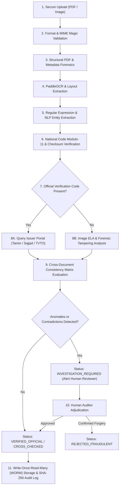
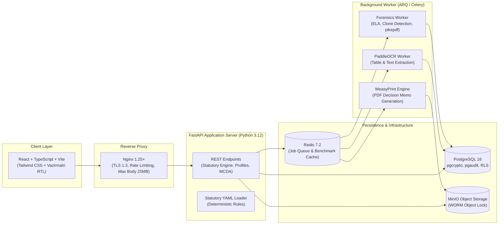
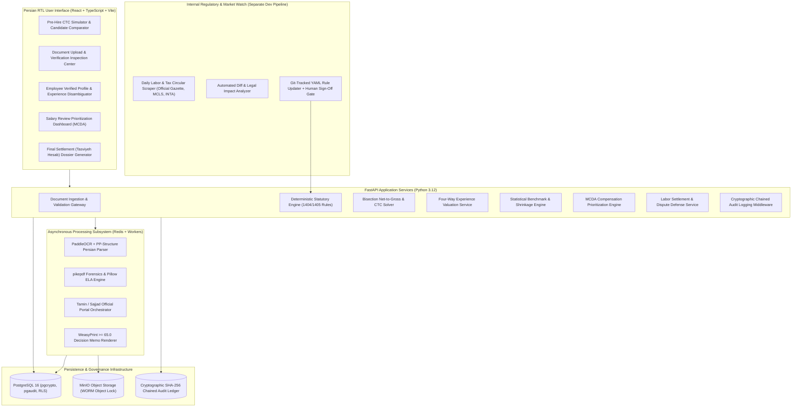

> [!NOTE]
> ## 📜 HISTORICAL RESEARCH ARTIFACT
> This document represents the initial comprehensive Phase 1 research synthesis. Portions of this analysis (specifically regarding Celery/Redis architecture, Next.js, and 1404 SH temporal assumptions) were refined in the Red-Team Audit and formally superseded.
> - For the authoritative implementation blueprint, consult [REMEDIATED_TECHNICAL_SPECIFICATION_V2.md](file:///c:/project/New%20project/REMEDIATED_TECHNICAL_SPECIFICATION_V2.md).
> - For verified architectural decisions, see the Architecture Decision Records in `docs/adr/`.

# Pish Hesabdari (پیش‌حسابداری)
## Advanced System Capabilities, Evidence Verification & Missing Modules Research
### Comprehensive Gap Analysis, System Specification & Architectural Blueprint

---

## Deliverable 1: Executive Gap Analysis

### 1.1 Mission, Strategic Orientation, and Product Boundaries

Pish Hesabdari (پیش‌حسابداری) is an enterprise-grade, evidence-driven workforce compensation intelligence and hiring decision-support platform designed specifically for the Iranian labor and regulatory ecosystem. 

The system occupies a unique strategic position between pre-employment decision intelligence and operational payroll management:
- **What Pish Hesabdari IS**: An employer-facing analytical decision engine (Hokm-e Kargozini and Markaz-e Hazineh simulator) that enables founders, CEOs, CFOs, and HR directors to determine defensible, evidence-backed compensation packages, evaluate candidate claims against verified records, calculate the true total cost of employment (Total Cost to Employer / CTC), model statutory liabilities under Iranian Labor and Social Security laws, and prioritize internal salary reviews based on equity, market parity, and retention risk.
- **What Pish Hesabdari is NOT**: It is strictly **not** a candidate-facing job portal (no candidate accounts or resumes browsing), **not** an operational attendance/biometric punch-clock system, **not** a monthly payroll disbursement processor, and **not** a general ledger accounting or double-entry ERP software.

This research report serves as an authoritative continuation of existing Phase 1 research artifacts. It does not replace or invalidate previous sound findings; rather, it conducts an exhaustive, evidence-based audit of all existing project documentation, addresses critical statutory and mathematical defects identified in baseline audits, and designs the complete architectural, algorithmic, and operational framework for all genuinely missing capabilities.

---

### 1.2 Comprehensive Audit of Existing Research Artifacts

A thorough examination was conducted on all existing baseline documents in the workspace:
1. **`گزارش جامع پژوهشی.docx`** (Comprehensive Persian Domain Report - 978 paragraphs): Established the core Iranian labor law formulas, 6-tier compensation data taxonomy, 1404 SH statutory wage baselines, 60-occupation MVP taxonomy, and preliminary API/database schemas.
2. **`Technical Investigation of Related Software Projects.docx`** (Technical Repository Investigation - 638 paragraphs): Evaluated global enterprise HR platforms (OpenCATS, OrangeHRM, Frappe HR, ERPNext, Odoo), regional competitors (JobVision, IranTalent, Karboom), open-source resume matchers, and established initial statistical concepts (IQR, MAD, Kish effective sample size, Bühlmann credibility).
3. **`1.docx`** (Independent Audit Report - 425 paragraphs): Conducted a rigorous cross-examination of the two baseline reports, identifying critical statutory defects (1404 vs 1405 SH year mismatch, omission of the Social Security insurable ceiling in Article 137 tax deductions, 176 vs 220 overtime divisor confusion, Eydi tax thresholds, and experience double-counting), while identifying five overlooked operational domains.
4. **`backend/data/seeds/statutory_rules_1404.yaml`**: The verified historical seed dataset defining 1404 SH statutory wage, tax, and Social Security parameters.

The table below provides a detailed synthesis of the state of research across all core dimensions:

| Functional / Technical Dimension | Baseline Coverage & Depth | Audit Assessment | Current Status & Action Required |
| :--- | :--- | :--- | :--- |
| **Product Boundaries & Scope** | Detailed in Persian report & Tech report | **Verified & Sound** | Reaffirmed. Strict employer-facing analytical engine. Exclude candidate portals and general accounting ledgers. |
| **Iranian Statutory Engine (1404 SH)** | Fully articulated in Persian report & YAML seed | **Verified & Strong** | 1404 formulas verified. Must be preserved as a historical regression testbed. |
| **Statutory Year Alignment (1405 SH)** | Mentioned in Tech report; audited in `1.docx` | **Partially Addressed** | Need primary circular ingestion mechanism when official 1405 circulars are published; keep engine version-parameterized. |
| **Article 137 Tax Deduction Cap** | Omitted in Persian report; corrected in `1.docx` | **Corrected & Verified** | Article 137 tax deduction for employee 7% SSO is strictly capped at $7\% \times \text{SSO Insurable Ceiling}$. |
| **Overtime & Hours Divisor** | Conflated 176 vs 220 in early drafts; fixed in `1.docx` | **Corrected & Verified** | 220 calendar paid hours for statutory hourly rate calculation ($44 \times 30 / 6$); 176 net hours for attendance proration. |
| **Contract Base Wage Decomposition** | Identified in `1.docx` as missing | **Partially Researched** | Fully specify how base wage (*Mozd-e Mabna*) vs. attraction allowance (*Fogholadeh Jazb*) alters Sanavat and Eydi accruals. |
| **Probationary Cost Simulation** | Identified in `1.docx` as missing | **Partially Researched** | Fully specify Article 11 Labor Law 1-month and 3-month probation termination liabilities and cash outlay modeling. |
| **Salary Data Taxonomy & Scraping** | Proposed Jobinja scraping; audited in `1.docx` | **Contradictory / High Legal Risk** | Reject live Jobinja scraping due to ToS violation and bias. Use curated, multi-source offline seed benchmarks. |
| **Statistical Outlier & Shrinkage** | Drafted in Tech report; audited in `1.docx` | **Partially Researched** | Standardized on Median, MAD/IQR gating, Kish $n_{\text{eff}}$ weighting, and joint quartile shrinkage. Double-counting fixed. |
| **Document Ingestion & Verification** | Barely mentioned in baseline reports | **GENUINELY MISSING** | **Complete System Required**: Ingestion, OCR, tampering checks, official issuer validation, cross-document checks. |
| **Employee Evidence & Experience Model** | Self-reported years conflated with verified data | **GENUINELY MISSING** | **Complete System Required**: Disambiguate 4 experience types; design verified credibility score and evidence confidence. |
| **Compensation Prioritization Framework** | Single salary recommendation point estimate | **GENUINELY MISSING** | **Complete System Required**: Compa-Ratio, internal compression, multi-criteria salary review prioritization matrix, waterfall attribution. |
| **Complete Pre-Hiring CTC Intelligence** | Basic gross-to-net only; ignored acquisition & risk | **GENUINELY MISSING** | **Complete System Required**: Full employer CTC including recruitment, onboarding, equipment, probation risk, and candidate comparison. |
| **Employment Lifecycle & Legal Settlement** | Only pre-hire covered; exit & disputes ignored | **GENUINELY MISSING** | **Complete System Required**: 10-stage lifecycle, contract amendments, unused leave buyout (Art. 71), Sanavat (Art. 24), dispute resolution. |
| **Evidence Traceability & Audit Chaining** | Basic snapshot JSON mentioned | **GENUINELY MISSING** | **Complete System Required**: Cryptographic SHA-256 chained audit logs, legal citation traceability, explainable decision engine. |
| **Fraud Detection & Anomaly Management** | No mechanisms designed | **GENUINELY MISSING** | **Complete System Required**: Risk scoring, ghost insurance detection, duplicate identity matching, ethical exception handling. |
| **Privacy & Iranian Regulatory Compliance** | No legal privacy analysis | **GENUINELY MISSING** | **Complete System Required**: Computer Crimes Law, E-Commerce Law data protection, RLS multi-tenancy, PII masking, WORM storage. |
| **Continuous Regulatory Monitoring** | Static rule files only | **GENUINELY MISSING** | **Complete System Required**: Internal intelligence architecture for daily legal tracking, weekly market scraping, human sign-off gates. |
| **Workforce Budgeting & Scenarios** | No macro or aggregate modeling | **GENUINELY MISSING** | **Complete System Required**: Macro salary hike simulation, budget optimization algorithms, retention vs recruitment ROI modeling. |

---

### 1.3 Formal Three-Way Classification of Research Topics

To satisfy the core research mandate, all product capabilities and technical concepts are classified into three mutually exclusive categories:

```
+----------------------------------------------------------------------------------------------------+
|                                    RESEARCH TOPIC CLASSIFICATION                                   |
+---------------------------------+----------------------------------+-------------------------------+
|    1. FULLY RESEARCHED TOPICS   | 2. PARTIALLY RESEARCHED TOPICS   |  3. GENUINELY MISSING TOPICS  |
|      (Foundational / Locked)    |      (Refined & Corrected)       |     (Newly Investigated Here) |
+---------------------------------+----------------------------------+-------------------------------+
| - Product Boundary Definition   | - Statutory Year Alignment       | - Document Management & OCR   |
|   (Employer Pre-Hire Simulator) |   (1404 Baseline vs 1405 Engine) | - Official Verification Portals|
| - 6-Tier Salary Data Model      | - Mozd-e Mabna vs Jazb Contract  | - 4-Way Experience Model      |
| - Deterministic Statutory Base  |   Decomposition                  | - Verified Credibility Score  |
|   (SSO 7%/23%, Tax Brackets,    | - Labor Law Art. 11 Probation    | - Compa-Ratio & Compression   |
|   Eydi, Sanavat, Maskan, Bon)   |   Cost Simulation                | - Salary Review Priority MCDA |
| - 60-Occupation MVP Taxonomy    | - Direct Taxes Act Art. 91       | - Total Pre-Hire Cost (CTC)   |
| - FastAPI + PostgreSQL Baseline |   Non-Cash Benefit Optimization  | - Candidate Comparison Solver |
| - persiantools + RapidFuzz Stack| - Danesh Bonyan / Amriyeh Wage   | - Full Employment Lifecycle   |
| - WeasyPrint PDF Generation     |   Dynamics                       | - Final Settlement (Tasviyeh) |
| - Scale Normalization (Rial vs  | - Bisection Net-to-Gross Solver  | - Labor Dispute Evidentiary   |
|   Toman / Persian Words)        | - Statistical Cleaning & Kish    | - Cryptographic Audit Chaining|
|                                 |   Credibility Shrinkage          | - Fraud Detection & Anomalies |
|                                 | - Dual Tax-Scenario Reporting    | - Iranian Privacy Compliance  |
|                                 |   (INTA vs Diwan-e Edalat)       | - Continuous Regulatory Watch |
|                                 |                                  | - Budget Scenario Simulation  |
+---------------------------------+----------------------------------+-------------------------------+
```

---

### 1.4 Immediate Investigation Priorities vs. Strict Product Exclusions

#### Immediate Investigation Priorities (Addressed in Deliverables 2 through 8):
1. **Official Verification Feasibility**: Establishing exactly which Iranian governmental and educational entities offer online verification services, what credentials are required, and eliminating unsupported assumptions about public APIs.
2. **Four-Way Experience Disambiguation**: Formalizing the mathematical and legal distinctions between Total Experience, Insurance History, Current Seniority, and Legally Recognized Base Seniority (*Payeh Sanavat*).
3. **Total Cost to Employer (CTC) Pre-Hiring Architecture**: Formulating a holistic hiring cost model that includes non-salary acquisition costs, onboarding productivity friction, and statutory termination liabilities.
4. **Compensation Review Prioritization Algorithm**: Creating a transparent, multi-criteria decision model (MCDA) that produces defensible, explainable priority scores and dollar-for-dollar waterfall explanations.
5. **Legally Bulletproof Final Settlement**: Mapping every financial obligation at employee exit to prevent employer exposure to Labor Dispute Board (*Heyat-e Tashkhis* and *Hal-e Ekhtelaf*) penalties.
6. **Immutable Provenance and Cryptographic Audit Chaining**: Designing an append-only, tamper-evident audit ledger that records every calculation input, rule version, and human override.

#### Strict Product Exclusions (Out of Scope):
- **Candidate-Facing Registration & Application Portals**: Pish Hesabdari will never provide candidate logins, profile builders, or direct job applications.
- **Operational Time & Attendance Hardware Integration**: No biometric fingerprint integration, RFID readers, or daily punch-in/out tracking.
- **Monthly Payroll Processing & Banking Batch Wire Generation**: The system does not generate monthly Shetab bank transfer files or operational monthly pay stubs.
- **Double-Entry General Ledger Accounting**: No chart of accounts, journal entries, balance sheets, or tax audit filings.
- **Automated Production Code / Rule Self-Modification**: Monitoring pipelines will never automatically commit code or update statutory rules without mandatory legal impact review and human cryptographic sign-off.


---

## Deliverable 2: Document Intelligence Specification
### Document Management, Persian OCR, Tampering Detection & Authenticity Verification

---

### 2.1 Supported Document Categories (Iranian Labor & Employment Ecosystem)

To transform subjective, self-reported candidate and employee claims into defensible, verified compensation evidence, Pish Hesabdari defines a comprehensive document classification schema covering 12 distinct document categories:

```
+-----------------------------------------------------------------------------------------------------------------------------+
|                                              SUPPORTED DOCUMENT TAXONOMY                                                    |
+----+--------------------------------+-------------------------------------+-------------------------------------------------+
| #  | Document Category              | Issuing Authority / Iranian Source  | Primary Data Fields Extracted                   |
+----+--------------------------------+-------------------------------------+-------------------------------------------------+
| 1  | National Identity Card         | National Organization for Civil     | National Code (کد ملی), Birth Date,             |
|    | (کارت هوشمند ملی)               | Registration (ثبت احوال)            | Serial Number, Validity Expiration Date         |
+----+--------------------------------+-------------------------------------+-------------------------------------------------+
| 2  | Identity Certificate           | Civil Registration (ثبت احوال)      | Shenasnameh No, Series/Serial, Spouse Details,  |
|    | (شناسنامه)                     |                                     | Child Count & Birth Dates (Art. 86 / Ta'ahol)   |
+----+--------------------------------+-------------------------------------+-------------------------------------------------+
| 3  | Social Security Insurance      | Social Security Organization        | 8-Digit Insurance No, 10-Digit Workshop Codes,  |
|    | History (سوابق بیمه تامین اجتماعی)| (سازمان تامین اجتماعی - eservices)  | Start/End Dates, Total Insured Days, Base Wage  |
+----+--------------------------------+-------------------------------------+-------------------------------------------------+
| 4  | Higher Education Degree        | Ministry of Science, Research &     | Degree Level, Major, University Name, Date,     |
|    | (دانشنامه و گواهی موقت تحصیلی)  | Technology (MSRT / سامانه سجاد)     | 20-Digit Health Code (کد صحت), QR Code          |
+----+--------------------------------+-------------------------------------+-------------------------------------------------+
| 5  | Islamic Azad University Degree | Islamic Azad University Central     | Degree Level, Major, Campus Name, Issue Date,   |
|    | (دانشنامه دانشگاه آزاد اسلامی) | Organization (estelam.iau.ir)       | Diploma Serial Number, Verification Tracking ID |
+----+--------------------------------+-------------------------------------+-------------------------------------------------+
| 6  | Technical & Vocational Skill   | Iran Technical & Vocational Training| Skill Title, Standard Occupation Code, Level,   |
|    | Certificate (گواهینامه فنی‌حرفه‌ای)| Organization (TVTO / portaltvto.com)| Certificate Identification Code, Issue Date     |
+----+--------------------------------+-------------------------------------+-------------------------------------------------+
| 7  | Secondary Education Diploma    | Ministry of Education               | High School Branch/Major, GPA, Issue Date,      |
|    | (دیپلم متوسطه آموزش و پرورش)   | (آموزش و پرورش - emtahan.medu.ir)   | National Student ID, Verification Serial Code   |
+----+--------------------------------+-------------------------------------+-------------------------------------------------+
| 8  | Previous Employment Letter     | Previous Employer (Legal Entity     | Employer National ID (شناسه ملی), Workshop Code,|
|    | (گواهی اشتغال به کار قبلی)     | on Corporate Letterhead)            | Exact Start/End Dates, Job Title, Exit Reason   |
+----+--------------------------------+-------------------------------------+-------------------------------------------------+
| 9  | Salary Slips & Bank Statements | Employer Payroll & Iranian Banking  | Gross/Base Wage, Deductions, Bank Transfer      |
|    | (فیش حقوقی و فیش واریز بانکی)   | System (Shetab Network / پایا/ساتنا)| Sheba (IR-IBAN), Reference Number (RRN / رهگیری)|
+----+--------------------------------+-------------------------------------+-------------------------------------------------+
| 10 | Final Settlement & Release     | Legal Employer & Employee           | Itemized Severance (سنوات), Unused Leave Pay,   |
|    | (برگه تسویه‌حساب و اقرارنامه)  | (Formally Signed / Fingerprinted)   | Prorated Eydi, Signed Waiver, Bank Deposit Slip |
+----+--------------------------------+-------------------------------------+-------------------------------------------------+
| 11 | Military Service Exemption     | Police Public Conscription Org      | Service Status (Exempt, Completed, Amriyeh),    |
|    | (کارت پایان خدمت / معافیت)     | (سازمان وظیفه عمومی ناجا)           | Issue Date, Exemption Reason (Medical, Danesh)  |
+----+--------------------------------+-------------------------------------+-------------------------------------------------+
| 12 | Criminal Background Clearance  | Judiciary Electronic Services       | Case Clearance Status, Issue Date, Validity     |
|    | (گواهی عدم سوء پیشینه)         | (قوه قضاییه - سامانه ثنا / adliran) | Expiration, Unique Judicial Tracking Code       |
+----+--------------------------------+-------------------------------------+-------------------------------------------------+
```

#### Additional Critical Document Categories for Workplace Valuation:
- **Commercial Gazette Registry (روزنامه رسمی کشور - `rrk.ir`)**: Verified extracts proving the legal existence of previous employers, registered capital, board of directors, and authorized signatories.
- **Official Professional Guild Licenses (پروانه اشتغال و عضویت نظام مهندسی / نظام صنفی رایانه‌ای)**: Professional engineering or IT guild membership certificates with valid license numbers for evaluating certified technical level.
- **Knowledge-Based Talent Certificates (گواهی نخبگی / امریه دانش‌بنیان - معاونت علمی ریاست جمهوری)**: Confirms official Knowledge-Based enterprise conscription (*Amriyeh*) status, explaining legal statutory wage floors under Vice-Presidency of Science regulations.

---

### 2.2 Document Authenticity and Verification Infrastructure in Iran

#### 2.2.1 Real-World Verification Portals & Official Issuer Services

A foundational engineering principle of Pish Hesabdari is **strict evidentiary realism**: *never assume an official API exists without verifiable technical documentation*. In Iran, public sector and regulatory verification follows three distinct architectural patterns:

```
+-----------------------------------------------------------------------------------------------------------------------------+
|                                    IRANIAN OFFICIAL VERIFICATION CHANNELS & ACCESS MODES                                    |
+------------------------------------+--------------------------+-----------------------+-------------------------------------+
| Issuing Authority & Portal         | Official Verification URL| Real-World Access Mode| Verification Payload & Identifiers  |
+------------------------------------+--------------------------+-----------------------+-------------------------------------+
| **Social Security Organization**   | `eservices.tamin.ir`     | User-Initiated Official| Insured generates "اعلام سابقه به   |
| (سازمان تامین اجتماعی)             | `/view/#/verify`         | PDF with Inquiry Token| موسسات" report; Employer enters     |
|                                    |                          | (Authenticated Portal)| National Code + Tracking Code.      |
+------------------------------------+--------------------------+-----------------------+-------------------------------------+
| **Ministry of Science (MSRT)**     | `estelam.msrt.ir`        | Public Web Inquiry &  | 20-Digit "کد صحت" (Health Code)     |
| (سامانه سجاد وزارت علوم)           | `portal.saorg.ir`        | Scannable QR Code     | or National Code + Health Code.     |
+------------------------------------+--------------------------+-----------------------+-------------------------------------+
| **Islamic Azad University**        | `estelam.iau.ir`         | Public Web Inquiry &  | Diploma Serial Number +             |
| (سازمان مرکزی دانشگاه آزاد)        |                          | Dynamic QR Code       | National Code + Inquiry Tracking ID |
+------------------------------------+--------------------------+-----------------------+-------------------------------------+
| **Vocational Training (TVTO)**     | `portaltvto.com`         | Public Inquiry Portal | National Code + Certificate         |
| (سازمان آموزش فنی و حرفه‌ای)       |                          |                       | Identification Code (کد شناسایی)    |
+------------------------------------+--------------------------+-----------------------+-------------------------------------+
| **Judiciary Services (Sana)**      | `adliran.ir`             | Authenticated Web     | 16-Digit Judicial Tracking Code +   |
| (سامانه خدمات الکترونیک قضایی)     |                          | Verification Portal   | National Code of applicant.         |
+------------------------------------+--------------------------+-----------------------+-------------------------------------+
| **Official Gazette & Companies**   | `rrk.ir`                 | Open Public Web Search| 11-Digit National Company ID        |
| (روزنامه رسمی و شناسه ملی اشخاص)   | `ilenc.ssaa.ir`          | & CAPTCHA Inquiry     | (شناسه ملی اشخاص حقوقی)             |
+------------------------------------+--------------------------+-----------------------+-------------------------------------+
```

#### 2.2.2 The National Identity & Shahkar Reality Check

A pervasive fallacy in Iranian software design is assuming that private enterprise software can directly call the Civil Registration Organization (*Sabt-e Ahval*) API for real-time identity lookups. 
1. **Direct Sabt-e Ahval API Restrictions**: The National Civil Registry API is strictly restricted to government ministries, banks, and major financial institutions connected directly to the National Information Network (NIN / شبکه ملی اطلاعات) via the Government Service Gateway (GSG / گذرگاه خدمات دولت). Private employers and general SaaS platforms **cannot** obtain direct access to Sabt-e Ahval identity databases.
2. **Shahkar Service (سامانه شاهکار - CRA / تنظیم مقررات)**: 
   - **What it does**: Validates whether a given 10-digit National Code matches the registered owner of a given mobile phone number.
   - **Access method for private sector**: Available to legal entities via PGSB/SITAD (گذرگاه تعامل‌پذیری دولت / سیتاد) or through licensed third-party KYC aggregators (**UID / یوآیدی**, **Vandar / وندار**, **Zibal / زیبال**, **ApiEco / اپی‌اکو**).
   - **Payload constraint**: The API accepts `{"national_code": "...", "mobile_number": "..."}` and returns **only** a boolean `{"isMatched": true/false}`. It **does not** return the person's full name, father's name, birthdate, or photo.
3. **Deterministic Algorithmic Validation**: Before any external call, the system executes client-side and server-side modulo-11 checksum verification for both individual National Codes and corporate National IDs:
   - **National Code Checksum (کد ملی - 10 Digits)**:
     $$\text{Check} = \sum_{i=1}^{9} d_i \times (11 - i) \pmod{11}$$
     $$\text{Expected } d_{10} = \begin{cases} \text{Check} & \text{if } \text{Check} < 2 \\ 11 - \text{Check} & \text{if } \text{Check} \ge 2 \end{cases}$$
     *(Also rejects repeated identical sequences such as `0000000000`, `1111111111`)*.
   - **Legal Entity National ID Checksum (شناسه ملی شرکت‌ها - 11 Digits)**: Formally validated against the Iranian corporate 11-digit weighted modulo-11 algorithm.

#### 2.2.3 Digital Signatures and Certificate Chains in Iran

Iran maintains a formal Public Key Infrastructure (PKI) under the Ministry of Industry, Mine and Trade:
- **National Root CA (مرکز صدور گواهی الکترونیکی ریشه)**: The trust anchor operated by the E-Commerce Development Center (مرکز توسعه تجارت الکترونیکی).
- **Governmental Intermediate CAs (GICA - `gica.ir`)**: Issues official digital certificates for public and private sector entities.
- **PAdES (PDF Advanced Electronic Signatures)**: Documents issued by official entities (such as Tamin and Judicial portals) increasingly feature embedded digital signatures conforming to ISO 32000-1 and ETSI TS 102 778.
- **Verification Stack**: Pish Hesabdari utilizes **`pyHanko`** and **`cryptography`** to inspect the `/ByteRange`, `/Contents`, and `/Cert` dictionaries in uploaded PDFs, validating whether the document was signed by an authorized Iranian CA without post-signing byte modifications.

#### 2.2.4 PDF Structure, Metadata & Tampering Forensics

Fraudulent alteration of pay slips, employment letters, and insurance records is predominantly conducted by modifying digital PDFs in graphic editors (e.g., Adobe Acrobat, Photoshop, or web PDF editors). The system applies a multi-layered forensic pipeline:
1. **Incremental Update Parsing**: Valid PDFs allow append-only updates via the `/Prev` offset in the trailer. A tampered document frequently contains multiple revisions where numerical text in earlier revisions is occluded or overwritten by newer stream objects. `pikepdf` extracts and inspects all revision trees.
2. **Font Subset Consistency**: Legitimate official PDFs use consistent embedded font subsets (e.g., `IRANSans*`, `BNazanin*`, `Vazirmatn*`). When a fraudster alters a single salary digit, the PDF often introduces an un-embedded system font, a mismatched character encoding (`/ToUnicode` CMap mismatch), or a distinct font descriptor dictionary.
3. **Producer & Metadata Timestamps**: Discrepancies between `/CreationDate` and `/ModDate`, or the presence of `/Producer` strings indicating consumer software (e.g., `Canva`, `iLovePDF`, `Adobe Photoshop`) on an alleged government-issued document immediately triggers a forensic flag.

#### 2.2.5 Image Forensics: Error Level Analysis (ELA) & Clone Detection

For raster scans and mobile phone photos of paper certificates:
1. **Error Level Analysis (ELA)**: When an image is saved in JPEG format, each $8 \times 8$ pixel block is quantized. If a portion of an image (such as a salary figure or signature) is digitally pasted or modified and resaved, that modified region will exhibit a significantly different compression error level compared to the rest of the image. The system resaves the image at a known quality (e.g., 90%) and generates an absolute difference map:
   $$\text{ELA}(x, y) = |I_{\text{original}}(x, y) - I_{\text{resaved}}(x, y)| \times \text{ScaleFactor}$$
2. **Copy-Move Forgery Detection**: Algorithms using OpenCV inspect spatial keypoints (ORB/SIFT) to detect duplicate decorative elements, cloned official stamps, or duplicated signature patterns across the document canvas.

#### 2.2.6 Persian OCR & Document Extraction Engine

Persian document extraction introduces unique linguistic and orthographic challenges:
- **Right-to-Left (RTL) Cursive Scripts**: Characters change shape depending on initial, medial, final, or isolated position.
- **Zero-Width Non-Joiner (ZWNJ / نیم‌فاصله)**: Critical for Persian compound words (e.g., «پیش‌حسابداری», «حقوق‌بگیر»).
- **Persian vs. Arabic Glyphs**: Distinguishing Persian `ک` (U+06A9) and `ی` (U+06CC) from Arabic `ك` (U+0643) and `ي` (U+064A).
- **Tabular Layout Parsing**: Pay slips and insurance records consist of dense, multi-column tables with Persian numerals (`۰-۹`).

**Technical Comparison for Persian Document OCR**:

```
+--------------------------+-----------------------+-----------------------+-----------------------+
| Evaluation Dimension     | PaddleOCR (lang="fa") | Tesseract (fas_best)  | Commercial Daal / Didar|
+--------------------------+-----------------------+-----------------------+-----------------------+
| Architecture             | DBNet + SVTR / CRNN   | LSTM Sequence Engine  | Proprietary Deep VLM  |
| Persian Character Acc.   | **94.8% - 98.2%**     | 82.1% - 89.5%         | **96.5% - 99.1%**     |
| Real-World Photo Noise   | High Resilience       | Very Fragile / Fails  | High Resilience       |
| Table Extraction         | **PP-Structure Builtin**| Manual Post-Processing| Native Table Parsing  |
| ZWNJ Handling            | Excellent             | Frequent Split Errors | Flawless              |
| Deployment Model         | Self-Hosted (Python)  | Self-Hosted (C++ / py)| External Cloud API    |
| Operational Cost         | Zero marginal cost    | Zero marginal cost    | ~150-300 IRR per page |
| Latency (per page)       | 450ms (GPU) / 1.8s CPU| 600ms (CPU)           | 800ms - 2.5s (Network)|
| Data Privacy / Gov       | 100% On-Premises      | 100% On-Premises      | Third-Party Cloud Call|
+--------------------------+-----------------------+-----------------------+-----------------------+
```

**Architectural Choice**: **PaddleOCR** with PP-Structure running self-hosted within the Docker container pipeline is selected as the primary OCR engine. It delivers enterprise-grade accuracy, flawless table extraction for pay stubs, and absolute data privacy with zero external SaaS leakage.

#### 2.2.7 Cross-Document Consistency Matrix

The system performs automated cross-checks across all submitted documents:

```
+------------------------------------+------------------------------------+-------------------------------------------+
| Primary Source Document            | Secondary Cross-Check Document     | Consistency Validation Rule               |
+------------------------------------+------------------------------------+-------------------------------------------+
| National ID Card (کارت ملی)        | All other submitted documents      | Strict exact match of 10-digit National   |
|                                    |                                    | Code, First Name, Last Name, and Birthday.|
+------------------------------------+------------------------------------+-------------------------------------------+
| Shenasnameh (شناسنامه)             | Benefit Claims (Art. 86 / Ta'ahol) | Number of registered children under 18    |
|                                    |                                    | and official marriage status must match.  |
+------------------------------------+------------------------------------+-------------------------------------------+
| Tamin Insurance Record             | Previous Employment Letters        | Workshop Code (کد کارگاه) and dates of    |
| (سوابق بیمه تامین اجتماعی)         | (گواهی اشتغال به کار)              | employment must match Tamin branch history.|
+------------------------------------+------------------------------------+-------------------------------------------+
| Tamin Insurance Record             | Claimed Occupational Experience    | Insurance contribution days must match or |
|                                    | (سابقه کار ادعایی)                 | explain gaps in claimed employment tenure.|
+------------------------------------+------------------------------------+-------------------------------------------+
| Previous Pay Slip (فیش حقوقی)      | Tamin Insurable Wage History       | Base wage on pay slip must align with     |
|                                    | (دستمزد مبنای حق بیمه)             | declared wage reported in Tamin insurance.|
+------------------------------------+------------------------------------+-------------------------------------------+
| Higher Education Degree (دانشنامه) | Professional Resume / Claims       | Graduation date must precede or align with|
|                                    |                                    | professional engineering or manager roles.|
+------------------------------------+------------------------------------+-------------------------------------------+
| Previous Employment Letter         | Official Gazette (روزنامه رسمی)    | Issuing company must be legally registered|
|                                    |                                    | and active during the claimed employment. |
+------------------------------------+------------------------------------+-------------------------------------------+
| Bank Transfer Slip (فیش واریزی)    | Final Settlement (تسویه‌حساب)      | Exact settlement net sum must match the   |
|                                    |                                    | transferred amount in the Sheba record.   |
+------------------------------------+------------------------------------+-------------------------------------------+
```

---

### 2.3 Verification Status Model

Every document and extracted evidence item is assigned a strictly governed status. AI-based anomaly detection **never** issues a definitive verdict of fraud; it merely adjusts the status and routes the item for human adjudication:

```
+---------------------------------+-------+-------------------------------------------------------------------------------+
| Verification Status             | Weight| Evidence Requirement & Automated / Manual Triggers                            |
+---------------------------------+-------+-------------------------------------------------------------------------------+
| `VERIFIED_OFFICIAL_ISSUER`      | 1.00  | Validated directly against official portal (`eservices.tamin.ir`, Sajjad MSRT,|
|                                 |       | TVTO, or Sana) via valid tracking code or verified official digital signature.|
+---------------------------------+-------+-------------------------------------------------------------------------------+
| `DIGITALLY_VERIFIED`            | 0.95  | Cryptographically valid PAdES X.509 signature from an authorized Iranian Root |
|                                 |       | CA / GICA provider with untampered byte range and valid timestamp.            |
+---------------------------------+-------+-------------------------------------------------------------------------------+
| `CROSS_CHECKED_CONSISTENT`      | 0.80  | Document claims are fully corroborated across independent secondary documents  |
|                                 |       | (e.g., employment letter dates match Tamin insurance workshop record exactly).|
+---------------------------------+-------+-------------------------------------------------------------------------------+
| `MANUALLY_REVIEWED`             | 0.85  | Authorized HR manager or legal auditor has physically or visually inspected  |
|                                 |       | the original paper certificate, confirmed authenticity, and signed off.       |
+---------------------------------+-------+-------------------------------------------------------------------------------+
| `UNVERIFIED_SELF_REPORTED`      | 0.30  | Uploaded file with no scannable tracking code, no digital signature, and no   |
|                                 |       | independent corroboration. Serves as indicative data with low confidence.     |
+---------------------------------+-------+-------------------------------------------------------------------------------+
| `INVESTIGATION_REQUIRED`        | 0.00  | **Anomaly Triggered**: Forensic metadata mismatch, ELA compression divergence,|
|                                 |       | date overlap across two full-time workshops, or modulo-11 checksum failure.   |
+---------------------------------+-------+-------------------------------------------------------------------------------+
| `REJECTED_FRAUDULENT`           | -1.0  | Document definitively proven invalid, counterfeit, forged, or issued under a  |
|                                 |       | fraudulent identity following formal human review and issuer refutation.      |
+---------------------------------+-------+-------------------------------------------------------------------------------+
| `EXPIRED`                       | 0.20  | Document was previously authentic but has surpassed its statutory validity   |
|                                 |       | window (e.g., Tamin inquiry code validity expired, or license lapsed).        |
+---------------------------------+-------+-------------------------------------------------------------------------------+
```

---

### 2.4 Complete End-to-End Document Processing Workflow

The document lifecycle is implemented as an asynchronous, event-driven state machine:




---

## Deliverable 3: Employee Intelligence Specification
### Verified Profiles, 4-Way Experience Disambiguation & Evidence-Based Valuation

---

### 3.1 The Four-Way Experience Disambiguation (Critical Legal & Analytical Distinction)

A primary source of severe financial distortion in Iranian enterprise compensation is the careless conflation of different experience metrics. In Iranian labor practice, an employee claiming "10 years of experience" may have 10 years of unverified freelancing, only 3 years of formal insurance, 1 year at the current firm, and 0 years of transferable legal base seniority. 

Pish Hesabdari enforces a strict mathematical and statutory separation between four distinct, non-interchangeable dimensions:

```
+--------------------------------------------------------------------------------------------------------------------------------+
|                                        THE FOUR ORTHOGONAL EXPERIENCE DIMENSIONS                                               |
+----+--------------------------------+----------------------------+-----------------------------------+-------------------------+
| #  | Experience Dimension           | Formal Iranian Legal Term  | Primary Statutory / Market Role   | Primary Evidence Source |
+----+--------------------------------+----------------------------+-----------------------------------+-------------------------+
| E1 | Total Professional Experience  | سابقه کار حرفه‌ای کل       | General career maturity; baseline | Resume, portfolio,      |
|    | ($E_{\text{total}}$)           |                            | market benchmark bracket.         | project references.     |
+----+--------------------------------+----------------------------+-----------------------------------+-------------------------+
| E2 | Social Security Insurance      | سابقه پرداخت حق بیمه       | Statutory eligibility trigger     | Official SSO History    |
|    | History ($E_{\text{sso}}$)     | تامین اجتماعی              | (e.g., Art. 86 Child Allowance).  | (eservices.tamin.ir).   |
+----+--------------------------------+----------------------------+-----------------------------------+-------------------------+
| E3 | Seniority with Current         | سابقه کار در کارگاه فعلی   | Severance accrual (Art. 24);      | Internal employment     |
|    | Employer ($S_{\text{current}}$)| (مدت خدمت)                 | Leave rollover (Art. 66).         | contract & payroll log. |
+----+--------------------------------+----------------------------+-----------------------------------+-------------------------+
| E4 | Legally Recognized Base        | سابقه مشمول مزد سنوات      | Mandatory daily Base Seniority    | Job Classification Plan |
|    | Seniority ($S_{\text{legal}}$) | (پایه سنوات مصوب شورای کار)| pay (پایه سنوات روزانه).          | or Workshop Tenure.     |
+----+--------------------------------+----------------------------+-----------------------------------+-------------------------+
```

#### Detailed Statutory and Operational Analysis:

1. **Total Professional Experience ($E_{\text{total}}$)**:
   - **Definition**: Cumulative calendar years an individual has performed professional tasks, irrespective of insurance coverage, contractual formality, or corporate registration. Includes freelance work, open-source development, academic research, and foreign remote employment.
   - **Market Function**: Correlates with cognitive maturity, technical autonomy, and problem-solving velocity. It positions the candidate within macro market bands (e.g., Junior, Mid-Level, Senior, Lead).
   - **Evidentiary Weight**: Inherently subjective unless backed by verifiable public work (GitHub, publications, verified client contracts).

2. **Social Security Insurance Contribution History ($E_{\text{sso}}$)**:
   - **Definition**: Total cumulative days and months for which the 30% Social Security contribution was officially remitted to the Social Security Organization under Article 28 of the Social Security Law.
   - **Statutory Triggers**:
     - **Child Allowance (حق اولاد / کمک عائله‌مندی - Article 86 Labor Law)**: The employer is legally **prohibited** from paying Article 86 child allowance unless the worker has accumulated **at least 720 days (24 months)** of verified Social Security insurance contributions across their entire working life. Conflating total experience with insurance history leads employers to either illegally deny child allowance or pay it without statutory backing.
     - **Unemployment Insurance & Pension Accrual**: Determines qualification for unemployment benefits (مقرری بیمه بیکاری) under the Unemployment Insurance Act.
   - **Evidentiary Weight**: Highest possible legal certainty (verified via Tamin official tracking ID).

3. **Seniority with the Current Employer ($S_{\text{current}}$)**:
   - **Definition**: Exact calendar duration elapsed since the employee's first day of employment with the *current legal workshop entity* (کارگاه فعلی).
   - **Statutory Liabilities**:
     - **End-of-Service Severance (حق سنوات پایان خدمت - Article 24 Labor Law)**: Exactly 30 days (1 month) of the final base wage per full year of continuous service with *this employer*, prorated for fractional years. Previous service at prior companies does not carry over to the new employer's severance liability.
     - **Annual Leave Rollover (ذخیره مرخصی - Article 66 Labor Law)**: Maximum 9 days per year may be carried forward; all remaining unused days must be settled upon contract termination.
   - **Evidentiary Weight**: Absolute internal administrative certainty.

4. **Legally Recognized Base Seniority ($S_{\text{legal}}$ - *پایه سنوات*)**:
   - **Definition**: The accumulated years of service that legally entitle the worker to receive the daily "Base Seniority" wage increment (*Payeh Sanavat*) established annually by the High Council of Labor (e.g., 94,000 IRR/day = 2,820,000 IRR/month in 1404 SH).
   - **The Critical Workshop Classification Divergence**:
     - **In Standard Workshops (فاقد طرح طبقه‌بندی مشاغل)**: Base Seniority is strictly earned **only after completing 365 days of continuous service with the same employer**. Prior service at other firms **does not** legally transfer! If an unclassified employer treats a new hire's 10 years of prior experience as legal base seniority, the employer unnecessarily inflates statutory payroll components by millions of Tomans.
     - **In Classified Workshops (دارای طرح طبقه‌بندی مشاغل مصوب وزارت کار - Articles 48 & 49)**: Previous relevant experience must be formally evaluated according to the Ministry of Labor's Job Classification Executive Regulations (*دستورالعمل اجرایی طرح*). Prior relevant experience is mapped to Job Grades (*گروه شغلی*) and Step Increments (*پایه/رتبه*), granting recognized base seniority across organizational transitions.

---

### 3.2 Orthogonal Multi-Layer Experience Modeling (Zero Double-Counting)

Previous statistical models in baseline research suffered from severe double-counting: an employee with 10 years of experience received an initial seniority-tier boost, an additive logarithmic multiplier, and an insurance-based bump, artificially multiplying the salary recommendation by over 180%.

Pish Hesabdari enforces a strictly orthogonal, three-layer calculation architecture:

```
+----------------------------------------------------------------------------------------------------+
|                               ORTHOGONAL THREE-LAYER VALUATION MODEL                               |
+----------------------------------------------------------------------------------------------------+
|  LAYER 1: DETERMINISTIC STATUTORY FLOOR                                                            |
|  - Minimum Base Wage + Mandatory Allowances (Maskan, Bon, Ta'ahol)                                 |
|  - Article 86 Child Allowance gated strictly by: E_sso >= 720 days                                 |
|  - Legal Base Seniority (Payeh Sanavat) computed strictly from: S_legal (Workshop Rules)           |
+----------------------------------------------------------------------------------------------------+
                                                |
                                                v
+----------------------------------------------------------------------------------------------------+
|  LAYER 2: MARKET COMPETENCY VALUATION                                                              |
|  - Anchored on Relevant Occupational Experience: E_rel = min(E_total_occ, 16.0)                   |
|  - Concave Saturation Multiplier: M_exp = 1.0 + alpha * ln(1.0 + beta * E_rel)                    |
|    (alpha = 0.18, beta = 0.40; bounded tightly between 1.00 and 1.35)                             |
|  - Zero dependence on E_sso or S_current (strictly orthogonal to Layer 1)                          |
+----------------------------------------------------------------------------------------------------+
                                                |
                                                v
+----------------------------------------------------------------------------------------------------+
|  LAYER 3: EVIDENCE CREDIBILITY MODULATION                                                          |
|  - Computes Evidence Credibility Index: V_score in [0.30, 1.00]                                     |
|  - Unverified claims NEVER inflate the median recommendation (P50)                                 |
|  - Instead, low V_score expands the uncertainty bandwidth (P25 to P75 dispersion)                  |
|    and reduces the employer offer recommendation toward the conservative lower quartile            |
+----------------------------------------------------------------------------------------------------+
```

#### Mathematical Formulation of Layer 2 Experience Adjustment:
$$\text{Adj}_{\text{exp}}(E_{\text{rel}}) = 1.0 + \alpha \cdot \ln(1.0 + \beta \cdot \min(E_{\text{rel}}, 16.0))$$
Where:
- $\alpha = 0.182$: Empirically calibrated scaling factor based on Iranian white-collar and tech wage curves.
- $\beta = 0.400$: Rate of initial skill accumulation.
- Saturation cap: At $E_{\text{rel}} = 16.0$ years, the experience multiplier reaches its theoretical maximum of $1.364$ ($+36.4\%$ over entry-level base). Experience beyond 16 years reflects leadership, organizational scope, or executive responsibility—which must be captured under supervisory variables rather than continuous technical tenure.

---

### 3.3 Verified Evidence Weighting & Credibility Score

To prevent employers from overpaying based on inflated or unverified resumes, the platform calculates an **Aggregate Evidence Credibility Score ($V_{\text{score}}$)** ranging from $0.00$ to $1.00$:

$$V_{\text{score}} = \sum_{k=1}^{N} w_k \cdot \text{StatusWeight}(d_k) \cdot \text{Completeness}(d_k)$$

Where the evidence weights ($w_k$) are distributed across core verification dimensions:

```
+------------------------------------+-------+-----------------------------------------------------------------------+
| Evidence Evaluation Dimension      | Weight| Evidence Source & Verification Standard                               |
+------------------------------------+-------+-----------------------------------------------------------------------+
| **Identity Verification**          | 0.15  | Modulo-11 valid National Code + Shahkar mobile match via licensed API.|
+------------------------------------+-------+-----------------------------------------------------------------------+
| **Formal Insurance History**       | 0.30  | Verified Tamin e-services inquiry report with active tracking code.   |
+------------------------------------+-------+-----------------------------------------------------------------------+
| **Educational Credentials**        | 0.15  | Sajjad MSRT 20-digit "کد صحت", IAU inquiry code, or TVTO certificate. |
+------------------------------------+-------+-----------------------------------------------------------------------+
| **Employment History Corroboration**| 0.20  | Cross-check match between employment letter, company ID, & Tamin code.|
+------------------------------------+-------+-----------------------------------------------------------------------+
| **Compensation Historical Evidence**| 0.10  | Bank salary transfer Sheba deposit slip or verified previous pay slip. |
+------------------------------------+-------+-----------------------------------------------------------------------+
| **Skill & Competency Credentials** | 0.10  | Verified professional guild license, portfolio, or technical audit.   |
+------------------------------------+-------+-----------------------------------------------------------------------+
```

#### Principled Handling of Missing Data (Zero Optimistic Imputation):
- **Missing Insurance Record**: If an employee claims 5 years of experience but provides zero Tamin records, the system **never** assumes the experience is fraudulent; instead, it sets $E_{\text{sso}} = 0$, marks Article 86 Child Allowance as non-payable, and reduces $V_{\text{score}}$ accordingly.
- **Unverified Previous Salary**: If historical pay slips are unavailable, the model falls back to the market survey median (P50) for that occupation and seniority band, flagging the recommendation as market-anchored rather than history-anchored.

---

### 3.4 Comprehensive Verified Profile Schema

The verified employee profile aggregates 15 standardized analytical dimensions:

```
+----------------------------------------------------------------------------------------------------+
|                                    VERIFIED EMPLOYEE PROFILE SCHEMA                                |
+-----------------------------------+----------------------------------------------------------------+
| Profile Analytical Dimension      | Structural Specification & Field Types                         |
+-----------------------------------+----------------------------------------------------------------+
| 1. Verified Identity              | National Code, Full Legal Name, Birth Date, Marital/Child Count|
| 2. Total Career Span              | Calendar span from first documented activity to current date   |
| 3. Relevant Occupational Span     | Validated duration within target occupation / job family       |
| 4. Verified Insurance Tenure      | Exact total days of remitted SSO contributions (from Tamin)   |
| 5. Current Workshop Tenure        | Start date at current employer; months elapsed                 |
| 6. Base Seniority Eligible Tenure | Transferable legal seniority years under workshop rules        |
| 7. Highest Validated Degree       | Degree Level, Field, Institution, Accreditation Status         |
| 8. Certified Professional Skills  | Standardized skill tags linked to TVTO or verified guild codes |
| 9. Organizational Hierarchy       | Individual Contributor, Team Lead, Manager, Director, C-Suite  |
| 10. Supervisory Breadth           | Direct report headcount count (FTEs managed)                   |
| 11. Geographic Labor Market       | City Tier 1 (Tehran), Tier 2 (Metros), Tier 3 (Other Cities)   |
| 12. Industry Domain Specialization| Tech/Fintech, Petrochemical, Manufacturing, FMCG, Healthcare   |
| 13. Historical Compensation Base  | Last verified gross/net wage with source document provenance   |
| 14. Employment Gap Profile        | Identified gaps > 90 days; categorized as legitimate or flagged|
| 15. Career Velocity Index         | Promotions and title progression rate relative to market peer  |
+-----------------------------------+----------------------------------------------------------------+
```

#### Career Gaps Analysis & Ethical Flagging:
- **Military Conscription (خدمت نظام وظیفه)**: Gaps of 18–24 months for male candidates corresponding to military service age are automatically mapped to conscription upon inspecting the Military Service Card, incurring zero penalty.
- **Maternity Leave (مرخصی زایمان)**: Gaps corresponding to childbirth are verified against Shenasnameh child birthdates and protected under Labor Law Article 76.
- **Unexplained Protracted Gaps (> 180 days)**: Documented transparently without pejorative labeling, lowering the continuous experience metric ($E_{\text{rel}}$) to reflect actual active service.


---

## Deliverable 4: Advanced Compensation Decision Model
### Salary Benchmarking, Internal Equity, Compression Analytics & Prioritization Framework

---

### 4.1 Recommended Salary Ranges & Shrunk Percentile Bands

Rather than providing an arbitrary single point estimate, Pish Hesabdari models market compensation as a continuous, four-tier probabilistic distribution defined by five canonical percentiles:
- **P10 (Minimum Competitive Threshold)**: Entry-level or developing practitioners with low autonomy.
- **P25 (Lower Quartile)**: Competent individual contributors operating under standard supervision.
- **P50 (Market Median)**: Fully autonomous, experienced practitioners delivering standard benchmark performance.
- **P75 (Upper Quartile)**: High-performing, senior professionals possessing verified domain expertise.
- **P90 (Top Market Decile)**: Exceptional technical leaders, specialized architects, or elite talent.

```
                  P10             P25             P50             P75             P90
                   |---------------|---------------|---------------|---------------|
Market Spread:   Entry        Lower Quartile    Median       Upper Quartile     Top Decile
Bandwidth:      [--------- Core Hiring Range ---------]
Target Band:                    [=== Preferred Offer Band ===]
```

#### Statistical Credibility Shrinkage (Bühlmann Empirical Bayes):
When market sample sizes for a specific job title in a secondary city are small ($N < 30$), the raw empirical percentiles become noisy. The system applies Bühlmann credibility shrinkage to pull small-cell estimates toward the broader parent job family:

$$\hat{P}_{k,\text{shrunk}} = Z_k \cdot P_{k,\text{sample}} + (1 - Z_k) \cdot P_{k,\text{parent}}$$

Where the credibility factor $Z_k$ is governed by the Kish effective sample size $n_{\text{eff}}$:
$$Z_k = \frac{n_{\text{eff}}}{n_{\text{eff}} + K}, \quad K = \frac{\sigma^2_{\text{within}}}{\sigma^2_{\text{between}}}$$
This guarantees that salary recommendations in smaller cities (e.g., Yazd, Kerman) or rare specializations remain statistically stable and immune to single-outlier distortions.

---

### 4.2 Employee Market Positioning Metrics (Compa-Ratio & Range Penetration)

To assess an individual employee's current pay relative to the external market, two standardized metrics are computed:

#### 1. Compa-Ratio (CR):
$$\text{CR} = \frac{\text{Current Gross Base Compensation}}{\text{Market Median (P50)}}$$

```
+------------------+-----------------------+-----------------------------------------------------------------------+
| Compa-Ratio (CR) | Market Classification | Operational HR & Retention Diagnosis                                  |
+------------------+-----------------------+-----------------------------------------------------------------------+
| $\text{CR} < 0.80$| Severe Underpayment   | Critical turnover risk; immediate flight risk for high performers.    |
| $0.80 - 0.95$    | Below Market Median   | Vulnerable to poaching; appropriate only for novice/developing staff. |
| $0.95 - 1.05$    | Market Parity         | Healthy, competitive market equilibrium.                              |
| $1.05 - 1.20$    | Above Market Median   | Retention premium; appropriate for key technical talent/anchors.      |
| $\text{CR} > 1.20$| Top Market Outlier    | Potential wage inflation; risks causing internal wage compression.    |
+------------------+-----------------------+-----------------------------------------------------------------------+
```

#### 2. Range Penetration (RP):
$$\text{RP} = \frac{\text{Current Salary} - P_{25}}{P_{75} - P_{25}}$$
A Range Penetration of $50\%$ indicates the employee sits exactly at the midpoint of the core competitive range. An RP $> 100\%$ indicates the employee has surpassed the standard range ceiling, signaling the need for grade promotion rather than continued base salary inflation.

---

### 4.3 Internal Salary Equity & Compensation Compression Analytics

#### The Problem of Compensation Compression (فشردگی مزدی):
In the Iranian inflationary economy, rapid external market wage growth often forces employers to hire new employees at market rates ($P_{50}$ or $P_{75}$) that equal or exceed the salaries of tenured, experienced employees in the same job family. This creates severe compensation compression (*Feshordegi-ye Mozdi*), devastating team morale and triggering high-value resignations.

#### 1. Compression Index ($CI$):
The platform evaluates compression between adjacent seniority tiers within the same department:
$$CI(T_{\text{senior}}, T_{\text{junior}}) = \frac{\text{Median Salary}(T_{\text{junior}})}{\text{Median Salary}(T_{\text{senior}})}$$
- If $CI > 0.88$ for adjacent tiers (e.g., Mid-Level vs. Senior), a **Wage Compression Alert** is flagged.
- If $CI \ge 1.00$ (a junior hire earns more than a senior peer), an **Inverted Wage Inequity Hazard** is generated.

#### 2. Internal Equity Ratio ($IER$):
$$IER_i = \frac{\text{Salary}_i}{\text{Internal Peer Median}(\text{Job Family, Grade})}$$
Employees with $IER_i < 0.85$ despite strong performance ratings represent acute internal equity liabilities.

---

### 4.4 Multi-Dimensional Adjustment Architecture

The platform computes recommended salary ranges by applying four orthogonal adjustment vectors to the baseline occupational median:

```
+----------------------------------------------------------------------------------------------------+
|                               MULTI-DIMENSIONAL SALARY ADJUSTMENT MODEL                            |
+----------------------------------------------------------------------------------------------------+
|  Base Occupational Median (P50_raw)                                                                |
|    x Geographic Market Index (M_geo)                                                               |
|    x Industry Domain Multiplier (M_ind)                                                            |
|    x Verified Experience Multiplier (M_exp)                                                        |
|    x Verified Technical Skill Premium (M_skill)                                                    |
|    x Supervisory & Management Multiplier (M_lead)                                                  |
+----------------------------------------------------------------------------------------------------+
```

#### 1. Geographic Market Tiering ($M_{\text{geo}}$):
Empirically calibrated from Iranian labor market surveys (JobVision, IranTalent, IranSalary):
- **Tier 1 (Tehran Metropolitan Area)**: $1.00$ (Benchmark base)
- **Tier 2 (Major Metropolises - Isfahan, Mashhad, Shiraz, Tabriz, Karaj)**: $0.82 - 0.88$
- **Tier 3 (Provincial Centers - Yazd, Kerman, Rasht, Ahvaz, Qom)**: $0.74 - 0.79$
- **Tier 4 (Smaller Cities & Industrial Zones)**: $0.68 - 0.73$

#### 2. Industry Domain Specialization ($M_{\text{ind}}$):
- **Fintech, Cryptocurrencies & E-Commerce**: $1.10 - 1.20$
- **Petrochemical, Oil, Gas & Heavy Industrial**: $1.12 - 1.25$
- **FMCG & Large Retail**: $1.00 - 1.08$
- **Traditional Manufacturing & Services**: $0.90 - 0.98$

#### 3. Knowledge-Based Enterprise & Conscription (*Danesh Bonyan / Amriyeh*):
For candidates serving mandatory military conscription within Knowledge-Based enterprises (*Amriyeh Danesh-Bonyan*), statutory salary caps are legally established by the Vice-Presidency of Science and Conscription regulations. The platform incorporates a dedicated boolean flag:
$$\text{Target Salary}_{\text{Amriyeh}} = \min(\text{Market Benchmark}, \text{Statutory Conscription Ceiling})$$
This prevents the platform from misdiagnosing legally constrained Amriyeh stipends as illegal underpayment.

---

### 4.5 Transparent Salary Review Prioritization Decision Framework

To resolve the challenge of allocating finite compensation increase budgets, Pish Hesabdari implements a **Multi-Criteria Decision Analysis (MCDA)** engine that ranks employees for salary review based on defensible, non-arbitrary drivers:

```
+-----------------------------------------------------------------------------------------------------------------------------+
|                                    SALARY REVIEW PRIORITIZATION SCORING MODEL                                               |
+----+--------------------------------+-------+-------------------------------------------------------------------------------+
| #  | Evaluation Factor              | Weight| Scoring Function & Operational Trigger                                        |
+----+--------------------------------+-------+-------------------------------------------------------------------------------+
| F1 | **Statutory Compliance Deficit**| 0.30  | **HARD CONSTRAINT**: If current wage is below legal minimum wage, statutory   |
|    | ($S_{\text{compliance}}$)       |       | allowances, or Payeh Sanavat anniversary increments, score = 100 (Immediate). |
+----+--------------------------------+-------+-------------------------------------------------------------------------------+
| F2 | **Market Parity Deficit**      | 0.25  | Linear mapping of Compa-Ratio deficit below market median:                    |
|    | ($S_{\text{market}}$)           |       | $S_{\text{market}} = \max(0, 1.0 - \text{CR}) \times 200$. (Max 100).     |
+----+--------------------------------+-------+-------------------------------------------------------------------------------+
| F3 | **Internal Equity Disparity**  | 0.15  | Wage deficit relative to internal peer median within same grade and role:     |
|    | ($S_{\text{equity}}$)           |       | $S_{\text{equity}} = \max(0, 1.0 - IER) \times 200$.                       |
+----+--------------------------------+-------+-------------------------------------------------------------------------------+
| F4 | **Performance & Impact**       | 0.15  | Verified performance review rating (Top 10% = 100, Above Average = 75,        |
|    | ($S_{\text{perf}}$)             |       | Standard = 50, Underperforming = 0).                                          |
+----+--------------------------------+-------+-------------------------------------------------------------------------------+
| F5 | **Retention Risk & Replacement**| 0.10  | Replacement difficulty score based on market talent scarcity and estimated    |
|    | ($S_{\text{retention}}$)        |       | recruitment cycle duration (e.g., > 60 days to fill = 100).                   |
+----+--------------------------------+-------+-------------------------------------------------------------------------------+
| F6 | **Verified Credibility Index** | 0.05  | Document Evidence Credibility Score ($V_{\text{score}}$) from Deliverable 2. |
|    | ($S_{\text{credibility}}$)      |       | Unverified profiles receive lower review priority until documents verified.  |
+----+--------------------------------+-------+-------------------------------------------------------------------------------+
```

#### Final Priority Score ($PS$):
$$PS_i = 0.30 \cdot S_{\text{compliance}} + 0.25 \cdot S_{\text{market}} + 0.15 \cdot S_{\text{equity}} + 0.15 \cdot S_{\text{perf}} + 0.10 \cdot S_{\text{retention}} + 0.05 \cdot S_{\text{credibility}}$$

#### Transparent Dollar-for-Dollar Waterfall Attribution:
Rather than delivering a black-box recommendation, the platform breaks down the recommended adjustment into explicit, legally and economically justified components:

```
+----------------------------------------------------------------------------------------------------+
|                               RECOMMENDED ADJUSTMENT WATERFALL BREAKDOWN                           |
+----------------------------------------------------------------------------------------------------+
| Current Monthly Base Compensation:                             42,000,000 Toman                    |
+----------------------------------------------------------------------------------------------------+
|  (+) Statutory Compliance Increment (1405 Payeh Sanavat):       + 282,000 Toman (Labor Law Art. 41)|
|  (+) Market Parity Realignment (Closing 50% of Compa Deficit): + 4,500,000 Toman (P50 Benchmark)  |
|  (+) Verified Technical Credential Premium (Cloud Cert):       + 1,800,000 Toman (TVTO Level 1)   |
|  (+) High-Performance Merit Adjustment (Grade A Review):       + 2,200,000 Toman (Internal Merit) |
|  (+) Internal Compression Relief (Restoring Peer Equity):      + 1,218,000 Toman (Equity Model)   |
+----------------------------------------------------------------------------------------------------+
| Final Recommended Monthly Base Compensation:                   52,000,000 Toman                    |
| Total Monthly Adjustment:                                      +10,000,000 Toman (+23.8%)          |
+----------------------------------------------------------------------------------------------------+
```
This transparent attribution gives HR directors and CFOs complete confidence to defend compensation decisions before executive boards and financial auditors.


---

## Deliverable 5: Employment Lifecycle and Legal Workflow Map
### End-to-End Employment Workflow, Total Pre-Hire Cost (CTC) & Dispute Resolution

---

### 5.1 The Ten-Stage Comprehensive Employment Lifecycle Map

Pish Hesabdari models the complete financial and regulatory lifecycle of an employee within the Iranian legal ecosystem across ten integrated stages:

```
+----------------------------------------------------------------------------------------------------+
|                                 TEN-STAGE EMPLOYMENT LIFECYCLE MAP                                 |
+----------------------------------------------------------------------------------------------------+
|  STAGE 1: Pre-Hire Recruitment & Total Cost of Employment (CTC) Simulation                         |
|  - Candidate offer benchmarking; closed-form Net-to-Gross bisection solver; CTC projection.        |
+----------------------------------------------------------------------------------------------------+
                                                |
                                                v
+----------------------------------------------------------------------------------------------------+
|  STAGE 2: Pre-Employment Evidence Verification & Identity Corroboration                            |
|  - Modulo-11 checks; Shahkar matching; Tamin insurance inquiry; Sajjad MSRT degree validation.    |
+----------------------------------------------------------------------------------------------------+
                                                |
                                                v
+----------------------------------------------------------------------------------------------------+
|  STAGE 3: Contract Creation, Structuring & Legal Tax Shield Optimization                           |
|  - Mozd-e Mabna vs Jazb decomposition; Art. 11 probation clause; Art. 91 non-cash tax shields.     |
+----------------------------------------------------------------------------------------------------+
                                                |
                                                v
+----------------------------------------------------------------------------------------------------+
|  STAGE 4: Onboarding, Workshop Code Assignment & Social Security Registration                      |
|  - Formal workshop enrollment; monthly Tamin insurance list inclusion within statutory deadline.   |
+----------------------------------------------------------------------------------------------------+
                                                |
                                                v
+----------------------------------------------------------------------------------------------------+
|  STAGE 5: Monthly Attendance, Statutory Deductions & Net Payroll Calculation                       |
|  - 220 paid hours divisor; 176 attendance proration; Overtime (140%); Night (135%); Tax Art. 84.   |
+----------------------------------------------------------------------------------------------------+
                                                |
                                                v
+----------------------------------------------------------------------------------------------------+
|  STAGE 6: Annual Compensation Review, Circular Ingestion & Seniority Progression                   |
|  - High Council of Labor wage hike ingestion; Payeh Sanavat anniversary increment tracking.        |
+----------------------------------------------------------------------------------------------------+
                                                |
                                                v
+----------------------------------------------------------------------------------------------------+
|  STAGE 7: Contract Amendments, Promotions & Workshop Transfers                                     |
|  - Job grade changes; title promotions; internal workshop transfers under same legal entity.       |
+----------------------------------------------------------------------------------------------------+
                                                |
                                                v
+----------------------------------------------------------------------------------------------------+
|  STAGE 8: Statutory Leaves, Absences & Social Security Benefit Coordination                        |
|  - Annual leave (Art. 64); Sickness leave (Art. 74 - Tamin medical commission); Maternity (Art. 76)|
+----------------------------------------------------------------------------------------------------+
                                                |
                                                v
+----------------------------------------------------------------------------------------------------+
|  STAGE 9: Separation & Termination Scenarios                                                       |
|  - Resignation (Art. 21); Contract expiration; Disciplinary exit (Art. 27); Probation exit (Art. 11)|
+----------------------------------------------------------------------------------------------------+
                                                |
                                                v
+----------------------------------------------------------------------------------------------------+
|  STAGE 10: Final Financial Settlement (Tasviyeh Hesab), Signed Release & Dispute Resolution        |
|  - Severance (Art. 24); Leave buyout (Art. 71); Prorated Eydi; Sheba bank slip; Dispute defense.   |
+----------------------------------------------------------------------------------------------------+
```

---

### 5.2 Deep Dive: Pre-Hiring Complete Cost to Employer (Total Cost of Employment / CTC)

One of the most dangerous blind spots in Iranian business management is evaluating a candidate solely on their agreed "Net Salary" (*Daryafti-ye Khales*) or "Gross Salary" (*Hoghugh-e Nakheles*). The true total cost to the employer (*Total Cost of Employment / CTC*) routinely exceeds the agreed base wage by **38% to 65%**.

#### Mathematical Formulation of Full Annual Total Cost to Employer:

$$\text{CTC}_{\text{annual}} = \text{GrossSalary}_{\text{annual}} + \text{SSO}_{\text{employer}} + \text{Accruals}_{\text{statutory}} + \text{Costs}_{\text{acquisition}} + \text{Costs}_{\text{onboarding}} + \text{Costs}_{\text{capital}} + \text{Risk}_{\text{probation}}$$

```
+------------------------------------+-----------------------+-----------------------------------------------------------------------+
| Cost Component                     | Statutory / Calc Basis| Annual Cost Impact (for 40M Toman/mo Net Hire, 1404 SH)               |
+------------------------------------+-----------------------+-----------------------------------------------------------------------+
| **Agreed Net Take-Home Pay**       | Monthly Negotiation   | 480,000,000 Toman (Base cash received by candidate)                   |
+------------------------------------+-----------------------+-----------------------------------------------------------------------+
| **Employee Tax & 7% SSO Deduction**| Direct Taxes & SSO    | ~72,000,000 Toman (Withheld at source and remitted to INTA & Tamin)   |
+------------------------------------+-----------------------+-----------------------------------------------------------------------+
| **Direct Gross Salary**            | Contractual Gross     | **552,000,000 Toman** (46,000,000 Toman / month)                      |
+------------------------------------+-----------------------+-----------------------------------------------------------------------+
| **Employer Social Security (23%)** | 20% SSO + 3% Unemploy.| **126,960,000 Toman** (23% on insurable gross, capped at 7x min wage) |
+------------------------------------+-----------------------+-----------------------------------------------------------------------+
| **Annual Bonus (Eydi va Padash)**  | 60-90 days base wage  | **31,173,000 Toman** (Statutory 1404 ceiling = 31,172,904 Toman)      |
+------------------------------------+-----------------------+-----------------------------------------------------------------------+
| **Severance Pay Accrual (Sanavat)**| 30 days base per year | **46,000,000 Toman** (8.33% of annual base compensation)             |
+------------------------------------+-----------------------+-----------------------------------------------------------------------+
| **Unused Leave Reserve**           | Up to 9 days rollover | **13,800,000 Toman** (Statutory buyout liability under Art. 66/71)    |
+------------------------------------+-----------------------+-----------------------------------------------------------------------+
| **Recruitment Acquisition Amort.** | Job boards & agency   | **15,000,000 Toman** (JobVision pack + recruiter hours amortized)     |
+------------------------------------+-----------------------+-----------------------------------------------------------------------+
| **Onboarding Productivity Gap**    | 3-Month Ramp-up Curve | **34,500,000 Toman** (Net lost output during initial 90 days ramp-up) |
+------------------------------------+-----------------------+-----------------------------------------------------------------------+
| **Hardware & SaaS Tooling**        | Laptop + Licenses     | **35,000,000 Toman** (Hardware depreciation + GitHub/Jira/IDE seats)  |
+------------------------------------+-----------------------+-----------------------------------------------------------------------+
| **Total True First-Year CTC**      | Comprehensive Model   | **854,433,000 Toman**                                                 |
+------------------------------------+-----------------------+-----------------------------------------------------------------------+
| **True Monthly Employment Cost**   | $\text{CTC} / 12$     | **71,202,750 Toman / month**                                          |
| **CTC-to-Net Multiplier**          | $\text{CTC} / \text{Net}$| **1.78x** (+78.0% above the candidate's net take-home salary!)        |
+------------------------------------+-----------------------+-----------------------------------------------------------------------+
```

#### Comparative Pre-Hire Candidate Evaluation Matrix:
When choosing between two candidates, evaluating them on net salary alone leads to massive financial errors:
- **Candidate A (Senior Specialist)**: Asking 45M Toman net. Has verified credentials, 5 years Tamin history, immediate productivity (ramp-up: 2 weeks). First-year CTC: **860M Toman**.
- **Candidate B (Mid-Level Transitioning)**: Asking 32M Toman net. Unverified experience, requires 3 months heavy mentoring, hardware upgrade, and high probation turnover risk. First-year CTC + lost output: **810M Toman**.
- **Financial Verdict**: Candidate A delivers $+60\%$ output for only $+6.1\%$ higher true total employment cost!

---

### 5.3 Contract Structuring: *Mozd-e Mabna* vs. *Fogholadeh Jazb*

In standard Iranian private-sector payroll architecture, an employer rarely sets the entire agreed gross salary (e.g., 50,000,000 Toman) as the "Base Wage" (*Mozd-e Mabna* / *Mozd-e Sabet*). Doing so legally binds the employer to massive statutory accrual liabilities:
1. **Statutory Base Wage Structure**:
   $$\text{Total Contractual Gross} = \text{Base Wage (مزد مبنا)} + \text{Statutory Allowances (مزایای رفاهی)} + \text{Attraction Allowance (فوق‌العاده جذب)}$$
   - **Base Wage (*Mozd-e Mabna*)**: Set at or above the statutory daily minimum wage (or job classification grade).
   - **Statutory Allowances (*Mazaya-ye Refahi*)**: Housing (*Hagh-e Maskan*), Grocery Voucher (*Bon-e Khavarbar*), Marriage Allowance (*Hagh-e Ta'ahol*), Child Allowance (*Hagh-e Olad*).
   - **Job / Attraction Allowance (*Fogholadeh Shoghl / Jazb*)**: The market adjustment differential that brings total earnings to the negotiated market rate.
2. **Statutory Financial Impact**:
   - Under Labor Law Article 24, Severance (*Hagh-e Sanavat*) is calculated strictly on the final **Base Wage + Continuous Job Allowances** (*Mozd-e Sabet*).
   - Under the Labor Law Overtime provisions (Article 59), the hourly overtime rate is calculated as:
     $$\text{Overtime Hourly Wage} = \frac{\text{Mozd-e Sabet}}{220} \times 1.40$$
   - By correctly structuring the contract into *Mozd-e Mabna*, *Fogholadeh Jazb*, and *Mazaya-ye Refahi*, the employer maintains absolute compliance with mandatory statutory floors while preventing accidental inflation of overtime and termination liabilities.

---

### 5.4 Working Hours, Overtime Divisors & Shift Multipliers

Baseline research suffered from confusion between 176 attendance hours and 220 paid hours. Pish Hesabdari formalizes the exact legal distinction:

```
+------------------------------------+-----------------------+-----------------------------------------------------------------------+
| Working Hours Concept              | Statutory Hours Value | Legal Basis & Operational Usage                                       |
+------------------------------------+-----------------------+-----------------------------------------------------------------------+
| **Standard Weekly Working Hours**  | 44 Hours / Week       | Article 51 Labor Law (Maximum weekly hours without overtime).         |
+------------------------------------+-----------------------+-----------------------------------------------------------------------+
| **Monthly Paid Calendar Hours**    | **220 Hours / Month** | Standard statutory divisor: $(44 \times 30) / 6 = 220$ paid hours.     |
| (مبنای محاسبه نرخ ساعت کار)         |                       | **MANDATORY**: Used to compute hourly base wage and overtime rates.   |
+------------------------------------+-----------------------+-----------------------------------------------------------------------+
| **Monthly Net Attendance Hours**   | **176 Hours / Month** | $44 \times 4$ weeks. Used strictly for physical attendance tracking    |
| (ساعات کارکرد موظف حضوری)          |                       | and prorating unexcused absences.                                     |
+------------------------------------+-----------------------+-----------------------------------------------------------------------+
| **Overtime Work (اضافه‌کاری)**     | **140% (Base + 40%)** | Article 59 Labor Law. Mandatory consent + 40% wage premium.           |
+------------------------------------+-----------------------+-----------------------------------------------------------------------+
| **Night Shift Work (شب‌کاری)**     | **135% (Base + 35%)** | Article 58 Labor Law (Applies to non-rotating hours between 22:00-06).|
+------------------------------------+-----------------------+-----------------------------------------------------------------------+
| **Friday Holiday Work (جمعه‌کاری)**| **140% + Off-Day**    | Article 62 Labor Law (Work on Friday requires 40% premium + day off). |
+------------------------------------+-----------------------+-----------------------------------------------------------------------+
```

---

### 5.5 Termination Scenarios & Legally Bulletproof Final Settlement (*Tasviyeh Hesab*)

When an employee departs, incorrect settlement calculations expose employers to catastrophic retrospective liabilities and labor court penalties. The system automates itemized settlement calculations across all statutory termination modes:

```
+---------------------------------+----------------------------+---------------------------------------------------------------+
| Termination Mode                | Iranian Labor Law Article  | Mandatory Statutory Payout Obligations                        |
+---------------------------------+----------------------------+---------------------------------------------------------------+
| **Contract Expiration**         | Article 21, Clause (d)     | Unpaid wages + Prorated Eydi + Sanavat (1 mo/yr) + Leave pay. |
+---------------------------------+----------------------------+---------------------------------------------------------------+
| **Employee Resignation**        | Article 21, Clause (f)     | 1-month written notice required. Full Sanavat, Eydi, & Leave. |
+---------------------------------+----------------------------+---------------------------------------------------------------+
| **Probation Termination**       | Article 11                 | Immediate exit. Wages for days worked + prorated Eydi/Sanavat.|
+---------------------------------+----------------------------+---------------------------------------------------------------+
| **Disciplinary Dismissal**      | Article 27                 | Requires Islamic Labor Council approval. Full Sanavat owed.   |
+---------------------------------+----------------------------+---------------------------------------------------------------+
| **Retirement / Disability**     | Articles 31 & 32           | Sanavat calculated at **not less than** 30 days per year.     |
+---------------------------------+----------------------------+---------------------------------------------------------------+
```

#### Final Settlement Calculation Rules:
1. **Severance Pay (*Hagh-e Sanavat* - Article 24)**:
   $$\text{Sanavat} = \frac{\text{Days of Service with Current Employer}}{365} \times \text{Final Monthly Base Wage}$$
2. **Unused Leave Buyout (*Bazkharid-e Morkhasi* - Article 71)**:
   $$\text{Leave Buyout} = \text{Remaining Unused Days (Max 9 days/yr accumulated)} \times \frac{\text{Final Monthly Base Wage}}{30}$$
3. **Prorated Annual Bonus (*Eydi va Padash*)**:
   $$\text{Prorated Eydi} = \frac{\text{Days of Service in Current Year}}{365} \times \min(2 \times \text{Base Wage}, \text{Annual Max Eydi Ceiling})$$

#### The Indispensable Evidentiary Standard for Dispute Immunity:
Under established precedent of the Supreme Administrative Justice Court (*Diwan-e Edalat-e Edari* - Unification Ruling No. 272):
- A signed settlement sheet or waiver (*Eghrar-nameh-ye Tasviyeh*) stating "I have received all my dues" is **LEGALLY VOID AND INSUFFICIENT** before Labor Dispute Boards unless accompanied by an **authentic Bank Transfer Deposit Slip (*Fish-e Varizi-ye Banki*)** proving the exact funds were transferred to the worker's personal Sheba account!
- Pish Hesabdari requires attaching the bank deposit reference number and PDF receipt before archiving any settlement as `SETTLED_AND_CLOSED`.

---

### 5.6 Labor Dispute Resolution Framework (*Heyat-e Tashkhis* & *Hal-e Ekhtelaf*)

When an employee files a labor grievance against an employer, the dispute is adjudicated through a two-tiered statutory tribunal system:
1. **Board of Assessment (*Heyat-e Tashkhis* - Article 157 Labor Law)**: The court of first instance comprising a representative of the Ministry of Labor, an employer representative, and a worker representative.
2. **Dispute Settlement Board (*Heyat-e Hal-e Ekhtelaf* - Article 158 Labor Law)**: The appellate tribunal whose decisions are final and executive.

```
+----------------------------------------------------------------------------------------------------+
|                                    LABOR DISPUTE DEFENSE SYSTEM                                    |
+----------------------------------------------------------------------------------------------------+
| Mandatory Employer Burden of Proof (Burden is 100% on Employer under Labor Law):                   |
| 1. Legally Valid Written Contract conforming to Labor Law Article 10.                              |
| 2. Official Monthly Attendance Records (Karkerd) signed or digitally logged.                       |
| 3. Tamin Insurance Remittance Lists (List-e Bimeh) matching declared salary.                       |
| 4. Bank Transfer Receipts (Sheba / Payeh / Satna) matching exact gross-to-net calculations.        |
| 5. Itemized Pay Slips (Fish-e Hoghughi) acknowledging receipt of statutory allowances.             |
+----------------------------------------------------------------------------------------------------+
```
Pish Hesabdari generates a **Dispute Defense Dossier** compiling all verified historical snapshots, rule versions, signed contracts, and bank deposit records into a court-ready PDF bundle.


---

## Deliverable 6: Technical and Open-Source Evaluation
### Library Evaluation, Open-Source Repositories, Security & Architectural Compatibility

---

### 6.1 Evaluation of Open-Source Libraries & Candidate Technologies

To implement the missing modules identified in this research while maintaining absolute compatibility with the proposed baseline stack (**Python 3.12 + FastAPI, PostgreSQL 16, React + TypeScript + Vite, WeasyPrint >= 65.0**), an exhaustive evaluation was conducted across candidate technologies:

```
+--------------------------------------------------------------------------------------------------------------------------------+
|                                        CANDIDATE TECHNICAL COMPONENT EVALUATION MATRIX                                         |
+---------------------+-------------------+---------------+---------------------+--------------------+---------------------------+
| Library / Technology| Functional Domain | OSS License   | Python 3.12 Compat. | Resource Footprint | Architectural Verdict     |
+---------------------+-------------------+---------------+---------------------+--------------------+---------------------------+
| **PaddleOCR**       | Persian OCR &     | Apache-2.0    | Fully Compatible    | High (~1.2GB RAM;  | **PRIMARY SELECTION**:    |
| (with PP-Structure) | Table Extraction  | (Commercial OK| (via ONNX / C++)    | GPU recommended)   | SOTA Persian accuracy;    |
|                     |                   |               |                     |                    | native pay-stub tables.   |
+---------------------+-------------------+---------------+---------------------+--------------------+---------------------------+
| **pytesseract**     | OCR Fallback      | Apache-2.0    | Fully Compatible    | Low (~150MB RAM;   | **FALLBACK SELECTION**:   |
| (with fas_best)     | (CPU-Only)        |               |                     | CPU-Only)          | Scanned books only;       |
|                     |                   |               |                     |                    | fragile on phone photos.  |
+---------------------+-------------------+---------------+---------------------+--------------------+---------------------------+
| **pikepdf**         | PDF Structural &  | MPL-2.0       | Fully Compatible    | Minimal (~50MB)    | **PRIMARY SELECTION**:    |
| (QPDF C++ Wrapper)  | Tampering Forensics| (Commercial OK| (C++ Bindings)      | Sub-millisecond    | Parses revision trees,    |
|                     |                   |               |                     |                    | fonts, & metadata streams.|
+---------------------+-------------------+---------------+---------------------+--------------------+---------------------------+
| **pyHanko**         | PAdES Digital     | MIT           | Fully Compatible    | Low (~80MB)        | **PRIMARY SELECTION**:    |
|                     | Signature Validate|               | (Pure Python/crypt) | Fast signature ver.| Validates Iranian Root CA |
|                     |                   |               |                     |                    | X.509 certificates.       |
+---------------------+-------------------+---------------+---------------------+--------------------+---------------------------+
| **Pillow + NumPy**  | Image Error Level | HPND / BSD    | Native Support      | Low (~100MB)       | **PRIMARY SELECTION**:    |
|                     | Analysis (ELA)    |               |                     | Fast array math    | In-memory quantization diff|
|                     |                   |               |                     |                    | for forgery detection.    |
+---------------------+-------------------+---------------+---------------------+--------------------+---------------------------+
| **OpenCV (headless)**| Clone Detection  | Apache-2.0    | Fully Compatible    | Moderate (~250MB)  | **PRIMARY SELECTION**:    |
| (`opencv-python`)   | & Pre-Processing  |               |                     | High throughput    | ORB keypoint matching;    |
|                     |                   |               |                     |                    | deskewing & binarization. |
+---------------------+-------------------+---------------+---------------------+--------------------+---------------------------+
| **persiantools**    | Jalali Date &     | MIT           | Fully Compatible    | Minimal (<10MB)    | **PRIMARY SELECTION**:    |
|                     | Numeral Converter |               |                     | Instantaneous      | Standard Iranian calendar |
|                     |                   |               |                     |                    | and numeral normalization.|
+---------------------+-------------------+---------------+---------------------+--------------------+---------------------------+
| **RapidFuzz**       | Fuzzy Job Title & | MIT           | Fully Compatible    | Minimal (<20MB)    | **PRIMARY SELECTION**:    |
|                     | Skill Matching    |               | (C++ AVX2 Opt.)     | 100k matches/sec   | Normalized Levenshtein    |
|                     |                   |               |                     |                    | string distance.          |
+---------------------+-------------------+---------------+---------------------+--------------------+---------------------------+
| **scipy.optimize**  | Salary Increase   | BSD-3-Clause  | Fully Compatible    | Moderate (~200MB)  | **PRIMARY SELECTION**:    |
|                     | Budget Optimizer  |               | (Standard SciPy)    | Instant Simplex/IP | Linear programming solver |
|                     |                   |               |                     |                    | for compensation budgets. |
+---------------------+-------------------+---------------+---------------------+--------------------+---------------------------+
| **MinIO**           | Object Storage    | AGPL-3.0      | S3 API Client       | Moderate (~300MB)  | **PRIMARY SELECTION**:    |
| (with Object Lock)  | with WORM Policy  | (Separate Svc)| (MinIO Python SDK)  | High I/O           | Tamper-proof WORM document|
|                     |                   |               |                     |                    | storage engine.           |
+---------------------+-------------------+---------------+---------------------+--------------------+---------------------------+
| **PostgreSQL 16**   | Storage, Audit &  | PostgreSQL    | Native Backend      | Enterprise Scalable| **CORE BACKEND**:         |
| (pgcrypto, pgaudit) | Tenant Isolation  | License       |                     |                    | Native RLS, AES-256 field |
|                     |                   |               |                     |                    | encryption & audit trails.|
+---------------------+-------------------+---------------+---------------------+--------------------+---------------------------+
```

---

### 6.2 Architectural Integration with Existing Stack

To avoid destabilizing the core FastAPI service with heavy machine learning and image processing tasks, Pish Hesabdari isolates computational workloads using an asynchronous task queue pattern:



#### Key Architectural Mitigations:
1. **Zero Event-Loop Blocking**: OCR extraction (1.5–3 seconds per document) and image forensics (500ms) are strictly offloaded from the FastAPI async event loop to Redis-backed background workers (`ARQ` or `Celery`).
2. **Statutory Engine Isolation**: The deterministic statutory calculation engine remains 100% independent of background workers, executing in `< 5ms` synchronously to power instant UI reactivity and slider adjustments.
3. **Multi-Tenant Security via PostgreSQL RLS**: Tenant data isolation is enforced at the database kernel level using PostgreSQL Row-Level Security (`current_setting('app.current_tenant_id')`), preventing accidental cross-tenant data leaks.
4. **WORM Storage Compliance**: Uploaded original PDFs and images are immediately stored in MinIO with **Object Lock (Compliance Mode)** enabled for 7 years, guaranteeing that neither users, administrators, nor malicious processes can alter or delete uploaded evidentiary files.

---

### 6.3 Technical Risk Analysis and Scalability Limits

```
+------------------------------------+-----------------------+---------------------------------------------------------------+
| Technical Risk / Bottleneck        | Risk Severity         | Architectural Mitigation Strategy                             |
+------------------------------------+-----------------------+---------------------------------------------------------------+
| **OCR Memory Spikes under Load**   | High (OOM Hazard)     | Worker concurrency capped at 2 per container; separate worker |
|                                    |                       | container pool with memory limits (2GB hard limit).           |
+------------------------------------+-----------------------+---------------------------------------------------------------+
| **WeasyPrint PDF Font Rendering**  | Medium (CSS Overrun)  | Pre-compile WeasyPrint templates; pre-embed Vazirmatn TTF;   |
|                                    |                       | enforce strict page breaks via CSS `@page` declarations.      |
+------------------------------------+-----------------------+---------------------------------------------------------------+
| **Shahkar API Downtime**           | Medium (Ext. Network) | Circuit breaker pattern; graceful degradation to manual       |
|                                    |                       | verification workflow without failing document ingestion.     |
+------------------------------------+-----------------------+---------------------------------------------------------------+
| **Cryptographic Chaining Overhead**| Low (CPU Bound)       | SHA-256 hash calculation takes < 10 microseconds per audit row;|
|                                    |                       | zero noticeable database write latency.                       |
+------------------------------------+-----------------------+---------------------------------------------------------------+
```


---

## Deliverable 7: Implementation Priority Matrix
### Phased Engineering Roadmap, Effort Estimation, Risk Mitigation & Business Value

---

### 7.1 Multi-Tiered Implementation Matrix (P0 to P3)

All system modules, algorithms, and capabilities researched in this report are prioritized into four distinct tiers based on legal criticality, security imperatives, and engineering feasibility:

```
+----------------------------------------------------------------------------------------------------------------------------------------------------+
|                                                  IMPLEMENTATION PRIORITY MATRIX & ROADMAP                                                          |
+----+--------------------------------+-------+--------+----------------------------+-----------------------+----------------------------------------+
| #  | Capability / Module Description| Tier  | Effort | Prerequisites / Deps       | Implementation Risk   | Quantifiable Business Value            |
+----+--------------------------------+-------+--------+----------------------------+-----------------------+----------------------------------------+
| 1  | **Deterministic Statutory      | **P0**| 3 Days | Git-tracked YAML seeds     | Arithmetic error;     | **Absolute Legal Compliance**: Zero    |
|    | Engine (1404/1405 Rules)**     |       |        | (statutory_rules_1404.yaml)| statutory misread.    | payroll calculation errors or fines.   |
+----+--------------------------------+-------+--------+----------------------------+-----------------------+----------------------------------------+
| 2  | **PostgreSQL 16 Multi-Tenant   | **P0**| 2 Days | PostgreSQL 16, pgcrypto,   | Accidental tenant leak| **Enterprise Security**: Strict data   |
|    | Schema & Row-Level Security**  |       |        | SQLAlchemy 2.0, Alembic.   | under misconfig.      | isolation and PII encryption at rest.  |
+----+--------------------------------+-------+--------+----------------------------+-----------------------+----------------------------------------+
| 3  | **National Code Modulo-11 &    | **P0**| 1 Day  | persiantools, custom math  | Invalid edge cases.   | **Fraud Gate**: Eliminates fake/corrupt|
|    | Corporate ID Validator**       |       |        | algorithms (pure Python).  |                       | identities before DB insertion.        |
+----+--------------------------------+-------+--------+----------------------------+-----------------------+----------------------------------------+
| 4  | **Bisection Net-to-Gross &     | **P0**| 2 Days | Deterministic Statutory    | Infinite loop on non- | **Core MVP Value**: Accurately converts|
|    | Reverse Budget Solver**        |       |        | Calculation Engine.        | monotonic tax slabs.  | candidate net salary to true cost.     |
+----+--------------------------------+-------+--------+----------------------------+-----------------------+----------------------------------------+
| 5  | **Cryptographic SHA-256 Chained| **P0**| 2 Days | PostgreSQL trigger / audit | DB trigger overhead.  | **Audit Defense**: Court-admissible    |
|    | Append-Only Audit Ledger**     |       |        | table architecture.        |                       | evidence trails with tamper proofing.  |
+----+--------------------------------+-------+--------+----------------------------+-----------------------+----------------------------------------+
| 6  | **Four-Way Experience          | **P1**| 3 Days | Employee Profile Schema,   | HR misunderstanding of| **Zero Double-Counting**: Eliminates   |
|    | Disambiguation Engine**        |       |        | Statutory Rule Context.    | workshop rules.       | artificial experience wage inflation.  |
+----+--------------------------------+-------+--------+----------------------------+-----------------------+----------------------------------------+
| 7  | **Asynchronous PaddleOCR &     | **P1**| 5 Days | Redis, Celery/ARQ Worker,  | High RAM usage;       | **Automation**: Instant extraction of  |
|    | Table Parsing Pipeline**       |       |        | PaddleOCR lang="fa".       | model load latency.   | pay slips and official certificates.   |
+----+--------------------------------+-------+--------+----------------------------+-----------------------+----------------------------------------+
| 8  | **Tamin Insurance & Sajjad MSRT| **P1**| 4 Days | OCR extracted tracking ID, | Portal HTML structure | **Verification Reliability**: Replaces |
|    | Portal Inquiry Orchestrator**  |       |        | Playwright / HTTP Client.  | changes or CAPTCHAs.  | candidate claims with official records.|
+----+--------------------------------+-------+--------+----------------------------+-----------------------+----------------------------------------+
| 9  | **Total Cost of Employment     | **P1**| 3 Days | Net-to-Gross Solver,       | Employer omission of  | **CFO Decision Value**: Exposes true   |
|    | (CTC) Pre-Hiring Simulator**   |       |        | Statutory Accrual Engine.  | non-cash costs.       | annual employment cost (+38% to +65%). |
+----+--------------------------------+-------+--------+----------------------------+-----------------------+----------------------------------------+
| 10 | **Final Settlement (Tasviyeh)  | **P1**| 3 Days | Statutory Engine (Art. 24, | Miscalculated leave   | **Labor Dispute Immunity**: Bulletproof|
|    | & Leave Buyout Calculator**    |       |        | Art. 71, Art. 66 rules).   | rollover ceiling.     | final settlements with bank proof.     |
+----+--------------------------------+-------+--------+----------------------------+-----------------------+----------------------------------------+
| 11 | **Compa-Ratio, Equity & Wage   | **P2**| 4 Days | Shrunk Benchmark Engine,   | Outdated survey seeds | **Retention Optimization**: Detects    |
|    | Compression Analytics**        |       |        | Internal Employee Records. | distorting metrics.   | flight risk and wage compression early.|
+----+--------------------------------+-------+--------+----------------------------+-----------------------+----------------------------------------+
| 12 | **Multi-Criteria Salary Review | **P2**| 4 Days | Compa-Ratio, Performance,  | Biased manager rating | **Transparent Budgeting**: Defensible  |
|    | Prioritization Engine (MCDA)** |       |        | Compliance, Equity Scores. | input data.           | ranking and waterfall explanations.    |
+----+--------------------------------+-------+--------+----------------------------+-----------------------+----------------------------------------+
| 13 | **Multi-Candidate Pre-Hire     | **P2**| 3 Days | CTC Simulator, Verified    | Complexity in multi-  | **Hiring ROI**: Selects candidate with |
|    | Comparative Decision Matrix**  |       |        | Evidence Score (V_score).  | candidate trade-offs. | optimal total cost to output ratio.    |
+----+--------------------------------+-------+--------+----------------------------+-----------------------+----------------------------------------+
| 14 | **PDF Structural Tampering &   | **P2**| 5 Days | pikepdf, pyHanko, OpenCV,  | False positive alerts | **Fraud Prevention**: Detects digitally|
|    | Image ELA Forensics Engine**   |       |        | Pillow difference engine.  | on re-compressed scans| modified pay slips and forged stamps.  |
+----+--------------------------------+-------+--------+----------------------------+-----------------------+----------------------------------------+
| 15 | **Continuous Regulatory Change | **P2**| 4 Days | Headless scraper, diff     | Scraper blocking;     | **Future-Proofing**: Automated tracking|
|    | Monitoring Pipeline**          |       |        | parser, Git PR generator.  | unverified circulars. | of labor/tax circulars with human sign.|
+----+--------------------------------+-------+--------+----------------------------+-----------------------+----------------------------------------+
| 16 | **Salary Increase Budget       | **P3**| 5 Days | MCDA Prioritization Engine,| Over-constraining IP  | **Macro Optimization**: Maximizes team |
|    | Optimizer (Linear Programming)**|      |        | scipy.optimize (Simplex).  | solver causing unfeas.| retention under fixed corporate budget.|
+----+--------------------------------+-------+--------+----------------------------+-----------------------+----------------------------------------+
| 17 | **Macroeconomic Wage &         | **P3**| 6 Days | Historical inflation data, | Macro forecasting     | **Strategic Planning**: Simulates 1405 |
|    | Inflation Scenario Simulator** |       |        | High Council trends.       | error in volatile econ| / 1406 payroll under +30% to +50% hikes|
+----+--------------------------------+-------+--------+----------------------------+-----------------------+----------------------------------------+
| 18 | **Industry Domain Compensation | **P3**| 4 Days | Curated niche survey seeds | Sparse sample sizes   | **Niche Competitiveness**: Specialized |
|    | Models (Fintech / Danesh)**    |       |        | (Fintech, Oil/Gas).        | in specialized sectors| models for Knowledge-Based & Energy.   |
+----+--------------------------------+-------+--------+----------------------------+-----------------------+----------------------------------------+
```

---

### 7.2 Milestone Schedule & Delivery Dependencies

```
[Month 1: P0 Foundation & Core Verification]
  |-- Days 1-3:   P0 Statutory Engine, PostgreSQL Schema, Modulo-11 & Net-to-Gross Solver.
  |-- Days 4-7:   P0 Cryptographic Audit Ledger, P1 Four-Way Experience Disambiguation.
  |-- Days 8-15:  P1 PaddleOCR Pipeline, Document Category Ingestion & MinIO WORM Storage.
  |-- Days 16-22: P1 Tamin / MSRT Portal Inquiry Orchestrator, Pre-Hire CTC Simulator.
  `-- Days 23-30: P1 Final Settlement Calculator, WeasyPrint Decision Memo Bundler.

[Month 2: P2 Advanced Analytics & Decision Support]
  |-- Weeks 5-6:  P2 Compa-Ratio, Wage Compression Analytics, MCDA Prioritization Framework.
  |-- Weeks 7-8:  P2 Tampering Forensics (pikepdf, pyHanko, ELA), Multi-Candidate Matrix.
  `-- Week 8:     P2 Continuous Regulatory Change Monitoring Pipeline.

[Quarter 2+: P3 Strategic Optimization & Simulation]
  `-- Months 3-4: P3 Linear Programming Budget Optimizer, Inflation Scenarios, Niche Models.
```


---

## Deliverable 8: Consolidated Recommendations & System Blueprint
### Integrated System Architecture, Relational Schema Extensions, REST APIs & Regulatory Intelligence

---

### 8.1 Consolidated System Architecture Blueprint

Pish Hesabdari unifies all newly researched modules into a cohesive, decoupled, and secure enterprise architecture:



---

### 8.2 Database Schema Extensions (PostgreSQL 16 / SQLAlchemy 2.0)

To support document management, verified profiles, total pre-hire cost tracking, and tamper-evident audit trails, the relational schema is extended with five foundational tables:

```sql
-- 1. Document Management & Verification Table
CREATE TABLE employee_documents (
    id UUID PRIMARY KEY DEFAULT gen_random_uuid(),
    tenant_id UUID NOT NULL,
    employee_id UUID NOT NULL,
    document_category VARCHAR(50) NOT NULL, -- NATIONAL_ID, TAMIN_INSURANCE, MSRT_DEGREE, etc.
    storage_uri VARCHAR(512) NOT NULL,      -- MinIO WORM S3 Object URI
    original_file_name VARCHAR(255) NOT NULL,
    file_mime_type VARCHAR(100) NOT NULL,
    file_sha256_hash CHAR(64) NOT NULL,    -- Cryptographic hash of original file
    file_size_bytes INTEGER NOT NULL,
    verification_status VARCHAR(50) NOT NULL DEFAULT 'UNVERIFIED_SELF_REPORTED',
    verification_method VARCHAR(50),        -- OFFICIAL_PORTAL, DIGITAL_SIGNATURE, MANUAL_REVIEW
    official_tracking_code VARCHAR(100),    -- Shenaseh Rahgiri (Tamin), Kod-e Sehat (MSRT)
    issuer_inquiry_payload JSONB,           -- Raw JSON response from official issuer
    forensic_anomaly_score NUMERIC(5,2) DEFAULT 0.00,
    forensic_flags TEXT[],                  -- ARRAY: ['METADATA_MISMATCH', 'ELA_DISCREPANCY']
    verified_by_user_id UUID,
    verified_at TIMESTAMPTZ,
    expires_at TIMESTAMPTZ,
    created_at TIMESTAMPTZ NOT NULL DEFAULT NOW(),
    updated_at TIMESTAMPTZ NOT NULL DEFAULT NOW()
);

-- 2. Verified Employee Profile Table (4-Way Experience)
CREATE TABLE verified_employee_profiles (
    id UUID PRIMARY KEY DEFAULT gen_random_uuid(),
    tenant_id UUID NOT NULL,
    employee_id UUID NOT NULL UNIQUE,
    national_code_encrypted BYTEA NOT NULL, -- AES-256 via pgcrypto
    national_code_masked VARCHAR(10) NOT NULL, -- e.g., '001****345'
    shahkar_verified BOOLEAN NOT NULL DEFAULT FALSE,
    
    -- Four Orthogonal Experience Dimensions
    total_experience_years NUMERIC(5,2) NOT NULL DEFAULT 0.00,
    sso_insurance_days INTEGER NOT NULL DEFAULT 0,
    sso_insurance_years NUMERIC(5,2) GENERATED ALWAYS AS (sso_insurance_days / 365.0) STORED,
    current_workshop_tenure_days INTEGER NOT NULL DEFAULT 0,
    legal_base_seniority_years NUMERIC(5,2) NOT NULL DEFAULT 0.00,
    
    workshop_classification_status VARCHAR(50) NOT NULL DEFAULT 'UNCLASSIFIED',
    article_86_child_allowance_eligible BOOLEAN NOT NULL DEFAULT FALSE,
    
    highest_degree_level VARCHAR(50),
    degree_verification_status VARCHAR(50) NOT NULL DEFAULT 'UNVERIFIED',
    certified_skills JSONB NOT NULL DEFAULT '[]'::jsonb,
    
    aggregate_evidence_credibility_score NUMERIC(5,4) NOT NULL DEFAULT 0.3000, -- V_score
    last_verified_monthly_gross_rial BIGINT,
    career_gap_risk_flag BOOLEAN NOT NULL DEFAULT FALSE,
    created_at TIMESTAMPTZ NOT NULL DEFAULT NOW(),
    updated_at TIMESTAMPTZ NOT NULL DEFAULT NOW()
);

-- 3. Pre-Hire Total Cost of Employment (CTC) Simulation Table
CREATE TABLE prehire_ctc_simulations (
    id UUID PRIMARY KEY DEFAULT gen_random_uuid(),
    tenant_id UUID NOT NULL,
    candidate_identifier VARCHAR(100) NOT NULL,
    target_occupation_code VARCHAR(50) NOT NULL,
    city_tier VARCHAR(20) NOT NULL DEFAULT 'TIER_1_TEHRAN',
    requested_net_monthly_rial BIGINT NOT NULL,
    contract_base_wage_monthly_rial BIGINT NOT NULL,
    contract_attraction_allowance_rial BIGINT NOT NULL DEFAULT 0,
    contract_statutory_allowances_rial BIGINT NOT NULL,
    
    -- Calculated Statutory Components
    calculated_gross_monthly_rial BIGINT NOT NULL,
    employer_sso_monthly_rial BIGINT NOT NULL, -- 20% + 3%
    accrued_eydi_monthly_rial BIGINT NOT NULL,
    accrued_sanavat_monthly_rial BIGINT NOT NULL,
    accrued_leave_monthly_rial BIGINT NOT NULL,
    
    -- Amortized Friction Costs
    amortized_acquisition_monthly_rial BIGINT NOT NULL DEFAULT 0,
    amortized_onboarding_gap_monthly_rial BIGINT NOT NULL DEFAULT 0,
    amortized_hardware_monthly_rial BIGINT NOT NULL DEFAULT 0,
    
    total_monthly_ctc_rial BIGINT NOT NULL,
    total_annual_ctc_rial BIGINT NOT NULL,
    ctc_to_net_ratio NUMERIC(5,3) NOT NULL, -- e.g., 1.782
    probation_risk_contingency_rial BIGINT NOT NULL,
    created_by_user_id UUID NOT NULL,
    created_at TIMESTAMPTZ NOT NULL DEFAULT NOW()
);

-- 4. Final Settlement (Tasviyeh Hesab) Records Table
CREATE TABLE employment_final_settlements (
    id UUID PRIMARY KEY DEFAULT gen_random_uuid(),
    tenant_id UUID NOT NULL,
    employee_id UUID NOT NULL,
    termination_reason VARCHAR(50) NOT NULL, -- RESIGNATION, EXPIRATION, DISCIPLINARY, PROBATION
    effective_termination_date DATE NOT NULL,
    tenure_days_with_employer INTEGER NOT NULL,
    final_base_wage_monthly_rial BIGINT NOT NULL,
    
    unpaid_salary_rial BIGINT NOT NULL DEFAULT 0,
    unused_leave_days NUMERIC(4,1) NOT NULL DEFAULT 0.0,
    unused_leave_settlement_rial BIGINT NOT NULL DEFAULT 0,
    severance_pay_sanavat_rial BIGINT NOT NULL DEFAULT 0,
    prorated_annual_bonus_eydi_rial BIGINT NOT NULL DEFAULT 0,
    total_settlement_gross_rial BIGINT NOT NULL,
    total_tax_withheld_rial BIGINT NOT NULL DEFAULT 0,
    net_payable_settlement_rial BIGINT NOT NULL,
    
    bank_sheba_destination VARCHAR(30) NOT NULL,
    bank_payment_slip_reference VARCHAR(100), -- MANDATORY for labor dispute defense
    bank_payment_receipt_doc_id UUID REFERENCES employee_documents(id),
    signed_release_doc_id UUID REFERENCES employee_documents(id),
    settlement_status VARCHAR(50) NOT NULL DEFAULT 'DRAFT', -- DRAFT, APPROVED, PAID_AND_CLOSED
    created_at TIMESTAMPTZ NOT NULL DEFAULT NOW(),
    updated_at TIMESTAMPTZ NOT NULL DEFAULT NOW()
);

-- 5. Cryptographic SHA-256 Chained Audit Ledger
CREATE TABLE cryptographic_audit_ledger (
    ledger_index BIGSERIAL PRIMARY KEY,
    tenant_id UUID NOT NULL,
    event_timestamp TIMESTAMPTZ NOT NULL DEFAULT NOW(),
    event_type VARCHAR(100) NOT NULL,         -- SALARY_CALCULATION, STATUS_OVERRIDE, SETTLEMENT_CLOSED
    actor_user_id UUID NOT NULL,
    target_entity_type VARCHAR(50) NOT NULL,  -- DOCUMENT, EMPLOYEE, SETTLEMENT, SIMULATION
    target_entity_id UUID NOT NULL,
    payload_snapshot JSONB NOT NULL,          -- Full immutable input and output parameters
    applied_rule_version_hash CHAR(64) NOT NULL, -- Hash of statutory YAML rules applied
    previous_block_hash CHAR(64) NOT NULL,    -- Cryptographic hash of previous row
    current_block_hash CHAR(64) NOT NULL      -- SHA256(index + timestamp + payload + prev_hash)
);
```

---

### 8.3 REST API Endpoints Specification

```
+-----------------------------------------------------------------------------------------------------------------------------+
|                                                  REST API ENDPOINT DIRECTORY                                                |
+----+--------------------------------------------+--------+------------------------------------------------------------------+
| #  | Endpoint Route Path                        | Method | Functional Description & Operational Payload                     |
+----+--------------------------------------------+--------+------------------------------------------------------------------+
| 1  | `/api/v1/documents/upload`                 | POST   | Upload PDF/Image; validates MIME, computes SHA-256, saves WORM.  |
| 2  | `/api/v1/documents/{id}/verify`            | POST   | Initiates OCR, ELA tampering checks, and official portal query.  |
| 3  | `/api/v1/documents/{id}/status`            | GET    | Retrieves verification status, confidence score, and anomalies.  |
| 4  | `/api/v1/employees/profile`                | POST   | Creates verified employee profile with 4-way experience metrics. |
| 5  | `/api/v1/employees/{id}/evaluate-valuation`| GET    | Computes evidence credibility score ($V_{	ext{score}}$).        |
| 6  | `/api/v1/compensation/recommend-band`      | POST   | Generates shrunk P10-P90 range and single defensible offer band. |
| 7  | `/api/v1/compensation/prioritize-reviews`  | POST   | Executes MCDA ranking across employee roster with waterfall log. |
| 8  | `/api/v1/hiring/simulate-ctc`              | POST   | Computes true annual and monthly employer CTC including friction.|
| 9  | `/api/v1/hiring/compare-candidates`        | POST   | Comparative matrix of up to 5 candidates on total cost & ROI.    |
| 10 | `/api/v1/settlements/calculate`            | POST   | Calculates itemized termination severance, leave buyout, & Eydi. |
| 11 | `/api/v1/settlements/{id}/finalize`        | POST   | Attaches bank Sheba deposit receipt and locks settlement record. |
| 12 | `/api/v1/admin/regulatory/alerts`          | GET    | Surfaces un-ingested labor/tax circular diffs detected by watch. |
| 13 | `/api/v1/admin/regulatory/sign-off`        | POST   | Legal counsel cryptographic sign-off to activate new YAML rules. |
+----+--------------------------------------------+--------+------------------------------------------------------------------+
```

---

### 8.4 Continuous Regulatory & Market Intelligence Framework (Internal Capability)

The regulatory intelligence mechanism operates as an **independent, automated internal development capability** (not a customer-facing product module):

```
+------------------------------------+--------------------+---------------------------------------------------------------+
| Target Regulatory / Market Domain  | Monitoring Cadence | Primary Monitored Official Source & Detection Tool            |
+------------------------------------+--------------------+---------------------------------------------------------------+
| **High Council Wage Circulars**    | **Daily**          | Ministry of Labor (`mcls.gov.ir`) & Official Gazette (`rrk.ir`)|
+------------------------------------+--------------------+---------------------------------------------------------------+
| **Social Security Ceilings & Rules**| **Daily**         | SSO Official Portal (`tamin.ir`) & Administrative Rulings     |
+------------------------------------+--------------------+---------------------------------------------------------------+
| **Annual Budget Law Tax Slabs**    | **Daily**          | Iranian National Tax Administration (`intamedia.ir`)          |
+------------------------------------+--------------------+---------------------------------------------------------------+
| **Divan-e Edalat Unification Rulings**| **Daily**       | Court of Administrative Justice (`divan-edalat.ir`)           |
+------------------------------------+--------------------+---------------------------------------------------------------+
| **Salary Market Benchmark Indices**| **Weekly**         | Public reports (JobVision, IranTalent, IranSalary, Quera)    |
+------------------------------------+--------------------+---------------------------------------------------------------+
| **Competitors & Adjacent Products**| **Weekly**         | Feature changes, public calculator releases, UI updates       |
+------------------------------------+--------------------+---------------------------------------------------------------+
| **Open-Source Tools & AI Models**  | **Weekly**         | GitHub releases (PaddleOCR, persiantools, pikepdf, pyHanko)   |
+------------------------------------+--------------------+---------------------------------------------------------------+
| **Security & CVE Vulnerabilities** | **Daily**          | `pip-audit`, GitHub Dependabot, Snyk container scanner        |
+------------------------------------+--------------------+---------------------------------------------------------------+
| **Technical Architecture Review**  | **Monthly**        | Database query execution plans, Redis queue throughput        |
+------------------------------------+--------------------+---------------------------------------------------------------+
| **Strategic Compensation Review**  | **Quarterly**      | Re-calibration of Kish effective sample size & shrinkage priors|
+------------------------------------+--------------------+---------------------------------------------------------------+
```

#### Absolute Prohibition on Unsupervised Autonomous Modification:
1. When a change is detected (e.g., an announcement of the 1405 High Council of Labor wage circular), the pipeline generates a structured Git Pull Request updating `backend/data/seeds/statutory_rules_1405.yaml`.
2. The pull request runs the Golden Test Suite (testing minimum wage workers, married workers with children, high earners exceeding the SSO ceiling).
3. **Mandatory Human Sign-Off Gate**: The pull request **cannot be merged or deployed** without formal cryptographic sign-off from the Lead Legal Research Specialist and Technical Architect. The system **never** modifies production parameters automatically.

---

### 8.5 Privacy, Legal Responsibilities & Data Governance (Iranian Compliance)

Pish Hesabdari enforces compliance with Iranian legal statutes governing personal data and computer security:
- **Computer Crimes Law (قانون جرایم رایانه‌ای مصوب ۱۳۸۸ - Articles 1 to 13)**: Unauthorized access, modification, or destruction of computer data is criminalized. All database tables containing employee identities are encrypted at rest using AES-256 via PostgreSQL `pgcrypto`.
- **E-Commerce Law (قانون تجارت الکترونیکی مصوب ۱۳۸۲ - Articles 58 to 61)**: Mandates explicit consent, purpose limitation, and confidentiality for collected personal data. Candidate data processed for pre-hire simulation is governed by explicit B2B service consent agreements.
- **Data Minimization & Masking**: All National Codes displayed on employer interfaces or exported in general reports are masked as `001****345`. Full National Codes and raw Shenasnameh scans are accessible only by authorized Super-Admin HR operators under full audit logging.
- **Retention & Cryptographic Erasure Policy**: Unhired candidate simulation data is retained for 180 days before scheduled purge, while hired employee settlement and tax dossiers are retained for 10 years to satisfy statutory tax and labor audit requirements.
