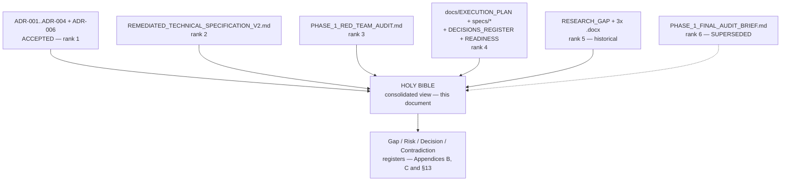
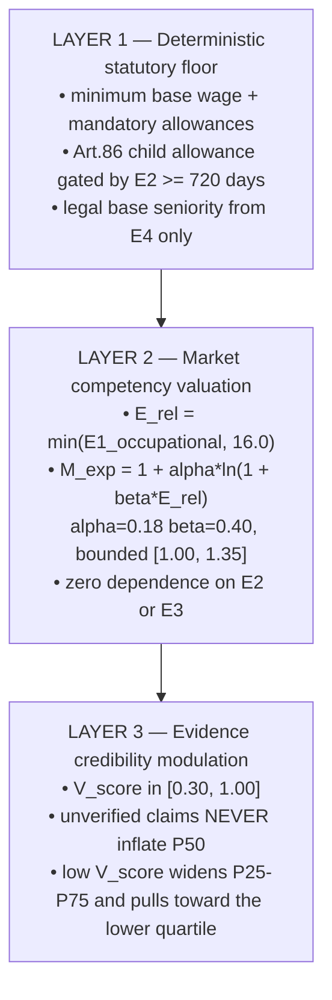
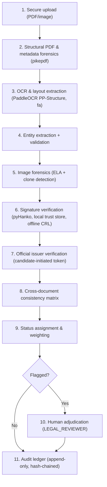
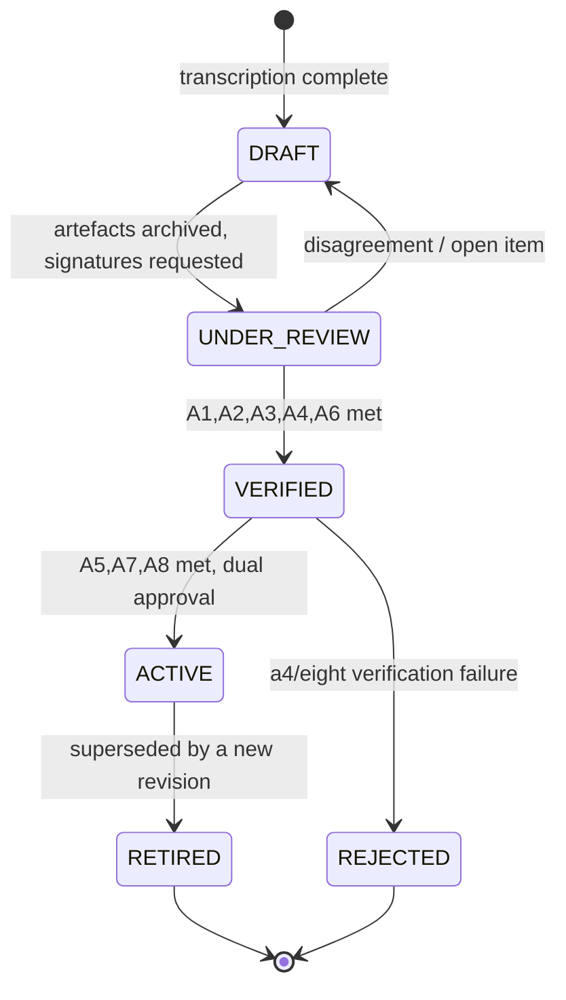
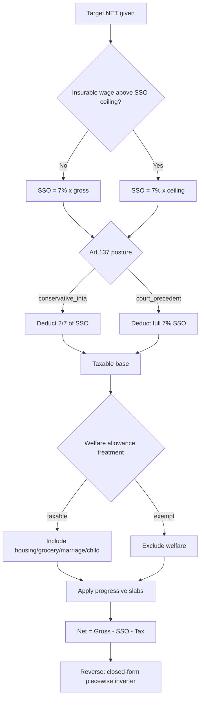
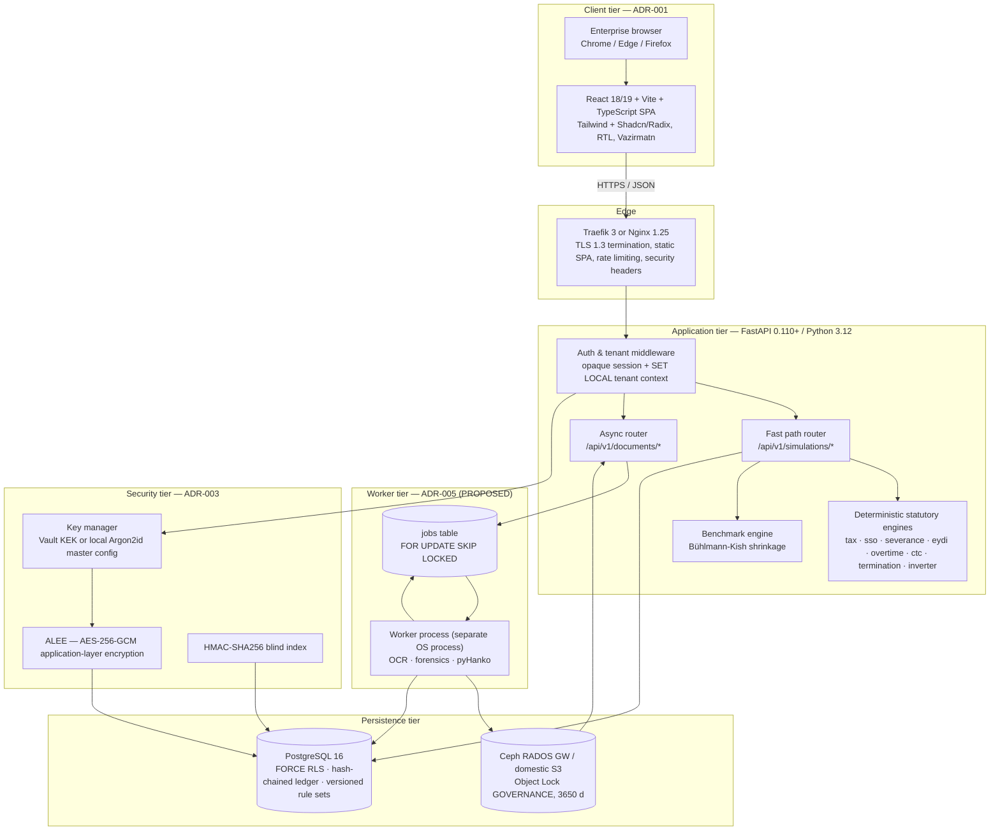
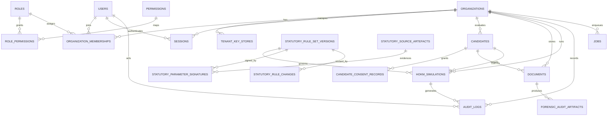
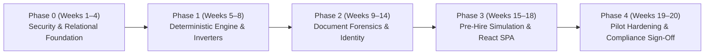

# Pish Hesabdari (پیش‌حسابداری) — The Project Holy Bible

**Master knowledge base, evidence register and gap analysis for the Pish Hesabdari pre-employment compensation intelligence platform.**

| Field | Value |
| :--- | :--- |
| **Document ID** | `DOC-HOLY-001` |
| **Version** | `1.0.6` |
| **Status** | **Active — the primary context document for the project** |
| **Compiled** | 2026-11-14 (23 Aban 1405 SH) |
| **Compiled by** | Chief Software Architect / Principal Product Analyst / Technical Documentation Engineer / Project Knowledge Auditor |
| **Operational date of the corpus** | 2026-11-13 – 2026-11-14 (22–23 Aban 1405 SH) |
| **Governing specification** | `REMEDIATED_TECHNICAL_SPECIFICATION_V2.md` (`2.0.0-PROD-SPEC`) |
| **Binding decisions** | ADR-001…004 (**Accepted**), plus ADR-006 (**Accepted**, owner-approved Phase 0 choices; formally corrects ADR-003 directive 3's table target only) |
| **Non-binding decision** | `docs/adr/ADR-005` (**PROPOSED** — not binding) |
| **Implementation state** | **Bootstrap, isolated encryption and verified local PostgreSQL runtime.** 1 `COMPLETED`, 1 `IN_PROGRESS`, 2 `READY_FOR_REVIEW`, 78 `NOT_STARTED`, 4 `BLOCKED`; 86 total. P0-T03 official pull/build and real hardening verifier PASS (2026-11-15); CI dependency remains. No migration, financial engine or integrated tenant-security foundation exists. |
| **Active statutory baseline** | **1404 SH** (`1404.1`, `VERIFIED`). 1405 SH is transcribed but **not activated**. |
| **Overall readiness** | **NOT implementation-ready.** 2 of 5 phases `BLOCKED`, 3 `READY_WITH_CONDITIONS`. |

> **Current-state correction (2026-11-14, owner-authorized remediation).** `VERIFIED`: Git exists with bootstrap commit `2fc2b6f`; `backend/app/`, tests, `pyproject.toml`, `uv.lock`, repository hygiene files and `LICENSE` exist. See §11.1–§11.3 and `docs/BOOTSTRAP_CHANGELOG.md` §10 for current evidence. The source inventory in §0.4 and the original self-audit in Appendix E are historical snapshots of v1.0.0, not fresh claims about the current workspace. The 16 original findings are retained; their current disposition is recorded in the changelog. `MISSING`, confirmed by the owner: a Certified Tax Accountant, Iranian Labour Counsel and licensed/consented datasets. No statutory verification or architecture approval is implied by these factual corrections.

> **How to read this document.** Read task-relevant sections, not the entire document by default. Start with §0.3, §13.1, §13.8 and the relevant §3 requirements; DOCUMENTATION_INDEX §0 routes to the primary sources. §0.4 and Appendix E preserve the original inventory/self-audit. Current delivery status is in PROJECT_STATUS §2 and the WBS; changelog §16 records the latest application/collector verification, §15 PostgreSQL runtime, and §13 documentation maintenance. Historical evidence is not a fresh execution result.

---

## Table of Contents

- [0. How to Use This Document](#0-how-to-use-this-document)
  - [0.1 Purpose, audience and scope](#01-purpose-audience-and-scope)
  - [0.2 Evidence label legend](#02-evidence-label-legend)
  - [0.3 Authority hierarchy and precedence rules](#03-authority-hierarchy-and-precedence-rules)
  - [0.4 Source register](#04-source-register)
  - [0.5 Document hierarchy and supersession map](#05-document-hierarchy-and-supersession-map)
- [1. Project Identity and Strategy](#1-project-identity-and-strategy)
  - [1.1 Product definition](#11-product-definition)
  - [1.2 Vision and mission](#12-vision-and-mission)
  - [1.3 Business objectives](#13-business-objectives)
  - [1.4 Target customers and user personas](#14-target-customers-and-user-personas)
  - [1.5 Value proposition](#15-value-proposition)
  - [1.6 Competitive positioning](#16-competitive-positioning)
  - [1.7 Business model hypotheses](#17-business-model-hypotheses)
  - [1.8 Product boundaries and explicit exclusions](#18-product-boundaries-and-explicit-exclusions)
- [2. Domain and Business Logic](#2-domain-and-business-logic)
  - [2.1 The eight compensation-intelligence capabilities](#21-the-eight-compensation-intelligence-capabilities)
  - [2.2 The four experience dimensions — never merged](#22-the-four-experience-dimensions--never-merged)
  - [2.3 Statutory calculation rules](#23-statutory-calculation-rules)
  - [2.4 The three-layer valuation model](#24-the-three-layer-valuation-model)
  - [2.5 Legal compensation constraints](#25-legal-compensation-constraints)
- [3. Product Modules and Requirements](#3-product-modules-and-requirements)
  - [3.1 Module inventory](#31-module-inventory)
  - [3.2 Module specifications](#32-module-specifications)
  - [3.3 Functional requirements](#33-functional-requirements)
  - [3.4 Non-functional requirements](#34-non-functional-requirements)
  - [3.5 User journeys](#35-user-journeys)
  - [3.6 Workflow diagrams](#36-workflow-diagrams)
  - [3.7 Requirements traceability](#37-requirements-traceability)
  - [3.8 Priorities and statuses](#38-priorities-and-statuses)
- [4. Architecture and Technology](#4-architecture-and-technology)
  - [4.1 System architecture](#41-system-architecture)
  - [4.2 Frontend architecture](#42-frontend-architecture)
  - [4.3 Backend architecture](#43-backend-architecture)
  - [4.4 Database architecture](#44-database-architecture)
  - [4.5 API design](#45-api-design)
  - [4.6 Authentication and authorization](#46-authentication-and-authorization)
  - [4.7 Storage](#47-storage)
  - [4.8 Background processing](#48-background-processing)
  - [4.9 AI integration](#49-ai-integration)
  - [4.10 External integrations](#410-external-integrations)
  - [4.11 Deployment topology](#411-deployment-topology)
  - [4.12 Technology inventory and version information](#412-technology-inventory-and-version-information)
  - [4.13 Architectural trade-offs](#413-architectural-trade-offs)
- [5. Database and Data Model](#5-database-and-data-model)
  - [5.1 Entity inventory](#51-entity-inventory)
  - [5.2 Relationships](#52-relationships)
  - [5.3 Constraints and indexes](#53-constraints-and-indexes)
  - [5.4 Tenant isolation](#54-tenant-isolation)
  - [5.5 Authentication entities](#55-authentication-entities)
  - [5.6 Sensitive data and encryption](#56-sensitive-data-and-encryption)
  - [5.7 Audit trail and audit actor representation](#57-audit-trail-and-audit-actor-representation)
  - [5.8 Migration strategy](#58-migration-strategy)
  - [5.9 Data lifecycle and retention](#59-data-lifecycle-and-retention)
  - [5.10 Known schema defects — verified](#510-known-schema-defects--verified)
  - [5.11 Statutory seed files — verified inspection](#511-statutory-seed-files--verified-inspection)
- [6. Persian UX and Localization](#6-persian-ux-and-localization)
  - [6.1 RTL layout](#61-rtl-layout)
  - [6.2 Jalali calendar](#62-jalali-calendar)
  - [6.3 Persian typography](#63-persian-typography)
  - [6.4 Numeral and number formatting policy](#64-numeral-and-number-formatting-policy)
  - [6.5 Rial and Toman conventions](#65-rial-and-toman-conventions)
  - [6.6 Financial precision in the UI](#66-financial-precision-in-the-ui)
  - [6.7 Tables and forms](#67-tables-and-forms)
  - [6.8 PDF generation, printing](#68-pdf-generation-printing)
  - [6.9 Accessibility](#69-accessibility)
  - [6.10 Responsive design](#610-responsive-design)
  - [6.11 Unresolved localisation choices](#611-unresolved-localisation-choices)
- [7. AI and Intelligence](#7-ai-and-intelligence)
  - [7.1 AI use cases in scope](#71-ai-use-cases-in-scope)
  - [7.2 Deterministic versus probabilistic boundaries](#72-deterministic-versus-probabilistic-boundaries)
  - [7.3 Model responsibilities](#73-model-responsibilities)
  - [7.4 Recommendation explainability](#74-recommendation-explainability)
  - [7.5 Confidence scores](#75-confidence-scores)
  - [7.6 Human review and adjudication](#76-human-review-and-adjudication)
  - [7.7 Bias mitigation](#77-bias-mitigation)
  - [7.8 Model evaluation](#78-model-evaluation)
  - [7.9 Hallucination controls](#79-hallucination-controls)
  - [7.10 Data privacy and AI](#710-data-privacy-and-ai)
  - [7.11 AI cost and provider flexibility](#711-ai-cost-and-provider-flexibility)
- [8. Security and Privacy](#8-security-and-privacy)
  - [8.1 Security control model](#81-security-control-model)
  - [8.2 Authentication](#82-authentication)
  - [8.3 Authorization](#83-authorization)
  - [8.4 Tenant isolation](#84-tenant-isolation)
  - [8.5 Encryption and key management](#85-encryption-and-key-management)
  - [8.6 PII protection and blind indexing](#86-pii-protection-and-blind-indexing)
  - [8.7 Secrets management](#87-secrets-management)
  - [8.8 Audit logging](#88-audit-logging)
  - [8.9 Threat model](#89-threat-model)
  - [8.10 Rate limiting and abuse controls](#810-rate-limiting-and-abuse-controls)
  - [8.11 Backup security](#811-backup-security)
  - [8.12 Incident response](#812-incident-response)
  - [8.13 Secure development lifecycle](#813-secure-development-lifecycle)
  - [8.14 Explicit non-claims](#814-explicit-non-claims)
- [9. Document Intelligence](#9-document-intelligence)
  - [9.1 Ingestion and custody](#91-ingestion-and-custody)
  - [9.2 OCR and extraction](#92-ocr-and-extraction)
  - [9.3 Identity matching](#93-identity-matching)
  - [9.4 Provenance](#94-provenance)
  - [9.5 Tamper detection](#95-tamper-detection)
  - [9.6 Evidence handling and retention](#96-evidence-handling-and-retention)
  - [9.7 Confidence](#97-confidence)
  - [9.8 Human verification](#98-human-verification)
  - [9.9 Technical limitations — stated plainly](#99-technical-limitations--stated-plainly)
- [10. Iranian Legal and Regulatory Requirements](#10-iranian-legal-and-regulatory-requirements)
  - [10.1 Regulatory source hierarchy](#101-regulatory-source-hierarchy)
  - [10.2 The 1405 legal baseline — status](#102-the-1405-legal-baseline--status)
  - [10.3 1404 baseline (the only active set)](#103-1404-baseline-the-only-active-set)
    - [10.3.1 The 1405 candidate parameter set — transcribed, not activated](#1031-the-1405-candidate-parameter-set--transcribed-not-activated)
  - [10.4 Statutory calculation rules and citations](#104-statutory-calculation-rules-and-citations)
  - [10.5 Effective dating and versioning](#105-effective-dating-and-versioning)
  - [10.6 Verification and update process](#106-verification-and-update-process)
  - [10.7 Open statutory items](#107-open-statutory-items)
- [11. Engineering and Execution](#11-engineering-and-execution)
  - [11.1 Repository structure — actual](#111-repository-structure--actual)
  - [11.2 Target repository structure](#112-target-repository-structure)
  - [11.3 Implementation status by workstream](#113-implementation-status-by-workstream)
  - [11.4 Coding conventions](#114-coding-conventions)
  - [11.5 Git workflow](#115-git-workflow)
  - [11.6 Testing strategy](#116-testing-strategy)
  - [11.7 CI/CD](#117-cicd)
  - [11.8 Deployment](#118-deployment)
  - [11.9 Infrastructure](#119-infrastructure)
  - [11.10 Monitoring and logging](#1110-monitoring-and-logging)
  - [11.11 Backup and disaster recovery](#1111-backup-and-disaster-recovery)
  - [11.12 Maintenance and release process](#1112-maintenance-and-release-process)
  - [11.13 Status vocabulary](#1113-status-vocabulary)
- [12. Project Management](#12-project-management)
  - [12.1 The five-phase, 20-week roadmap](#121-the-five-phase-20-week-roadmap)
  - [12.2 Milestones and acceptance gates](#122-milestones-and-acceptance-gates)
  - [12.3 Work breakdown structure](#123-work-breakdown-structure)
  - [12.4 Dependencies and critical path](#124-dependencies-and-critical-path)
  - [12.5 Task ownership by role](#125-task-ownership-by-role)
  - [12.6 Deliverables](#126-deliverables)
  - [12.7 Schedule risk register](#127-schedule-risk-register)
  - [12.8 Blockers](#128-blockers)
  - [12.9 Phase readiness assessment](#129-phase-readiness-assessment)
- [13. Knowledge Governance](#13-knowledge-governance)
  - [13.1 Document change-control rules](#131-document-change-control-rules)
  - [13.2 Accepted decision register](#132-accepted-decision-register)
  - [13.3 Proposed decision register](#133-proposed-decision-register)
  - [13.4 Unresolved question register](#134-unresolved-question-register)
  - [13.5 Contradiction register](#135-contradiction-register)
  - [13.6 Superseded documents and decisions](#136-superseded-documents-and-decisions)
  - [13.7 Missing information](#137-missing-information)
  - [13.8 Instructions for future agents](#138-instructions-for-future-agents)
- [Appendix A — Independent recalculation of the worked financial example](#appendix-a--independent-recalculation-of-the-worked-financial-example)
- [Appendix B — Gap register](#appendix-b--gap-register)
- [Appendix C — Risk register](#appendix-c--risk-register)
- [Appendix D — Missing requirements register](#appendix-d--missing-requirements-register)
- [Appendix E — Final self-audit record](#appendix-e--final-self-audit-record)
- [Appendix F — Change log](#appendix-f--change-log)

---

## 0. How to Use This Document

**Implementation addendum, 2026-11-15:** Owner accepted DEC-012 T-2/F-1 in ADR-007. P0-T04 local migration/security acceptance and independent review now PASS; READY_FOR_REVIEW with CI pending. Latest census: 1 COMPLETED, 6 IN_PROGRESS, 5 READY_FOR_REVIEW, 70 NOT_STARTED, 4 BLOCKED. Statutory tables are global with FORCE RLS and restricted DB roles; writes remain gated until P0-T05 validates users FKs. Source of current evidence: PROJECT_STATUS §2 and BOOTSTRAP_CHANGELOG §21; older snapshots below are historical. No seed, roadmap, statutory activation or phase gate changed.

**Current state, 2026-11-15:** PostgreSQL local hardening is verified (§15); P0-T03 is READY_FOR_REVIEW and P0-T01 CI remains incomplete. A bounded official-source acquisition CLI is implemented and independently reviewed (§16); 157 tests pass, strict types/lint/format pass. All six official acquisition probes failed (403/transport), so no fresh legal document or parameter was verified/activated. Full-scope Wednesday target is EXECUTION_PLAN §14.8, with unchanged gates/roadmap and explicit external dependencies. Earlier inventories are historical snapshots.

**v1.0.2 current-state addendum:** accepted ADR-006 records the owner's approval of DEC-004/004a/004b/005 and formally corrects ADR-003 directive 3's table target while preserving its original text. Five ADRs are accepted; ADR-005 remains proposed. The isolated field-encryption primitive in `backend/app/core/security/pii_transformer.py` is independently reviewed and READY_FOR_REVIEW with local evidence, not an integrated key-management system or completed Phase 0 gate. Current verification: BOOTSTRAP_CHANGELOG §11. Original inventories and historical proposal/implementation counts elsewhere must be read with this addendum.

### 0.1 Purpose, audience and scope

This document is the **single consolidated knowledge base** for Pish Hesabdari. It exists because the project corpus had grown to 39 files across five formats (Markdown, YAML, DOCX, skill contracts) with no single place where a new contributor — human or AI agent — could determine *what is true*, *what is decided*, *what is merely proposed*, and *what is missing*.

**Audience:**

| Audience | Use |
| :--- | :--- |
| AI agents (including Codex and Antigravity) | Read task-relevant sections via DOCUMENTATION_INDEX §0; §0.3 gives precedence and §13.8 the operating constraints. |
| Developers / backend / frontend engineers | §4 (architecture), §5 (data model), §11 (engineering), §2 (domain rules). |
| Architects | §4.13 (trade-offs), §13.2–13.5 (decision and contradiction registers), Appendix B (gaps). |
| QA engineers | §3 (requirements), §11.6–11.7 (test strategy and CI), §11.4 (money invariants). |
| Security engineers | §8 (security), §5.4–5.7 (isolation, keys, audit), Appendix C (risks). |
| Product managers | §1 (strategy), §3 (modules), §10 (legal constraints), §12 (delivery). |
| Legal / payroll specialists | §10 (legal baseline), §2 (domain rules), Appendix A (recalculation). |

**Scope.** This document consolidates and verifies. It does **not** amend any accepted ADR, the authoritative specification, the seed files, or any historical document. Where this document disagrees with a binding artefact, the disagreement is recorded in §13.5 as a **contradiction** with an owner and a required action — it is never silently applied.

**Out of scope by instruction:** no application source code was created or modified; no packages installed; no schema, migration or seed changed; no Git operation performed; no separate documentation files created.

### 0.2 Evidence label legend

| Label | Meaning | Binding? |
| :--- | :--- | :--- |
| `VERIFIED` | Independently checked against a primary artefact in this workspace during this audit, and the check is reproducible. | Yes |
| `ACCEPTED` | Approved by a recorded approver in an accepted ADR. Implementation must conform. | Yes |
| `PROPOSED` | A drafted, analysed recommendation awaiting a named approver. **Not binding.** | No |
| `INFERRED` | A conclusion derived by reasoning from evidence, not directly stated in a source. | No — treat as a hypothesis |
| `UNVERIFIED` | Asserted somewhere but not evidenced; may be true, may be false. | No |
| `CONFLICT` | Two or more sources make incompatible statements, or a source contradicts itself. | No — requires resolution |
| `MISSING` | The information does not exist in the corpus and could not be established from it. | No |
| `SUPERSEDED` | Retained for the audit trail; no longer authoritative. | No |
| `IMPLEMENTED` | Built, present in the repository, and verified. | — |
| `PARTIALLY IMPLEMENTED` | Present but incomplete or defective. | — |
| `PLANNED` | Specified with an owner and a task, but not built. | No |

**Additional state markers used only for code and documents:** `BLOCKED`, `SUPERSEDED`, `NOT_STARTED`.

> **Rule of evidence.** A statement without a label and a source path is an assertion by this document, not a project fact. This document labels **every** factual claim. Where a source is cited, the path is given relative to the repository root.

### 0.3 Authority hierarchy and precedence rules

The binding order, preserved from `docs/EXECUTION_PLAN.md` §1.2 and `docs/DOCUMENTATION_INDEX.md` §5.1:

| Rank | Class | Documents | Binding scope |
| :--: | :--- | :--- | :--- |
| **1** | Accepted ADRs | `docs/adr/ADR-001`…`ADR-004`, plus `ADR-006` | Architectural decisions explicitly decided; ADR-006 amends only ADR-003's indexed table target |
| **2** | Authoritative specification | `REMEDIATED_TECHNICAL_SPECIFICATION_V2.md` | Product scope, functional modules, technology stack, domain model, API contracts, roadmap and gates |
| **3** | Findings register | `PHASE_1_RED_TEAM_AUDIT.md` | Historical findings and the disposition of each finding |
| **4** | Execution package | `docs/EXECUTION_PLAN.md`, `docs/specs/*`, `docs/DECISIONS_REGISTER.md`, `docs/IMPLEMENTATION_READINESS.md`, `docs/ADR_INDEX.md`, `docs/DOCUMENTATION_INDEX.md`, `docs/EXECUTION_DOCUMENTATION_AUDIT.md` | Sequencing, task decomposition, subordinate specifications, decision register |
| **5** | Research (non-superseded content only) | `RESEARCH_GAP_ANALYSIS_AND_ADVANCED_SPECIFICATION.md`, `گزارش جامع پژوهشی.docx`, `Technical Investigation of Related Software Projects.docx`, `1.docx` | Background, methods, harvested technical content — **never** current implementation instructions |
| **6** | Historical / superseded | `PHASE_1_FINAL_AUDIT_BRIEF.md` | Reference only |
| **n/a** | Behaviour contracts | `.agents/skills/*/SKILL.md` | Agent engineering standards — **not** project decisions, but they constrain how work is done |

**Precedence rules (binding):**

1. **No silent revival.** A technology or approach rejected by a red-team finding or an ADR may not reappear without a new, reviewed ADR. The rejected set is enumerated in `docs/ADR_INDEX.md` §5 and reproduced in §13.6 of this document.
2. **No silent narrowing.** Where a subordinate document proposes a change to a rank-2 specification line, the proposal is recorded in `docs/DECISIONS_REGISTER.md`; the specification line is **not** altered until the decision lands.
3. **Documentation readiness ≠ implementation completion.** A specification being written does not make a task `COMPLETED`.
4. **Unknown is a first-class value.** An unverified statutory parameter, an inaccessible primary source or an undecided architecture is recorded as such. It is never filled with an estimate.
5. **Historical documents are never deleted or overwritten.** They are retained for the audit trail (`docs/DOCUMENTATION_INDEX.md` §4).

### 0.4 Source register

**Historical v1.0.0 source inventory.** Rows, sizes, counts and the Git limitation below describe the original audit, not the current workspace. Preserve them as evidence; do not use them as current setup instructions. PROJECT_STATUS and ENVIRONMENT_INVENTORY own delivery and dated host observations.

| # | Path | Role | Rank | Size | Inspection performed |
| --: | :--- | :--- | :--: | --: | :--- |
| 1 | `REMEDIATED_TECHNICAL_SPECIFICATION_V2.md` | Authoritative product & technical specification | 2 | 31.6 KB | **Full read** (513 lines) + targeted re-read of §3.1, §5.1 |
| 2 | `PHASE_1_FINAL_AUDIT_BRIEF.md` | Superseded baseline brief | 6 | 37.6 KB | **Full read** (362 lines) |
| 3 | `PHASE_1_RED_TEAM_AUDIT.md` | Red-team findings register (21 findings) | 3 | 48.6 KB | **Full read** (342 lines) |
| 4 | `RESEARCH_GAP_ANALYSIS_AND_ADVANCED_SPECIFICATION.md` | Historical research synthesis, 8 deliverables | 5 | 129.9 KB | Structural map (all 78 headings) + line-level reads of the 17 cited lines + targeted reads of §2, §3, §5, §8 |
| 5 | `docs/EXECUTION_PLAN.md` | Master execution plan, 86-task WBS | 4 | 73.0 KB | **Full read** (779 lines) |
| 6 | `docs/DECISIONS_REGISTER.md` | 17 open decisions | 4 | 39.3 KB | **Full read** (591 lines) |
| 7 | `docs/IMPLEMENTATION_READINESS.md` | Per-phase readiness | 4 | 17.8 KB | **Full read** (243 lines) |
| 8 | `docs/DOCUMENTATION_INDEX.md` | Document hierarchy + supersession map | 4 | 16.6 KB | **Full read** (199 lines) |
| 9 | `docs/EXECUTION_DOCUMENTATION_AUDIT.md` | Self-audit of the `docs/` package | 4 | 25.8 KB | Structural map + **full read** of §§3.3–3.7, 4–6 (lines 156–315) |
| 10 | `docs/ADR_INDEX.md` | ADR register + rejected-technology list | 4 | 8.5 KB | **Full read** (123 lines) |
| 11 | `docs/adr/ADR-001-frontend-architecture-react-vite-spa.md` | Frontend architecture decision | 1 | 4.0 KB | **Full read** |
| 12 | `docs/adr/ADR-002-object-storage-worm-ceph-s3-governance.md` | Object storage + WORM decision | 1 | 3.6 KB | **Full read** |
| 13 | `docs/adr/ADR-003-sensitive-data-encryption-alee-blind-indexing.md` | Encryption + blind indexing decision | 1 | 3.4 KB | **Full read** |
| 14 | `docs/adr/ADR-004-phase-1-product-boundary-prehire-scope.md` | Scope de-escalation decision | 1 | 3.8 KB | **Full read** |
| 15 | `docs/adr/ADR-005-async-execution-strategy.md` | Async execution strategy | proposed | 17.9 KB | **Full read** (218 lines) |
| 16 | `docs/specs/STATUTORY_INGESTION.md` | `SPEC-STAT-001` — statutory ingestion & verification | 4 | 25.6 KB | **Full read** (389 lines) |
| 17 | `docs/specs/AUTH.md` | `SPEC-AUTH-001` — authn, authz, tenant isolation | 4 | 27.7 KB | Read §1–§5 (220 lines) + requirement table §10 |
| 18 | `docs/specs/DEPLOYMENT.md` | `SPEC-OPS-001` — topology, ops, backup, air-gap | 4 | 31.1 KB | Structural map (58 headings) + full read of §1, §7.4, §8, §10, §11, §12 |
| 19 | `docs/specs/DOCUMENT_FORENSICS.md` | `SPEC-DOC-001` — document taxonomy, forensics, `V_score` | 4 | 31.7 KB | Read §2–§7 (180 lines) + §8–§16 (180 lines) |
| 20 | `docs/specs/FRONTEND_PERSIAN.md` | `SPEC-FE-001` — RTL, numerals, Jalali, PDF | 4 | 25.4 KB | Structural map + full read of §4–§6 (180 lines) + requirement table §11 |
| 21 | `docs/specs/TESTING.md` | `SPEC-QA-001` — 13 test layers, CI, release criteria | 4 | 30.6 KB | Structural map + full read of §6, §15–§19 + all requirement-ID tables |
| 22 | `backend/data/seeds/statutory_rules_1404.yaml` | **Verified historical** rule set — immutable | 2 | 3.2 KB | **Full read** + arithmetic re-derivation of all 10 invariants |
| 23 | `backend/data/seeds/statutory_rules_1405.yaml` | **Empty placeholder** — must stay inactive | 2 | 2.8 KB | **Full read** + key-by-key diff against the 1404 file |
| 24 | `1.docx` | Independent audit of the two baseline reports | 5 | 64.8 KB | **Text extracted** (`word/document.xml` → UTF-8), 497 lines read |
| 25 | `Technical Investigation of Related Software Projects.docx` | Technology landscape survey | 5 | 72.8 KB | **Text extracted**, header read; platform/license comparison table read |
| 26 | `گزارش جامع پژوهشی.docx` (PH-RES-1405-01) | Persian baseline research, 6 domains + SRS | 5 | 102.6 KB | **Text extracted**, 1 011 lines; §1 (roles), §8 (SRS F-01…F-15), §9 (schema), §12 (risks) read |
| 27 | `.agents/skills/software-architecture/SKILL.md` | Behaviour contract — modular monolith, fast/slow path | n/a | 1.5 KB | Grep-scanned for technology mandates |
| 28 | `.agents/skills/database-engineering/SKILL.md` | Behaviour contract — RLS, blind index, no `pgcrypto` | n/a | 1.8 KB | Grep-scanned |
| 29 | `.agents/skills/persian-rtl-engineering/SKILL.md` | Behaviour contract — Vazirmatn, WeasyPrint | n/a | 7.3 KB | Grep-scanned |
| 30 | `.agents/skills/iranian-payroll-engineering/SKILL.md` | Behaviour contract — Iranian payroll bases | n/a | 8.0 KB | Grep-scanned |
| 31 | `.agents/skills/financial-data-integrity/SKILL.md` | Behaviour contract — Decimal, rounding, provenance | n/a | 6.8 KB | Grep-scanned |
| 32 | `.agents/skills/adr-authoring/SKILL.md` | Behaviour contract — ADR format | n/a | 1.7 KB | Grep-scanned |
| 33 | `.agents/skills/security-threat-model/SKILL.md` | Behaviour contract — STRIDE, KMS, RLS | n/a | 2.0 KB | Grep-scanned |
| 34 | `.agents/skills/actuarial-risk-modeling/SKILL.md` | Behaviour contract — Bühlmann-Kish, CTC, hyperinflation | n/a | 1.5 KB | Grep-scanned |
| 35 | `.agents/skills/product-discovery/SKILL.md` | Behaviour contract — scope, MVP | n/a | 1.7 KB | Grep-scanned |
| 36 | `.agents/skills/spec-driven-development/SKILL.md` | Behaviour contract — specs, Gherkin, vectors | n/a | 1.5 KB | Grep-scanned |
| 37 | `.agents/skills/doubt-driven-development/SKILL.md` | Behaviour contract — adversarial review | n/a | 1.5 KB | Grep-scanned |
| 38 | `.freebuff/project-id` | Tooling identifier (UUID) | n/a | 37 B | Read (content is a UUID) |
| 39 | `.freebuff/.gitignore` | Tooling ignore rules | n/a | 114 B | Read |

**Inspection totals:** 39 files enumerated; **39 inspected**; 0 inaccessible; 0 unparseable. Of the 39: **16 read line-by-line** in full; **10 text-extracted and read in substance** (a complete structural map, every requirement/ID table extracted, and the substantive sections read — the two DOCX files that were extracted in full but read selectively are counted here); **11 behaviour-contract files inspected by targeted search only** (their technology mandates were captured; their domain guidance was not line-by-line audited); **2 tooling files read** (their contents are a UUID and a four-line ignore file). The two `.docx` files that could not be read in their original encoding were successfully parsed by extracting `word/document.xml` and decoding UTF-8 — no content was lost.

**Limitation — Git history:** the workspace is **not a Git repository** (`git status` → `fatal: not a git repository`). There is no commit history, branch model, or authorship record to analyse. Any statement about "how a decision evolved" is therefore derived from document timestamps and supersession banners, not from VCS history. `docs/EXECUTION_PLAN.md` §1.5 and `docs/DOCUMENTATION_INDEX.md` §5.5 describe a Git-based change-control process that **is not yet instantiated**.

### 0.5 Document hierarchy and supersession map



**Supersession map — the key facts** (`docs/DOCUMENTATION_INDEX.md` §2, re-verified line by line in this audit):

| Source | Status | Replaced by |
| :--- | :--- | :--- |
| `PHASE_1_FINAL_AUT_AUDIT_BRIEF.md` (entire document) | `SUPERSEDED` — carries its own warning banner at lines 1–5 | `REMEDIATED_TECHNICAL_SPECIFICATION_V2.md` |
| `RESEARCH_GAP…md` §4.1–§4.5 (compa-ratio, compression, MCDA, priority framework) | `REJECTED for Phase 1` | ADR-004 (`FIND-PROD-01`) |
| `RESEARCH_GAP…md` §5.1–§5.6 (lifecycle) | `PARTIALLY RETAINED` — statutory content retained; operational settlement execution rejected | ADR-004 (`FIND-PROD-02`) |
| `RESEARCH_GAP…md` L989–990, L1028, L1049, L1155, L1210, L1242 (MinIO) | `REJECTED` | ADR-002 |
| `RESEARCH_GAP…md` L994, L1027, L1094, L1209, L1265, L1434 (`pgcrypto`) | `REJECTED` | ADR-003 |
| `RESEARCH_GAP…md` L82, L731, L1100, L1193 (bisection solver) | `REJECTED` | `FIND-MATH-01` → `REMEDIATED` Module 2 |
| `RESEARCH_GAP…md` L1109 (Redis + Celery/ARQ) | `REJECTED` | ADR-005 (`PROPOSED`) |
| `RESEARCH_GAP…md` §7.2 Month-1/Month-2/Q2 schedule; `گزارش جامع پژوهشی.docx` §11 7-day schedule; `1.docx` §7.3 7-day schedule | `REJECTED as a schedule` | `REMEDIATED` §7 five-phase / 20-week roadmap |
| `1.docx` Defect 2 (Art. 137 as a *tax cap*) | `SUPERSEDED` | `FIND-LEG-02` (two-policy toggle) |
| `1.docx` Defect 1's inference that 5,541,850 IRR/day was a "digit transposition" | `SUPERSEDED` — the inference was wrong (daily vs. monthly comparison) | `docs/specs/STATUTORY_INGESTION.md` §3.6 |

> **Open documentation defect.** `RESEARCH_GAP…md` carries a historical banner (lines 1–5) that names only *Celery/Redis, Next.js and 1404 temporal assumptions* as superseded, while its body still prescribes `pgcrypto` at six lines, MinIO at seven, and the bisection solver at four. `docs/DOCUMENTATION_INDEX.md` §2.2 enumerates them at line level, but the file itself was not edited (the earlier workstream's write scope was `docs/` only). **This is HB-GAP-042.** A developer who opens the richest document in the corpus without reading the index will implement AGPLv3 storage, in-database key exposure and a 50-iteration solver.

---

## 1. Project Identity and Strategy

### 1.1 Product definition

> **Pish Hesabdari (پیش‌حسابداری)** is an enterprise **pre-employment workforce compensation intelligence and evidentiary verification platform** for the Iranian private and technology sectors, operating strictly as an analytical decision-support and pre-hire simulation engine (*Hokm-e Kargozini* / *Markaz-e Hazineh* simulator).

- Source: `REMEDIATED_TECHNICAL_SPECIFICATION_V2.md` §1.1; `docs/EXECUTION_PLAN.md` §2.1. `ACCEPTED` (rank 2).
- It is **not** a payroll system, **not** an HRIS, **not** a recruitment ATS, and **not** an accounting package. `ACCEPTED` via ADR-004 and `REMEDIATED` §1.2.

### 1.2 Vision and mission

**Vision.** To be the authoritative, legally defensible source of pre-hire compensation decisions in Iran — the platform an employer's counsel trusts before a *Hokm-e Kargozini* is signed. `INFERRED` from `REMEDIATED` §1.1, the `FIND-LEG-01`/`FIND-ARCH-02` framing, and the Phase 4 gate ("external legal review sign-off by Iranian labour attorneys").

**Mission (four pillars),** quoted in substance from `REMEDIATED` §1.1 and `docs/EXECUTION_PLAN.md` §2.1:

1. Synthesize legally defensible, market-benchmarked hiring offers from **verified records** rather than self-reported resume claims.
2. Verify candidate authenticity against official Iranian issuers through multi-layer document forensics and interactive Shahkar identity validation.
3. Compute exact **Total Cost to Employer (CTC)** including direct wages, statutory employer burdens, severance, annual bonus and termination reserves.
4. Guarantee evidentiary posture before Labor Dispute Settlement Boards (*Heyat-e Tashkhis*, *Heyat-e Hal-e Ekhtelaf*) through Supreme Court Precedent No. 272 and Article 10 clause alignment.

**Naming.** *Pish Hesabdari* = "pre-accounting" — the discipline of costing a hire before the hire exists. `INFERRED` from the Persian research and the English gloss used consistently across the corpus.

### 1.3 Business objectives

| # | Objective | Evidence | Status |
| --: | :--- | :--- | :--- |
| BO-1 | Produce a legally defensible gross-to-net computation that survives a tax or labour audit | `REMEDIATED` §1.1, §7 Phase 1 gate | `PLANNED` |
| BO-2 | Eliminate the employer exposure created by Article 11 probation termination | `FIND-LEG-01` (CRITICAL) | `PLANNED` |
| BO-3 | Eliminate the 1404/1405 temporal disconnect that produces unlawful contracts | `FIND-TIME-01` (CRITICAL) | `PLANNED` — **blocked** (see §10.2) |
| BO-4 | Give the CFO a defensible CTC figure including the 23 % employer burden, *Sanavat* and *Eydi* | `REMEDIATED` Module 6 | `PLANNED` |
| BO-5 | Reduce false fraud-rejections caused by insurance-title vs. market-title divergence | `FIND-PROD-03` | `PLANNED` |
| BO-6 | Reach an enterprise pilot with design-partner corporations on local/air-gapped Windows deployments | `REMEDIATED` §7 Phase 4 | `PLANNED` |
| BO-7 | Reach a 20-week MVP without the HRIS scope creep that historically doubled the schedule | ADR-004 | `ACCEPTED` constraint |

**No revenue objective, pricing model, cost-to-serve model, or customer-acquisition objective exists anywhere in the corpus.** See HB-GAP-019.

### 1.4 Target customers and user personas

**Target customers** — derived from `REMEDIATED` §1.1 and `گزارش جامع پژوهشی.docx` §8.1:

| Segment | Why it buys | Evidence |
| :--- | :--- | :--- |
| Iranian technology companies, 50–1 000 employees | High churn, high offer-velocity, strong exposure to statutory disputes | `REMEDIATED` §1.1 "private and technology sectors" |
| Iranian private-sector SMEs with a *karگاه* (workshop) insurance number | Same statutory exposure, less internal payroll expertise | `1.docx` §3 (insurable base) |
| Start-ups using *Danesh Bonyan* status | Distinct statutory wage floor under the Vice-Presidency for Science | `1.docx` §8; `SPEC-DOC-001` §2.2 |
| Employers replacing or augmenting incumbent Iranian payroll/HRIS vendors | Deliberately *not* a replacement — a pre-hire decision layer | ADR-004 decision driver 3 |

**User personas.** The corpus defines **three operational roles** (in the Persian research §8.1 and `SPEC-AUTH-001` §3) and **four decision-maker roles** (in `REMEDIATED` §1.1). Both sets are recorded below; they are not reconciled anywhere in the corpus, which is itself a gap (HB-GAP-047).

| Persona | Source | Needs | Authority in the system |
| :--- | :--- | :--- | :--- |
| **Employer / Hiring Manager (کارفرما / مدیر تصمیم‌گیرنده)** | Persian research §8.1; `REMEDIATED` §1.1 | A single defensible salary recommendation within budget; an Acceptable Negotiation Corridor; a confidence band | `OWNER` — full read, approve |
| **HR Operator (اپراتور منابع انسانی)** | Persian research §8.1 | Fast intake in Simple/Advanced mode; document upload; Shahkar OTP capture; dossier preparation for sign-off | `HR_MANAGER` — create/read only |
| **System & Data Admin (مدیر سیستم و داده)** | Persian research §8.1 | Annual statutory parameter update; benchmark pipeline health; occupation taxonomy management | `ADMIN` — propose rule sets, manage benchmarks |
| **CFO** | `REMEDIATED` §1.1 | Exact CTC, 12-month cash flow, termination reserve | `OWNER`/`ADMIN` |
| **Legal reviewer / labour attorney** | `SPEC-AUTH-001` §3 | Verify evidence; promote a document's verification status; sign the Phase 4 legal opinion | `LEGAL_REVIEWER` — `document:verify_override`, `audit_log:read/export` |
| **Auditor / compliance** | `SPEC-AUTH-001` §3 | Read the hash-chained ledger; export it | `AUDITOR` — `audit_log:read` |
| **Analyst** | `SPEC-AUTH-001` §3 | Build benchmark bands; read simulations | `ANALYST` — read-only |

> **Note.** `SPEC-AUTH-001` §3 is a **PROPOSED** role and permission matrix (DEC-004). It is not yet approved.

### 1.5 Value proposition

| # | Proposition | Why it is defensible | Evidence |
| --: | :--- | :--- | :--- |
| VP-1 | **"The number is right, and you can prove it."** | Every figure carries a rule-set version, an engine version, a calculation hash and a per-field provenance map | `docs/EXECUTION_PLAN.md` §7.2 rule 4 |
| VP-2 | **"We know which year of the law your offer is built on."** | Rule sets are immutable, versioned `(year, revision)`, and fail closed | `SPEC-STAT-001` §5, §7.2 |
| VP-3 | **"Both tax postures, side by side."** | Conservative INTA and Diwan-e Edalat readings are computed and shown together, not chosen silently | `REMEDIATED` Module 2; `FIND-LEG-02` |
| VP-4 | **"A flag is not a verdict."** | Forensic anomalies adjust status and route to a human; they never declare fraud | `SPEC-DOC-001` §5.2 |
| VP-5 | **"It runs on your server, air-gapped."** | Four mandatory components, no cloud service, no Node.js runtime, no outbound connection | ADR-001; `SPEC-OPS-001` §1, §12 |
| VP-6 | **"Your data is unreadable to us."** | Application-layer envelope encryption, per-tenant DEKs, blind indexes | ADR-003 |

### 1.6 Competitive positioning

**Not documented as such anywhere in the corpus.** What can be reconstructed:

| Dimension | Pish Hesabdari | Incumbent Iranian payroll/HRIS | International comp tools | Open-source ATS |
| :--- | :--- | :--- | :--- | :--- |
| Category | Pre-hire decision support | Post-hire payroll execution | Global benchmarking methodology | Candidate pipeline |
| Statutory engine | Iranian-specific, versioned, fail-closed | Iranian-specific (localised) | None | None |
| Document forensics | Core module | Absent | Absent | Absent |
| Deployment | On-premise, air-gapped, no Node runtime | On-prem / hosted | SaaS only | Self-hosted |
| Evidence posture | Hash-chained ledger + WORM | Varies | None | None |

Evidence: ADR-004 decision driver 3 ("Avoid direct competition with entrenched Iranian payroll/HRIS vendors (e.g. Charsoon, Hamkaran System, Rayvarz)"); `1.docx` §7 (which open-source projects were rejected and why); `RESEARCH_GAP…md` §6.1.

`MISSING`: a formal competitive analysis, a differentiation statement, a pricing benchmark, and a win/loss framework. See HB-GAP-046.

### 1.7 Business model hypotheses

`MISSING` — the corpus contains **no** business model, pricing, packaging, licence, revenue-share, or cost-to-serve analysis. See HB-GAP-019 (HIGH).

What can be inferred as hypotheses from the deployment and licensing decisions:

| # | Hypothesis | Evidence | Confidence |
| --: | :--- | :--- | :--- |
| BM-H1 | **On-premise / air-gapped enterprise licence**, priced per organisation and per year | ADR-001 driver 2; ADR-002 driver 2; `SPEC-OPS-001` §12 (air-gapped installation path is a first-class pilot procedure) | `INFERRED` — strong |
| BM-H2 | **No per-transaction candidate fee**, because candidates are never a customer | ADR-004 (no candidate portal); `REMEDIATED` §1.2 | `INFERRED` — strong |
| BM-H3 | **Managed object storage is a client choice, not a platform line item** (Ceph RADOS GW or a domestic managed S3 such as ArvanCloud, Cloudware, MobinNet) | ADR-002 decision outcome; `SPEC-OPS-001` §1.2 | `INFERRED` — strong |
| BM-H4 | **Professional-services component**: statutory onboarding, benchmark corpus construction, legal review coordination | `P4-T07` (external labour attorney), `P2-T16` (corpus assembly), `P1-T15` (accountant engagement) | `INFERRED` — moderate |
| BM-H5 | **No data-fywheel revenue** until the opt-in policy (DEC-008) is settled | DEC-008 | `INFERRED` — moderate |

**None of these may be presented to a customer as a commercial commitment.** No stakeholder has approved them.

### 1.8 Product boundaries and explicit exclusions

**In scope, Phase 1** (`REMEDIATED` §1.2 and ADR-004 directive 2):

1. Pre-hire *Hokm-e Kargozini* simulation — gross-to-net and net-to-gross.
2. The 1405/1404 statutory wage, SSO and tax engine.
3. Document intelligence and forensic verification.
4. Four-way experience disambiguation.
5. Pre-hire compensation benchmarking (credibility-shrunk bands).
6. Pre-hire Total Cost to Employer and termination-liability modelling.
7. Cryptographic snapshot ledger and provenance.

**Explicitly out of scope, and the reason:**

| Excluded | Reason | Reconsider? | Source |
| :--- | :--- | :--- | :--- |
| Candidate web portal, candidate accounts, job boards, applicant profiles | No public-facing product surface | **Never** | ADR-004; `REMEDIATED` §1.2 |
| Biometric attendance / punch clocks / shift logs | Out of category | **Never** | `REMEDIATED` §1.2 |
| Monthly payroll disbursement, Shetab batch files | Out of category | **Never** | `REMEDIATED` §1.2 |
| General ledger accounting, tax filings | Out of category | **Never** | `REMEDIATED` §1.2 |
| Company-wide annual salary review / MCDA / compression monitoring | ADR-004 — spun off into a standalone Phase 2 product | Phase 2 | ADR-004; `FIND-PROD-01` |
| Operational exit settlement execution (*Tasviyeh Hesab*) and Sheba disbursement | ADR-004 — Phase 1 **models** the liability only | Phase 2 | ADR-004; `FIND-PROD-02` |
| Direct *Sabt-e Ahval* (Civil Registration) API | Legally unavailable to private employers | **Never** | `FIND-ARCH-07` |
| Live scraping of Jobinja or similar | Terms-of-service violation; advertised pay ≠ paid salary | Only via a negotiated feed | `1.docx` Defect 5 |
| Automated / background Shahkar verification | CRA mandate requires interactive SMS OTP consent | **Never** | `FIND-ARCH-07` |
| Legal representation or advocacy | The platform produces evidentiary dossiers, not legal counsel | **Never** | `REMEDIATED` §1.2 |
| Multi-currency pegging / real-time USD-USDT indexing | Deferred | Phase 2+ | `REMEDIATED` §1.2 |

---

## 2. Domain and Business Logic

### 2.1 The eight compensation-intelligence capabilities

| # | Capability | Definition | Module | Status |
| --: | :--- | :--- | :--- | :--- |
| CI-1 | **Compensation intelligence** | The umbrella: turning verified facts about a candidate and a role into a defensible offer | 1–7 | `PLANNED` |
| CI-2 | **Salary benchmarking** | Producing market percentile bands (P10–P90) for an occupation × seniority × geography cell, with credibility-weighted shrinkage | 5 | `PLANNED` |
| CI-3 | **Salary recommendation** | A point recommendation plus a defensible band, anchored to the statutory floor and modulated by evidence credibility | 5 | `PLANNED` |
| CI-4 | **Internal pay equity** | Compa-ratio, range penetration, compression index, internal equity ratio | *Deferred to Phase 2* | `SUPERSEDED` for Phase 1 — ADR-004 |
| CI-5 | **External market competitiveness** | Positioning against external market bands rather than internal history | 5 | `PLANNED` |
| CI-6 | **Workforce cost analysis** | 12-month employer cash-flow projection: gross + 23 % employer burden + *Sanavat* + *Eydi* + recruitment friction | 6 | `PLANNED` |
| CI-7 | **Hiring cost analysis** | Pre-hire cost model including recruitment friction, onboarding/equipment amortisation, probation-termination risk | 6 | `PLANNED` |
| CI-8 | **Compensation adjustment prioritisation** | Multi-criteria ranking of which existing employees should receive an increase | *Deferred to Phase 2* | `SUPERSEDED` for Phase 1 — ADR-004 |
| CI-9 | **Employment lifecycle financial analysis** | The ten-stage lifecycle modelled from requisition to exit; Phase 1 covers only the pre-hire and modelled-termination ends | 6 | `PARTIALLY IMPLEMENTED` (specified only) |
| CI-10 | **Legal compensation constraints** | Article 41 minimum wage, Article 36 Note 3 overtime base, Article 24 severance base, Article 86 child allowance, Article 11 probation, Articles 66/71 leave | 1, 6 | `PLANNED` |

> **CI-4 and CI-8 are deliberately deferred.** The corpus contains a full statistical treatment of them (`RESEARCH_GAP…md` §4) and it is **rejected for Phase 1** by ADR-004. Any reintroduction requires a new ADR.

### 2.2 The four experience dimensions — never merged

This is the single most consequential domain rule in the product. The four dimensions are **orthogonal** and must never be collapsed into one "years of experience" number, and overlapping periods must never be double-counted.

| # | Dimension | Persian | Statutory role | Primary evidence | Source |
| --: | :--- | :--- | :--- | :--- | :--- |
| E1 | Total professional experience | سابقه کار حرفه‌ای کل | Market benchmark bracket only | CV, portfolio, references | `SPEC-DOC-001` §10.1 |
| E2 | Social Security insurance contribution history | سابقه پرداخت حق بیمه | **Statutory eligibility trigger** — Art. 86 child allowance requires ≥ 720 insured days | Official SSO history (Tamin) | `SPEC-DOC-001` §10.1 |
| E3 | Seniority with the current employer | سابقه کار در کارگاه فعلی | Severance accrual (Art. 24); leave rollover (Art. 66) | Contract, payroll log | `SPEC-DOC-001` §10.1 |
| E4 | Legally recognised base seniority | سابقه مشمول مزد سنوات | The mandatory daily base-seniority increment (پایه سنوات) | Job-classification plan, workshop tenure | `SPEC-DOC-001` §10.1 |

**Why merging them is financially destructive** — the corpus gives a concrete illustration (`SPEC-DOC-001` §10.1): a candidate may have **10 years of total experience, 3 years of insurance, 1 year at the current firm, and 0 years of legally recognised base seniority.** A single merged metric produces one of four different wrong answers.

**Statutory consequences that make disambiguation mandatory** (`SPEC-DOC-001` §10.2):

1. **Art. 86 child allowance is gated on E2, not E1.** Enforcing on E1 causes an unlawful payment; enforcing on E_total when the true E_sso is short causes an unlawful denial.
2. **Severance does not carry over (E3 only).** Art. 24 severance is one month of the final base wage per full year of continuous service *with this employer*. Previous service does not transfer.
3. **Base seniority depends on the workshop classification (E4).**
   - *Unclassified workshops* (فاقد طرح طبقه‌بندی مشاغل): base seniority is earned only after 365 days of continuous service with the same employer. Prior service does not transfer.
   - *Classified workshops* (دارای طرح طبقه‌بندی مشاغل مصوب, Arts. 48–49): prior relevant experience is evaluated under the Ministry of Labour's Job Classification Executive Regulations and mapped to job grades and step increments.

**Double-counting architecture** (`SPEC-DOC-001` §10.3) — the three layers are strictly separated:



> **Note on the market-premium parameters.** `SPEC-DOC-001` §10.3 uses α = 0.18, β = 0.40 and a 16-year cap. The superseded `PHASE_1_FINAL_AUDIT_BRIEF.md` §4 (Module 4) and the Persian research use α = 0.35, β = 0.40 with an **uncapped** log multiplier; the Persian research separately recommends a 16-year saturation cap. `1.docx` Defect 6 recommends a 16-year cap and a within-band adjustment of −0.05…+0.08. **The three sources disagree.** The `SPEC-DOC-001` values are the most recent engineering proposal and are `PROPOSED` (no register entry covers them). See HB-GAP-018 / §13.4 QB-07.

### 2.3 Statutory calculation rules

All rules below are `ACCEPTED` as *specifications*; the *values* they consume are governed by §10.

**A. Social Security (تأمین اجتماعی)**

| Rule | Value | Source |
| :--- | :--- | :--- |
| Employee contribution | 7 % of insurable earnings | Social Security Law Art. 28; `statutory_rules_1404.yaml` |
| Employer contribution | 20 % | Social Security Law Art. 28 |
| Unemployment insurance (بیکاری) | 3 %, employer-paid | Unemployment Insurance Act |
| Combined employer burden | **23 %** | `REMEDIATED` Module 1 |
| Insurable ceiling | 7 × daily minimum wage, per calendar day, applied per month length (29/30/31) | Social Security Law Art. 39; SSO circular S4 item 13 |

**B. Progressive salary income tax (DTA Arts. 82–92, 137)**

1404 monthly slabs, the **only verified active set**:

| Slab | Range (Rial) | Rate |
| --: | :--- | --: |
| 1 | 0 – 240,000,000 | 0 % |
| 2 | 240,000,001 – 300,000,000 | 10 % |
| 3 | 300,000,001 – 380,000,000 | 15 % |
| 4 | 380,000,001 – 500,000,000 | 20 % |
| 5 | 500,000,001 – 666,666,667 | 25 % |
| 6 | 666,666,668 – ∞ | 30 % |

Source: `backend/data/seeds/statutory_rules_1404.yaml` lines 44–74; `1.docx` §3 (Band Z Tab. 1 of the 1404 Budget Law). `VERIFIED` as the seed's content.

**C. Article 137 deduction — the dual-posture toggle (`FIND-LEG-02`)**

| Posture | Deduction | Basis |
| :--- | :--- | :--- |
| `conservative_inta` | 2/7 of the 7 % employee contribution (≈ 2 % of insurable wage) | INTA Circular 200/98/44 — *"کسر دو هفتم حق بیمه‌ی سهم کارگر از مبنای مالیات"* |
| `court_precedent` | The full 7 % employee contribution | Diwan-e Edalat-e Edari Precedents 1956 and 3328; DTA Art. 137 and Note 2 of Art. 83 |

`ACCEPTED` (the toggle must exist) but the **default is `PROPOSED`** — `conservative_inta`, in both seeds. `FIND-LEG-02` records that field tax auditors frequently insist on the 2/7 reading despite the Court rulings.

**D. *Mozd-e Mabna* / *Mozd-e Saabet* decomposition — the rule most often got wrong**

```
Mozd_e_Saabet = Gross − housing − grocery − marriage − child
               = Gross − welfare allowances        (continuous attraction RETAINED)
```

- Welfare allowances (مسکن، بن، تاهل، اولاد) are excluded from *Mozd-e Mabna* and *Mozd-e Saabet*: Labour Law Art. 36 Note 3 — *"مزایای رفاهی و انگیزه‌ای از قبیل کمک هزینه مسکن، خواربار و کمک عائله مندی، پاداش افزایش تولید و سود سالانه جزو مزد ثابت و مزد مبنا محسوب نمی‌شود."*
- Continuous fixed attraction allowances (*Fogholadeh Jazb*) **are** included in *Mozd-e Saabet*: Diwan-e Edalat-e Edali En Banc Judgment No. 3328 (1398/11/29), which overturned the restrictive Ministry practice; *Heyat-e Hal-e Ekhtelaf* routinely classifies a fixed monthly attraction allowance as *Mozd-e Saabet*.
- Sources: `FIND-LEG-05`; `docs/EXECUTION_PLAN.md` task `P1-T07`; `docs/specs/TESTING.md` §4.1.
- **The corpus does not state whether حق تاهل (marriage) and حق اولاد (child) fall inside or outside "کمک عائله مندی".** The engineering definition (`P1-T07`) excludes both; the statutory text names "کمک عائله مندی" without defining whether it includes the Art. 86 child allowance. See QB-09.

**E. Severance (*Sanavat*, Art. 24)**

```
monthly_accrual = Mozd_e_Saabet / 12          (8.3333… % of base, per year of service)
```
Source: `FIND-LEG-05`; `statutory_rules_1404.yaml` `sanavat_monthly_accrual_rate`. Note the seed's literal is `0.0833333333`, which is **not** exactly 1/12 — see HB-GAP-017.

**F. Annual bonus (*Eydi*, 1370 law)**

```
Eydi_annual = min( 60 × daily_mozd_e_mabna , 90 × daily_minimum_wage )
             = min( 2 × Mozd_e_Saabet , 3 × monthly_minimum_wage )
monthly_accrual = Eydi_annual / 12
```
- Source: `1.docx` §3; `SPEC-QA-001` property `P-06`; `statutory_rules_1404.yaml` (`eydi_min_days: 60`, `eydi_max_days_min_wage: 90`).
- **Taxation: `FIND-LEG-04` (HIGH).** Exemption = 1/12 of the annual Art. 84 exemption. The **excess is taxed across the progressive monthly salary brackets** — *not* at a flat 10 %. A flat 10 % produces tax under-withholding and Art. 199 DTA exposure.
- ⚠️ **Conflict:** the active 1404 seed still contains `eydi_tax_excess_rate: 0.10` — the rejected flat-10 % rule. See HB-GAP-005.

**G. Overtime (Arts. 36 Note 3, 51, 59)**

| Rule | Value | Source |
| :--- | :--- | :--- |
| Statutory weekly hours | 44 hours over 6 working days | Labour Law Art. 51 |
| Monthly divisor, 30-day month | **220.00 h** (44 × 30 / 6) | `FIND-LEG-03`; 1404 seed |
| Monthly divisor, 31-day month | **227.33 h** (44 × 31 / 6) | `FIND-LEG-03`; 1405 seed placeholder |
| Attendance hours (part-time proration only) | 176 h/month | 1404 seed `standard_monthly_attendance_hours`; `1.docx` Defect 3 |
| Overtime multiplier | 1.40 | Labour Law Art. 59 |
| Night-shift multiplier | 1.35 | `statutory_rules_1404.yaml` |
| Overtime base | *Mozd-e Saabet* — **housing, grocery and child allowances excluded from numerator *and* divisor** | Labour Law Art. 36 Note 3; `FIND-LEG-03` |

**H. Probation (Art. 11)** — `FIND-LEG-01` (CRITICAL)

> *"در صورتی که قطع رابطه کار از طرف کارفرما باشد وی ملزم به پرداخت خسارت نبوده ولی **مکلف است حقوق تمام دوره آزمایشی را پرداخت نماید**…"*

If the **employer** terminates during the agreed probationary period, the employer must pay **the entire probation period's salary**, not only the days worked. Only an employee-initiated termination reduces the liability to days worked. The CTC engine must model the worst case.

**I. Annual leave (Arts. 64, 66, 71)** — `FIND-MATH-02`, `FIND-LEG-06`

- The 26 working days of statutory annual leave are **paid** and are already inside the 12 months of gross salary. Accruing a separate 26-day cash reserve is an ~8.3 % double count. **Removed** from CTC.
- Art. 66 caps **annual carryover** at 9 days.
- Art. 71 requires payment of **all** accumulated unused leave at exit — for a 5-year employee who carried over 9 days each year, that is 45 days, not 9. `EXIT_buyout = min(9 × years, accumulated) × final_daily_wage`.

**J. Child allowance (Art. 86)**

```
child_allowance_per_child = 3 × daily_minimum_wage        (verified for 1404)
eligibility gate: E_sso >= 720 insured days
```
- Source: `1.docx` §3; `SPEC-DOC-001` §10.2; `SPEC-STAT-001` invariant `R-05`.
- ⚠️ **The 720-day threshold is not traced to a primary instrument** in the corpus (`RESEARCH_GAP…md` §3.1 states it; no Art. 86 determination exists in the corpus). It is `UNVERIFIED` and under DEC-011c. See HB-GAP-039.

### 2.4 The three-layer valuation model

```
S_recommended = max( S_statutory_min , P50_base × Φ_adj × H_contract × H_standard )
```
Source: `1.docx` §9 (corrected reproducible specification), `SPEC-DOC-001` §10.3.

**Bounded multiplicative adjustment** (avoids the double-counting the red-team audit found):

```
Φ_adj = clamp( 1 + δ_skill + δ_exp,band + δ_edu + δ_resp + δ_cond , 0.80 , 1.35 )
  δ_skill   ∈ [−0.15, +0.15]   weighted core/bonus skill overlap
  δ_exp,band ∈ [−0.04, +0.06]  position of min(E_applicant, 16) within the seniority band
  δ_edu     ∈ [ 0.00, +0.10]   only Tier-1 technical universities, Junior/Mid only
  δ_resp    ∈ [ 0.00, +0.12]   extra signing/supervisory responsibility beyond the band
  δ_cond    ∈ [−0.08, +0.12]   remote discount vs. harsh/shift premium
```

**Benchmark shrinkage** — Bühlmann credibility with Kish effective sample size:

```
Z_k = n_eff / (n_eff + K_clamped)
K   = σ²_within / σ²_between ,  K_clamped = clamp(K, 0.1, 100.0)     ← FIND-MATH-03
μ̂_k = Z_k · X̄_k + (1 − Z_k) · μ₀
n_eff = (Σw_i)² / Σw_i²
```
P10/P25/P50/P75/P90 bands are shrunk **jointly**, not per-quantile. `FIND-MATH-03` (LOW) requires the clamp because `σ²_between → 0` sends `K → ∞` and `Z → 0`, collapsing every estimate onto the grand mean.

**Weighted quantiles** (`1.docx` §5, `RESEARCH_GAP…md` §10):

```
w_i = w_time × w_source ,   w_time = exp( −ln2 · Δt_i / h ) ,  h = 6 months
Q_p = linear interpolation of s_k at cumulative midpoint W_k − w_k/2 = p
```

**Outlier gate** — IQR fences plus Modified Z-score with a **MAD = 0 guard**:

```
MAD = median(|x_i − M|)
if MAD > 0:  reject if M_i = 0.6745·(x_i − M)/MAD > 3.5
if MAD = 0:  fall back to Tukey fences Q25 − 1.5·IQR / Q75 + 1.5·IQR, or 0.5M / 2.0M if IQR = 0
```

**Geographic tiering** — three tiers with calibrated factors: Tehran 1.00, major cities 0.83, small cities 0.72 (`1.docx` §5; JobVision 1405's +20 % Tehran premium → 1/1.20 ≈ 0.833).

> **Statistical integrity rule.** `UNVERIFIED` claims never inflate P50. A missing observation is never imputed; it lowers the sample size, widens the band and reduces the confidence score. `SPEC-DOC-001` §11: *"principled handling of missing data (zero optimistic imputation)"*. The corpus is explicit that advertised salary ≠ paid salary (70–80 % of specialised postings are "توافقی"), and that "negotiable" is **MNAR** — companies hiding below-market *and* above-market salaries — so NULL must never be imputed to zero or to the minimum wage.

### 2.5 Legal compensation constraints

| Constraint | Instrument | Effect on the platform | Status |
| :--- | :--- | :--- | :--- |
| Minimum wage floor | Labour Law Arts. 36, 41 | Hard floor on every recommendation; `S_recommended ≥ S_statutory_min` | `ACCEPTED` |
| Overtime base | Art. 36 Note 3 | Excludes housing/grocery/child from numerator and divisor | `ACCEPTED` |
| Severance base | Art. 24 + Precedent 3328 | *Mozd-e Saabet*, includes continuous attraction | `ACCEPTED` |
| Probation termination | Art. 11 | Employer-initiated ⇒ full probation period payable | `ACCEPTED` |
| Leave buyout | Arts. 66, 71 | 9 days/yr carryover cap; **all** accumulated days payable at exit | `ACCEPTED` |
| Child allowance gate | Art. 86 (+ 720-day SSO rule) | Hard eligibility gate on `E_sso` | `ACCEPTED` (mechanism) / `UNVERIFIED` (720-day source) |
| Tax exemption and slabs | DTA Arts. 82–92; annual Budget Law | Progressive monthly slabs, versioned per year | `ACCEPTED` (mechanism) |
| Art. 137 SSO deduction | DTA Art. 137 + Note 2 Art. 83; INTA Circular 200/98/44; Precedents 1956, 3328 | Dual-policy toggle | `ACCEPTED` (toggle) / default `PROPOSED` |
| Eydi taxation | DTA Art. 91(10); 1370 Eydi Law | 1/12 annual exemption; excess taxed progressively | `ACCEPTED` (rule) / **the active seed contradicts it** — HB-GAP-005 |
| Non-cash benefit exemption | DTA Art. 91 | 2/12 of the annual exemption (1404: 480,000,000 Rial/yr) | `ACCEPTED` |
| Less-developed-region discount | DTA Art. 92 | 50 % tax discount for qualifying regions | `UNVERIFIED` — **not implemented in any seed or task**; see HB-GAP-036 |
| Evidence retention | Commercial Code Art. 19 (10-year books) | 10-year retention of dossiers, ledger, forensic objects | `ACCEPTED` |
| Settlement discharge | Supreme Court Precedent No. 272 | A signed release alone does not discharge; banking evidence required | `ACCEPTED` (Phase 1 models liability only) |
| Personal data | Computer Crimes Law Arts. 1, 16, 17; E-Commerce Law Art. 58 | Consent record, minimisation, access log, erasure | `ACCEPTED` |

---

## 3. Product Modules and Requirements

### 3.1 Module inventory

| # | Module | Phase | Status | Acceptance gate | Primary spec |
| --: | :--- | :--: | :--- | :--- | :--- |
| M1 | Deterministic Iranian Statutory Wage & Tax Engine | 1 | `PLANNED` | 10 000-case certified corpus, < 1 Rial | `REMEDIATED` §2 Module 1; `SPEC-STAT-001` |
| M2 | Piecewise Analytical Net-to-Gross & Gross-to-Net Inverter | 1 | `PLANNED` | same | `REMEDIATED` §2 Module 2 |
| M3 | Forensic Document Intelligence & Iranian Authenticity Verification | 2 | `PLANNED` | 500 authentic slips, > 95 % field accuracy | `SPEC-DOC-001` |
| M4 | 4-Way Candidate Experience & Title Disambiguation | 2 | `PLANNED` | L1 + L2 | `SPEC-DOC-001` §10, §12 |
| M5 | Pre-Hire Compensation Benchmarking (Bühlmann-Kish) | 1 | `PLANNED` | statistical L1 + dataset validation | `REMEDIATED` §2 Module 5 |
| M6 | Pre-Hire Total Cost to Employer & Termination Liability Simulator | 1 | `PLANNED` | L1 + property | `REMEDIATED` §2 Module 6 |
| M7 | Cryptographic Snapshot Ledger & SHA-256 Provenance Logging | 0 | `PLANNED` | `CR-10`, `CR-11` | `REMEDIATED` §2 Module 7 |
| M8 | React SPA + Persian RTL design system | 3 | `PLANNED` | < 3 s end-to-end in the browser | `SPEC-FE-001` |
| M9 | Regulatory ingestion & four-eyes activation | 1 | `PLANNED` — **blocked** | A1–A8 satisfied | `SPEC-STAT-001` |
| M10 | Enterprise output bridges (Sepidar / Rahkaran / SSO diskette / INTA) | 3 | `PLANNED` — **specification is thin** | — | `REMEDIATED` §3.3 only |

> ⚠️ **M10 has a specification but no task.** `REMEDIATED` §3.3 lists five organizational bridges (PDF *Hokm*, Sepidar, Rahkaran, SSO `DSKKAR00`/`DSKWOR00` DBF, INTA). The 86-task WBS contains **no task** for them. The 1404 rules were built and the export formats are not specified anywhere. This is HB-GAP-025.

### 3.2 Module specifications

---

#### M1 — Deterministic Iranian Statutory Wage & Tax Engine

| Attribute | Value |
| :--- | :--- |
| **Purpose** | Compute the legally exact gross-to-net and net-to-gross figures for a given candidate and contract |
| **Business value** | This is the product. If the number is wrong, every other module is decoration |
| **Users** | `HR_MANAGER` (operates), `OWNER`/`ADMIN` (approves), `LEGAL_REVIEWER` (audits) |
| **Inputs** | Target net (or gross) in Rial; marital status; eligible children count; `days_in_month`; the allowance set (housing, grocery, marriage, child, continuous attraction); tax posture; `rule_set_version_id`; tenure inputs for Art. 86 and Art. 24 |
| **Outputs** | Gross, employee SSO, taxable income, income tax, net; employer SSO, unemployment, *Sanavat* accrual, *Eydi* accrual, total employer cost; `rule_version`, `rule_set_status`, `engine_version`, `calculation_hash`, `generated_at`, per-field `provenance` |
| **Business rules** | §2.3 A–F, I, J; the fail-closed loader (`SPEC-STAT-001` §7.2); round-once-at-line-item with a surfaced `rounding_residual_rial` (`EXECUTION_PLAN` §7.2 rule 3); Decimal only (`prec=34`, `ROUND_HALF_UP`); never a `float` literal under `engines/` |
| **Dependencies** | `statutory_rule_set_versions` (active, `VERIFIED`); `P0-T04`; `P1-T04` money primitives; `P1-T15` certified corpus |
| **Data entities** | `statutory_rule_set_versions`, `statutory_source_artefacts`, `statutory_parameter_signatures`, `statutory_rule_changes`, `statutory_verification_log`, `hokm_simulations` |
| **Permissions** | `statutory_rule:read` (all roles); `statutory_rule:propose` (OWNER, ADMIN, SUPER_ADMIN); `statutory_rule:activate` (OWNER, SUPER_ADMIN) — with a four-eyes rule: the proposer may not be the activator for the same rule set |
| **Error cases** | `StatutoryParameterUnavailable` (null/unverified rule set — never coerced to 0); `RuleSetNotActive` (response carries `rule_set_status` + machine-readable `warning`); `TaxableBaseNegative` (P-07); `NetTargetUnreachable`; `SlabBoundaryAmbiguity`; `InsufficientPrecision` (residual > 1 Rial) |
| **Acceptance criteria** | `P-01`…`P-15`; `L3` golden corpus, 0 Rial deviation; `R-01`…`R-10` invariants; `L5` contract test asserts `rule_set_status` equals the database value |
| **Implementation status** | `PLANNED` — **0 %**. The engine does not exist. The **only** executable artefact is the 1404 YAML seed, which is a *parameter file*, not an engine. |

---

#### M2 — Piecewise Analytical Net-to-Gross & Gross-to-Net Inverter

| Attribute | Value |
| :--- | :--- |
| **Purpose** | Solve for gross given a negotiated **net** figure — the way Iranian candidates actually negotiate (Khales-e Pardakhti) |
| **Business value** | Removes the negotiation ambiguity that creates disputes about what was actually agreed |
| **Users** | `HR_MANAGER`, `OWNER` |
| **Inputs** | Target net; the same allowance/tenure set as M1; `days_in_month`; tax posture |
| **Outputs** | Solved gross; the residual tax band it lands in; the employer-cost total; a boundary-verification flag |
| **Business rules** | O(1) closed form within a detected region; **mandatory** boundary verification at every slab edge and at the SSO ceiling; Newton-Raphson fallback (2 iterations) for non-linear allowance rules; `dNet/dGross ≥ 0.651 > 0` guarantees monotonicity (`FIND-MATH-01`) |
| **Dependencies** | M1; `P1-T13`, `P1-T14`; `P1-T05` |
| **Data entities** | `hokm_simulations` |
| **Permissions** | `simulation:read`, `simulation:write` |
| **Error cases** | `NoSolutionInRange`; `BoundaryAmbiguity` (two regions give the same net — the solver must report, not pick); `CeilingCrossover` |
| **Acceptance criteria** | `P-01` (round-trip within 1 Rial for G ∈ [1, 5×10⁹]); `P-09`; `P-02`; inversion p99 < 5 ms; fast-path p99 < 20 ms |
| **Implementation status** | `PLANNED` — 0 % |

---

#### M3 — Forensic Document Intelligence & Iranian Authenticity Verification

| Attribute | Value |
| :--- | :--- |
| **Purpose** | Verify that a candidate's submitted identity, insurance, education and employment documents are genuine, internally consistent and attributable |
| **Business value** | Replaces self-reported CV claims with evidenced records; prevents both fraud and false fraud-rejections |
| **Users** | `HR_MANAGER` (upload), `LEGAL_REVIEWER` (adjudicate, override), `AUDITOR` (read the chain) |
| **Inputs** | PDF/image uploads (≤ 50 MB, magic-byte validated); candidate id; the Tamin slip set |
| **Outputs** | Extracted fields with confidence; OCR tables; structural/metadata findings; ELA and clone scores; signature verification result; a verification status with weight; anomaly flags; a `forensic_audit_artifacts` row with the input hash, engine version and model version |
| **Business rules** | Hash **before** transformation; WORM archival under `GOVERNANCE` (3650 d); duplicate suppression on `(tenant_id, file_sha256)`; retries overwrite via `UNIQUE (document_id, analysis_version)`; status transitions are append-only and actor-attributed; **a flag is never a verdict**; `REVOCATION_UNKNOWN` is never "valid" |
| **Dependencies** | `P2-T01`…`P2-T18`; **ADR-005 for the job pipeline**; `P2-T16` for the corpus |
| **Data entities** | `documents`, `forensic_audit_artifacts`, `candidate_consent_records` |
| **Permissions** | `document:upload`, `document:read` (HR_MANAGER, ANALYST, LEGAL_REVIEWER, ADMIN, OWNER); `document:delete` (ADMIN, OWNER, LEGAL_REVIEWER); `document:verify_override` (**LEGAL_REVIEWER and SUPER_ADMIN only**) |
| **Error cases** | `MimeMismatch`; `FileTooLarge`; `DuplicateDocument` (200, not an error); `OcrTimeout` (retryable); `SignatureChainUntrusted`; `RevocationUnavailable` → `REVOCATION_UNKNOWN`; `FieldValidationFailed`; `ConsistencyConflict` → `INVESTIGATION_REQUIRED` |
| **Acceptance criteria** | `DF-01`…`DF-13`; DF-01 is the Phase 2 gate and depends on a corpus that does not exist |
| **Implementation status** | `PLANNED` — 0 % |

---

#### M4 — 4-Way Candidate Experience & Title Disambiguation

| Attribute | Value |
| :--- | :--- |
| **Purpose** | Keep the four experience dimensions separate and resolve title conflicts without false fraud-rejections |
| **Business value** | Prevents systematic overpayment of statutory entitlements and systematic wrongful rejection |
| **Users** | `HR_MANAGER`, `LEGAL_REVIEWER` |
| **Inputs** | CV; Tamin insurance history; employment contracts; workshop classification plan; the market benchmark cell |
| **Outputs** | `E_total`, `E_sso`, `S_current`, `S_legal`; the title-discrepancy record with a structured commercial justification; the three-layer valuation inputs; `V_score` |
| **Business rules** | The four dimensions never cross-contaminate; the Art. 86 gate uses `E_sso` only; a title discrepancy **never** causes an automatic rejection (`DF-12`); every justification is actor-attributed and timestamped |
| **Dependencies** | M3; `P1-T01`; `P2-T14`, `P2-T15` |
| **Data entities** | `candidates` (+ experience columns), `documents`, `forensic_audit_artifacts` |
| **Permissions** | `candidate:read`; the justification is written under `document:read` + `simulation:write`; promotion under `document:verify_override` |
| **Error cases** | `Art86GateBlocked` (child allowance refused, `E_sso < 720`); `WorkshopUnclassified`; `WorkshopClassificationUnavailable`; `DimensionAmbiguity` |
| **Acceptance criteria** | `DF-12`, `DF-13`; L1 + L2; P-07 |
| **Implementation status** | `PLANNED` — 0 % |

---

#### M5 — Pre-Hire Compensation Benchmarking

| Attribute | Value |
| :--- | :--- |
| **Purpose** | Produce a market band for a role with an honest, evidence-weighted credibility |
| **Business value** | Prevents overpayment and underpayment without pretending to more precision than the data supports |
| **Users** | `ANALYST`, `HR_MANAGER`, `OWNER` |
| **Inputs** | Occupation (taxonomy), seniority tier (L1–L6), city tier, contract type; the curated offline benchmark corpus |
| **Outputs** | P10/P25/P50/P75/P90 bands with confidence; the credibility factor `Z`; the effective sample size `n_eff`; a "provincial fallback" badge when `n_eff < 5`; the compa-ratio and range-penetration against the band |
| **Business rules** | Bühlmann-Kish shrinkage with `K` clamped to [0.1, 100]; joint quartile shrinkage; IQR + MAD gate with a MAD = 0 fallback; statutory floor filter; outliers rejected, never silently clamped except by a documented 90 % winsorisation at 3.5 < M_i ≤ 6.0; **only licensed offline sources** load; advertised pay is a separate `compensation_type` and carries a bias weight; unverified claims never raise P50 |
| **Dependencies** | `P0-T13` (taxonomy + cities seed), `P1-T17`, `P1-T18`; **DEC-007** (licensing) |
| **Data entities** | `salary_observations`, `occupation_benchmarks_cache`, `data_sources`, `occupations_taxonomy`, `skills_catalog`, `locations_iran` |
| **Permissions** | `benchmark:read` (all); `benchmark:admin` (OWNER, SUPER_ADMIN) |
| **Error cases** | `NoBenchmarkForCell` → shrink to the parent cell with a lowered confidence, never impute; `BelowStatutoryFloor` → reject the observation; `DuplicateObservation` → reject; `SourceLicenceViolation` → reject at ingest |
| **Acceptance criteria** | `K` clamped; the band widens as the sample shrinks; P50 never rises from unverified data; dataset validation test (`P1-T18`) |
| **Implementation status** | `PLANNED` — 0 %. **No benchmark data exists.** No licensed corpus has been acquired (DEC-007). |

---

#### M6 — Pre-Hire Total Cost to Employer & Termination Liability Simulator

| Attribute | Value |
| :--- | :--- |
| **Purpose** | Convert a negotiated net into the true 12-month employer liability, and model the worst-case separation cost |
| **Business value** | The budget number the CFO actually approves |
| **Users** | `OWNER`, `ADMIN`, `ANALYST` |
| **Inputs** | M1/M2 outputs; tenure assumptions; probation length; the leave-utilisation probability |
| **Outputs** | Monthly and annual CTC; the employer-cost identity proof; the termination-liability scenarios |
| **Business rules** | **No 26-day leave reserve** (`FIND-MATH-02`); carryover liability capped at 9 days; Art. 11 employer-initiated probation ⇒ the **full** probation period; Art. 71 exit buyout = **all** accumulated days (≤ 9 × years) |
| **Dependencies** | M1, M2; `P1-T11`, `P1-T12` |
| **Data entities** | `hokm_simulations` (+ `compensation_breakdown` JSONB) |
| **Permissions** | `simulation:read`, `simulation:write`, `simulation:override` (OWNER, LEGAL_REVIEWER, SUPER_ADMIN) |
| **Error cases** | `ProbationBeyondStatutoryMax` (> 3 months for skilled workers is not Art. 11 probation); `LeaveCarryoverUnbounded` |
| **Acceptance criteria** | `P-03`, `P-05`; the employer-cost identity holds exactly; a zero residual is surfaced |
| **Implementation status** | `PLANNED` — 0 % |

---

#### M7 — Cryptographic Snapshot Ledger & Provenance Logging

| Attribute | Value |
| :--- | :--- |
| **Purpose** | Make every computation and every change to a rule or a record tamper-evident |
| **Business value** | The platform's central claim is auditability; this module is that claim |
| **Users** | All roles (writes); `AUDITOR`, `LEGAL_REVIEWER`, `OWNER` (read/export) |
| **Inputs** | Every mutation, every parameter override, every simulation snapshot, every job lifecycle event |
| **Outputs** | An append-only, hash-chained ledger; a separate access log; the chain-verification result |
| **Business rules** | `H_n = SHA256(H_{n−1} ‖ Timestamp_ISO8601 ‖ TenantID ‖ Actor ‖ PayloadJSON)`; `UPDATE`/`DELETE` rejected by trigger; the chain covers mutations and evidentiary events; high-frequency reads go to a separately tamper-evident access log (DEC-004b, `PROPOSED`) |
| **Dependencies** | `P0-T10`; ADR-003 |
| **Data entities** | `audit_logs`, `access_log` |
| **Permissions** | `audit_log:read` (OWNER, ADMIN, LEGAL_REVIEWER, AUDITOR, SUPER_ADMIN); `audit_log:export` (same set) |
| **Error cases** | `ChainVerificationFailure` → **SEV-1**; `ActorUnresolvable`; `PayloadTooLarge` |
| **Acceptance criteria** | `CR-10`, `CR-11`, `AU-06`, `AU-07`, `P-14` |
| **Implementation status** | `PLANNED` — 0 % |

---

#### M8 — React SPA & Persian RTL Design System

| Attribute | Value |
| :--- | :--- |
| **Purpose** | Deliver the executive interface in Persian, RTL, with exact Jalali and Rial semantics |
| **Business value** | A Persian-language executive product is the difference between a demo and a deployment in Iran |
| **Users** | All personas |
| **Inputs** | The typed API client; the rule-set status; the session |
| **Outputs** | The simulation workbench, the CTC and termination views, the document forensics view, the benchmark chart, the PDF decision memo |
| **Business rules** | The eight non-negotiable localisation rules (`EXECUTION_PLAN` §8.1) |
| **Dependencies** | `P3-T01`…`P3-T14`; the API contract (`P1-T19`); ADR-001; **DEC-006** (Jalali library, PDF pipeline, font subsetting) |
| **Data entities** | none (read-only over the API) |
| **Permissions** | Route-level guards mirroring `SPEC-AUTH-001` §3 |
| **Error cases** | `RuleSetNotVerified` (warning banner); `SessionExpired`; `ApiError` (catalogue-mapped) |
| **Acceptance criteria** | `FE-01`…`FE-14`; axe clean on every route; the Simple/Advanced form operable at 360 px; a full simulation in < 3 s in the browser |
| **Implementation status** | `PLANNED` — 0 % |

---

#### M9 — Regulatory Ingestion & Four-Eyes Activation

| Attribute | Value |
| :--- | :--- |
| **Purpose** | Bring a new Solar Hijri rule set into the engine **safely**, with provenance and dual sign-off |
| **Business value** | The only thing standing between the product and `FIND-TIME-01` |
| **Users** | `ADMIN` (propose), `OWNER`/`SUPER_ADMIN` (activate), the Legal Counsel and Certified Tax Accountant (external signatories) |
| **Inputs** | Official circular PDFs / gazette entries; the L1–L4 authority ladder; the transcribed parameter set |
| **Outputs** | `statutory_source_artefacts`, `statutory_parameter_signatures`, `statutory_rule_changes`, `statutory_verification_log`; a new `statutory_rule_set_versions` row with a status transition |
| **Business rules** | The eight-stage procedure (`SPEC-STAT-001` §§2–7); `DRAFT → UNDER_REVIEW → VERIFIED → ACTIVE → RETIRED`; a published set is immutable; corrections create a new revision with `supersedes_id`; **fail closed** — the loader refuses `null` parameters, refuses a non-`ACTIVE` set, and never silently falls back to 1404 while labelling the result 1405 |
| **Dependencies** | **External** — L1 primary PDFs, a Certified Tax Accountant, a Labour Counsel |
| **Data entities** | as above |
| **Permissions** | `statutory_rule:propose` / `statutory_rule:activate`, with the four-eyes segregation rule |
| **Error cases** | `L1SourceUnreachable`; `SignatureInsufficient`; `OpenItemOutstanding`; `RegressionDeviation`; `ActivationBlocked` (A1–A8 not met) |
| **Acceptance criteria** | A1–A8 (`SPEC-STAT-001` §7.1); `R-01`…`R-10`; the 1404 differential report attributes every changed line to a named parameter delta |
| **Implementation status** | Acquisition preparation implemented/tested/reviewed only (BOOTSTRAP_CHANGELOG §16); six official probes failed. Database/WORM/extraction/review/activation pipeline remains unimplemented; P1-T02 stays BLOCKED. **The 1405 candidate set is transcribed but not verified. See §10.2.** |

---

#### M10 — Enterprise Output Bridges

| Attribute | Value |
| :--- | :--- |
| **Purpose** | Emit the platform's output into the Iranian enterprise software ecosystem |
| **Business value** | Adoption — an employer will not re-key a *Hokm* into Sepidar or Rahkaran by hand |
| **Users** | `HR_MANAGER`, `ADMIN` |
| **Inputs** | A stored simulation snapshot |
| **Outputs** | A PDF *Hokm-e Kargozini* with a tamper-evident QR code; Sepidar import files; Rahkaran XML/JSON/Excel payloads; SSO DBF diskettes (`DSKKAR00.dbf`, `DSKWOR00.dbf`); an INTA salary-tax declaration file |
| **Business rules** | The PDF must render the **stored snapshot**, never recompute; it must carry the rule-set version, engine version and calculation hash |
| **Dependencies** | `P3-T11` (PDF); **no WBS task exists for the other four** |
| **Data entities** | `hokm_simulations` |
| **Permissions** | `simulation:read` |
| **Error cases** | `BridgeFormatUnknown` (no authoritative format spec exists) |
| **Acceptance criteria** | `MISSING` — HB-GAP-025 |
| **Implementation status** | `PLANNED` — 0 %. **Specification is one paragraph in `REMEDIATED` §3.3.** |

### 3.3 Functional requirements

Stable IDs. `HB-FR-###` are consolidated project-level requirements; where a requirement already has an upstream ID, that ID is authoritative and is given in the "Trace" column.

| ID | Requirement | Priority | Trace | Status |
| :--- | :--- | :--: | :--- | :--- |
| HB-FR-001 | The engine MUST refuse to compute against a rule set whose status is not `ACTIVE`, and MUST raise rather than coerce a null parameter | Must | `SPEC-STAT-001` §7.2; `P1-T01` | `PLANNED` |
| HB-FR-002 | Every response MUST carry `statutory_version`, `rule_set_status`, `is_verified`, `engine_version`, `calculation_hash`, `generated_at` and a per-field `provenance` map | Must | `EXECUTION_PLAN` §7.2 r4; `P1-T19` | `PLANNED` |
| HB-FR-003 | The `statutory_version` field MUST be `YYYY.R` only; the verification state MUST be a separate field | Must | `SPEC-STAT-001` §5.3; `P1-T20` | `PLANNED` |
| HB-FR-004 | A response computed against a non-`ACTIVE` rule set MUST carry a machine-readable `warning` and MUST NOT be presented as a quotable offer | Must | `SPEC-STAT-001` §5.3 | `PLANNED` |
| HB-FR-005 | The engine MUST compute both tax postures (Art. 137 conservative / court-precedent) and surface both, labelled | Must | `REMEDIATED` M2; `FIND-LEG-02`; `P1-T05` | `PLANNED` |
| HB-FR-006 | The taxable base MUST be a function of the resolved welfare-allowance treatment, which MUST be configurable and recorded | Must | DEC-002a; `P1-T05` | `PLANNED` — **decision open** |
| HB-FR-007 | The severance base MUST be `Mozd_e_Saabet`, excluding welfare allowances and retaining continuous fixed attraction allowances | Must | `FIND-LEG-05`; `P1-T07` | `PLANNED` |
| HB-FR-008 | The Eydi excess above 1/12 of the annual Art. 84 exemption MUST be taxed across the progressive brackets | Must | `FIND-LEG-04`; `P1-T09` | `PLANNED` — **contradicted by the active seed** |
| HB-FR-009 | The overtime base MUST exclude housing, grocery and child allowances from both numerator and divisor | Must | `FIND-LEG-03`; `P1-T10` | `PLANNED` |
| HB-FR-010 | Both the 220.00 h and 227.33 h monthly overtime divisors MUST be supported; a 176 h divisor MUST NOT appear in the statutory engine | Must | `FIND-LEG-03`; `1.docx` Defect 3; `P1-T10` | `PLANNED` |
| HB-FR-011 | The Art. 86 child allowance MUST be refused when `E_sso < 720` days | Must | `DF-13`; `P2-T14` | `PLANNED` — threshold source `UNVERIFIED` (DEC-011c) |
| HB-FR-012 | Employer-initiated termination during probation MUST accrue the **full** probation period | Must | `FIND-LEG-01`; `P1-T12` | `PLANNED` |
| HB-FR-013 | The exit leave buyout MUST use total accumulated unused days (≤ 9 × years), not a flat 9-day cap | Must | `FIND-LEG-06`; `P1-T12` | `PLANNED` |
| HB-FR-014 | The CTC MUST NOT contain a 26-day statutory-leave cash reserve | Must | `FIND-MATH-02`; `P1-T11` | `PLANNED` |
| HB-FR-015 | The four experience dimensions MUST be stored and computed separately, and MUST NOT cross-contaminate | Must | `SPEC-DOC-001` §10; `P2-T14` | `PLANNED` |
| HB-FR-016 | A title discrepancy MUST NOT cause an automatic rejection; a structured commercial justification MUST be recorded | Must | `FIND-PROD-03`; `DF-12`; `P2-T14` | `PLANNED` |
| HB-FR-017 | Shahkar verification MUST be interactive only; an automated verification code path MUST NOT exist | Must | `FIND-ARCH-07`; `DF-10` | `PLANNED` |
| HB-FR-018 | A Shahkar verification MUST be impossible without a corresponding `candidate_consent_records` row | Must | `FIND-DATA-01`; `DF-10`; `P2-T12` | `PLANNED` |
| HB-FR-019 | A document MUST be hashed before any transformation, and every downstream artefact MUST record the hash of its input | Must | `SPEC-DOC-001` §3.1; `DF-07` | `PLANNED` |
| HB-FR-020 | A retry of a document job MUST NOT create a duplicate forensic artefact | Must | `DF-08` | `PLANNED` |
| HB-FR-021 | An unavailable revocation check MUST be reported as `REVOCATION_UNKNOWN`, never as valid | Must | `DF-11`; `FIND-ARCH-06` | `PLANNED` |
| HB-FR-022 | Forensic outputs MUST present scores and flags, never a verdict of fraud | Must | `SPEC-DOC-001` §5.2 | `PLANNED` |
| HB-FR-023 | Verification-status transitions MUST be append-only and actor-attributed | Must | `DF-09`; `P2-T10` | `PLANNED` |
| HB-FR-024 | A statistical benchmark MUST never impute a missing value; a missing observation MUST reduce the sample size and widen the band | Must | `SPEC-DOC-001` §11 | `PLANNED` |
| HB-FR-025 | Only licensed, offline benchmark sources MUST load | Must | DEC-007; `1.docx` Defect 5 | `PLANNED` — **decision open** |
| HB-FR-026 | The platform MUST NOT expose any endpoint that performs live job-board scraping | Must | `1.docx` Defect 5 | `PLANNED` |
| HB-FR-027 | The Persian machine layer MUST be ASCII; a Persian-digit string MUST NEVER be hashed | Must | `SPEC-FE-001` §4.1 | `PLANNED` |
| HB-FR-028 | Every monetary cell MUST render with an explicit unit label | Must | `FE-06` | `PLANNED` |
| HB-FR-029 | The PDF MUST render the stored snapshot, MUST embed the font, and MUST pass the shaping stage | Must | `SPEC-FE-001` §6 | `PLANNED` |
| HB-FR-030 | The statutory year MUST be anchored to the rule-set version, never to the wall clock | Must | `SPEC-FE-001` §5.4 | `PLANNED` |
| HB-FR-031 | Every tenant table MUST carry `tenant_id`, a policy, and `FORCE ROW LEVEL SECURITY`, created in the same migration | Must | `FIND-ARCH-04`; `ISO-06`, `ISO-07` | `PLANNED` |
| HB-FR-032 | Every mutation MUST appear in the hash-chained ledger; every read MUST appear in the access log | Must | `AU-06`, `AU-07` | `PLANNED` |
| HB-FR-033 | Emergency access MUST require two distinct principals | Must | `AU-09`; `SPEC-AUTH-001` P7 | `PLANNED` — **proposed** |
| HB-FR-034 | The platform MUST NOT present itself as a legal adviser; the output MUST be labelled a statutory computation | Must | `REMEDIATED` §1.2; DEC-009 | `PLANNED` |
| HB-FR-035 | A rule set that has produced any stored simulation MUST be immutable; corrections MUST create a new revision | Must | `SPEC-STAT-001` §5.5 | `PLANNED` |
| HB-FR-036 | The platform MUST make no outbound network connection in production | Must | `SPEC-OPS-001` §12 | `PLANNED` |
| HB-FR-037 | The employment contract generated MUST map computed wage components into the Article 10 clause set | Must | `FIND-PROD-03` §5.2 item 3 | `PLANNED` — **no implementation path** |
| HB-FR-038 | Under-reporting (declared wage materially above the Tamin insurable base) MUST be surfaced as an employer cost and SSO exposure, never as legal advice | Must | `SPEC-DOC-001` §9 | `PLANNED` |

### 3.4 Non-functional requirements

| ID | Requirement | Target | Trace | Status |
| :--- | :--- | :--: | :--- | :--- |
| HB-NFR-001 | Fast-path request latency | p99 < 20 ms | `REMEDIATED` §5.1; `DEPLOYMENT.md` §7.4 | `PLANNED` |
| HB-NFR-002 | Net-to-gross inversion latency | p99 < 5 ms | `EXECUTION_PLAN` `P1-T21` | `PLANNED` |
| HB-NFR-003 | End-to-end browser simulation | < 3 s | `REMEDIATED` §7 Phase 3 gate | `PLANNED` |
| HB-NFR-004 | OCR latency, 4 vCPU no GPU | 3.5 – 6.0 s/page | `FIND-ARCH-05` | `PLANNED` |
| HB-NFR-005 | OCR latency, NVIDIA T4 | 1.2 – 1.8 s/page | `FIND-ARCH-05` | `PLANNED` |
| HB-NFR-006 | Field extraction accuracy on the authentic corpus | > 95 % aggregate; ≥ 90 % per forensic field | `DF-01`, `DF-02` | `PLANNED` — corpus missing |
| HB-NFR-007 | Document classification accuracy | ≥ 95 % | `DF-03` | `PLANNED` |
| HB-NFR-008 | False-positive tamper flag rate | ≤ 5 % | `DF-04` | `PLANNED` |
| HB-NFR-009 | True-positive tamper detection | ≥ 90 % | `DF-05` | `PLANNED` |
| HB-NFR-010 | Monetary precision | Integer Rial only; `Decimal` `prec=34`; `ROUND_HALF_UP`; residual ≤ 1 Rial per line, surfaced | `EXECUTION_PLAN` §7.2; `TESTING.md` §4.3 | `PLANNED` |
| HB-NFR-011 | Golden-vector deviation | 0 Rial (the < 1 Rial gate is operationally 0) | `TESTING.md` §6.4 | `PLANNED` |
| HB-NFR-012 | Tenant isolation | 12 isolation assertions pass 100 % | `ISO-01`…`ISO-12` | `PLANNED` |
| HB-NFR-013 | Cryptographic correctness | 13 assertions pass 100 % | `CR-01`…`CR-13` | `PLANNED` |
| HB-NFR-014 | Accessibility | axe clean on every route; WCAG AA | `FE-07`; `TESTING.md` §11.1 | `PLANNED` |
| HB-NFR-015 | Repository line coverage | ≥ 85 %; `engines/**` ≥ 95 % line and branch | `TESTING.md` §17 | `PLANNED` |
| HB-NFR-016 | Audit-chain verification | must succeed on every cycle; failure is SEV-1 | `DEPLOYMENT.md` §7.4 | `PLANNED` |
| HB-NFR-017 | Job stall detection | `job_oldest_queued_age_seconds`; alert at > 600 s | `DEPLOYMENT.md` §7.4 | `PLANNED` — depends on ADR-005 |
| HB-NFR-018 | Air-gap compliance | zero outbound connections; fonts from own origin; models from local FS | `DEPLOYMENT.md` §12.1 | `PLANNED` |
| HB-NFR-019 | Backup integrity | nightly full + continuous WAL; 10-year retention; quarterly restore drill | `DEPLOYMENT.md` §8 | `PLANNED` |
| HB-NFR-020 | Recovery targets | RTO 2–24 h, RPO 5–24 min (by scenario) — **proposals, not client commitments** | `DEPLOYMENT.md` §8.3 | `PROPOSED` |
| HB-NFR-021 | No plaintext PII in the database or the ledger | zero-finding scan gate | `TESTING.md` §8.1; `AU-10` | `PLANNED` |
| HB-NFR-022 | No secret in any log, error or traceback | `CR-13`; `AU-10` | — | `PLANNED` |
| HB-NFR-023 | Legal traceability of every output | every field traceable to `{rule_id, rule_year, formula_ref}` | `EXECUTION_PLAN` §7.2 r4 | `PLANNED` |
| HB-NFR-024 | Determinism of the PDF | same snapshot + engine + template ⇒ byte-identical PDF | `SPEC-FE-001` §6.6 | `PLANNED` |

### 3.5 User journeys

**UJ-1 — Simple offer calculation (the 60-second path).**
`HR_MANAGER` signs in → selects a candidate → opens the *Simple* tab → picks occupation, seniority, city → enters the candidate's requested **net** → sees the gross, the net, the statutory floor check and the employer cost → optionally switches to *Advanced* to add allowances, tenure and the tax posture → downloads the PDF memo → the hiring manager approves. `INFERRED` from `گزارش جامع پژوهشی.docx` §8.1–8.2 and `REMEDIATED` §5.

**UJ-2 — Document-backed verification.**
`HR_MANAGER` uploads the Tamin slip and the national card → the job is queued → the worker returns extracted fields, structural findings and a verification status → the status is `CROSS_CHECKED_CONSISTENT` → `V_score` is computed → the recommendation band widens or narrows accordingly. If a flag is raised, the item routes to the `LEGAL_REVIEWER` queue. `INFERRED` from `SPEC-DOC-001` §13.

**UJ-3 — Interactive Shahkar capture.**
`HR_MANAGER` triggers `request-otp` → the candidate receives the official SMS → the candidate reads the code to the interviewer → `HR_MANAGER` enters it within the 120-second window → `verify-otp` writes a consent record → the SIM/National-ID ownership is recorded. `ACCEPTED` (the flow is mandatory by CRA mandate, `FIND-ARCH-07`).

**UJ-4 — Title discrepancy adjudication.**
`LEGAL_REVIEWER` sees "Lead Architect (CV)" vs. "کارگر فنی (Tamin)" → the system presents both and a controlled vocabulary of commercial justifications → the reviewer records one → the justification is written to the audit trail → the candidate is **not** auto-rejected. `ACCEPTED` (`FIND-PROD-03`).

**UJ-5 — Annual statutory refresh.**
`ADMIN` uploads the new wage circular → the ingestion pipeline archives it to WORM and records the SHA-256 → the parameters are transcribed → a `Certified Tax Accountant` and a `Labour Counsel` each sign → the rule set moves `DRAFT → UNDER_REVIEW → VERIFIED` → an `OWNER` activates it → the 1404 differential report is produced → historical simulations are **not** recomputed. `PROPOSED` (`SPEC-STAT-001` §§2–7; DEC-001).

**UJ-6 — Forensic dispute dossier export.**
`LEGAL_REVIEWER` selects a hired candidate → the platform assembles the 10-year dossier: the hash-chained ledger export, the WORM object references, the consent records, the verification history and the settlement figures → the PDF memo is generated with the calculation hash → the employer produces it before a *Heyat-e Tashkhis*. `PROPOSED` (`SPEC-OPS-001` §10; `REMEDIATED` §3.3).

### 3.6 Workflow diagrams

**End-to-end document workflow** (`SPEC-DOC-001` §13, reproduced):



**Statutory rule-set lifecycle** (`SPEC-STAT-001` §§5, 7):



**Decision-branch tree for the statutory engine** (`REMEDIATED` Module 1/2, reconstructed):



### 3.7 Requirements traceability

**From red-team finding → corrective decision → delivering task** (verified against `docs/EXECUTION_PLAN.md` §4.1):

| Finding | Severity | Disposition | Delivered by |
| :--- | :--: | :--- | :--- |
| `FIND-TIME-01` | CRITICAL | 1405 must be the active baseline; 1404 retained as a historical testbed | `P1-T02`, `P1-T03`, `SPEC-STAT-001` |
| `FIND-LEG-01` | CRITICAL | Employer-initiated probation ⇒ full probation period | `P1-T12` |
| `FIND-ARCH-02` | CRITICAL | MinIO COMPLIANCE → Ceph/S3 GOVERNANCE | ADR-002, `P0-T11`, `P2-T03` |
| `FIND-LEG-02` | HIGH | Art. 137 becomes a configurable dual-policy toggle | `P1-T05`, DEC-002a |
| `FIND-LEG-03` | HIGH | Overtime base excludes housing/grocery/child; 220 and 227.33 divisors | `P1-T10` |
| `FIND-LEG-04` | HIGH | Eydi excess taxed progressively, not at a flat 10 % | `P1-T09` |
| `FIND-LEG-05` | HIGH | *Mozd-e Saabet* includes continuous fixed attraction allowances | `P1-T07`, `P1-T08` |
| `FIND-LEG-06` | MEDIUM | Art. 66 caps annual carryover at 9 days; Art. 71 pays all accumulated days at exit | `P1-T12` |
| `FIND-MATH-01` | MEDIUM | Bisection replaced by an O(1) closed-form inverter | `P1-T13` |
| `FIND-MATH-02` | HIGH | The 26-day leave reserve is removed from CTC | `P1-T11` |
| `FIND-MATH-03` | LOW | Bühlmann-K credibility `K` clamped to [0.1, 100] | `P1-T17` |
| `FIND-ARCH-01` | HIGH | Next.js → React + Vite SPA | ADR-001, `P3-T01` |
| `FIND-ARCH-03` | HIGH | `pgcrypto` → ALEE + Vault | ADR-003, `P0-T06`, `P0-T08` |
| `FIND-ARCH-04` | HIGH | `FORCE RLS` + per-transaction tenant context | `P0-T09`, `P0-T14` |
| `FIND-ARCH-05` | HIGH | OCR latency budget revised to 3.5–6.0 s CPU / 1.2–1.8 s T4 | `P2-T05`, `SPEC-DOC-001` §4.2 |
| `FIND-ARCH-06` | MEDIUM | pyHanko + local Iranian trust store + offline CRL cache | `P2-T09` |
| `FIND-ARCH-07` | HIGH | Shahkar becomes an HR-assisted interactive OTP flow | `P2-T12` |
| `FIND-DATA-01` | HIGH | `StatutoryRuleSetVersion`, `ForensicAuditArtifact`, `CandidateConsentRecord` added | `P0-T04`, `P2-T01`, `P2-T12` |
| `FIND-DATA-02` | HIGH | Blind indexing for encrypted PII | ADR-003, `P0-T07` |
| `FIND-PROD-01` | HIGH | MCDA salary review removed from Phase 1 | ADR-004 |
| `FIND-PROD-02` | MEDIUM | *Tasviyeh Hesab* becomes a termination-liability simulator | ADR-004, `P1-T12` |
| `FIND-PROD-03` | HIGH | Title discrepancy requires a structured commercial justification | `SPEC-DOC-001` §12, `P2-T14` |
| `FIND-INT-02` | MEDIUM | Synchronous fast path separated from asynchronous job endpoints | `REMEDIATED` §5, ADR-005, `P2-T04` |

**Module → gate mapping** (`docs/EXECUTION_PLAN.md` §4.2):

| Module | Delivered by | Verified by | Gate |
| :--- | :--- | :--- | :--- |
| 1 · Statutory wage & tax engine | `P1-T01`…`P1-T09` | L1 unit + L2 property + L3 golden | Phase 1 |
| 2 · Net-to-gross inverter | `P1-T13`, `P1-T14` | L2 `P-01`; L12 latency | Phase 1 |
| 3 · Document forensics | `P2-T05`…`P2-T11` | L8 accuracy | Phase 2 |
| 4 · 4-way disambiguation | `P2-T14`, `P2-T15` | L1 + L2 | Phase 2 |
| 5 · Pre-hire benchmarking | `P1-T17`, `P1-T18` | L1 statistical | Phase 1 |
| 6 · CTC & termination | `P1-T11`, `P1-T12` | L1 + property | Phase 1 |
| 7 · Provenance ledger | `P0-T10` | L7 `CR-10`, `CR-11` | Phase 0 |
| Frontend (Phase 3) | `P3-T01`…`P3-T14` | L9 + L10 | Phase 3 |

### 3.8 Priorities and statuses

**Requirement priority scale.** `Must` = the phase gate cannot pass without it. `Should` = materially degrades the product. `Could` = nice-to-have.

| Priority | Count (HB-FR) | Notes |
| :--: | --: | :--- |
| Must | 38 | All HB-FR-001…038 are currently `Must` by default; none may be dropped without a register entry |
| Should | 0 | — |
| Could | 0 | — |

**Implementation status vocabulary** (`docs/EXECUTION_PLAN.md` §14.2): `NOT_STARTED` · `IN_PROGRESS` · `BLOCKED` · `READY_FOR_REVIEW` · `APPROVED` · `COMPLETED`.

**Historical v1.0.0 census:** counts below are retained as the original snapshot. Use PROJECT_STATUS §2 and EXECUTION_PLAN §14.3 for current task selection; this maintenance does not change task statuses.

| Status | Historical count of WBS tasks |
| :--- | --: |
| `COMPLETED` | **0** |
| `APPROVED` | **0** |
| `READY_FOR_REVIEW` | **0** |
| `IN_PROGRESS` | **0** |
| `NOT_STARTED` | **82** |
| `BLOCKED` | **4** (`P1-T02`, `P1-T15`, `P2-T04`, `P2-T16`) |

> **Documentation readiness is not implementation completion.** `docs/EXECUTION_PLAN.md` §14.2 is explicit, and this document restates it because it is the single most likely thing for a new agent to get wrong.

---

## 4. Architecture and Technology

### 4.1 System architecture

The binding architecture is a **modular monolith** (FastAPI) with a **separate worker process** for CPU-bound work, **PostgreSQL 16** as the system of record with native RLS, and **S3-compatible object storage** with WORM governance. **No cloud-managed service is assumed.** Four mandatory components.



**Architectural principles** (`docs/EXECUTION_PLAN.md` §7.2, `.agents/skills/software-architecture/SKILL.md`):

1. **Engines are pure.** No database, no network, no clock, no `random`. The clock is injected.
2. **Decimal only.** No `float` literal anywhere under `engines/` — enforced statically.
3. **Round once, at the line-item boundary.** A residual of ≤ 1 Rial per line is surfaced as `rounding_residual_rial`.
4. **Every output carries provenance.**
5. **The engine reads the rule set; it never hard-codes a statutory value.**
6. **Fail closed.** An unverified or null rule set raises; it never coerces and never falls back silently.

### 4.2 Frontend architecture

| Aspect | Decision | Status | Source |
| :--- | :--- | :--: | :--- |
| Framework | React 18/19 + Vite + TypeScript | `ACCEPTED` | ADR-001 |
| SSR | **None** — a pure client-side SPA | `ACCEPTED` | ADR-001 |
| UI system | Tailwind CSS + Shadcn UI (Radix primitives) | `ACCEPTED` | ADR-001 directive 2 |
| Font | Vazirmatn, self-hosted, SIL OFL | `PROPOSED` | DEC-006 |
| Server state | TanStack Query v5 | `ACCEPTED` | ADR-001 directive 3 |
| UI state | Zustand | `ACCEPTED` | ADR-001 directive 3 |
| Routing | Route-level code splitting via `React.lazy` | `ACCEPTED` (ADR-001 trade-off) | ADR-001 |
| Container | Multi-stage: Node 20 builder → Nginx 1.25 Alpine (≈ 25 MB) | `ACCEPTED` | ADR-001 directive 4 |
| RTL root | `dir="rtl" lang="fa"` once, at the document root | `PROPOSED` | `SPEC-FE-001` §2.1 |
| Styling rule | CSS **logical properties only**; a CI lint rejects physical utilities | `PROPOSED` | `SPEC-FE-001` §2.2; `FE-01` |
| Icons | Directional icons mirrored with `rtl:-scale-x-100`; assets are never swapped | `PROPOSED` | `SPEC-FE-001` §2.4 |
| Bidi | `<bdi>` isolation for Latin runs; bidi punctuation is never hand-swapped | `PROPOSED` | `SPEC-FE-001` §2.5 |

### 4.3 Backend architecture

**Module layout** (target, `docs/EXECUTION_PLAN.md` §7.1 — `PLANNED`, the directory does not exist):

```
backend/app/
  main.py                 app factory, middleware stack, exception handlers
  core/
    config.py             pydantic-settings; the environment matrix
    logging.py            structured JSON logging + SecretRedactingFilter
    db.py                 async engine, session factory, pools (API / worker separate)
    tenancy.py            set_tenant_context(); fail-closed helpers
    security/             PiiFieldTransformer, blind index, key registry, session, rbac
    audit/                canonical JSON, hash chain, writer, verifier
    errors.py             the error catalogue
  engines/
    rules.py              rule set loader (versioned, fail-closed)
    money.py              Decimal primitives, rounding policy, residual handling
    tax.py  sso.py  severance.py  eydi.py  overtime.py  ctc.py  termination.py
    inverter.py           O(1) piecewise net-to-gross
    benchmark.py          Bühlmann-Kish shrinkage, percentile bands
  models/                 SQLAlchemy 2.0 models
  schemas/                Pydantic v2 request/response
  services/               domain services (the only place engines are composed)
  api/v1/                 routers
  workers/                the job worker process (ADR-005, proposed)
```

**Backend sequencing** (`docs/EXECUTION_PLAN.md` §7.4):

```
P0-T01 → P0-T02 → P0-T06 → P0-T07 → P0-T08 → P1-T04 → P1-T05/P1-T06/P1-T07
  → P1-T08/P1-T09/P1-T10 → P1-T11/P1-T12/P1-T13 → P1-T14 → P1-T19 → P1-T21
```

### 4.4 Database architecture

- **PostgreSQL 16** — native Row-Level Security with `FORCE ROW LEVEL SECURITY`, JSONB with GIN indexes, `pgaudit`, transactional Alembic migrations.
- **Direct async connection via SQLAlchemy** — `REMEDIATED` §3.1 explicitly eliminates an external PgBouncer requirement. (Note: `PHASE_1_FINAL_AUDIT_BRIEF.md` §5.1 shows PgBouncer in the topology; that document is `SUPERSEDED`.)
- **Money** — `BIGINT` Rial; rates `NUMERIC(20,6)`; never `FLOAT`/`REAL`/`DOUBLE PRECISION`.
- **Hashes** — `CHAR(64)`. **Ciphertext** — `BYTEA` (nonce ‖ ciphertext ‖ tag).
- **JSON** — `JSONB`, GIN-indexed where queried.
- **Timestamps** — `TIMESTAMPTZ` everywhere; never a Jalali string in a date column.
- **Audit ledger** — append-only; triggers reject `UPDATE` and `DELETE`.

### 4.5 API design

| Method | Path | Class | Source |
| :--- | :--- | :--- | :--- |
| POST | `/api/v1/simulations/net-to-gross` | Fast | `REMEDIATED` §5.1 |
| POST | `/api/v1/simulations/gross-to-net` | Fast | `EXECUTION_PLAN` §7.3 |
| POST | `/api/v1/simulations/pre-hire-ctc` | Fast | ADR-004 directive 2 |
| POST | `/api/v1/simulations/termination-liability` | Fast | ADR-004 directive 2 |
| GET | `/api/v1/simulations/{id}` | Fast | `EXECUTION_PLAN` §7.3 |
| POST | `/api/v1/simulations/{id}/pdf` | Fast → async render | `EXECUTION_PLAN` §7.3 |
| POST | `/api/v1/documents/upload` | Async | `REMEDIATED` §5.2 |
| GET | `/api/v1/documents/{id}/status` | Async | `EXECUTION_PLAN` §7.3 |
| POST | `/api/v1/documents/{id}/verify` | Async | `EXECUTION_PLAN` §7.3 |
| POST | `/api/v1/identity/shahkar/request-otp` | Fast | `REMEDIATED` §5.2 |
| POST | `/api/v1/identity/shahkar/verify-otp` | Fast | `REMEDIATED` §5.2 |
| GET | `/api/v1/documents/tasks/{job_id}` | Async | `REMEDIATED` §5.2 |
| POST | `/api/v1/benchmarks/band` | Fast | `EXECUTION_PLAN` §7.3 |
| GET/POST | `/api/v1/statutory/rules`, `/api/v1/statutory/rules/{id}/propose` | Admin | `EXECUTION_PLAN` §7.3 |
| POST | `/api/v1/documents/tasks/{job_id}` — *not* in the corpus | — | — |

**API design rules** (`FIND-INT-02`): the API MUST partition synchronous computation from asynchronous long-running work, so a client never receives a 504 on a multi-page dossier and never has to poll for a 10 ms inversion. Every response carries the provenance block (§3.3 HB-FR-002).

> **`MISSING`:** no OpenAPI document exists. The contract is described only in prose. `TESTING.md` L5 (contract tests) and `P1-T19` assume an OpenAPI 3.1 artefact that has never been written. See HB-GAP-024.

### 4.6 Authentication and authorization

**`PROPOSED` model** (`docs/specs/AUTH.md` §1.2, DEC-004 — CISO + CTO approval required):

| ID | Proposal | Approver | Blocking task |
| :--- | :--- | :--- | :--- |
| P1 | First-party credentials in PostgreSQL with **Argon2id**; no external IdP in Phase 1 | CISO + CTO | `P0-T18` |
| P2 | **Opaque server-side session tokens**, hashed at rest, in an `HttpOnly; Secure; SameSite=Lax` cookie. **Not** stateless JWT | CISO | `P0-T18` |
| P3 | Roles: `OWNER`, `ADMIN`, `HR_MANAGER`, `LEGAL_REVIEWER`, `ANALYST`, `AUDITOR`, `SUPER_ADMIN` | CTO + Product Manager | `P0-T05` |
| P4 | `SUPER_ADMIN` is out-of-band, never assignable in-product | CISO | `P0-T05` |
| P5 | MFA (TOTP) mandatory for `OWNER`, `ADMIN`, `LEGAL_REVIEWER`, `SUPER_ADMIN` | CISO | `P0-T18` |
| P6 | Session lifetime: 8 h absolute, 15 min idle, 30-day "remember me" with refresh rotation | CISO | `P0-T18` |
| P7 | Emergency access requires **two-person authorisation** | CISO + Legal Counsel | `P0-T18`, `P4-T07` |
| P8 | All access events written to the append-only hash-chained ledger | CISO | `P0-T10`, `P0-T18` |

**Confirmed by accepted ADRs:** ALEE encryption with keys never in the database; per-tenant DEKs; HMAC-SHA256 blind index with an isolated pepper; `tenant_id` + `FORCE RLS` on every tenant table; the emergency key isolated in an offline vault; per-transaction `SET LOCAL` tenant context.

**Segregation of duties** (enforced in code, not only in the matrix):
1. `statutory_rule:activate` and `statutory_rule:propose` may not be held by the same principal for the same rule set within one organisation.
2. `emergency_access:approve` requires a different principal from `emergency_access:request`; neither may be a `SUPER_ADMIN` acting alone.
3. `document:verify_override` is restricted to `LEGAL_REVIEWER` and `SUPER_ADMIN` — never `HR_MANAGER`.
4. A `SUPER_ADMIN` may not hold `OWNER` or `ADMIN` in any organisation.

> ⚠️ **`REMEDIATED` §3 says "JWT & Multi-Tenant Middleware".** `SPEC-AUTH-001` §1.2 argues this must be read as "bearer-token middleware", not a mandate for stateless JWTs. **This is a proposed change to a rank-2 specification line and needs CTO sign-off (DEC-004).** Until then, the wording is `CONFLICT` — see §13.5 CONF-04.

### 4.7 Storage

| Concern | Decision | Status |
| :--- | :--- | :--: |
| Object store | Ceph RADOS GW (Apache-2.0 / LGPL-2.1) **or** a domestic managed S3 (ArvanCloud, Cloudware, MobinNet) | `ACCEPTED` (ADR-002) |
| Client | `boto3` / `aioboto3`, standard S3 API, SigV4 | `ACCEPTED` (ADR-002 directive 1) |
| Retention | `GOVERNANCE`, 3 650 days (10 years) | `ACCEPTED` (ADR-002 directive 2) |
| Emergency override | `s3:BypassGovernanceRetention` denied to standard service accounts; isolated in an offline administrative vault | `ACCEPTED` (ADR-002 directive 3) |
| Key layout | `tenants/{tenant_id}/documents/{document_id}/` | `PROPOSED` (`SPEC-DOC-001` §3.1) |
| Statutory artefacts | `statutory/{year}/{source_id}/{filename}` | `PROPOSED` (`SPEC-STAT-001` §2) |
| Local filesystem | `chattr +a` append-only — considered, **not** chosen | `REJECTED` (ADR-002 option 3) |

### 4.8 Background processing

**This is the unresolved architectural decision.** See §13.5 CONF-02 and Appendix A.

**The actual state of the sources:**

| Source | What it says | Verified |
| :--- | :--- | :--: |
| `REMEDIATED` §3.1, §3 diagram, §7 Phase 2 | **FastAPI `BackgroundTasks`**, "eliminating Redis server and Celery daemon operational complexity" | `VERIFIED` — lines 142, 174, 487 |
| `.agents/skills/software-architecture/SKILL.md` | FastAPI `BackgroundTasks`, explicitly rejecting Redis/Celery | `VERIFIED` — agrees with `REMEDIATED` |
| `PHASE_1_FINAL_AUDIT_BRIEF.md` §5.1, §5.2 (rank 6, `SUPERSEDED`) | Redis 7.2 broker + Celery workers | `VERIFIED` |
| `RESEARCH_GAP…md` L1109 (rank 5) | Redis, Celery/ARQ worker | `VERIFIED` |
| `ADR-005` (proposed) | Recommends a PostgreSQL-backed queue with `FOR UPDATE SKIP LOCKED` | `VERIFIED` |

> 🔴 **Important correction to the documentation package.** `ADR-005` §"Related", `docs/ADR_INDEX.md` §3 row 1, `docs/DECISIONS_REGISTER.md` DEC-003 and `docs/EXECUTION_DOCUMENTATION_AUDIT.md` §5.1 B-4 all state that *"`REMEDIATED_TECHNICAL_SPECIFICATION_V2.md` §3.1 mandates Celery 5.4 + Redis 7.2"*. **This is false.** `REMEDIATED` §3.1 mandates FastAPI `BackgroundTasks`; the words "Celery" and "Redis" do not appear in the file at all. The Celery/Redis mandate originates in the **superseded** brief and the **historical** research file.
>
> **Consequence.** The conflict ADR-005 was raised to resolve is *not* a textual contradiction between two current binding documents — `REMEDIATED` and the skill corpus **agree**. The genuine, unresolved conflict is between `BackgroundTasks` (which ADR-005 correctly identifies as losing jobs on restart, having no retry semantics, and degrading the < 20 ms fast path) and the project's own durability, auditability and fast-path-isolation requirements (C5, C6, C7 in ADR-005). **ADR-005 is therefore still needed and still unaccepted, but its stated premise is misdescribed, and the five downstream documents that repeat the error must be corrected.** This is HB-GAP-011 and CONF-02.

**ADR-005's recommendation (recorded, `PROPOSED`, not binding):** Option 3 — a PostgreSQL-backed `jobs` table with `FOR UPDATE SKIP LOCKED` leasing, heartbeat, reaper, exponential backoff, idempotency keys, CPU isolation in a separate OS process, a dedicated connection pool, and audit linkage. The `jobs` schema (12 directives) is in ADR-005 §"Implementation Directives". Its estimated cost is **8 engineer-days** (`P2-T04`), which is a planning figure inside a `PROPOSED` document, not a commitment.

### 4.9 AI integration

| Component | Role | Status |
| :--- | :--- | :--: |
| PaddleOCR PP-Structure (Persian) | Local table structure recognition and text extraction | `ACCEPTED` (`REMEDIATED` §3.1) |
| Google Gemini Multimodal API | **Optional** cloud fallback for degraded / low-resolution / complex slips, using the user's own API key | `ACCEPTED` in `REMEDIATED` §3.1 — but **not** implemented by any task, and it conflicts with the air-gap constraint |
| pyHanko 0.25+ | PAdES digital-signature verification against a local Iranian trust store | `ACCEPTED` (`REMEDIATED` §3.1) |
| Gemini-based circular ingestion | Parses a Persian legal PDF into structured rule parameters for human confirmation | `ACCEPTED` in `REMEDIATED` §3.2 — **no task**, and it conflicts with `SPEC-STAT-001`'s manual transcription + four-eyes model |

> ⚠️ **Two conflicts here that the corpus does not resolve.**
> 1. `REMEDIATED` §3.1/§3.2 mandate a Gemini API fallback and Gemini-based circular ingestion. `SPEC-OPS-001` §12 mandates **no outbound network connection in production**, and air-gapped operation is a pilot acceptance item. A Gemini fallback is therefore unavailable in exactly the environments the deployment model targets. **Conflict CONF-03.**
> 2. `REMEDIATED` §3.2 Layer 3 says the new rule set "is only activated upon explicit human confirmation". `SPEC-STAT-001` §4 demands a **four-eyes** protocol (≥ 2 signatures, ≥ 1 by a Certified Tax Accountant or Labour Counsel) plus **eight** activation conditions A1–A8. Human confirmation alone is weaker than four-eyes. The rank-2 specification is therefore **out of date** with respect to the rank-4 specification. **Conflict CONF-05.**

### 4.10 External integrations

| Integration | Access mode | Constraint | Status |
| :--- | :--- | :--- | :--- |
| **Shahkar** (SIM ↔ National Code) | **Interactive SMS OTP only**, HR-assisted, 120-second window | CRA mandate; background queries prohibited | `ACCEPTED` (`FIND-ARCH-07`) |
| Shahkar access route | PGSB/SITAD direct (primary) or a licensed aggregator (UID, Vandar, Zibal, ApiEco) (fallback) | No commercial arrangement exists | `PROPOSED` (DEC-011a) |
| MSRT / Sajjad | Candidate-initiated token flow, with a recorded manual fallback | `rrk.ir`, `sajjad.president.ir` | `PROPOSED` (DEC-011a-adjacent, `P2-T13`) |
| TVTO | Candidate-initiated token flow | `portaltvto.com` | `PROPOSED` |
| Sana (military clearance) | Candidate-initiated token flow | `sana.ir` | `PROPOSED` |
| Commercial Gazette | `rrk.ir` | Portal instability | `PROPOSED` |
| Iranian National Root CA / GICA | pyHanko against a **local** trust store | Root certs are not in Linux/Adobe trust stores; OCSP is unreliable | `ACCEPTED` (`FIND-ARCH-06`); trust store **not yet obtained**— HB-GAP-028 |
| Sabt-e Ahval (Civil Registration) | — | **Prohibited by law** for private employers | `REJECTED` |
| Job boards (Jobinja etc.) | — | ToS prohibits commercial scraping; advertised pay ≠ paid salary | `REJECTED` (`1.docx` Defect 5) |
| Regulatory crawler (`rrk.ir`, `mcls.gov.ir`, `intamedia.ir`, `tamin.ir`, `divan-edalat.ir`) | Human-in-the-loop ingestion with a mandatory sign-off gate | — | `PROPOSED` in `RESEARCH_GAP…md` §8.4 — **no task exists**; HB-GAP-026 |

### 4.11 Deployment topology

```
                   ┌──────────────────────────────┐
   Internet (opt.) │  Traefik or Nginx            │
   ───────────────►│  TLS 1.3 termination        │
                   │  static SPA + /api reverse  │
                   │  rate limiting, security hdr │
                   └───────────────┬──────────────┘
                                   │  http://app:8000
                   ┌───────────────▼──────────────┐
                   │  FastAPI application         │
                   │  (uvicorn, N replicas)       │
                   │  · session middleware        │
                   │  · ALEE encryption           │
                   │  · statutory engine (sync)   │
                   └──────┬───────────────┬───────┘
                          │               │
              ┌───────────▼──┐      ┌─────▼──────────────┐
              │ PostgreSQL 16│      │ Job worker pool   │
              │ · FORCE RLS  │◄─────┤ (separate process)│
              │ · append-only│      │ OCR / forensics    │
              │   audit ledger│      └────────────────────┘
              └──────────────┘
                          │
              ┌───────────▼──────────────────┐
              │ Ceph Object Gateway (RADOS GW)│
              │ S3 API, Object Lock GOVERNANCE │
              │ 3650-day retention             │
              └────────────────────────────────┘

   Optional (air-gapped sites): HashiCorp Vault
   Alternative (no Vault):        local encrypted master config + Argon2id KEK
```

**Mandatory components:** PostgreSQL 16 · S3-compatible object storage · the application runtime · the reverse proxy. **No Redis, no Kubernetes, no Node.js runtime in production, no managed cloud service.** `SPEC-OPS-001` §1.2–1.3.

**Windows development:** `uv` + Python 3.12 · `pnpm` + Node 20 · Docker Desktop on WSL 2. The Linux containers are the production artefacts; the Windows path is a developer convenience.

### 4.12 Technology inventory and version information

> **Version caveat.** The corpus states version *ranges* ("FastAPI 0.110+", "pyHanko 0.25+", "WeasyPrint 62+", "pikepdf 8.12+", "persiantools 3.1+", "RapidFuzz 3.6+", "PaddleOCR v2.7+"). **No lockfile exists** (`uv.lock`, `package-lock.json`, `pnpm-lock.yaml` are all absent), so **no exact version is verifiable**. Ranges below are `ACCEPTED`/`PROPOSED` as written; the exact pins are `MISSING` and are the deliverable of task `P0-T01`.

| Layer | Technology | Stated version | Status | Source | Licence note |
| :--- | :--- | :--- | :--: | :--- | :--- |
| Frontend | React | 18/19 | `ACCEPTED` | ADR-001 | MIT |
| Frontend | Vite | — | `ACCEPTED` | ADR-001 | MIT |
| Frontend | TypeScript | — | `ACCEPTED` | ADR-001 | Apache-2.0 |
| Frontend | Tailwind CSS + Shadcn UI (Radix) | — | `ACCEPTED` | ADR-001 | MIT / MIT |
| Frontend | TanStack Query | v5 | `ACCEPTED` | ADR-001 directive 3 | MIT |
| Frontend | Zustand | — | `ACCEPTED` | ADR-001 directive 3 | MIT |
| Frontend | Vazirmatn | — | `PROPOSED` | `SPEC-FE-001` §3.1 | SIL OFL |
| Frontend build | Node | 20 | `ACCEPTED` | ADR-001 directive 4 | — |
| Backend | Python | 3.12+ | `ACCEPTED` | `REMEDIATED` §3.1 | PSF |
| Backend | FastAPI | 0.110+ | `ACCEPTED` | `REMEDIATED` §3.1 | MIT |
| Backend | Pydantic | v2 | `ACCEPTED` | `REMEDIATED` §3.1 | MIT |
| Backend | SQLAlchemy | 2.0 | `ACCEPTED` | `EXECUTION_PLAN` §5.3 | MIT |
| Backend | Alembic | — | `ACCEPTED` | `EXECUTION_PLAN` §5.3 | MIT |
| Backend | Uvicorn | — | `ACCEPTED` | `REMEDIATED` §3 | BSD-3-Clause |
| Money | `decimal` (stdlib) | `prec=34`, `ROUND_HALF_UP` | `PROPOSED` | `EXECUTION_PLAN` `P1-T04` | stdlib |
| Database | PostgreSQL | 16 | `ACCEPTED` | `REMEDIATED` §3.1 | PostgreSQL licence |
| Database | `pgaudit` | — | `ACCEPTED` | `EXECUTION_PLAN` §5.3 | PostgreSQL licence |
| Object store client | `boto3` / `aioboto3` | — | `ACCEPTED` | ADR-002 directive 1 | Apache-2.0 |
| Object store | Ceph RADOS GW | — | `ACCEPTED` | ADR-002 | Apache-2.0 / LGPL-2.1 |
| KMS | HashiCorp Vault | — | `ACCEPTED` (Vault) / `PROPOSED` (local fallback) | ADR-003; `SPEC-AUTH-001` §8.1 | BUSL — **licence review needed for Iranian distribution** |
| OCR | PaddleOCR PP-Structure | v2.7+ / "PP-Structure v2" | `ACCEPTED` | `REMEDIATED` §3.1 | Apache-2.0 |
| OCR fallback | Google Gemini Multimodal API | — | `ACCEPTED` in `REMEDIATED` §3.1, **conflicted** with the air-gap rule | — | Proprietary |
| Signatures | pyHanko | 0.25+ | `ACCEPTED` | `REMEDIATED` §3.1 | MIT |
| PDF forensics | pikepdf | 8.12+ | `PROPOSED` | `SPEC-DOC-001` §5.1 | MPL-2.0 |
| Image forensics | OpenCV (headless) + Pillow + NumPy | — | `PROPOSED` | `SPEC-DOC-001` §5.2 | Apache-2.0 / BSD / BSD |
| PDF generation | WeasyPrint | 62+ (research says ≥ 65.0 for the RTL fix) | `ACCEPTED` / `PROPOSED` | `REMEDIATED` §3.1; DEC-006 | BSD-3-Clause |
| PDF fallback | ReportLab + `arabic_reshaper` + `python-bidi` | — | `PROPOSED` | `SPEC-FE-001` §6.1 | BSD-3-Clause / Apache-2.0 |
| Statistics | NumPy / SciPy | — | `ACCEPTED` | `REMEDIATED` §3.1 | BSD-3-Clause |
| Jalali | `persiantools` (+ `jdatetime` cross-check) | — | `PROPOSED` | DEC-006 | MIT |
| String matching | `rapidfuzz` | 3.6+ | `PROPOSED` | `1.docx` §7 | MIT |
| Proxy | Traefik 3 or Nginx 1.25 | — | `ACCEPTED` | `SPEC-OPS-001` §1.2 | Apache-2.0 / BSD-2-Clause |
| Container | Docker / Compose | — | `PROPOSED` | `SPEC-OPS-001` §1.2 | Apache-2.0 |
| Reverse-bridge | `dbfread` / custom DBF exporter | — | `ACCEPTED` in `REMEDIATED` §3.1, **no task** | — | MIT / own |
| CI | GitHub Actions (implied) | — | `MISSING` | — | — |

> ⚠️ **A licence issue the corpus does not address:** HashiCorp Vault moved to the **BUSL** licence in August 2023, which is source-available but **not** OSI-open-source and carries a production-use restriction. For an air-gapped Iranian enterprise distribution this needs a licence review, or the local Argon2id KEK path must be the default. **Not raised anywhere in the corpus.** See HB-GAP-035.

### 4.13 Architectural trade-offs

| Decision | Gain | Cost | Reversibility | Evidence |
| :--- | :--- | :--- | :--: | :--- |
| React + Vite SPA over Next.js | No Node.js runtime, trivial air-gapped deploy, no hydration bugs, tiny attack surface | No SSR (irrelevant), bundle management, client-side token handling must be careful | Low cost to reverse | ADR-001 |
| Ceph/S3 GOVERNANCE over MinIO COMPLIANCE | No AGPLv3 exposure, judicial expungement possible via a dual-key bypass | Ceph operational expertise; a fourth mandatory service for some clients | Medium | ADR-002 |
| ALEE + blind index over `pgcrypto` | Keys never in the DB or the SQL log; O(1) exact-match lookups | No range/substring search on encrypted fields; KMS operational load; per-tenant key management | Medium | ADR-003 |
| Pre-hire only | Unambiguous value proposition; 20-week delivery protected | Clients wanting end-to-end salary review must wait for Phase 2 | Medium | ADR-004 |
| PostgreSQL job queue (proposed) | One fewer mandatory service; SQL-observable job state joins the audit ledger | We build leasing/heartbeat/reaping ourselves; polling load; no off-the-shelf dashboard | Medium — the `JobQueue` interface keeps the pipeline swappable | ADR-005 |
| `Decimal` everywhere | Exact statutory arithmetic, no IEEE-754 drift | Slower; more verbose code | Low | `EXECUTION_PLAN` §7.2 |
| Versioned, immutable rule sets | Reproducibility, legal defensibility | Every year needs a four-eyes ceremony; corrections create revisions | Low | `SPEC-STAT-001` §5 |
| Fail-closed loader | Cannot silently produce an unlawful contract | The product is unusable until 1405 is verified | Low | `SPEC-STAT-001` §7.2 |

---

## 5. Database and Data Model

### 5.1 Entity inventory

| Entity | Origin | Phase-1 status | Notes |
| :--- | :--- | :--- | :--- |
| `ORGANIZATIONS` | `REMEDIATED` §4.1 | Extended (`P0-T05`) | `key_store_id` added |
| `TENANT_KEY_STORES` | `REMEDIATED` §4.1 | Extended (`P0-T08`) | Per-tenant DEK wrapping |
| `CANDIDATES` | `REMEDIATED` §4.1 | Retained; carries the blind index (`P0-T12`) | + the four experience dimensions |
| `HOKM_SIMULATIONS` | `REMEDIATED` §4.1 | Retained | + `supersedes_simulation_id` |
| `AUDIT_LOGS` | `REMEDIATED` §4.1 | Corrected (`P0-T10`, `P0-T12`) | + `actor_type`, `on_behalf_of_organization_id`, `actor_display_name` |
| `STATUTORY_RULE_SET_VERSIONS` | `REMEDIATED` §4.1 | Extended (`P0-T04`) | + `revision`, `status`, `source_manifest`, `parameter_snapshot` |
| `CANDIDATE_CONSENT_RECORDS` | `REMEDIATED` §4.1 | Retained (`P2-T12`) | E-Commerce Law Art. 58 |
| `DOCUMENTS` | `REMEDIATED` §4.1 | Extended (`P2-T01`) | + `file_sha256_hash`, `UNIQUE (tenant_id, file_sha256_hash)` |
| `FORENSIC_AUDIT_ARTIFACTS` | `REMEDIATED` §4.1 | Extended (`P2-T01`) | + `analysis_version`, `UNIQUE (document_id, analysis_version)` |
| `EMPLOYEES` | `REMEDIATED` §4.1 | **Deferred to Phase 2** | DEC-005 |
| `USERS`, `ROLES`, `PERMISSIONS`, `ROLE_PERMISSIONS`, `ORGANIZATION_MEMBERSHIPS`, `SESSIONS` | **Missing** | Added (`P0-T05`) | `SPEC-AUTH-001` §2 |
| `statutory_source_artefacts`, `statutory_parameter_signatures`, `statutory_rule_changes`, `statutory_verification_log` | **Missing** | Added (`P0-T04`) | `SPEC-STAT-001` §§2, 4, 5, 10 |
| `access_log` | **Missing** | Added (`P0-T10`) | DEC-004b |
| `jobs` | ADR-005 | Added (`P2-T04`) — **proposed** | 12 columns, ADR-005 directive 1 |
| `salary_observations`, `occupation_benchmarks_cache`, `data_sources`, `occupations_taxonomy`, `skills_catalog`, `locations_iran` | Persian research §9 | **Not in any task's deliverables** | `P0-T13` covers only cities + a 60-occupation taxonomy |
| `compensation_benchmarks`, `compensation_review_items`, `hiring_simulation_ctc`, `cryptographic_audit_log`, `verified_employee_profile`, `document_audit_record`, `final_settlement_record` | `PHASE_1_FINAL_AUDIT_BRIEF.md` §6.2 (rank 6) | **Superseded** by the `REMEDIATED` §4.1 model | `SUPERSEDED` |

### 5.2 Relationships



### 5.3 Constraints and indexes

| Rule | Enforcement |
| :--- | :--- |
| Every tenant table: `tenant_id UUID NOT NULL REFERENCES organizations(id)` | Migration lint |
| Every tenant table: a policy **and** `ALTER TABLE … FORCE ROW LEVEL SECURITY`, in the same migration | Catalogue introspection (`ISO-06`, `ISO-07`) |
| Every FK target: `UNIQUE (tenant_id, id)` | Migration lint (`ISO-08`) |
| Money: `BIGINT` (Rial); rates `NUMERIC(20,6)`; never `FLOAT`/`REAL`/`DOUBLE PRECISION` | Migration lint |
| Hashes: `CHAR(64)`; ciphertext: `BYTEA` (nonce ‖ ciphertext ‖ tag) | Migration lint |
| JSON: `JSONB` + GIN index where queried | Review |
| Timestamps: `TIMESTAMPTZ`; never a Jalali string in a date column | Migration lint |
| Audit ledger: append-only; triggers reject `UPDATE` and `DELETE` | `CR-11` |
| Documents: `UNIQUE (tenant_id, file_sha256_hash)` | `P2-T01` |
| Forensic artefacts: `UNIQUE (document_id, analysis_version)` | `P2-T01` (idempotent retry) |
| Rule sets: `UNIQUE (rule_year_shamsi, revision)` | `SPEC-STAT-001` §5.2 |
| Parameter signatures: `UNIQUE (rule_set_version_id, parameter_key, verifier_role)` | `SPEC-STAT-001` §4.2 |
| Memberships: `UNIQUE (organization_id, user_id)` | `SPEC-AUTH-001` §2 |
| Sessions: `token_hash CHAR(64) UNIQUE`, `refresh_token_hash CHAR(64) UNIQUE` | `SPEC-AUTH-001` §2 |

### 5.4 Tenant isolation

| Layer | Control | Status | Source |
| :--- | :--- | :--: | :--- |
| Database | `tenant_id` on every table + RLS policy + `FORCE RLS` | `ACCEPTED` | ADR-003; `FIND-ARCH-04` |
| Context | `SET LOCAL app.current_tenant_id` **per transaction** | `ACCEPTED` | `FIND-ARCH-04`; `SPEC-AUTH-001` D6 |
| Fail-closed | No context ⇒ **zero rows and an exception**, never all rows | `ACCEPTED` | `ISO-03`, `ISO-11` |
| Pool safety | `SET LOCAL` must not survive a pooled connection | `ACCEPTED` | `AU-05`, `ISO-04` |
| Object storage | Tenant-prefixed keys; the storage adapter resolves the prefix from the session context | `PROPOSED` | `SPEC-DOC-001` §3.1 |
| Application | Every query carries the tenant predicate; a tenant id never widens a result set | `ACCEPTED` | `P-11` |
| Super-admin | A cross-tenant read is audited with **both** actor and affected tenant | `PROPOSED` | `ISO-10`, `AU-08` |

> **Why `FORCE RLS` matters.** Table owners and superusers bypass RLS by default in PostgreSQL. Without `ALTER TABLE … FORCE ROW LEVEL SECURITY`, a migration worker, a reporting script or a background job running under standard credentials silently bypasses every tenant boundary. `FIND-ARCH-04` (HIGH).

### 5.5 Authentication entities

`MISSING` from `REMEDIATED` §4.1 and specified in `docs/specs/AUTH.md` §2 (PROPOSED, DEC-004). Full column lists are in `SPEC-AUTH-001` §2; the required shape is:

| Entity | Purpose | Key constraints |
| :--- | :--- | :--- |
| `organizations` | The tenant root; the RLS anchor | `id UUID PK`, `key_store_id → tenant_key_stores(id)` |
| `users` | The human principal | `email_normalized VARCHAR(320) UNIQUE`, `password_hash BYTEA` (Argon2id), `password_params JSONB`, `totp_secret_enc BYTEA`, `is_platform_admin BOOLEAN` |
| `roles` | The role catalogue | `role_key VARCHAR(32) UNIQUE`, `is_system_role BOOLEAN` |
| `permissions` | The permission catalogue | `permission_key VARCHAR(120) UNIQUE`, `resource`, `action` |
| `role_permissions` | The many-to-many | `PRIMARY KEY (role_id, permission_id)`, `ON DELETE CASCADE` both ways |
| `organization_memberships` | The tenant membership | `UNIQUE (organization_id, user_id)`, `INDEX (user_id) WHERE is_active` |
| `sessions` | The revocable session | `token_hash CHAR(64) UNIQUE`, `mfa_satisfied BOOLEAN`, `absolute_expires_at`, `idle_expires_at`, `revoked_at`, `revoked_reason`, `INDEX (user_id) WHERE revoked_at IS NULL` |

> **`email_normalized` is explicitly NOT a blind index.** It is lowercased and trimmed but stored in clear — it is a login identifier, not a secret. Contrast with `national_id_bindex`, which is a blind index. `SPEC-AUTH-001` §2.

### 5.6 Sensitive data and encryption

| Field | Treatment | Key type | Source |
| :--- | :--- | :--- | :--- |
| `national_id` | AES-256-GCM application-layer ciphertext (`BYTEA`: nonce ‖ ciphertext ‖ tag), 96-bit random IV | per-tenant DEK | ADR-003 |
| `national_id_bindex` | HMAC-SHA256 hex, `CHAR(64)` | isolated pepper + per-tenant salt | ADR-003 |
| `mobile` | AES-256-GCM ciphertext | per-tenant DEK | ADR-003 |
| `mobile_bindex` | HMAC-SHA256 hex | pepper | ADR-003 |
| `sheba` | AES-256-GCM ciphertext | per-tenant DEK | ADR-003 |
| `totp_secret` | AES-256-GCM under the platform KEK | platform KEK | `SPEC-AUTH-001` §2 |
| `password_hash` | Argon2id, `m=19456, t=2, p=1`, 16-byte salt, 32-byte tag | — | `SPEC-AUTH-001` §4.1 |
| `session.token` | SHA-256 hash at rest; the plaintext token never touches the DB | — | `CR-12` |
| Employment/medical-adjacent data in documents | Not extracted into the relational model beyond the fields listed; documents stay in WORM | per-tenant DEK for the key reference | `SPEC-DOC-001` |

**Key hierarchy** (`SPEC-AUTH-001` §8.1, ADR-003): platform master KEK → per-tenant DEK → field ciphertext. The master KEK lives in HashiCorp Vault, or in a local encrypted master configuration file from which it is derived via **Argon2id**.

**Blind-index normalisation.** The blind index must be computed over a **normalised** value so that `1234567890` and `۱۲۳۴۵۶۷۸۹۰` produce the same index. `P0-T07` owns the normalisation rule. The corpus does not specify the exact normalisation (leading zeros? Persian vs. Arabic-Indic digits? `ar`→`fa` character folding?). **This is an open implementation risk** — if two engineers implement it differently, duplicate detection silently breaks. See QB-11.

### 5.7 Audit trail and audit actor representation

**The chain.**

```
H_n = SHA256( H_{n−1} ‖ Timestamp_ISO8601 ‖ TenantID ‖ Actor ‖ PayloadJSON )
```
Source: `REMEDIATED` Module 7; `PHASE_1_FINAL_AUDIT_BRIEF.md` §7.4 (the richer form including the actor).

**The actor problem — and its resolution.** `REMEDIATED` §4.1 declares `AUDIT_LOGS.actor_id UUID` with **no foreign key and no target entity**, because no user entity existed. `SPEC-AUTH-001` §2.1 resolves it (`PROPOSED`, DEC-005):

| Column | Type | Purpose |
| :--- | :--- | :--- |
| `actor_id` | `UUID → users(id)`, **nullable** | The acting human; null for system events |
| `actor_type` | `VARCHAR(16) NOT NULL DEFAULT 'USER'`, `CHECK IN ('USER','SYSTEM','SERVICE','EMERGENCY')` | Distinguishes a human from a service or an emergency-access actor |
| `on_behalf_of_organization_id` | `UUID → organizations(id)` | Makes a platform administrator's action attributable to the affected tenant |
| `actor_display_name` | `VARCHAR(200)` | A **denormalised snapshot** of the actor's name at the time of the event, so the trail survives account deletion |

> **Why the denormalised name matters.** The candidate/employee record may be purged under the 180-day retention rule, but the audit row must remain intelligible as evidence. A FK-only actor reference would leave an orphaned `NULL` in exactly the rows an employer would need to defend. `SPEC-AUTH-001` §2.1.

**Chain scope — open.** `REMEDIATED` Module 7 chains "every calculation snapshot and parameter override". It is silent on reads. `SPEC-AUTH-001` §7.2 proposes chaining mutations and evidentiary events while a separate `access_log` covers reads; DEC-004b recommends this, with the caveat that the access log needs **its own** tamper evidence (a periodic signed digest over a window of rows) and the same append-only triggers. `PROPOSED`.

### 5.8 Migration strategy

| Rule | Detail | Source |
| :--- | :--- | :--- |
| Tool | Alembic (SQLAlchemy 2.0) | `EXECUTION_PLAN` §6.4 |
| Review | Every migration reviewed; a destructive change requires a written justification | — |
| Zero-downtime | Expand → migrate → contract over three releases for hot-path tables | — |
| Irreversibility | A migration that cannot be reversed is marked `downgrade_requires_data_restore` and requires a restore procedure before it ships | — |
| Audit ledger | Never altered by a migration after activation | — |
| RLS | A new tenant table is created with `tenant_id`, its policy and `FORCE RLS` **in the same migration** | — |
| Verification | Each migration runs against a production-shaped snapshot in CI; the migration job is a release gate | `TESTING.md` §15 Stage 12 |
| Rollback | Rehearsed before every release | `DEPLOYMENT.md` §11.3 |
| Lint | A CI migration lint rejects a `CHAR`/`VARCHAR` without an explicit length; rejects `FLOAT`/`REAL`; requires `TIMESTAMPTZ` | `P0-T12`, `DEC-005` |

### 5.9 Data lifecycle and retention

| Data | Retention | Basis | Action at expiry |
| :--- | :--- | :--- | :--- |
| Unhired candidate simulation data | **180 days** | `RESEARCH_GAP…md` §8.5 | **Cryptographic erasure** — destroy the per-candidate DEK, rendering the ciphertext mathematically unrecoverable; keep the audit row (count and hash, not content) |
| Hired-employee dossiers | 10 years | Tax and labour audit requirement | Retain |
| `audit_logs` | 10 years | Evidentiary requirement | Retain; append-only |
| Forensic document objects | 10 years (3 650-day `GOVERNANCE`) | ADR-002 | Retain; deletion only via the emergency path |
| Object-storage access logs | 1 year | — | Delete |
| Application logs | 30 days local / 1 year central | — | Delete |
| Sessions | Absolute + 30 days | — | Delete |
| `statutory_rule_set_versions` | Indefinite | Legal | Retain, never mutate |
| Golden vector corpus | Indefinite, versioned | Legal | Retain; supersede, never edit in place |

> **Cryptographic erasure and WORM.** The two mechanisms appear to conflict: the 180-day purge requires the data to become unrecoverable, while `GOVERNANCE` retention forbids deletion. They are reconciled by destroying the **key**, not the object. The ciphertext remains in WORM but is cryptographically dead. This is the only reconciliation that satisfies both ADR-002 and the retention policy.

### 5.10 Known schema defects — verified

| # | Defect | Evidence | Status |
| --: | :--- | :--- | :--: | :--- |
| SD-1 | **`CHAR` without a length.** `AUDIT_LOGS.prev_hash`, `AUDIT_LOGS.current_hash`, `CANDIDATES.national_id_bindex` are declared `char`. PostgreSQL `CHAR` without a length defaults to **`CHAR(1)`** — a SHA-256 hash needs 64 hex characters. ADR-003 correctly specifies `CHAR(64)`, contradicting the ERD. | `REMEDIATED` §4.1 vs ADR-003 directive 2 | `VERIFIED` — DEC-005, `P0-T12` |
| SD-2 | **Blind-index table mismatch.** ADR-003 directive 3 requires `CREATE UNIQUE INDEX … ON employees (tenant_id, national_id_bindex)`, but the ERD defines `national_id_bindex` on `CANDIDATES` and gives `EMPLOYEES` no columns at all. | ADR-003 vs `REMEDIATED` §4.1 | `VERIFIED` — DEC-005, `P0-T12`; correction preserves ADR-003's intent |
| SD-3 | **Dangling audit actor.** `AUDIT_LOGS.actor_id` has no referential target, and no entity exists from which a human actor could be resolved. | `REMEDIATED` §4.1 | `VERIFIED` — DEC-005, `P0-T12`; resolution in §5.7 |
| SD-4 | **No identity entities.** No `users`, `roles`, `permissions`, `role_permissions`, `organization_memberships`, `sessions`. | `REMEDIATED` §4.1 | `VERIFIED` — `P0-T05` |
| SD-5 | **No statutory provenance entities.** No `statutory_source_artefacts`, `statutory_parameter_signatures`, `statutory_rule_changes`, `statutory_verification_log` — so the four-eyes protocol has nowhere to live. | `REMEDIATED` §4.1 | `VERIFIED` — `P0-T04` |
| SD-6 | **No access log.** Only `audit_logs` exists; `AUDIT_LOGS` as drawn carries a `payload_snapshot` and a `bigint sequence_id`, implying high-volume use. | `REMEDIATED` §4.1 | `VERIFIED` — DEC-004b, `P0-T10` |
| SD-7 | **No `jobs` table.** The async design is undefined in the schema. | ADR-005 | `VERIFIED` — `P2-T04`, proposed |
| SD-8 | **No benchmark tables.** `salary_observations`, `occupation_benchmarks_cache`, `data_sources`, `occupations_taxonomy`, `skills_catalog`, `locations_iran` exist only in the Persian research §9; `P0-T13` names only "Iranian cities, the 60-occupation MVP taxonomy, versioned seed commands". | Persian research §9 vs `EXECUTION_PLAN` `P0-T13` | `VERIFIED` — HB-GAP-025 |
| SD-9 | **No index on the blind index in the ERD.** ADR-003 requires a unique B-Tree index on `(tenant_id, national_id_bindex)`; the ERD shows no index at all. | ADR-003 directive 3 | `VERIFIED` — `P0-T12` |
| SD-10 | **`documents` uniqueness is unspecified.** The corpus states the requirement (`UNIQUE (tenant_id, file_sha256_hash)`) but the ERD does not carry it. | `SPEC-DOC-001` §3.2 | `VERIFIED` — `P2-T01` |

### 5.11 Statutory seed files — verified inspection

Both seeds were read in full and their arithmetic re-derived. **Neither file was modified.**

#### 5.11.1 `statutory_rules_1404.yaml` — the only active rule set

| Field | Value | Invariant check |
| :--- | ---: | :--- |
| `rule_year_shamsi` | 1404 | — |
| `effective_date` | "1404-01-01" | — |
| `source_circular_reference` | "335th High Council of Labor Circular (25 Esfand 1403) & 1404 Budget Law" | — |
| `is_verified_and_active` | **true** | — |
| `daily_minimum_wage_rial` | 3,463,656 | — |
| `monthly_minimum_wage_30days_rial` | 103,909,680 | 3,463,656 × 30 = 103,909,680 ✓ |
| `monthly_minimum_wage_31days_rial` | 107,373,336 | 103,909,680 × 31/30 = 107,373,336 ✓ (`R-07`) |
| `monthly_housing_allowance_rial` | 9,000,000 | — |
| `monthly_grocery_allowance_rial` | 22,000,000 | — |
| `monthly_marriage_allowance_rial` | 5,000,000 | — |
| `child_allowance_per_child_rial` | 10,390,968 | 3 × 3,463,656 = 10,390,968 ✓ (`R-05`) |
| `daily_seniority_base_rial` | 94,000 | — |
| `monthly_seniority_base_30days_rial` | 2,820,000 | 94,000 × 30 ✓ |
| `employee_sso_rate` / `employer_sso_rate` / `employer_unemployment_rate` | 0.070 / 0.200 / 0.030 | — |
| `max_daily_insurable_wage_rial` | 24,245,592 | 7 × 3,463,656 = 24,245,592 ✓ |
| `max_monthly_insurable_wage_30days_rial` | 727,367,760 | 24,245,592 × 30 ✓ (`R-01`) |
| `overtime_monthly_divisor` | 220.00 | (44 × 30 / 6) ✓ |
| `standard_weekly_hours` / `standard_monthly_attendance_hours` | 44.00 / 176.00 | `1.docx` Defect 3 distinction preserved ✓ |
| `overtime_multiplier` / `night_shift_multiplier` | 1.40 / 1.35 | — |
| `monthly_tax_exemption_rial` | 240,000,000 | — |
| `annual_tax_exemption_rial` | 2,880,000,000 | = 12 × 240,000,000 ✓ (`R-02`) |
| `tax_brackets` | 6 slabs, 0/10/15/20/25/30 % | Contiguous and strictly increasing; slab-1 upper bound = the exemption ✓ (`R-09`) |
| `eydi_min_days` / `eydi_max_days_min_wage` | 60 / 90 | — |
| `max_annual_eydi_rial` | 311,729,040 | 3 × 103,909,680 ✓ (`R-06`) |
| `eydi_tax_exemption_rial` | 240,000,000 | = 2,880,000,000 ÷ 12 ✓ (`R-03`) |
| **`eydi_tax_excess_rate`** | **0.10** | 🔴 **Contradicts `FIND-LEG-04`**— HB-GAP-005 |
| `sanavat_monthly_accrual_rate` | 0.0833333333 | 🔴 **Not exactly 1/12** — HB-GAP-017 (`R-08` would fail) |
| `non_cash_benefit_annual_tax_exemption_rial` | 480,000,000 | = 2,880,000,000 × 2 ÷ 12 ✓ (`R-04`) |
| **`article_137_deduction_policy`** | **key absent** | 🔴 The active set cannot express the `FIND-LEG-02` toggle — HB-GAP-015 |

**Verdict on the 1404 seed:** the values are arithmetically self-consistent (8 of 10 `R-` invariants pass exactly), the source is named, and the file is correctly marked active. **Two defects** (the flat-10 % Eydi rate and the absent Art. 137 policy) plus **one literal-precision issue** and **four structural gaps** (missing 29/31-day ceiling variants, missing 31-day overtime divisor, missing `standard_monthly_attendance_hours` analogue for 31 days, missing `article_137_deduction_policy`) are catalogued in Appendix B.

#### 5.11.2 `statutory_rules_1405.yaml` — the placeholder

Every statutory parameter is **`null`** and `is_verified_and_active: false`, with the source string literally reading *"1405 High Council of Labor Wage Circular & 1405 National Budget Law **[PENDING OFFICIAL RATIFICATION]**"*. **This is the correct fail-closed posture** and must not be changed until `P1-T02` and `P1-T03` complete. `VERIFIED`.

**Key-by-key drift against the 1404 file** (this drift is a loader-implementation hazard):

| Concept | 1404 key | 1405 key | Status |
| :--- | :--- | :--- | :--- |
| Overtime divisor | `overtime_monthly_divisor` | `overtime_monthly_divisor_30days` + `_31days` | 🔴 **name drift**— HB-GAP-013 |
| Attendance hours | `standard_monthly_attendance_hours` | *absent* | 🔴 drift |
| Insurable ceiling | `max_monthly_insurable_wage_30days_rial` only | `..._29days`, `_30days`, `_31days` | 🔴 drift; 1404 is missing two variants — HB-GAP-016 |
| Art. 137 policy | *absent* | `article_137_deduction_policy` | 🔴 drift — HB-GAP-015 |
| Art. 91 non-cash exemption | `non_cash_benefit_annual_tax_exemption_rial` | **absent** | 🔴 the placeholder omits a key the 1405 transcription (800,000,000) requires — HB-GAP-014 |
| Eydi excess taxation | `eydi_tax_excess_rate: 0.10` | *absent* (comment: "taxed according to progressive salary tax brackets (FIND-LEG-04)") | 🟡 The **1404** file is the one that carries the rejected rule |
| Monthly min wage, 31 days | present | present | consistent |
| Monthly seniority base, 31 days | absent | absent | 🔴 both missing — HB-GAP-016 |

**Verdict on the 1405 placeholder:** structurally sound as a placeholder; **not loadable**; correctly deactivated; but the key drift against the 1404 file is a real implementation hazard for `P1-T01`, and it silently omits the Art. 91 non-cash exemption.

---

## 6. Persian UX and Localization

Source of authority: `docs/specs/FRONTEND_PERSIAN.md` (`SPEC-FE-001`) and the `persian-rtl-engineering` behaviour contract. Everything in this section is **`PROPOSED`** (DEC-006) except the ADR-001 commitments.

### 6.1 RTL layout

| Rule | Value | Verification |
| :--- | :--- | :--- |
| Root attributes | `dir="rtl" lang="fa"` — set **once**, at the document root | `FE-09` |
| CSS | **Logical properties only** (`margin-inline-start`, `padding-block`, `inset-inline`); a CI lint rejects physical utilities (`ml-`, `pr-`, `left-`, `right-`) | `FE-01` |
| Tailwind | Direction-aware logical utilities; the physical set is banned by lint | `SPEC-FE-001` §2.3 |
| Directional icons | Mirrored with `rtl:-scale-x-100`; **assets are never swapped** (the asset hash must stay stable) | `SPEC-FE-001` §2.4 |
| Bidi isolation | `<bdi>` around Latin runs; bidi punctuation is never hand-swapped | `FE-10` |
| Numbers in RTL text | Wrapped so the numeral run keeps its own directionality | `SPEC-FE-001` §2.6 |

### 6.2 Jalali calendar

| Rule | Value |
| :--- | :--- |
| Storage | **Gregorian UTC** (`TIMESTAMPTZ`), always. Never a Jalali string in a date column |
| Sorting | Always on the Gregorian column |
| Conversion point | Jalali **only at the render boundary** |
| Library | A battle-tested implementation — `persiantools`, `jdatetime`, or the standard *jalaali* algorithm. **Never hand-rolled** |
| Timezone | `Asia/Tehran`, a fixed **UTC+03:30**. Iran abolished DST in October 1401 / 2022, so there is no DST branch |
| Year length | Months 1–6 (Farvardin–Shahrivar) = 31 days; 7–11 (Mehr–Bahman) = 30; Esfand = 29, **30 in a leap year** |
| Leap rule | The 33-year *Jalaali* cycle |
| Week start | **Saturday (شنبه)** — the Iranian convention, not Sunday or Monday |
| 1405 specifics | 1405 begins **2026-03-21**; 1405 has **365** days (2026-03-21 → 2027-03-20); Farvardin 1 of 1406 = 2027-03-21 |
| Statutory-year anchoring | A rule that depends on "the 1405 tax year" is anchored to the **rule-set version**, never to "today". A simulation executed in 2030 must reproduce exactly |

**Canonical display formats:**

| Context | Format | Example |
| :--- | :--- | :--- |
| Full date | `D MonthName YYYY` | `۲۳ آبان ۱۴۰۵` |
| Short date | `YYYY/MM/DD` | `۱۴۰۵/۰۸/۲۳` |
| Month + year | `MonthName YYYY` | `آبان ۱۴۰۵` |
| Date + time | `D MonthName YYYY، HH:MM` | `۲۳ آبان ۱۴۰۵، ۱۴:۳۰` |
| Month names | فروردین، اردیبهشت، خرداد، تیر، مرداد، شهریور، مهر، آبان، آذر، دی، بهمن، اسفند | — |
| Weekdays | شنبه، یکشنبه، دوشنبه، سه‌شنبه، چهارشنبه، پنج‌شنبه، جمعه | — |

**Calendar UI.** The picker offers **both** a Saturday-first Jalali grid and a Gregorian text input, kept in sync — Iranian enterprise users read ISO dates from system logs, contracts and bank documents. Selection yields a `Date` at Tehran local midnight, serialised to the API as an ISO-8601 date or a Julian day number, never as a Jalali string. Esfand 29/30 and leap years must be handled.

### 6.3 Persian typography

| Rule | Value | Verification |
| :--- | :--- | :--- |
| Font | **Vazirmatn**, self-hosted, SIL OFL. `.woff2`, `font-display: swap`, **no CDN** — an air-gapped intranet must not depend on an external host | `FE-11` (PDF embedding) |
| Arabic → Persian normalisation | `ي → ی` (U+064A → U+06CC), `ك → ک` (U+0643 → U+06A9) before storage, so downstream matching is stable | `SPEC-FE-001` §3.3 |
| ZWNJ (نیم‌فاصله) | Must be preserved end to end — OCR, normalisation, hashing, rendering, PDF shaping, font subsetting | `SPEC-FE-001` §3.4; `FE-02` |
| Line height | ≥ 1.8 for Persian body text (Persian ascenders/descenders need more leading than Latin) | `SPEC-FE-001` §3.2 |
| Numerals in code | Machine layer always ASCII (§6.4) | `FE-03` |
| Persian product copy | The UI is Persian-first; an English technical term is shown in Latin inside `<bdi>`, never transliterated into Persian script | `SPEC-FE-001` §3.5 |

### 6.4 Numeral and number formatting policy

**The three-layer numeral policy** — the single most common source of Persian localisation defects. The layers must never be conflated.

| Layer | Form | Rule |
| :--- | :--- | :--- |
| **Display** | Persian digits (U+06F0–U+06F9) | Amounts, dates, percentages, counters, table cells, axis labels |
| **Input** | Accept ASCII, Persian (U+06F0–06F9) **and** Arabic-Indic (U+0660–0669) | Normalise **all three to ASCII before parsing**. Reject anything else with a Persian validation message |
| **Machine** | Always **ASCII** | JSON payloads, database columns, audit payloads, **hashes**, CSV exports, URLs, `data-*`, `aria-label` numeric values |

> **A Persian-digit string must never be hashed.** The hash must be byte-identical to the value stored in the database. This is why the machine layer is ASCII. `SPEC-FE-001` §4.1.

Verification: `FE-02` (round-trip: a displayed value converts back to the exact ASCII integer stored); `FE-03` (input accepts all three digit sets and rejects other digit-like characters); `FE-13` (long Persian strings do not overflow).

**Percentages and rates.** Rates are percentages of a statutory base, not of a free amount. Displayed with **one decimal place** (`۷٫۰٪`) using U+066B and the Persian percent sign U+066A. The **machine layer carries rates as strings** with explicit scale (`"0.07"`) so a JavaScript client cannot coerce them to binary float.

### 6.5 Rial and Toman conventions

| Rule | Value |
| :--- | :--- |
| Canonical unit | **Rial (ریال)** — the unit of the Labour Law, the Social Security Law and the tax law |
| Display unit | Rial **and** Toman. **1 Toman = 10 Rial** |
| Decimal places | **None.** Rial is the smallest unit; a fractional Rial is not a legal amount |
| Display separator | Persian thousands separator `٬` (U+066C) |
| Machine separator | Plain ASCII in JSON; the database stores an integer `BIGINT` |
| Label | The unit is **always** stated — `ریال` or `تومان`. **A bare number in a salary interface is a defect** |

> **Precision note.** `rial / 10` must be computed as `Decimal` in the backend; the display layer may only divide by 10 when the source value is guaranteed divisible by 10. Rial amounts that are **not** divisible by 10 are legal (SSO on an odd base is not) and must not be silently truncated. **The backend supplies both the Rial and the Toman strings, pre-computed.** `SPEC-FE-001` §4.2. This is the boundary where the 180-day-purge and the Toman display interact — see `FE-06`.

**Verification:** `FE-06` — every monetary cell renders with a unit label.

### 6.6 Financial precision in the UI

| Rule | Value |
| :--- | :--- |
| Displayed figures | Byte-identical to the API response. The UI never recomputes |
| Rounding | Never in the display layer. The backend rounds once, at the line-item boundary, and surfaces `rounding_residual_rial` |
| Fractional Rial | Never displayed, never truncated silently |
| Rates | As strings with explicit scale |
| Comparison to an input | The displayed net MUST equal the API response exactly (`P3-T07` acceptance criterion) |
| PDF | The PDF's figures MUST equal the API response exactly (`P3-T11` acceptance criterion) |
| Tabular numerals | `font-variant-numeric: tabular-nums` so columns align |

### 6.7 Tables and forms

| Rule | Value |
| :--- | :--- |
| Table headers | Repeat across pages (`thead { display: table-header-group }`) |
| Row integrity | `tr, .figure-block { break-inside: avoid }` — **a monetary figure must never be separated from its label**. On a document that may be used as evidence this is a correctness requirement, not a cosmetic preference |
| Column alignment | Right-aligned for RTL text; left-aligned (LTR) for numeric columns within a RTL table, or tabular figures right-aligned — a single consistent convention must be chosen (DEC-006) |
| Forms | Simple/Advanced dual mode (the Persian research §8.2 form F-01…F-15); dependent dropdowns (province → city); a search-driven autocomplete bound to the occupation taxonomy; a free-text title forces a mapping to the nearest job family |
| Validation | Persian-language validation messages; a rejected digit character is named explicitly |

### 6.8 PDF generation, printing

A PDF is a **legal exhibit**. It may be shown to a *Heyat-e Tashkhis*. It must render byte-identical values to the API response and carry the rule-set version, the engine version and the calculation hash.

| Aspect | Decision | Status |
| :--- | :--- | :--: |
| Pipeline | HTML/CSS → PDF (WeasyPrint preferred; headless Chromium an alternative) | `PROPOSED` (DEC-006) |
| Fallback | ReportLab + `arabic_reshaper` + `python-bidi` | `PROPOSED` (DEC-006) |
| **Shaping** | For any engine without the Unicode Arabic shaping algorithm: `normalise → arabic_reshaper → python-bidi → render`. Omitting either stage yields **disconnected** and/or **reversed** Persian text — the single most common Persian PDF defect, and invisible to a developer who reads only Latin | `PROPOSED` |
| Font embedding | **Mandatory** — the PDF must render identically on a machine with no Persian font installed. Subsetting is permitted only if the subset retains all Persian glyphs and ZWNJ behaviour | `PROPOSED`; `FE-11` |
| PDF root | `lang="fa"`, `dir="rtl"`, `text-align: right` | `PROPOSED` |
| Direction | Rely on the PDF viewer, never on the operating system | `PROPOSED` |
| Page furniture | `صفحه ۳ از ۱۲`; Jalali document date; `شناسه شبیه‌سازی: SIM-2026-000123` (Latin identifier in an isolated LTR span); `نسخه قوانین: ۱۴۰۵.۱ — VERIFIED`; `هش محاسبه: 3f9a…c21` (LTR, isolated); generation timestamp in Jalali + `Asia/Tehran` | `PROPOSED` |
| Page size / margins | A4; `margin: 18mm 16mm 20mm` | `PROPOSED` |
| Determinism | The PDF is a **rendering of a stored snapshot**, never a second computation. Same snapshot + same engine + same template ⇒ byte-identical PDF; the timestamp is rendered **from the snapshot**, not from the render clock | `PROPOSED`; `FE-08` |
| Print | `@media print` through the same stylesheet; `window.print()` permitted for a quick internal print | `PROPOSED` |

> **Research contribution retained.** `1.docx` §9 recommends a **Persian number-to-words (حروف) verification line** beneath every monetary input, to eliminate zero-count misreadings. This is a genuinely useful affordance for the Rial/Toman confusion problem and is not in any WBS task. See HB-GAP-037 (missing requirement).

### 6.9 Accessibility

| Requirement | Value | Verification |
| :--- | :--- | :--- |
| Standard | WCAG 2.1 AA as the floor | `FE-07` |
| Automated scan | `axe` clean on **every route** — zero violations | `FE-07` |
| Direction semantics | `dir` and `lang` correct; the logical reading order matches the visual order | `FE-09`, `FE-10` |
| Labels | Every input has a programmatic label; `aria-label` numeric values carry **ASCII** | `SPEC-FE-001` §4.1 |
| Focus | Focus order follows the visual RTL order; the focus ring is never clipped | — |
| Contrast | Vazirmatn's thin strokes at small sizes — a minimum contrast of 4.5:1 must be verified, not assumed | — |
| Copy-paste | Persian logical order is preserved on copy | `FE-12` |
| Reflow | 360 px viewport; no horizontal scroll | `FE-14` |

### 6.10 Responsive design

| Breakpoint | Behaviour |
| :--- | :--- |
| ≥ 1280 px | Full workbench: side-by-side input and result panels, the benchmark chart, the provenance drawer |
| 768–1279 px | Stacked panels; the chart moves below the result; the provenance drawer becomes a modal |
| < 768 px | Single column; the Simple mode only; the Advanced mode becomes a stepped wizard |
| 360 px | The **minimum supported width** — the Simple form must be fully operable (`FE-14`) |

`PROPOSED` — `SPEC-FE-001` §9.

### 6.11 Unresolved localisation choices

| # | Question | Recommendation | Approver | Register |
| --: | :--- | :--- | :--- | :--- |
| L-1 | Which Jalali library? | `persiantools`, with `jdatetime` as a cross-check in tests | CTO | DEC-006 |
| L-2 | Which PDF pipeline? | WeasyPrint preferred; headless Chromium as the alternative; ReportLab only as a fallback | CTO | DEC-006 |
| L-3 | Font subsetting strategy? | Subset with a **ZWNJ-regression test** that renders a ZWNJ corpus and compares glyph counts | CTO | DEC-006 |
| L-4 | Table numeric alignment inside RTL tables | **Not decided anywhere** — a CI lint cannot catch this; it needs a design rule | CTO | QB-08 |
| L-5 | Whether to add the Persian number-to-words (حروف) line | **Not specified**; `1.docx` recommends it | Product Manager + CTO | QB-09 |
| L-6 | Whether the benchmark chart library can render Persian axis labels | Evaluate during `P3-T10` **before** adoption — a library that renders Latin axis labels is rejected | Lead Frontend Engineer | DEC-006 |
| L-7 | Whether Vazirmatn subsetting preserves ZWNJ contextual forms | Mitigation is the subset regression test | Lead Frontend Engineer | DEC-006 |

---

## 7. AI and Intelligence

### 7.1 AI use cases in scope

| # | Use case | Engine | Phase | Status |
| --: | :--- | :--- | :--: | :--: |
| AI-1 | Persian table structure recognition and text extraction | PaddleOCR PP-Structure (DBNet + SLANet), local, `lang="fa"` | 2 | `PLANNED` |
| AI-2 | Cloud fallback for degraded / low-resolution / complex slips | Google Gemini Multimodal API, user-supplied API key | 2 | `ACCEPTED` in `REMEDIATED` §3.1 — ⚠️ **conflicts with the air-gap rule** (CONF-03) |
| AI-3 | Legal-circular parameter extraction (PDF → structured JSON) | Google Gemini Multimodal API | 1 | `ACCEPTED` in `REMEDIATED` §3.2 — ⚠️ **no task, and superseded in strength by the four-eyes protocol** (CONF-05) |
| AI-4 | Narrative/explanation layer over a computed offer | Template-driven, deterministic (rule-based templates) | 3 | `PROPOSED` (`1.docx` §8, Persian research §9) |
| AI-5 | Image tamper screening | ELA + ORB/SIFT clone detection (OpenCV) | 2 | `PLANNED` |
| AI-6 | Anomaly routing, not verdict | Rule-based, on the outputs of AI-1/AI-5 | 2 | `PLANNED` |

**Not in scope, explicitly rejected:** live job-board crawlers; LLM narrative generation as a *value* source; an LLM in the statutory engine. The Persian research §8.2 "Deterministic vs. Optional AI Separation" is the governing principle:

> **LLMs (and any AI) MUST NOT participate in the statutory calculation.** Any figure that affects the net pay, the tax, the insurance or the CTC MUST be produced by the deterministic engine (DECIMAL(18,0) for Rial; DECIMAL(18,2) for Toman), covered by unit tests, with a stated formula and a cited article. The narrative layer may describe a computation; it may never produce one.

### 7.2 Deterministic versus probabilistic boundaries

| Concern | Deterministic (must be) | Probabilistic (may be) |
| :--- | :--- | :--- |
| Gross, net, tax, SSO, severance, Eydi, overtime, CTC | ✅ Mandatory | ❌ Forbidden |
| The statutory rule set | ✅ Immutable, versioned, four-eyes verified | ❌ Never model-generated |
| Benchmark bands | ✅ The shrinkage algorithm is deterministic; the *inputs* are surveyed data | ✅ Survey sampling and self-report bias are statistical, not AI |
| Document field extraction | ✅ The validation (modulo-11, Sheba checksum, date consistency) | ✅ The recognition itself |
| Tamper screening | ✅ The thresholds and the status mapping | ✅ The ELA/clone scores |
| Verification status | ✅ The status machine and the weights | ⚠️ The `V_score` inputs |
| The narrative on the PDF | ✅ The template | ✅ Optional LLM phrasing — **disabled by default** |
| Rule-set activation | ✅ Four-eyes, A1–A8 | ❌ Never automatic |

**The absolute prohibition.** `REMEDIATED` §8 and `RESEARCH_GAP…md` §8.4: an **architectural prohibition against automated code/rule self-modification**, requiring dual cryptographic human sign-off. No AI component may write to `statutory_rule_set_versions`, to the seed files, or to application code. This is the project's central AI governance rule and it is `ACCEPTED`.

### 7.3 Model responsibilities

| Model | Responsibility | Explicit non-responsibility | Version tracking |
| :--- | :--- | :--- | :--- |
| PaddleOCR PP-Structure | Detect text regions; recognise Persian characters and ZWNJ; recognise table structure (SLANet) | It does **not** decide authenticity, legality or fraud | `analysis_version` on every artefact (`DF-07`) |
| Gemini Multimodal | **Optional** fallback recognition for degraded inputs | It does **not** activate a rule set; its extraction is **proposed**, never applied | `analysis_version` |
| pyHanko | Verify the PAdES signature and the signed byte range | It does **not** decide that the document is genuine overall; revocation-unavailable is `REVOCATION_UNKNOWN` | `engine_version` |
| ELA / clone detection | Produce a tamper *score* | It never produces a verdict | `analysis_version` |
| The statutory engine | Every statutory figure | — | `engine_version` |
| The benchmark engine | Shrinkage and banding | It never imputes a missing value | `engine_version` |

### 7.4 Recommendation explainability

The platform's value proposition is *explainable*, not predictive. The mandatory decomposition:

```
S_recommended = max( S_statutory_min ,
                      P50_base
                      × Φ_adj = clamp(1 + δ_skill + δ_exp,band + δ_edu + δ_resp + δ_cond, 0.80, 1.35)
                      × H_contract × H_standard )
```

Every recommendation MUST render as a **factor-attribution waterfall** showing: the statutory floor; the market median; each bounded adjustment with its label; the contract and standard-work factor; the resulting point estimate; the P10–P90 band; and the confidence score with its contributing factors.

The Persian research §8.3 specifies the employer decision report structure, which `SPEC-FE-001` and the WBS adopt:

1. Executive verdict and single salary recommendation (with the executive summary, the market spectrum, the confidence score, the statutory and cost breakdown table, the explainability waterfall, the legal and financial risk warnings).
2. Market benchmark spectrum (statutory floor, P25, P50, P75, the negotiated band).
3. Statutory and cost breakdown table.
4. Explainability and factor-attribution waterfall.
5. Legal and financial risk warnings.

**The waterfall MUST be deterministic.** It is derived from the same stored snapshot as the figure it explains — never recomputed for display.

### 7.5 Confidence scores

Two distinct constructs. They must not be conflated.

**(a) Evidence credibility score `V_score`** — `SPEC-DOC-001` §11:

```
V_score = Σₖ  wₖ · StatusWeight(dₖ) · Completeness(dₖ)        ∈ [0.30, 1.00]
```
- `wₖ` — the statistical weight of the document category (a Tamin slip outweighs a self-reported CV)
- `StatusWeight(dₖ)` — from the verification-status table (§9.7)
- `Completeness(dₖ)` — the proportion of the category's expected fields extracted and validated

**Zero optimistic imputation.** A missing document is not a neutral claim: it lowers `V_score` and widens the band. It is never replaced by a population average.

> The earlier baseline research (§5 of the Persian research) proposed a different weighted set — Identity 0.15, SSO 0.30, Degree 0.15, Letters 0.20, Pay Slips 0.10, Skills 0.10. `SPEC-DOC-001` §11 replaces the fixed weights with the product of a category weight, a status weight and a completeness factor. **The two are different constructs; the older one is `SUPERSEDED`.**

**(b) Benchmark confidence** — `C_conf` from `1.docx` §5:

```
C_conf = 100 × [ 0.40 × min(1, ln(1 + n_eff) / ln 50)
                + 0.25 × w_source
                + 0.20 × max(0, 1 − (P75 − P25)/P50)
                + 0.15 × α_c ]
```
Fully reproducible; the walkthrough in `1.docx` §5 yields **59.5/100** for a five-observation Tier-B cell.

**Where `V_score` may act:** the uncertainty band and the recommendation. **Never** the statutory floor. A candidate with a weak evidence base may still be hired; the platform presents a wider band and a lower-confidence recommendation.

### 7.6 Human review and adjudication

| Trigger | Route | Authority |
| :--- | :--- | :--- |
| Verification status `INVESTIGATION_REQUIRED` | The document review queue | `LEGAL_REVIEWER` (DEC-011b) |
| A permanent `REJECTED_FRAULENT` status | Two-person process | `LEGAL_REVIEWER` + `ADMIN` (DEC-011b) |
| A title discrepancy | The discrepancy record with a structured commercial justification | `HR_MANAGER` records; `LEGAL_REVIEWER` may override |
| A statutory rule-set activation | Dual approval; four-eyes (A1, A7) | `OWNER` + a Certified Tax Accountant + a Labour Counsel |
| An emergency access to WORM-retained data | Two-person authorisation | `OWNER` (request) + `ADMIN`/`SUPER_ADMIN` (approve) |
| A benchmark source licence question | Legal sign-off | Legal Counsel + Product Manager (DEC-007) |

> **`HR_MANAGER` is explicitly denied `document:verify_override`.** It is the most frequent user of the platform and therefore the most exposed to social engineering; granting it a fraud-control decision puts that decision in the hands of the party most likely to want a favourable answer. `SPEC-AUTH-001` §3.1 rule 3.

### 7.7 Bias mitigation

| Risk | Mitigation | Source |
| :--- | :--- | :--- |
| Advertised salary ≠ paid salary (70–80 % "توافقی") | A six-layer compensation taxonomy; each source carries a `compensation_type` and a `bias_class` with a weight; advertised pay is never used as a median | `1.docx` §4; Persian research §1 |
| MNAR hiding (below-market *and* above-market) | NULL is never imputed to 0 or to the minimum wage; the Market Transparency Rate (`disclosed / total`) is tracked instead | `1.docx` §4 |
| Metropolitan white-collar skew | Three-tier geography; an explicit "provincial fallback estimate" badge whenever `n_eff < 5` | `1.docx` §10 |
| Sample-size noise | Bühlmann-Kish shrinkage toward the parent cell, with the clamp | `FIND-MATH-03` |
| Experience double-counting | The three-layer orthogonal model; the 16-year saturation cap | `1.docx` Defect 6; `SPEC-DOC-001` §10.3 |
| Right-skewed distributions | Weighted median and quartiles, never the arithmetic mean | `1.docx` §5 |
| Insurance-title discrimination | The title-discrepancy workflow | `FIND-PROD-03`; `DF-12` |
| Missing-evidence optimism | Zero optimistic imputation | `SPEC-DOC-001` §11 |
| Institutional bias in the *training* data of any ML component | OCR is a recogniser, not a decision-maker; status mapping is rule-based | §7.2 |

### 7.8 Model evaluation

| Component | Metric | Threshold | Status |
| :--- | :--- | :--: | :--- |
| OCR field extraction | Aggregate field-extraction accuracy on the authentic corpus | **> 95 %** (`DF-01`) | `UNVERIFIED` — the corpus does not exist |
| OCR field extraction | Per-field accuracy on the 8 forensic fields | ≥ 90 % (`DF-02`) | `UNVERIFIED` |
| Document classification | Accuracy | ≥ 95 % (`DF-03`) | `UNVERIFIED` |
| Tamper screening | False-positive rate on an untampered corpus | ≤ 5 % (`DF-04`) | `UNVERIFIED` |
| Tamper screening | True-positive detection on a tampered corpus | ≥ 90 % (`DF-05`) | `UNVERIFIED` |
| Statistical engine | The band widens as the sample shrinks; P50 never rises from unverified data | unit + statistical tests | `PLANNED` |
| The statutory engine | 10 000 certified vectors, 0 Rial deviation | `TESTING.md` §6.4 | **the corpus does not exist** |

> **The "98 %+ Persian character accuracy" figure is `UNVERIFIED`.** The technology survey reports 94.8 %–98.2 % character accuracy, but that applies **only to clean, high-resolution PDFs**. Real-world field accuracy on wrinkled, low-contrast, phone-captured Iranian insurance slips is unknown. The acceptance criterion is **field-extraction accuracy measured on the authentic corpus**, never the character-accuracy figure. `PHASE_1_RED_TEAM_AUDIT.md` List 3 item 1; `SPEC-DOC-001` §4.5.

### 7.9 Hallucination controls

| Control | Mechanism |
| :--- | :--- |
| **No LLM in the statutory path** | Architectural: the engines are pure functions with no network access |
| **No AI in the activation path** | A1–A8 plus dual cryptographic sign-off |
| **No AI verdict on documents** | A flag routes to a human; `REJECTED_FRAULENT` requires human review and issuer refutation |
| **No AI imputation of missing data** | Zero optimistic imputation is a stated rule with a test |
| **Extracted values are validated deterministically** | Modulo-11 for National Codes; Sheba `IR` + 24 digits + `62` prefix + modulo-97; date consistency |
| **Confidence is surfaced, never hidden** | Every extracted field carries a confidence; a low confidence routes to human review rather than to an assertion |
| **The PDF is a rendering, not a generation** | No model output reaches the PDF; the PDF renders a stored snapshot |
| **Reproducibility** | `calculation_hash` + `engine_version` + `rule_set_version_id` on every output |

### 7.10 Data privacy and AI

| Concern | Position |
| :--- | :--- |
| Candidate documents must not leave the premises | The primary OCR engine is **self-hosted**; the Gemini fallback (if used) would transmit documents to a third party — **and is therefore unavailable in the air-gapped deployment the project targets**. This is CONF-03 and it must be resolved before any cloud fallback is built |
| Model weights | PaddleOCR weights are baked into the worker image (~2–4 GB) and mirrored in advance for air-gapped sites (`SPEC-OPS-001` §12, schedule risk R-4) |
| Telemetry | No outbound telemetry, no crash reporting, no update pings (`SPEC-OPS-001` §12) |
| Training on customer data | **No component trains on customer data.** Nothing in the corpus describes a training pipeline, and none should be added without a new ADR and a data-processing review |
| Retention | The 180-day cryptographic-erasure rule applies to any AI-produced artefact derived from an un-hired candidate |

### 7.11 AI cost and provider flexibility

`MISSING` — the corpus contains **no** AI cost model, no token/page cost estimate, no per-document OCR cost, and no provider-abstraction specification. `INFERRED` constraints:

| Constraint | Source |
| :--- | :--- |
| The self-hosted OCR has **zero marginal cost per page** | `REMEDIATED` §3.1 |
| The Gemini fallback has a per-page cost borne by the **user's own API key** | `REMEDIATED` §3.1 |
| Capacity model | `pages/second = concurrency ÷ seconds_per_page`. On 4 vCPU with 2 concurrent workers, sustained throughput ≈ **0.4 pages/second**; a 500-page corpus takes ≈ 21 minutes | `SPEC-DOC-001` §4.2 |
| Air-gapped sites cannot use the cloud fallback at all | `SPEC-OPS-001` §12 |

**Provider flexibility.** The pipeline sits behind interfaces (`JobQueue`, an OCR provider interface, a trust-store abstraction), so the OCR engine can be swapped. The corpus does not specify these interfaces formally. See HB-GAP-038.

---

## 8. Security and Privacy

> **No absolute security claim is made anywhere in this document.** Security is a set of controls and residual risks, not a guarantee.

### 8.1 Security control model

The design follows **defence in depth with the database as the last line**: application-layer encryption means a compromised database yields ciphertext; per-tenant DEKs mean a cross-tenant compromise does not yield a cross-tenant compromise; RLS means a missing `WHERE` clause yields zero rows rather than a data leak; a hash chain means a retroactive edit is detectable.

| Layer | Controls |
| :--- | :--- |
| Edge | TLS 1.3, HSTS, forward-secrecy cipher suites, security headers, rate limiting |
| Application | Session middleware, RBAC, tenant context, ALEE, blind index, audit writer, secret redaction |
| Data | PostgreSQL RLS + `FORCE RLS`, `pgaudit`, `log_statement ≠ 'all'`, append-only ledger, `TIMESTAMPTZ`, `BYTEA` ciphertext |
| Storage | Object Lock `GOVERNANCE` 3650 days, tenant-prefixed keys, dual-key emergency bypass isolated offline |
| Process | Migration lint, secret scan, SAST, dependency audit, container scan, 13 CI stages, air-gap checklist, quarterly restore drill, annual penetration test |

### 8.2 Authentication

`PROPOSED` (DEC-004). See §4.6 for the proposal table.

| Concern | Control | Verification |
| :--- | :--- | :--- |
| Password storage | Argon2id (RFC 9106), `m=19456` (19 MiB), `t=2`, `p=1`, 16-byte random salt, 32-byte tag; parameters stored per user in `password_params` so they can be raised without a schema migration | `AU-10` |
| Password policy | Minimum 12 characters; a 50-password blocklist; **no composition rules** (NIST SP 800-63B); checked against a **locally bundled** breach list — **no external HIBP call**, for air-gap operation | — |
| Credential stuffing | Per-IP and per-account rate limits; exponential backoff; `failed_attempts` counter with `locked_until` after 10 failures (15 min) | — |
| Password reset | **Not** by email round-trip. An `OWNER`/`ADMIN` issues a single-use 30-minute token delivered out of band. A `SUPER_ADMIN` cannot reset another organisation's user | — |
| First login | `must_change_password = TRUE`; no business endpoint is callable until it is changed | — |
| MFA | TOTP (RFC 6238), server-side encrypted secret, mandatory for `OWNER`, `ADMIN`, `LEGAL_REVIEWER`, `SUPER_ADMIN`; one-time recovery codes, hashed | DEC-004a; `CR-13` |
| Session token | 256-bit cryptographically random, URL-safe base64; **no embedded claims** | `CR-12` |
| Session storage | `token_hash CHAR(64)` (SHA-256) at rest; the plaintext token never touches the database | `CR-12` |
| Session lifetime | 8 h absolute, 15 min idle, 30-day "remember me" with refresh rotation; **every refresh rotates the token** | `P6` |
| Refresh reuse | Reusing a consumed refresh token **revokes the entire session family** | `AU-04` |
| Revocation | Immediate: a revoked session is rejected on the next request | `AU-03` |
| Unauthenticated access | 401, revealing no resource existence | `AU-01` |
| Identity provider | First-party in Phase 1; an OIDC federation path is designed but deferred | `P1`/`P2`; `SPEC-AUTH-001` §4.2 |
| Shahkar | **Is not authentication.** It validates a National Code against a SIM subscriber and must never be wired into the session lifecycle | `SPEC-AUTH-001` §4.3 |

**Credential store isolation.** The credential store lives in its own schema with its own encryption key and its own backup policy, so a later OIDC federation can be added via a `users.oidc_subject` column without migrating any business data.

### 8.3 Authorization

`PROPOSED` (DEC-004). The full 23-permission × 7-role matrix is in `docs/specs/AUTH.md` §3.

**Summary:**

| Permission class | `OWNER` | `ADMIN` | `HR_MANAGER` | `LEGAL_REVIEWER` | `ANALYST` | `AUDITOR` | `SUPER_ADMIN` |
| :--- | :-: | :-: | :-: | :-: | :-: | :-: | :-: |
| `organization:read` | ✓ | ✓ | ✓ | ✓ | ✓ | ✓ | ✓ |
| `organization:manage`, `member:invite`, `member:manage_roles` | ✓ | ✓ | — | — | — | — | ✓ |
| `candidate:create`, `candidate:read`, `document:upload`, `document:read` | ✓ | ✓ | ✓ | ✓ | ✓ | — | ✓ |
| `candidate:delete`, `document:delete` | ✓ | ✓ | — | ✓ | — | — | ✓ |
| `document:verify_override` | — | — | **—** | ✓ | — | — | ✓ |
| `simulation:read` | ✓ | ✓ | ✓ | ✓ | ✓ | ✓ | ✓ |
| `simulation:write` | ✓ | ✓ | ✓ | ✓ | — | — | ✓ |
| `simulation:override` | ✓ | — | — | ✓ | — | — | ✓ |
| `benchmark:read` | ✓ | ✓ | ✓ | ✓ | ✓ | ✓ | ✓ |
| `benchmark:admin` | ✓ | ✓ | — | — | — | — | ✓ |
| `statutory_rule:read` | ✓ | ✓ | ✓ | ✓ | ✓ | ✓ | ✓ |
| `statutory_rule:propose` | ✓ | ✓ | — | — | — | — | ✓ |
| `statutory_rule:activate` | ✓ | — | — | — | — | — | ✓ |
| `audit_log:read`, `audit_log:export` | ✓ | ✓ | — | ✓ | — | ✓ | ✓ |
| `key:rotate` | ✓ | ✓ | — | — | — | — | ✓ |
| `emergency_access:request` | ✓ | ✓ | — | — | — | — | ✓ |
| `emergency_access:approve` | — | — | — | — | — | — | ✓ (2nd of 2) |

**Enforced segregation-of-duties rules** (code, not just the matrix):
1. `statutory_rule:activate` ≠ `statutory_rule:propose` for the same rule set within one organisation.
2. `emergency_access:approve` ≠ `emergency_access:request`; neither may be a `SUPER_ADMIN` acting alone.
3. `document:verify_override` is `LEGAL_REVIEWER` and `SUPER_ADMIN` only.
4. A `SUPER_ADMIN` may not hold `OWNER` or `ADMIN` in any organisation.

### 8.4 Tenant isolation

See §5.4 for the full control table. Twelve isolation assertions (`ISO-01`…`ISO-12`) form the **Phase 0 gate**.

### 8.5 Encryption and key management

| Concern | Control | Status |
| :--- | :--- | :--: |
| PII at rest | AES-256-GCM in the **application layer**, 96-bit random IV, 128-bit auth tag | `ACCEPTED` (ADR-003) |
| Key hierarchy | Platform master KEK → per-tenant DEK → field ciphertext | `ACCEPTED` (ADR-003) |
| KEK storage | HashiCorp Vault, **or** a local encrypted master config with an Argon2id-derived KEK | `ACCEPTED` / `PROPOSED` fallback |
| Rotation | DEK rotation re-encrypts all of a tenant's PII, leaving every value decryptable and **every blind index unchanged**; the old DEK is unusable after the grace window; the platform master KEK is rotated quarterly | `CR-08`, `CR-09` |
| In transit | TLS 1.3, HSTS, forward-secrecy suites | `ACCEPTED` |
| Database | `log_statement ≠ 'all'`; `pgaudit` present; extension policy documented | `P0-T03` |
| Revocation check | Offline CRL cache with a 24-hour expiry; an unavailable check is `REVOCATION_UNKNOWN`, never "valid" | `ACCEPTED` (`FIND-ARCH-06`) |
| Emergency key | `s3:BypassGovernanceRetention` isolated in an offline administrative vault; denied to standard service accounts | `ACCEPTED` (ADR-002) |

> ⚠️ **Vault licence.** HashiCorp Vault is **BUSL**-licensed since August 2023 — source-available, not OSI open source, with a production-use restriction. For air-gapped Iranian enterprise distribution this needs a licence review, or the local Argon2id KEK path becomes the default. **Not raised anywhere in the corpus.** HB-GAP-035.

### 8.6 PII protection and blind indexing

| Control | Value | Verification |
| :--- | :--- | :--- |
| Blind index | `bindex = HMAC-SHA256(Normalize(value), PEPPER)` | `CR-04` |
| Determinism | Deterministic **within** a tenant | `CR-04` |
| Tenant separation | Differs **across** tenants for the same plaintext (different pepper/salt) | `CR-05` |
| Lookup performance | B-Tree, < 1 ms | `CR-06` |
| Pepper isolation | The pepper is absent from the database and from application logs | `CR-07` |
| Randomisation | The same plaintext encrypted twice yields **different** ciphertexts (96-bit random IV) | `CR-02` |
| Tamper detection | A tampered ciphertext fails AES-GCM authentication (bit-flip, truncation, IV substitution) | `CR-03` |
| Non-equality | A ciphertext never equals its plaintext, including for edge strings | `CR-01` |
| Known limitation | Range queries and substring search (`LIKE '%123%'`) **cannot** be performed on encrypted fields — acceptable because National IDs and Shebas require exact matching | ADR-003 |
| Data minimisation | Only the fields in §5.6 are extracted into the relational model; the document itself stays in WORM | `SPEC-DOC-001` §3.3 |

### 8.7 Secrets management

| Concern | Control | Source |
| :--- | :--- | :--- |
| In the repository | **Never.** `.env.example` carries placeholders only | `P0-T01` |
| In an image layer | **Never** | `SPEC-OPS-001` §3.4 |
| In a compose file | **Never** | `SPEC-OPS-001` §3.4 |
| In transit | TLS 1.3 | — |
| At rest | Encrypted master config; the master config is a **tier-1 secret**; an off-site encrypted copy on change | `SPEC-OPS-001` §8.1 |
| In logs | A `SecretRedactingFilter` on the JSON logger; a CI secret scan at Stage 0; `CR-13` | `EXECUTION_PLAN` §7.1 |
| In errors and tracebacks | Never | `CR-13` |
| In the database | Never — not even for the blind-index pepper | `CR-07` |
| Rotation | The master KEK quarterly (planned); DEKs on demand | `SPEC-OPS-001` §9.1 |
| Loss | Losing the master KEK is **unrecoverable** for the affected data — hence the tier-1 classification | `SPEC-OPS-001` §8.1 |

### 8.8 Audit logging

| Concern | Control | Verification |
| :--- | :--- | :--- |
| Chain | `H_n = SHA256(H_{n−1} ‖ Timestamp ‖ TenantID ‖ Actor ‖ Payload)` | `CR-10`, `P-14` |
| Immutability | `UPDATE` and `DELETE` are rejected by database triggers | `CR-11` |
| Coverage | Every mutation appears in the chain; every read appears in the access log | `AU-06`, `AU-07` |
| Attribution | `actor_id` + `actor_type` + `on_behalf_of_organization_id` + a denormalised `actor_display_name` snapshot | `AU-08` |
| Emergency access | Requires two distinct principals and is itself audited | `AU-09` |
| PII in the ledger | The ledger stores identifiers and hashes, **never** plaintext PII — the zero-plaintext-PII scan gate covers both the database and the ledger | `TESTING.md` §8.1 |
| Rule-set linkage | Every rule-set read during a calculation is written to the ledger with its `rule_set_version_id` | `SPEC-STAT-001` §5.5 |
| Job linkage | Job creation and completion are written with the `job_id` and the applicable `rule_set_version_id` (ADR-005 directive 11, `PROPOSED`) | ADR-005 |
| Chain verification | Runs daily and on every release; a failure is **SEV-1** | `SPEC-OPS-001` §7.4 |

### 8.9 Threat model

STRIDE-derived, reconstructed from the corpus's controls. The corpus contains **no formal threat model document**— see HB-GAP-021.

| Category | Threat | Control | Residual risk |
| :--- | :--- | :--- | :--- |
| **Spoofing** | Stolen session cookie | HttpOnly/Secure/SameSite, rotation, 15-min idle, immediate revocation, IP + UA binding, MFA for privileged roles | Session theft on a compromised endpoint |
| **Spoofing** | Credential stuffing | Rate limits, backoff, lockout, local breach list | Distributed low-and-slow attacks |
| **Spoofing** | A candidate claiming a false identity | Shahkar interactive OTP; document forensics; four-way identity matching | A compromised SIM swap; forged documents with no tampering artefacts |
| **Spoofing** | A malicious tenant administrator | Platform admin is out-of-band; separation from tenant admin | — |
| **Tampering** | A rogue DBA | ALEE — the DBA holds ciphertext only; blind-index pepper absent from the DB | A compromised application host |
| **Tampering** | Retroactive edit of a record | Hash chain; append-only triggers; daily verification | A wholesale deletion of the ledger tail (detectable by the chain head, if the head is anchored elsewhere) |
| **Tampering** | A tampered document | PDF revision-tree walk; font-subset consistency; producer metadata; ELA; clone detection | A professionally re-rendered forgery — **ELA and clone detection are heuristics, not proof** |
| **Repudiation** | A denied action | Actor-attributed, append-only, hash-chained audit with a name snapshot | — |
| **Information disclosure** | A cross-tenant query | RLS + `FORCE RLS` + per-transaction `SET LOCAL` + a fail-closed loader | A policy written without a tenant predicate (mitigated by `ISO-06`/`ISO-07` introspection) |
| **Information disclosure** | A DB dump | ALEE; per-tenant DEKs; blind indexes | A compromise of the application host **and** the KMS |
| **Denial of service** | A slow OCR job saturating the API | ADR-005 directive 8 — CPU isolation in a separate process; directive 9 — a dedicated connection pool | **Unresolved until ADR-005 is accepted** |
| **Denial of service** | A flood of uploads | Rate limiting; a 50 MB size limit; a quarantine bucket | — |
| **Elevation of privilege** | `HR_MANAGER` promoting a document's status | `document:verify_override` restricted to `LEGAL_REVIEWER`/`SUPER_ADMIN`; two-person rejection | Social engineering of a `LEGAL_REVIEWER` |
| **Elevation of privilege** | A single actor activating a rule set and then approving it | Four-eyes segregation rule 1 | A colluding pair |
| **Elevation of privilege** | A `SUPER_ADMIN` acting alone on emergency access | Two-person authorisation; `SUPER_ADMIN` may not hold `OWNER`/`ADMIN` | A colluding pair |
| **Supply chain** | A malicious dependency | Dependency audit, SAST, container scan, SBOM per release | — |
| **Supply chain** | A tampered air-gapped image | Digest-pinned images; the mirror completeness checklist | A compromised build host |
| **Clock manipulation** | Skewed clocks breaking lease timing or audit timestamps | NTP is a mandatory pilot item; skew > 60 s is an alert | — |

### 8.10 Rate limiting and abuse controls

| Control | Value | Source |
| :--- | :--- | :--- |
| Edge rate limiting | At the reverse proxy, per source IP and per authenticated principal | `SPEC-OPS-001` §1.1 |
| Login endpoint | Per-IP and per-account limits; exponential backoff; lockout after 10 failures (15 min) | `SPEC-AUTH-001` §4.1 |
| Upload limits | 50 MB; magic-byte MIME validation; a quarantine bucket | `SPEC-DOC-001` §3.1 |
| Shahkar OTP | A 120-second window; rate-limited requests | `REMEDIATED` §5.2 |
| External issuer calls | Rate-limited; a documented failure behaviour; a manual fallback | `SPEC-DOC-001` §7.4 |
| Not implemented | A global per-tenant quota or a per-plan concurrency cap | `MISSING` — HB-GAP-040 |

### 8.11 Backup security

| Component | Method | Frequency | Retention | Security note |
| :--- | :--- | :--- | :--: | :--- |
| PostgreSQL | `pg_basebackup` + WAL archiving (PITR) | Continuous WAL; nightly full | 10 years | Encrypted at rest; off-site copy where the site has a second location |
| Object storage | Ceph snapshots + replication | Daily | 10 years | `GOVERNANCE` prevents deletion — intentional |
| Vault (if used) | Raft snapshot | Daily | 30 days + off-site | **KEK loss is unrecoverable for the affected data** |
| Configuration | Git + an encrypted config export | On change | Indefinite | — |
| Audit ledger | Covered by the PostgreSQL backup; **additionally** exported to immutable storage nightly | Daily | 10 years | Defence in depth — the ledger is the evidentiary record |
| Master config (fallback) | Encrypted file, off-site | On change | Indefinite | Loss is catastrophic — a tier-1 secret |

**Restore drill — quarterly**, and it must: restore the PostgreSQL backup to an isolated instance; verify the hash chain end to end; verify that a stored simulation reproduces its recorded output from the restored rule set; verify that PII decrypts with the restored key material; and measure the RTO against the target.

### 8.12 Incident response

| Severity | Definition | Response | Escalation |
| :--- | :--- | :--- | :--- |
| **SEV-1** | A suspected audit-chain break, or plaintext PII detected in a log or the ledger | **Contain without redeploying → preserve → verify → assess → notify → remediate by append-only correction → report** | Immediate: Security Architect, then CISO, then Legal Counsel and the CTO |
| **SEV-2** | A confirmed tenant-isolation escape; a confirmed PII disclosure | Halt the affected path; preserve evidence | Security Architect + CTO |
| **SEV-3** | A backup failure; a degraded fast path; a sustained job backlog | Restore or scale; open a defect | DevOps Lead |
| **SEV-4** | A non-blocking defect; a false-positive tamper flag | Normal triage | QA Lead |

**The SEV-1 runbook must be reviewed by the CISO and rehearsed once** (`P4-T02`). **Never redeploy before preserving evidence** — a redeploy destroys the volatile evidence and breaks the append-only correction path.

**Emergency-access runbook** (`SPEC-OPS-001` §9.4): a two-person procedure for WORM-retained data, mirroring the ADR-002 dual-key bypass.

### 8.13 Secure development lifecycle

| Stage | Control | CI stage |
| :--- | :--- | :--: |
| 0 | Format, lint, type check, **secret scan** | Stage 0 (every push) |
| 1 | Unit tests (L1) + coverage | Stage 1 |
| 2 | Property-based tests (L2), reduced example count | Stage 2 |
| 3 | Golden vectors (L3) + cross-year regression (L13) | Stage 3 |
| 4 | Integration + contract (L4, L5) | Stage 4 (every PR) |
| 5 | Isolation + cryptography (L6, L7) — **the Phase 0 gate** | Stage 5 |
| 6 | Frontend unit + accessibility (L9) | Stage 6 |
| 7 | E2E (L10) against a containerised stack | Stage 7 |
| 8 | SAST, dependency audit, container scan (L11) | Stage 8 |
| 9 | Full property-based run | Nightly |
| 10 | Document pipeline suite (L8) | Nightly |
| 11 | Performance/load (L12) + full L2 + full L8 | Pre-release |
| 12 | Penetration re-test + migration dry-run + rollback rehearsal | On release |

**Static enforcement of the money rule:** a lint rule bans `float` literals under `engines/`; the migration lint bans `CHAR`/`VARCHAR` without a length, `FLOAT`/`REAL`/`DOUBLE PRECISION`, and non-`TIMESTAMPTZ` date columns; a separate lint rejects physical direction utilities in the frontend.

**Blocking rules** (`TESTING.md` §16): always blocking — any L1/L3/L4/L6/L7 failure, **any monetary mismatch of any magnitude**, any tenant-isolation escape, any plaintext PII in the database or the ledger, any critical/high dependency vulnerability, any detected secret, any Persian digit round-trip or PDF snapshot failure, any fast-path latency breach. **Never acceptable** — quarantining a monetary test to unblock a release, skipping a stage with an "approved waiver" on a money/isolation/cryptography path, re-baselining a golden file without a reviewed change record.

### 8.14 Explicit non-claims

The following are **not** claimed anywhere in this document, because the evidence does not support them:

- That the platform is "bulletproof", "unhackable", "fraud-proof", or "airtight". The Persian research §8.3 used the word "bulletproof"; `FIND-PROD-03` and `DF-12` exist precisely because that framing is wrong.
- That OCR or image analysis can prove a document is authentic. §9.9.
- That the audit chain prevents tampering — it **detects** tampering; an attacker with total write access can truncate the tail.
- That the legal position is settled. §10.7.
- That the platform provides legal advice. `REMEDIATED` §1.2; DEC-009.
- That the phase gates are met. §12.9.

---

## 9. Document Intelligence

Source of authority: `docs/specs/DOCUMENT_FORENSICS.md` (`SPEC-DOC-001`). All `PLANNED` — nothing is implemented.

### 9.1 Ingestion and custody

```
1. RECEIVE    — MIME magic-byte validation (not the client-declared type); 50 MB limit
2. HASH       — SHA-256 of the raw bytes, computed on the server
3. QUARANTINE — a temporary, non-archived bucket
4. ARCHIVE    — the WORM bucket under tenants/{tenant_id}/documents/{document_id}/,
                Object Lock GOVERNANCE, 3650-day retention (ADR-002)
5. RECORD     — a documents row with the hash, the key, the version id and the metadata
6. ENQUEUE    — a document-verification job (ADR-005, proposed)
```

**The ordering rule.** The file is hashed **before** any transformation. The hash is of the bytes as received. Every downstream artefact records the hash of its input, so the chain from the original file to the extracted field is reconstructable. `DF-07`.

**Duplicates.** The tenant-scoped unique index on `(tenant_id, file_sha256_hash)` prevents a second forensic trail; the API returns the existing document with `200`.

### 9.2 OCR and extraction

**Engine:** PaddleOCR with PP-Structure, self-hosted, with a dedicated `lang="fa"` model. Selected for Persian table structure recognition (SLANet + DBNet), Persian character accuracy, on-premise deployment (no external SaaS leakage), and zero marginal cost per page.

**Latency budget (realistic, not aspirational):**

| Environment | Budget per page | Source |
| :--- | :--: | :--- |
| 4 vCPU, no GPU | **3.5 s – 6.0 s** | `FIND-ARCH-05` |
| NVIDIA T4 | **1.2 s – 1.8 s** | `FIND-ARCH-05` |
| Single page on a modern laptop CPU | ~8 s | Planning estimate |

> The commonly quoted "450 ms GPU / 1.8 s CPU" figure from the technology survey **does not apply** to complex Persian insurance micro-tables. The red-team audit corrected it.

**Persian-specific challenges and handling:**

| Challenge | Handling |
| :--- | :--- |
| RTL cursive shapes (initial/medial/final/isolated) | A dedicated `lang="fa"` recogniser is required |
| ZWNJ (نیم‌فاصله) | The Persian PaddleOCR model handles it well; Tesseract splitting is a known weakness. Validate on a ZWNJ corpus |
| Persian `ک`/`ی` vs. Arabic `ك`/`ي` | Normalise after extraction to U+06A9 / U+06CC before storage |
| Persian numerals in tables | The OCR frequently yields Arabic-Indic (U+0660–0669) or Persian (U+06F0–06F9) digits. **Normalise to ASCII in the machine layer** — the same three-layer numeral policy as the frontend |
| Dense multi-column tables | PP-Structure table model + a field-level post-processor per document category |
| Handwriting, wrinkles, phone-camera capture | Lower accuracy expected; the pipeline reports a confidence and routes low confidence to human review rather than to an assertion |

**The 8 forensic fields of a Social Security slip (سابقه بیمه تامین اجتماعی):**

| Field | Persian | Note |
| :--- | :--- | :--- |
| National Code | کد ملی | Must pass the modulo-11 check before storage |
| Branch code | کد شعبه | — |
| Employer workshop ID | کد کارگاه | 10 digits; links to the workshop registry |
| Title / occupation code | عنوان شغل / کد شغل | Reconciles against ISCO-08 and the workshop classification plan |
| Insurable days per month | روزهای بیمه‌پردازی | The primary input to the four-way disambiguation |
| Insurable base wage | دستمزد مبنای حق بیمه | Cross-checks against the declared wage |
| Total cumulative history | سابقه کل | The insured-days total |
| Premium paid | حق بیمه پرداختی | A lower bound on the actual wage — the under-reporting detector |

**Document taxonomy — the 12 primary categories:** National Identity Card · Identity Certificate (شناسنامه) · Social Security History · Higher Education Degree (MSRT/Sajjad) · Azad University Degree · Technical & Vocational Certificate (TVTO) · Secondary Education Diploma · Previous Employment Letter · Pay Slips & Bank Statements · Final Settlement & Release · Military Service Exemption/clearance (ناجا) · Criminal Background Clearance (سامانه ثنا). Plus three additional categories: Commercial Gazette registry (`rrk.ir`), professional guild licences, and knowledge-based-enterprise (*Danesh Bonyan* / *Amriyeh*) certificates.

### 9.3 Identity matching

**Deterministic validation, run client-side *and* server-side, before any external call** (fails fast, saves cost, avoids pointless PII transmission):

| Identifier | Check |
| :--- | :--- |
| Iranian National Code | modulo-11 |
| Corporate / legal-entity ID | modulo-11 |
| Bank Sheba | IRAN format: `IR` + 24 digits, the `62` prefix, and the modulo-97 check digits |
| Dates | Internal consistency; the graduation date must precede the claimed professional roles |
| Occupations | ISCO-08 / TVTO standard occupation codes |

**Shahkar.** The SIM ↔ National Code match, obtained **interactively only**. The CRA mandate requires real-time explicit consent from the mobile subscriber; a background API call without an OTP is prohibited and unsupported by licensed aggregators. The API returns **only a boolean**. `P2-T12`.

**Issuer orchestrators** (`P2-T13`): Tamin, MSRT/Sajjad, TVTO, Sana, `rrk.ir` — each behind an interface, each with a recorded manual fallback, each using a candidate-initiated token flow.

### 9.4 Provenance

| Provenance element | Where |
| :--- | :--- |
| Input hash | `forensic_audit_artifacts.input_sha256 CHAR(64)` — the hash of the bytes as received |
| Engine version | `forensic_audit_artifacts.engine_version CHAR(40)` |
| Model version | `forensic_audit_artifacts.analysis_version VARCHAR(40)` (code + model version) |
| Object location | `documents.s3_object_key` + `documents.s3_version_id` |
| Actor | `documents.uploaded_by → users(id)` |
| Audit trail | Every transition is a hash-chained ledger row with the actor, the timestamp, the reason and the evidence reference |
| Rule-set linkage | Every rule-set read during a calculation is written with its `rule_set_version_id` |

`DF-07` requires the input hash, the engine version and the model version on **every** forensic artefact. `DF-08` requires that a retry never duplicates an artefact (enforced by `UNIQUE (document_id, analysis_version)`).

### 9.5 Tamper detection

**PDF structural forensics (`pikepdf`):**

| Technique | Detection |
| :--- | :--- |
| Incremental-update parsing | A legitimate PDF has one revision tree; a tampered PDF usually has several, with earlier numeric content occluded by later stream objects. The `/Prev` offset chain is walked and every revision inspected |
| Font-subset consistency | Official PDFs embed consistent subsets (`IRANSans*`, `BNazanin*`, `Vazirmatn*`). A tampered document often introduces an un-embedded system font, a `/ToUnicode` CMap mismatch, or a different font descriptor |
| Producer metadata | A `/Producer` of `Canva`, `iLovePDF`, `Adobe Photoshop` on an alleged government-issued document is an immediate flag |
| Timestamp consistency | A gap or inversion between `/CreationDate` and `/ModDate`, or dates after the upload date, is a flag |

**Image forensics:**

```
ELA(x, y) = | I_original(x, y) − I_resaved(x, y) | × ScaleFactor
```
(the image is re-saved at a fixed quality of 90 and the absolute difference map is computed)

**Copy-move detection:** ORB/SIFT keypoints detect duplicated decorative elements, cloned official stamps, or duplicated signature patterns across the canvas.

**Digital signatures (`pyHanko`):** a local trust store containing the Iranian National Root CA (the E-Commerce Development Center) and the governmental intermediates (GICA). `/ByteRange`, `/Contents` and `/Cert` are inspected to confirm the signed byte range is intact. Standards: PAdES / ISO 32000-1, ETSI TS 102 778. Revocation is via a **local offline CRL cache with a 24-hour expiry**, because public-sector OCSP is unreliable.

### 9.6 Evidence handling and retention

| Aspect | Position |
| :--- | :--- |
| Storage | WORM under `GOVERNANCE`, 3 650 days, tenant-prefixed |
| Access | `document:read` for `HR_MANAGER`, `ANALYST`, `LEGAL_REVIEWER`, `ADMIN`, `OWNER` |
| Deletion | `document:delete` for `ADMIN`, `OWNER`, `LEGAL_REVIEWER` only; a WORM object cannot be deleted without the emergency bypass |
| Emergency access | Two-person authorisation; the bypass key is offline |
| Retention | 10 years for forensic objects; the audit ledger retains the row even after the underlying record is cryptographically erased |
| Chain of custody | The hash-before-transform rule plus the per-artefact input hash makes the chain reconstructable from the original file to the extracted field |
| Court-facing use | The PDF memo renders the **stored snapshot**; the calculation hash is printed on the page |

### 9.7 Confidence

**Verification status model** (`SPEC-DOC-001` §8):

| Status | Weight | Evidence requirement |
| :--- | ---: | :--- |
| `VERIFIED_OFFICIAL_ISSUER` | 1.00 | Validated directly against an official portal with a valid tracking code or a verified official digital signature |
| `DIGITALLY_VERIFIED` | 0.95 | A cryptographically valid PAdES signature from an authorised Iranian CA; an intact byte range; a valid timestamp |
| `MANUALLY_REVIEWED` | 0.85 | An authorised HR manager or legal auditor inspected the original and signed off |
| `CROSS_CHECKED_CONSISTENT` | 0.80 | Corroborated across independent secondary documents |
| `UNVERIFIED_SELF_REPORTED` | 0.30 | No tracking code, no signature, no corroboration. Indicative only |
| `EXPIRED` | 0.20 | Previously authentic but past its validity window |
| `INVESTIGATION_REQUIRED` | 0.00 | An anomaly triggered: a metadata mismatch, ELA divergence, a date overlap across two full-time workshops, or a checksum failure |
| `REJECTED_FRAULENT` | −1.00 | Definitively invalid, counterfeit or forged, following **formal human review and issuer refutation** |

**Status transitions are append-only.** Each transition is a row with the actor, the timestamp, the reason and the evidence reference. A status is never overwritten. `DF-09`.

**Cross-document consistency matrix** (`SPEC-DOC-001` §9):

| Primary document | Cross-check | Rule |
| :--- | :--- | :--- |
| National ID card | All other documents | Strict exact match of the National Code, first name, last name and birth date |
| Identity Certificate | Benefit claims (Art. 86 / marriage) | The registered count of children under 18 and the official marital status must match |
| Tamin insurance record | Previous employment letters | The workshop code and employment dates must match the Tamin branch history |
| Tamin insurance record | Claimed occupational experience | Insured contribution days must match, or the gap must be explained |
| Previous pay slip | Tamin insurable wage history | The base wage on the slip must align with the declared wage in Tamin |
| Higher-education degree | Resume / claims | The graduation date must precede or align with the claimed professional roles |
| Previous employment letter | Commercial Gazette (`rrk.ir`) | The issuing company must have been legally registered and active during the claimed employment |
| Bank transfer slip | Final settlement | The settlement net must match the transferred amount in the Sheba record |

**Two-workshop overlap detection:** two full-time workshop records covering the same calendar period is a strong indicator of double employment and must raise `INVESTIGATION_REQUIRED`.

**Under-reporting detection:** where the declared wage materially exceeds the Tamin insurable base, the platform surfaces the statutory consequence — the employer must contribute on the actual wage, and the difference becomes an employer cost and a social-security exposure. **Presented as information for the hiring decision — never as legal advice.**

### 9.8 Human verification

| Situation | Human action | Authority |
| :--- | :--- | :--- |
| `INVESTIGATION_REQUIRED` | Adjudicate | `LEGAL_REVIEWER` (DEC-011b) |
| A title discrepancy | Record a structured commercial justification | `HR_MANAGER`; `LEGAL_REVIEWER` may override |
| `REJECTED_FRAULENT` | Two-person formal review plus issuer refutation | `LEGAL_REVIEWER` + `ADMIN` (DEC-011b) |
| A low OCR confidence | Route to review rather than assert | The pipeline, automatically |
| A statistic-rule activation | Dual approval | `OWNER` + the external signatories |

The Persian research §2.3 is explicit: *"AI-based anomaly detection never issues a definitive verdict of fraud; it merely adjusts the status and routes the item for human adjudication."*

### 9.9 Technical limitations — stated plainly

> **OCR and image analysis cannot independently prove document authenticity.** This is not a hedge; it is a technical fact and it must be visible in the product and in every dossier.

| # | Limitation | Consequence |
| --: | :--- | :--- |
| L-1 | **ELA is a heuristic.** A pasted or modified region exhibits a different compression error level, but so do many benign artefacts (a scanner's halftone, a phone-camera's noise reduction, a re-compression of an *authentic* file) | The false-positive target is ≤ 5 % (`DF-04`), not 0 %. The output is a **score and a flag**, never a verdict |
| L-2 | **Copy-move detection is a heuristic.** ORB/SIFT finds visual clones; a forger who re-draws the stamp defeats it | True-positive target ≥ 90 % (`DF-05`), not 100 % |
| L-3 | **A professionally re-rendered forgery has no PDF revision tree, no font-subset anomaly and no metadata inconsistency.** It can only be caught by a signature check or by cross-document inconsistency | The forensic suite is **one** signal among several |
| L-4 | **A missing revocation endpoint does not mean the signature is valid.** It means the status is unknown | `REVOCATION_UNKNOWN` (`DF-11`) — never "valid" |
| L-5 | **The Iranian Root CA certificates are not in the standard Linux or Adobe trust stores.** `pyHanko` will reject valid Iranian signatures out of the box with `TrustAnchorNotFound` | A local trust store is mandatory (`P2-T09`); the trust store **has not yet been obtained**— HB-GAP-028 |
| L-6 | **OCR accuracy on field captures is unknown.** The published 94.8 %–98.2 % figure applies only to clean, high-resolution PDFs | `DF-01` is the gate, and it depends on a corpus that does not exist |
| L-7 | **Shahkar proves SIM ownership, not identity.** It proves the National Code matches the mobile subscriber. A person other than the candidate can hold the SIM; a stolen SIM defeats it | Shahkar is one corroborating signal, not proof of identity |
| L-8 | **A tracking code can be replayed.** A candidate's own genuine document can be re-submitted | The expiry window, the issuer re-query and the cross-document matrix are the mitigations |
| L-9 | **The verification status is a weighted heuristic**, not a probability of authenticity. A weight of 0.95 does not mean "95 % genuine" | The product must present it as a confidence tier, not a percentage of truth |
| L-10 | **The offline CRL cache has a 24-hour staleness window.** A certificate revoked within that window will still verify | The cache age must be surfaced in the artefact |

---

## 10. Iranian Legal and Regulatory Requirements

### 10.1 Regulatory source hierarchy

**The authority ladder** (`SPEC-STAT-001` §1.1):

| Level | Source | Examples | Admissible for activation |
| :--- | :--- | :--- | :--: |
| **L1** | Primary official publication (PDF, gazette, government portal) | `mcls.gov.ir` circular PDF, `rrk.ir` gazette, a Council of Ministers resolution PDF | **Yes** |
| **L2** | An official circular reproduced verbatim by a licensed legal database | `shenasname.ir`, `ekhtabar.ir` | Yes, if the reproduction carries the resolution number and date **and is archived** |
| **L3** | A professional secondary publication (accounting firms, labour-law advisory) | `dadyarkar.ir`, `kartaban.com`, `sarayehesabdar.ir` | **No** — corroboration only |
| **L4** | News media / aggregator | various | **No** — discovery only |

**The mandatory source set for a Solar Hijri year `Y`** (`SPEC-STAT-001` §1.2):

| # | Parameter family | Issuing authority | Channel | Document |
| --: | :--- | :--- | :--- | :--- |
| S1 | Minimum daily wage, wage-level uplift, seniority base, grocery allowance, marriage allowance | High Council of Labor (شورای عالی کار) | Ministry of Cooperatives, Labour and Social Welfare | Wage circular for year `Y` (bends 1–9) |
| S2 | Housing allowance (حق مسکن) | Council of Ministers (هیئت وزیران) on a High Council of Labor proposal | Cabinet resolution | `تصویب‌نامه` with a resolution number and date |
| S3 | Child allowance (حق اولاد) | Labour Law Art. 86 (statutory formula) + S1 | Labour Law | The formula applied to S1 |
| S4 | Insurable wage ceiling (سقف دستمزد مشمول کسر حق بیمه) | Social Security Organisation | SSO circular on the insurance base | *بخشنامه دستمزد مبنای کسر حق بیمه* for year `Y` |
| S5 | SSO contribution rates | Social Security Law Art. 28 | Statute | Re-verified annually |
| S6 | Tax exemption ceiling and progressive rates | Majlis | Budget Law (قانون بودجه / قانون الزامات بودجه‌های سنواتی) | ماده واحده |
| S7 | Non-cash benefit exemption (DTA Art. 91) | Direct Taxes Act | Budget Law + DTA | The formula applied to S6 |
| S8 | Eydi ceiling (1370 Law) | Labour Law + Budget Law | Statute | The formula applied to S1 |

**Primary-source reachability status, verified 2026-11-14** (`SPEC-STAT-001` §1.3):

| Channel | Attempted | Result |
| :--- | :--- | :--- |
| `www.mcls.gov.ir` | HTTP + HTTPS | **Transport error** — unreachable from the build environment |
| `www.tamin.ir` | HTTPS | **HTTP 403** — bot protection |
| `www.intamedia.ir` | HTTPS | **Transport error** — unreachable |
| `www.rrk.ir` (Official Gazette) | — | Not attempted |
| Legal databases (`shenasname.ir`) | HTTPS | **Reachable** — L2 |
| General internet egress | HTTPS | **Reachable** (`example.com` 200 OK) |

> **Consequence:** no L1 primary PDF could be retrieved from the engineering environment. The 1405 transcription is **L2/L3-sourced**. Under §7 the 1405 rule set **remains disabled**.

### 10.2 The 1405 legal baseline — status

### 🔴 The 1405 statutory baseline is **NOT VERIFIED**.

| Test | Result |
| :--- | :--- |
| Is 1405 the active statutory year? | **Yes** — 1404 SH ended 29 Esfand 1404 (2026-03-20); 1405 began 1 Farvardin 1405 (2026-03-21). The operating date is 23 Aban 1405 (2026-11-14). `FIND-TIME-01` |
| Has the 1405 rule set been transcribed? | **Yes** — `SPEC-STAT-001` §3.1/§3.2 |
| At what source level? | **L2/L3** — no L1 primary PDF was reachable |
| Has it been four-eyes verified? | **No** — no signatures exist |
| Has it been activated? | **No** — `backend/data/seeds/statutory_rules_1405.yaml` has every value `null` and `is_verified_and_active: false` |
| Are the activation conditions met? | **No.** A1 `NOT MET` · A2 partially met · A3 `NOT MET` · A4 `NOT MET` · A5 pending · A6 `NOT MET` · A7 `NOT MET` · A8 `NOT MET` |

#### 10.3.1 The 1405 candidate parameter set — transcribed, not activated

**The 1405 candidate values (transcribed, cross-corroborated, NOT four-eyes verified)** — reproduced from `SPEC-STAT-001` §3.1 so that the numbers are in one place:

| Parameter | 1405 value (Rial) | Source | Level | Derivation | Verification |
| :--- | ---: | :--- | :--- | :--- | :--- |
| `daily_minimum_wage_rial` | 5,541,850 | S1 wage circular, بند 1, session 1404/12/24 (2026-03-15) | L2 | Direct | Corroborated by the S1 reproduction, S4 item 1 and 4 independent payroll sources |
| `monthly_minimum_wage_30days_rial` | 166,255,500 | S1 | L2 | 5,541,850 × 30 | Arithmetic |
| `monthly_minimum_wage_31days_rial` | 171,797,350 | S1 | L2 | 5,541,850 × 31 | Arithmetic |
| `monthly_housing_allowance_rial` | 30,000,000 | S2, Council of Ministers Resolution **No. 9234**, session 1405/02/06, issued 1405/02/15 (2026-05-05) | L2 | Direct | Full resolution text retrieved with number and date; corroborated by 5 sources |
| `monthly_grocery_allowance_rial` | 22,000,000 | S1 wage circular, بند 3 | L2 | Direct | Corroborated (unchanged from 1404) |
| `monthly_marriage_allowance_rial` | 5,000,000 | S1 wage circular, بند 4 | L2 | Direct | Corroborated (unchanged from 1404) |
| `child_allowance_per_child_rial` | 16,625,550 | Labour Law Art. 86 via S1 | L2 | 3 × 5,541,850 | The formula reproduces the 1404 seed exactly (3 × 3,463,656 = 10,390,968) |
| `daily_seniority_base_rial` | 166,667 | S1 wage circular, بند 2 | L2 | Direct | Corroborated by S4 item 3 |
| `monthly_seniority_base_30days_rial` | 5,000,010 | S1 | L2 | 166,667 × 30 | Arithmetic |
| `max_daily_insurable_wage_rial` | 38,792,950 | S4 item 13 | L2 | 7 × 5,541,850 | The multiplier confirmed verbatim: *«حداکثر دستمزد روزانه مشمول کسر حق بیمه … ۷ برابر حداقل دستمزد روزانه»* |
| `max_monthly_insurable_wage_29days_rial` | 1,124,995,550 | S4 item 13 | L2 | 38,792,950 × 29 | Arithmetic; S4 requires per-month-length application |
| `max_monthly_insurable_wage_30days_rial` | 1,163,788,500 | S4 item 13 | L2 | 38,792,950 × 30 | Arithmetic |
| `max_monthly_insurable_wage_31days_rial` | 1,202,581,450 | S4 item 13 | L2 | 38,792,950 × 31 | Arithmetic |
| `monthly_tax_exemption_rial` | 400,000,000 | S6 Budget Law 1405, Art. 84 ceiling | L2/L3 | Direct | Corroborated by 8 independent sources; the annual equivalent 4,800,000,000 confirmed |
| `annual_tax_exemption_rial` | 4,800,000,000 | S6 | L2/L3 | Direct | Corroborated |
| `eydi_tax_exemption_rial` | 400,000,000 | S6 + S8 | L2 | annual ÷ 12 | The formula reproduces the 1404 seed |
| `non_cash_benefit_annual_tax_exemption_rial` | 800,000,000 | S6 + S7 (DTA Art. 91) | L2 | annual × 2 ÷ 12 | The formula reproduces the 1404 seed |
| `max_annual_eydi_rial` | 498,766,500 | S8 + S1 | L2 | 3 × 166,255,500 | The formula reproduces the 1404 seed |

**1405 progressive tax brackets** (`SPEC-STAT-001` §3.2):

| Slab | Lower (Rial) | Upper (Rial) | Rate | Published Toman band |
| --: | ---: | ---: | --: | :--- |
| 1 | 0 | 400,000,000 | 0 % | کمتر از ۴۰ میلیون تومان — معاف |
| 2 | 400,000,001 | 800,000,000 | 10 % | مازاد بر ۴۰ تا ۸۰ میلیون تومان |
| 3 | 800,000,001 | 1,000,000,000 | 15 % | مازاد بر ۸۰ تا ۱۰۰ میلیون تومان |
| 4 | 1,000,000,001 | 1,200,000,000 | 20 % | مازاد بر ۱۰۰ تا ۱۲۰ میلیون تومان |
| 5 | 1,200,000,001 | 1,400,000,000 | 25 % | مازاد بر ۱۲۰ تا ۱۴۰ میلیون تومان |
| 6 | 1,400,000,001 | null | 30 % | مازاد بر ۱۴۰ میلیون تومان |

**Corroborating arithmetic published by sources:** a monthly taxable income of 80,000,000 Toman (800,000,000 Rial) yields exactly 4,000,000 Toman of tax, i.e. 40,000,000 exempt + 40,000,000 × 10 %. **Recomputed and confirmed.**

**The 1405 wage-level uplift rule (S1 بند 1)** — quoted from the circular:

> *«سایر سطوح مزدی» به میزان ۴۵ درصد مزد ثابت یا مزد مبنا (موضوع ماده ۳۶ قانون کار) به اضافه روزانه مبلغ ۵۱۹,۵۴۹ ریال نسبت به آخرین مزد در سال ۱۴۰۴ افزایش می‌یابد.*

```
daily_wage_1405 = (daily_wage_1404 × 1.45) + 519,549
```
A classified-workshop job wage or fixed wage **must not fall below 5,541,850 Rial/day**. This uplift function is required to project a candidate's 1404 package into the 1405 baseline.

**The interim position (DEC-001 Option C, recommended).** Until 1405 is activated, the engine runs on the **verified 1404** set and every output carries `statutory_version: "1404.1"`, `rule_set_status: "VERIFIED"` and an explicit disclosure of the statutory year on the offer. **Running 1404 figures under a 1405 label — which is precisely what the published §5.1 example does — is the failure mode this position exists to prevent.**

### 10.3 1404 baseline (the only active set)

| Parameter | Value | Source | Publication date | Effective date | Applicable year | Article / section | Verification | Review status |
| :--- | ---: | :--- | :--- | :--- | :--: | :--- | :--- | :--- |
| Daily minimum wage | 3,463,656 | 335th High Council of Labor Wage Circular | 25 Esfand 1403 | 1404/01/01 | 1404 | Circular بند 1 | `VERIFIED` (seed) | To confirm against `rrk.ir` |
| Monthly minimum wage (30 d) | 103,909,680 | Derived | — | 1404/01/01 | 1404 | — | `VERIFIED` (arithmetic) | — |
| Monthly minimum wage (31 d) | 107,373,336 | Derived | — | 1404/01/01 | 1404 | — | `VERIFIED` (arithmetic) | — |
| Housing allowance | 9,000,000 | Wage circular + Cabinet ratification | 25 Esfand 1403 | 1404/01/01 | 1404 | Circular | `VERIFIED` (seed) | Unchanged from 1403 |
| Grocery allowance | 22,000,000 | Wage circular بند 3 | 25 Esfand 1403 | 1404/01/01 | 1404 | Circular بند 3 | `VERIFIED` (seed) | +57.1 % vs. 1403 |
| Marriage allowance | 5,000,000 | Wage circular بند 5 | 25 Esfand 1403 | 1404/01/01 | 1404 | Circular بند 5 | `VERIFIED` (seed) | Unchanged from 1403 |
| Child allowance / child | 10,390,968 | Labour Law Art. 86 via the circular | 25 Esfand 1403 | 1404/01/01 | 1404 | Art. 86 | `VERIFIED` (seed; `R-05`) | 720-day gate `UNVERIFIED` |
| Daily seniority base | 94,000 | Wage circular بند 2 | 25 Esfand 1403 | 1404/01/01 | 1404 | Circular بند 2 | `VERIFIED` (seed) | — |
| SSO daily insurable ceiling | 24,245,592 | SSO circular, Social Security Law Art. 39 | 25 Esfand 1403 | 1404/01/01 | 1404 | Art. 39 | `VERIFIED` (seed; `R-01`) | — |
| SSO monthly insurable ceiling (30 d) | 727,367,760 | Derived | — | 1404/01/01 | 1404 | — | `VERIFIED` (arithmetic) | — |
| Monthly tax exemption | 240,000,000 | 1404 Budget Law | 1403/12/28 | 1404/01/01 | 1404 | Band Z Tab. 1 | `VERIFIED` (seed; `R-02`) | Citation string to confirm |
| Annual tax exemption | 2,880,000,000 | 1404 Budget Law | 1403/12/28 | 1404/01/01 | 1404 | Band Z Tab. 1 | `VERIFIED` (seed) | — |
| Tax slabs | 0/10/15/20/25/30 % at 240 M – 666.67 M | 1404 Budget Law | 1403/12/28 | 1404/01/01 | 1404 | Band Z Tab. 1 | `VERIFIED` (seed; `R-09`) | — |
| Eydi cap | 311,729,040 | 1370 Law + the circular | 1370/12/06 | 1404/01/01 | 1404 | 1370 Law | `VERIFIED` (seed; `R-06`) | — |
| Eydi tax exemption | 240,000,000 | Annual ÷ 12 | — | 1404/01/01 | 1404 | DTA Art. 91(10) | `VERIFIED` (seed; `R-03`) | — |
| Art. 91 non-cash exemption | 480,000,000 | Annual × 2 ÷ 12 | — | 1404/01/01 | 1404 | DTA Art. 91 | `VERIFIED` (seed; `R-04`) | — |
| SSO rates | 7 % / 20 % / 3 % | Social Security Law Art. 28 | 1369/08/29 | Permanent | All | Art. 28 | `VERIFIED` (seed) | Re-verify annually |
| Severance accrual | 1/12 monthly | Labour Law Art. 24 | 1369/08/29 | Permanent | All | Art. 24 | `ACCEPTED` | The seed literal is imprecise — HB-GAP-017 |
| Overtime divisor | 220.00 h (30 d) | Labour Law Arts. 51, 59 | 1369/08/29 | Permanent | All | Arts. 51, 59 | `VERIFIED` (seed) | The 31-day variant is missing — HB-GAP-016 |
| Overtime / night multipliers | 1.40 / 1.35 | Labour Law Art. 59 | 1369/08/29 | Permanent | All | Art. 59 | `VERIFIED` (seed) | — |
| Overtime base | Excludes housing/grocery/child | Labour Law Art. 36 Note 3 | 1369/08/29 | Permanent | All | Art. 36 Note 3 | `ACCEPTED` | — |

**Statutory constants that must be re-verified annually, not sourced per year:** the SSO rates, the severance accrual, the Eydi day counts, the overtime divisors and multipliers, and the labour-law articles.

### 10.4 Statutory calculation rules and citations

| Rule | Instrument | Citation | Status |
| :--- | :--- | :--- | :--: |
| The minimum wage is a mandatory floor for all Labour Law workshops regardless of education, prorated by days/hours worked | Labour Law Arts. 36, 41 | «ماده ۴۱» | `ACCEPTED` |
| Employer-initiated probation termination ⇒ the full probation period's salary is payable | Labour Law Art. 11 | «مکلف است حقوق تمام دوره آزمایشی را پرداخت نماید» | `ACCEPTED` (`FIND-LEG-01`) |
| The welfare allowances are excluded from *Mozd-e Mabna* and *Mozd-e Saabet* | Labour Law Art. 36 Note 3 | «مزایای رفاهی و انگیزه‌ای … جزو مزد ثابت و مزد مبنا محسوب نمی‌شود» | `ACCEPTED` |
| Severance = 1 month of the final base wage per full year of continuous service | Labour Law Art. 24 | «ماده ۲۴» | `ACCEPTED` |
| The standard week is 44 hours over 6 working days; overtime at 1.40 | Labour Law Arts. 51, 59 | «ماده ۵۱» | `ACCEPTED` |
| 26 days of paid annual leave; a 9-day annual carryover cap; all accumulated days payable at exit | Labour Law Arts. 64, 66, 71 | «ماده ۶۶»، «ماده ۷۱» | `ACCEPTED` |
| The child allowance = 3 × the daily minimum wage, subject to a 720-day SSO-contribution condition | Labour Law Art. 86 (or Social Security Law Art. 86 — **disputed**) | «ماده ۸۶» | `ACCEPTED` (mechanism) / `UNVERIFIED` (720-day threshold, instrument) |
| The employee SSO contribution is deductible from taxable salary income | DTA Art. 137 + Note 2 Art. 83; INTA Circular 200/98/44; Diwan-e Edalat Precedents 1956 and 3328 | «ماده ۱۳۷» | `ACCEPTED` (dual posture) |
| The Eydi exemption is 1/12 of the annual Art. 84 exemption; the excess is taxed progressively | DTA Art. 91(10); the annual Budget Law | «ماده ۹۱ بند ۱۰» | `ACCEPTED` (`FIND-LEG-04`) — **the active seed contradicts it** |
| Non-cash benefits are exempt up to 2/12 of the annual exemption | DTA Art. 91 | «ماده ۹۱» | `ACCEPTED` |
| A 50 % tax discount for less-developed regions | DTA Art. 92 | «ماده ۹۲» | `UNVERIFIED` — **not implemented** (HB-GAP-036) |
| Corporate payroll books, contracts and settlement records are preserved for 10 years | Commercial Code Art. 19 | «ماده ۱۹» | `ACCEPTED` |
| A settlement release requires banking discharge evidence | Supreme Court Precedent No. 272; Directive 19827 | 1380/08/04 | `ACCEPTED` |
| Personal-data protection, consent and the right to audit stored data | E-Commerce Law Arts. 58–60 | 1382 | `ACCEPTED` |
| Unauthorised access, modification or destruction of computer data | Computer Crimes Law Arts. 1, 16, 17 | 1388 | `ACCEPTED` |
| The SSO insurable ceiling is 7 × the daily minimum wage | Social Security Law Art. 39 | — | `ACCEPTED` |
| A *Danesh Bonyan* / *Amriyeh* status affects the statutory wage floor | Vice-Presidency for Science directives | 1402/06/15 | `UNVERIFIED` — the current directive is not in the corpus |

### 10.5 Effective dating and versioning

- A rule set is identified by `(rule_year_shamsi, revision)`, canonically `YYYY.R` (e.g. `1405.1`). The string `1405.1-VERIFIED` is **not a valid status string** — it conflates three independent facts. See §10.6.
- The canonical form of a rule year in Jalali: `1405-01-01 … 1405-12-29`. 1405 has 365 days (2026-03-21 → 2027-03-20).
- A rule set that has produced any stored simulation is **immutable**. Corrections create a new `revision` with `supersedes_id` set and `effective_from` advanced.
- The status machine: `DRAFT → UNDER_REVIEW → VERIFIED → ACTIVE → RETIRED` (plus `REJECTED`).
- Every parameter set must carry the 29/30/31-day variants for the monthly insurable ceiling, the monthly minimum wage and the monthly seniority base, **or** a `days_in_month` field sufficient to derive them at load time. The engine must never assume 30 days.
- Historical simulations are **never** recomputed; they continue to reference the rule set that produced them. A change report is generated for the legal file with `affected_simulation_count`.

### 10.6 Verification and update process

**The eight-stage procedure** (`SPEC-STAT-001` §§2–7):

| Stage | Summary | Status |
| --: | :--- | :--- |
| 1 | Source identification — the L1–L4 authority ladder; only L1/L2 are admissible for activation | Defined |
| 2 | Acquisition and archival — the raw artefact to WORM with a stored `sha256`; a re-retrieval never mutates a prior row | Defined |
| 3 | Parameter transcription | **Done for 1405** (transcribed) |
| 4 | Four-eyes verification — the transcriber ≠ the verifier; a Certified Tax Accountant or Labour Counsel must also sign; the signatures are cryptographic and append-only | **Not done** |
| 5 | Effective dating and versioning | Defined |
| 6 | Change history and audit trail — a per-parameter diff with the legal citation, effective date, approver and the count of affected historical simulations | Defined |
| 7 | Activation criteria — eight mandatory conditions A1–A8; the fail-closed loader rule | **Not met** |
| 8 | Regression against 1404 — ten structural invariants (R-01…R-10) plus the golden vectors | Defined |

**The four-eyes protocol in detail:**

1. The **Transcriber (A)** enters each parameter from the archived artefact, recording the exact source location (article / بند / table row).
2. The **Verifier (B)** independently re-derives the value from the *same* archived artefact, without seeing A's entry, and signs the parameter row.
3. **A ≠ B in role, and never the same person.** For legal-interpretation parameters (bracket semantics, exemption applicability, the Art. 137 scope) a third role — a **Certified Tax Accountant** or a **Labor Law Counsel** — signs.
4. A parameter is `VERIFIED` only when ≥ 2 independent signatures exist **and** ≥ 1 is by a Certified Tax Accountant or Labor Law Counsel.
5. The signature is `sha256(parameter_canonical_json ‖ verifier_id ‖ timestamp ‖ artefact_sha256)`, appended to `statutory_parameter_signatures`; signature rows are append-only.

**The required 1405 verification roster:** Transcriber (Payroll Engineer) · Verifier (Senior Statutory Analyst) · Certified Tax Accountant · Labor Law Counsel. **None of the four has been engaged.**

**The fail-closed loader behaviour** (mandatory until A1–A8 are satisfied):

- refuse to load `statutory_rules_1405.yaml`;
- raise `StatutoryParameterUnavailable` rather than coercing `null` to `0`;
- **never** silently fall back to 1404 values while labelling the result 1405;
- return `rule_set_status: "DRAFT"` and a machine-readable `warning` on any response computed from a non-`ACTIVE` set.

### 10.7 Open statutory items

| # | Item | Status | Action | Severity |
| --: | :--- | :--- | :--- | :--: |
| O1 | SSO circular item 4 states that if the Council of Ministers **raises** the housing allowance, SSO will issue a follow-up circular. The housing allowance **was** raised (9,000,000 → 30,000,000, Resolution 9234). | `UNRESOLVED` | Determine whether a supplementary SSO circular adjusts the insurance base. Affects `mozd_e_mabna` | HIGH |
| O2 | The tax band boundaries came from one L2/L3 source with explicit figures, plus 8 corroborating sources that confirm the exemption and the rate ladder but not the exact edges | `PARTIAL` | Four-eyes check the band table against the Budget Law PDF | HIGH |
| O3 | The child-allowance legal citation appears as *Labour Law Art. 86* in some sources and *Social Security Law Art. 86* in others | `CONFLICTING` | Legal Counsel to confirm the instrument | HIGH |
| O4 | The tax exemption is characterised as *«ماده واحده قانون الزامات بودجه‌های سنواتی»* while the corpus cites *"Band Z Tab 1"* | `AMBIGUOUS` | Align the citation string | MEDIUM |
| O5 | The date of the SSO insurance-base circular (S4) was not captured from the retrieved reproduction | `UNVERIFIED` | Capture from the PDF before archiving | MEDIUM |
| O6 | The 720-day SSO condition for the Art. 86 child allowance is not traced to a primary instrument | `UNVERIFIED` | A written SSO or Labour Counsel determination (DEC-011c) | HIGH |
| O7 | DTA Art. 92's 50 % less-developed-region discount is not implemented, not parameterised and has no rule-set key | `MISSING` | Decide whether it is in scope; add a parameter and a toggle if so | MEDIUM |
| O8 | The *Danesh Bonyan* / *Amriyeh* minimum-stipend floor directive is not in the corpus | `MISSING` | Obtain the current directive | LOW |
| O9 | The 1404 seed's `eydi_tax_excess_rate: 0.10` encodes a rule the red-team audit rejected | `CONFLICT` | Resolve via a 1404 revision (the file is immutable)— HB-GAP-005 | CRITICAL |
| O10 | The 1405 band's "upper bound" for slab 2 is 800,000,000, but the 1405 table's published Toman wording says «مازاد بر ۴۰ تا ۸۰ میلیون تومان» — the Rial/Toman conversion of the band edges was checked only by the 8 corroborating sources | `UNVERIFIED` | Fold into O2's four-eyes check | MEDIUM |

---

## 11. Engineering and Execution

### 11.1 Repository structure — actual

`VERIFIED` current additions: `.git/` (one bootstrap commit, no remote), `README.md`, `AGENTS.md`, `.gitignore`, `.gitattributes`, `.editorconfig`, `LICENSE`; `backend/{pyproject.toml,uv.lock,ruff.toml,mypy.ini,.env.example}`; `backend/app/{main.py,core/config.py,core/logging.py}` plus package initializers; `backend/tests/unit/{test_config.py,test_logging.py}` and `backend/tests/api/test_health.py`. The six bootstrap control documents under `docs/` also exist. Source: direct inventory and `git ls-files`; verification log: `docs/BOOTSTRAP_CHANGELOG.md` §10.

The tree below preserves the original v1.0.0 corpus inventory; it is not an exhaustive current listing.

```
C:\project\New project\
├── 1.docx                                  independent audit (historical, rank 5)
├── PHASE_1_FINAL_AUDIT_BRIEF.md            SUPERSEDED (rank 6)
├── PHASE_1_RED_TEAM_AUDIT.md               findings register (rank 3)
├── REMEDIATED_TECHNICAL_SPECIFICATION_V2.md authoritative specification (rank 2)
├── RESEARCH_GAP_ANALYSIS_AND_ADVANCED_SPECIFICATION.md   historical research (rank 5)
├── Technical Investigation of Related Software Projects.docx  technology survey (rank 5)
├── گزارش جامع پژوهشی.docx                  Persian baseline research (rank 5)
├── .agents/skills/*/SKILL.md               11 agent behaviour contracts
├── .freebuff/                             tooling (project-id, .gitignore)
├── backend/data/seeds/
│   ├── statutory_rules_1404.yaml           ACTIVE rule set — immutable, hash-pinned
│   └── statutory_rules_1405.yaml           placeholder — all null, inactive
└── docs/
    ├── ADR_INDEX.md
    ├── DECISIONS_REGISTER.md
    ├── DOCUMENTATION_INDEX.md
    ├── EXECUTION_DOCUMENTATION_AUDIT.md
    ├── EXECUTION_PLAN.md
    ├── IMPLEMENTATION_READINESS.md
    ├── PISH_HESABDARI_HOLY_BIBLE.md        ← this document
    ├── adr/ADR-001…ADR-005
    └── specs/ AUTH, DEPLOYMENT, DOCUMENT_FORENSICS, FRONTEND_PERSIAN, STATUTORY_INGESTION, TESTING
```

**Still absent** (`VERIFIED` by current inventory): no frontend or frontend lockfile; no Alembic configuration or migrations; no Dockerfiles/compose services; no CI workflow; no domain API contract beyond the liveness scaffold; no licensed benchmark or certified golden/consented OCR corpus. Neither an empty directory nor a parameter seed is a financial engine.

### 11.2 Target repository structure

From `docs/specs/DEPLOYMENT.md` §2.2 and `docs/EXECUTION_PLAN.md` §7.1. `PLANNED`.

```
backend/
  pyproject.toml   uv.lock   ruff.toml   mypy.ini   .env.example
  alembic.ini      alembic/versions/
  app/             (see §4.3)
  tests/{unit,property,golden,integration,contract,isolation,crypto,documents,frontend,e2e,security,performance,regression}/
frontend/
  package.json     pnpm-lock.yaml
  src/{app,components,features,lib,styles}/
  public/fonts/vazirmatn/
docs/              (as today)
ops/
  compose/{compose.dev.yaml,compose.prod.yaml}
  nginx/nginx.conf
  images/          (the air-gap mirroring manifest)
.github/workflows/ci.yaml
```

### 11.3 Implementation status by workstream

| Workstream | Tasks | Status | Evidence |
| :--- | --: | :--- | :--- |
| P0 — Security and relational foundation | 20 | 1 `COMPLETED`, 1 `IN_PROGRESS`, 2 `READY_FOR_REVIEW`, 16 `NOT_STARTED`, 0 `BLOCKED` | P0-T03 runtime verified; P0-T06 reviewed; P0-T01 awaits CI. No schema, migrations or auth code |
| P1 — Deterministic engine and inverters | 22 | 20 `NOT_STARTED`, 2 `BLOCKED` | P1-T02 acquisition preparation implemented, official probes failed; P1-T02/P1-T15 remain blocked; no financial engine |
| P2 — Document forensics and identity | 18 | 16 `NOT_STARTED`, 2 `BLOCKED` | `P2-T04`, `P2-T16` blocked |
| P3 — Pre-hire simulation and React SPA | 15 | `NOT_STARTED` | No frontend directory |
| P4 — Pilot hardening and compliance | 11 | `NOT_STARTED` | — |
| **Total** | **86** | **1 `COMPLETED`, 1 `IN_PROGRESS`, 2 `READY_FOR_REVIEW`, 78 `NOT_STARTED`, 4 `BLOCKED`** | No new completed task; P0-T03 CI dependency and P0-T06 integration/CI remain |

**The four `BLOCKED` tasks and why each is genuinely blocked rather than merely un-started:**

| Task | Blocked on | Why |
| :--- | :--- | :--- |
| `P1-T02` | No L1 primary source reachable; O1–O5 open | Cannot complete without artefacts that do not exist in the environment |
| `P1-T15` | No Certified Tax Accountant engaged | The corpus does not exist |
| `P2-T04` | ADR-005 is `PROPOSED` | The job interface is not binding until the CTO accepts |
| `P2-T16` | No consented 500-slip corpus | The corpus does not exist |

### 11.4 Coding conventions

| Concern | Rule | Enforcement | Source |
| :--- | :--- | :--- | :--- |
| Language | Python 3.12+, `uv` for dependency management, `uv.lock` committed | `uv sync --frozen` in CI | `P0-T01` |
| Typing | `mypy --strict` clean | CI stage 0 | `P0-T01` |
| Lint | `ruff` clean | CI stage 0 | `P0-T01` |
| Money | `Decimal` with `prec=34`, `ROUND_HALF_UP`; **no `float` literal anywhere under `engines/`** | Static lint | `P1-T04` |
| Rounding | Round once, at the line-item boundary; a residual of ≤ 1 Rial per line is surfaced as `rounding_residual_rial`; the largest-remainder method allocates a residual | Unit tests | `EXECUTION_PLAN` §7.2 r3 |
| Money types | `BIGINT` Rial; rates `NUMERIC(20,6)`; never `FLOAT`/`REAL`/`DOUBLE PRECISION` | Migration lint | §5.3 |
| Schema | `TIMESTAMPTZ`; `CHAR(64)` for hashes; `BYTEA` for ciphertext; `JSONB`; no lengthless `CHAR`/`VARCHAR` | Migration lint | `P0-T04`, `P0-T12` |
| Time | The clock is injected; engines never call `now()` | Review | `EXECUTION_PLAN` §7.2 r1 |
| Purity | Engines are pure functions — no DB, no network, no clock, no `random` | Review | `EXECUTION_PLAN` §7.2 r1 |
| Provenance | Every output carries `rule_version`, `rule_set_status`, `engine_version`, `calculation_hash`, `generated_at` and a per-field `provenance` map | Contract test | `EXECUTION_PLAN` §7.2 r4 |
| Frontend | TypeScript strict; CSS logical properties only; the physical-utility lint gate | Lint | `SPEC-FE-001` §2.2 |
| Commits | `git` with a reviewed-PR requirement for a golden-file change | — | `TESTING.md` §6.3 |
| Line endings / encoding | `.gitattributes` to normalise; UTF-8 everywhere | `P0-T01` | — |

### 11.5 Git workflow

`PROPOSED` — the corpus specifies the *requirements*, but the repository is not under version control.

| Rule | Detail |
| :--- | :--- |
| Branches | Not specified in the corpus. A protected `main` with short-lived feature branches is the conventional default; **the branch model is **MISSING** (HB-GAP-034) |
| Commits | Conventional Commits — **not specified in the corpus**; `INFERRED` from the referenced `P0-T01` `.gitattributes`/`.env.example` deliverable |
| Review | Every migration reviewed; a golden-file change requires a reviewed PR stating why the engine's behaviour changed |
| Versioning | Semantic versioning on the API contract; the `engine_version` and `rule_set_version_id` appear in every response |
| Releases | A versioned container image pinned by digest + a signed SBOM + a release manifest |
| Migration policy | Applied by an explicit, logged step in the release pipeline — **not** by the app on startup |

### 11.6 Testing strategy

The full strategy is `docs/specs/TESTING.md` (`SPEC-QA-001`). The 13 layers:

| Layer | Scope | Approx. count | Budget | Blocks a PR? |
| :--: | :--- | --: | :--: | :--: |
| L1 | Unit — the money core: tax, SSO, *Sanavat*, Eydi, overtime, CTC, inverter, formatters, Jalali | ~1 200 | < 60 s | **Yes** |
| L2 | Property-based (Hypothesis) — 150 properties over the whole input space | 150 | < 180 s | **Yes** |
| L3 | Golden vector — certified input → expected output, per rule year | 10 000 (Phase 1 gate) | < 120 s | **Yes** |
| L4 | Integration — API + real PostgreSQL + real S3 (containerised) | ~300 | < 400 s | **Yes** |
| L5 | Contract — OpenAPI 3.1 conformance, request/response shapes, the error catalogue | ~120 | < 60 s | **Yes** |
| L6 | Isolation — RLS penetration, tenant escape, privilege escalation | ~90 | < 180 s | **Yes** |
| L7 | Cryptography — ALEE round-trip, blind-index determinism, key rotation, chain integrity | ~80 | < 60 s | **Yes** |
| L8 | Document pipeline — OCR accuracy, forensics detectors, verification status | ~250 | < 900 s | Accuracy gate only |
| L9 | Frontend component — Vitest + Testing Library + axe | ~300 | < 180 s | **Yes** |
| L10 | E2E — Playwright, full user journeys | ~40 | < 400 s | **Yes** |
| L11 | Security — static analysis, dependency audit, secret scan, SAST | continuous | < 240 s | **Yes** (high/critical) |
| L12 | Performance — latency budgets, load, OCR throughput | ~25 | < 600 s | Pre-release only |
| L13 | Regression — cross-year rule-set differential, historical snapshots | ~400 | < 240 s | **Yes** |

**The reconciliation invariants asserted on every financial test** (`TESTING.md` §4.2) — these are the structural control that would have caught the defective published example:

1. `Gross − Σ(deductions) == Net` exactly, in integer Rial.
2. `Σ(line items) − total == rounding_residual_rial`, with `|residual| ≤ 1` per line, signed and surfaced.
3. The employer-cost identity holds exactly.
4. `net_to_gross(gross_to_net(G)) == G` within 1 Rial.
5. Every emitted figure is an integer; no `float` ever reaches the boundary.
6. `rule_set_status` in the response equals the value read from the database.

**Coverage floors:** `engines/**` 95 % line / 95 % branch; `core/security/**` 95/90; `models/**`,`schemas/**` 90/85; `services/**` 85/75; `api/**` 85/75; `frontend/src/**` 85/75; **repository overall 85/75**.

**The golden corpus does not exist.** `P1-T15` is the longest-lead external item in the project, because the Phase 1 gate is defined in terms of it. It must start in **Week 1**, not Week 5.

### 11.7 CI/CD

Thirteen stages (`TESTING.md` §15):

```
Stage 0  (every push, ~2 min)    format + lint + type check + secret scan
Stage 1  (every push, ~3 min)    unit tests (L1) + coverage report
Stage 2  (every push, ~6 min)    property-based (L2), reduced example count
Stage 3  (every push, ~8 min)    golden vectors (L3) + regression (L13)
Stage 4  (every PR,  ~15 min)    integration + contract (L4, L5)
Stage 5  (every PR,  ~10 min)    isolation + cryptography (L6, L7)
Stage 6  (every PR,  ~20 min)    frontend unit + accessibility (L9)
Stage 7  (every PR,  ~12 min)    E2E (L10) against a containerised stack
Stage 8  (every PR,  ~8 min)     security scans (L11)
Stage 9  (nightly)               full property-based run
Stage 10 (nightly)               document pipeline suite (L8)
Stage 11 (pre-release)           performance/load (L12) + full L2 + full L8
Stage 12 (on release)            penetration re-test + migration dry-run + rollback rehearsal
```

**Gating:** stages 0–8 gate every pull request; stages 9–10 gate the nightly and must be green for **7 consecutive nights** before a release; stages 11–12 gate the release.

**Release approval criteria** (`TESTING.md` §18) — all ten must hold: every Phase 0–3 gate green with archived evidence · 7 consecutive green nights · no open Critical/High defect and no Sev-1/Sev-2 defect in the money, isolation or cryptography paths · the golden corpus for the active rule year accountant-signed and the gate reporting 0 Rial deviation · the active rule set `VERIFIED` and `ACTIVE` with the row and its signature chain archived in the legal file · dependency/SAST/secret/container scans clean or with a time-boxed approved exception for Medium · the migration dry-run and the rollback rehearsal both successful against a production-shaped database · monitoring, alerting and the on-call runbook live · a backup-and-restore drill within the preceding 30 days · for the pilot: the external penetration test with no unresolved Critical/High **and** the Iranian labour-attorney sign-off letter on file. Approvers: CTO, QA Lead, Security Architect, Legal Counsel, Product Manager. **No single approver may grant a release that fails criteria 1–5.**

**CI tooling is `MISSING`** — no workflow file exists (HB-GAP-032).

### 11.8 Deployment

Full procedure: `docs/specs/DEPLOYMENT.md` (`SPEC-OPS-001`). Summary in §4.11.

**Images.** A backend image, a worker image (with the OCR model weights baked in, ~2–4 GB) and a frontend image (Node 20 → Nginx 1.25 Alpine, ~25 MB). The image policy: pinned by digest, a signed SBOM, and no secrets in any layer.

**Windows development.** `uv` + Python 3.12 · `pnpm` + Node 20 · Docker Desktop on WSL 2. Windows-specific hazards enumerated in `DEPLOYMENT.md` §2.6: path lengths, antivirus file locking, UTF-8 filenames, line endings.

**Release sequence (9 steps):** Preflight → Backup → Maintenance (read-only, drain in-flight jobs) → Migrate (expand) → Deploy (rolling, N+1) → Verify (health, golden-vector smoke, chain verification) → Migrate (contract) → Resume → Observe (60 minutes).

**Rollback.** Roll back the image (migrations are forward-compatible during the expand phase); apply the contract migration to restore the previous schema; if a destructive migration has already run, **restore from the pre-release backup**. If the rule set was activated in error, **deactivate** (a status change, not a delete), redeploy and re-run the affected simulations under the corrected rule set — historical snapshots are never rewritten but are superseded by a new simulation with a `supersedes_simulation_id` reference.

**Air-gapped deployment.** Mirror the images (`docker save` → `docker load`), the Python wheels (`uv export` + `pip download`), the npm packages (`pnpm fetch`) and the OCR model weights; use an on-premise registry (Harbor) or a `docker load` bundle with **no external registry reference in the compose file**; bundle the Vazirmatn `.woff2` in the frontend image and the PDF font files in the backend image (**no font CDN**); **no outbound telemetry, no crash reporting, no update pings**; the client supplies an internal CA; **NTP is critical** (the lease mechanism and the audit timestamps depend on accurate time; skew > 60 s is an alert); the air-gapped CI runner uses a mirrored image set.

**The six-point air-gap verification checklist (run before pilot sign-off):**
1. The application container makes no outbound connection (verified by an egress test in a network-isolated namespace).
2. The frontend serves the Vazirmatn font from its own origin.
3. The PDF renders correctly with the bundled font and no system Persian font installed.
4. The OCR worker loads its model from the local filesystem.
5. The image mirror is complete and the digests match the registry.
6. Time synchronisation is verified across app, worker and database.

### 11.9 Infrastructure

| Component | Version | Purpose | Source |
| :--- | :--- | :--- | :--- |
| PostgreSQL | 16 | System of record; RLS; the hash-chained ledger; the proposed job queue | `SPEC-OPS-001` §1.2 |
| Ceph RADOS GW (or a domestic managed S3) | — | Immutable forensic dossiers | ADR-002 |
| FastAPI / Uvicorn | 0.110+ | Application runtime | `REMEDIATED` §3.1 |
| Worker process | — | OCR and forensics, CPU-isolated | ADR-005 (proposed) |
| Traefik or Nginx | Traefik 3 / Nginx 1.25 | TLS termination, static SPA, rate limiting | `SPEC-OPS-001` §1.2 |
| HashiCorp Vault (optional) | — | The master KEK | ADR-003 |
| Docker / Compose | — | Orchestration | `SPEC-OPS-001` §1.2 |
| Kubernetes | **excluded** | Overkill for the target estate | `SPEC-OPS-001` §1.3 |

### 11.10 Monitoring and logging

| Concern | Design | Source |
| :--- | :--- | :--- |
| Health endpoints | Three: liveness, readiness, and an authenticated detail endpoint | `SPEC-OPS-001` §7.1 |
| Logging | Structured JSON with a `SecretRedactingFilter` | §7.2 |
| Correlation | A correlation ID on every request, log line, audit event and job record | `EXECUTION_PLAN` §13.1 |
| Metrics | A Prometheus surface | §7.3 |
| The key metric | **`job_oldest_queued_age_seconds`** — the stall detector. It does not exist without a job queue, hence ADR-005 | §13.1 |
| Alerts | 11 rules with a severity and a documented response | §7.4 |
| The two Critical alerts | **Audit-chain verification failure** and **plaintext PII detected in logs or the ledger**. A non-zero `audit_chain_verification_failures_total` is a SEV-1 | §7.4 |
| Ops view | A read-only operations view (queue depth, the age of the oldest queued job, the failure rate, the dead-letter count) | ADR-005 directive 10; `P4-T01` |

**Alert table:**

| Alert | Condition | Severity |
| :--- | :--- | :--- |
| Audit-chain verification failure | any | **Critical** |
| Plaintext PII in logs or the ledger | any | **Critical** |
| Fast-path p99 > 20 ms | 5 min | High |
| Inversion p99 > 5 ms | 5 min | High |
| `job_oldest_queued_age_seconds` > 600 | 10 min | High |
| Job failure rate > 5 % over 15 min | 15 min | Medium |
| Dead-letter count > 0 | immediate | Medium |
| PostgreSQL disk > 80 % | 10 min | Medium |
| Backup failure | any | High |
| Certificate expiry < 14 days | daily | Medium |
| Rule-set status changes | any | Info (confirm the change was authorised by four eyes) |

### 11.11 Backup and disaster recovery

See §8.11 for the backup matrix and the drill procedure.

| Scenario | RTO | RPO |
| :--- | :--: | :--: |
| Application host loss | 2 h | 5 min (WAL) |
| PostgreSQL host loss | 4 h | 5 min (WAL) |
| Object store loss | 8 h | 24 h (snapshot) |
| **Total site loss** | **24 h** | **24 h** |

> These are **proposals for client acceptance**, to be agreed with each design-partner during pilot onboarding (`P4-T10`). They are not commitments.

**Operational cadence:** daily (backup verified, chain verified, dead-letter review, oldest queued job age) · weekly (error and latency review, failed-job review, rule-set status unchanged) · monthly (security patches, access-log anomaly review, certificate check, privileged-role review) · quarterly (restore drill, access review, planned master-KEK rotation) · annually (penetration test, legal compliance review, rule-set re-verification for the new year).

### 11.12 Maintenance and release process

| Cadence | Activity |
| :--- | :--- |
| On every phase gate | The documentation package is reviewed against the gate evidence |
| Quarterly | The specification is re-read against the implemented behaviour; drift is logged |
| Annually | The package is re-issued with a new version, alongside the statutory rule-set re-verification |
| Every release | The 9-step release sequence; a rollback rehearsal; a migration dry-run |
| Every change | The owner proposes with the affected documents identified; the approver signs where a binding document is affected; the change is applied and every cross-reference is updated in the same commit; `DOCUMENTATION_INDEX.md` and `ADR_INDEX.md` are updated within 1 working day |

### 11.13 Status vocabulary

`NOT_STARTED` · `IN_PROGRESS` · `BLOCKED` · `READY_FOR_REVIEW` · `APPROVED` · `COMPLETED`

Decision status: `OPEN` · `OPEN — BLOCKING` · `OPEN — NON-BLOCKING` · `RESOLVED` · `REJECTED`
ADR status: `Accepted` · `Proposed` · `Deprecated` · `Superseded` · `Rejected`
Rule-set status: `DRAFT` · `UNDER_REVIEW` · `VERIFIED` · `ACTIVE` · `RETIRED` · `REJECTED`

---

## 12. Project Management

### 12.1 The five-phase, 20-week roadmap

**This roadmap is authoritative and is preserved unchanged.** It appears verbatim in three independent places — `REMEDIATED` §7, `docs/EXECUTION_PLAN.md` §14.1 and `docs/specs/TESTING.md` §12 — with no re-scoping, re-sequencing or re-timing.



| Phase | Weeks | Theme | Acceptance gate (verbatim) |
| :-- | :--: | :--- | :--- |
| **Phase 0** | 1–4 | Security and Relational Foundation | 100 % automated test pass on the multi-tenant RLS penetration suite; zero plaintext PII in the database |
| **Phase 1** | 5–8 | Deterministic Engine and Inverters | 10 000-case automated test suite matching certified tax accountant test vectors with < 1 Rial deviation |
| **Phase 2** | 9–14 | Document Forensics and Identity | Successful parsing of 500 authentic Social Security slips with > 95 % field extraction accuracy |
| **Phase 3** | 15–18 | Pre-Hire Simulation and React SPA | Full end-to-end simulation completed in < 3 seconds via the browser UI |
| **Phase 4** | 19–20 | Pilot Hardening and Compliance Sign-Off | External security penetration testing (OWASP Top 10 + multi-tenant isolation); external legal review sign-off by Iranian labour attorneys |

**Rejected historical schedules** (must not replace the roadmap):

| Historical schedule | Source | Status |
| :--- | :--- | :--- |
| 7-day production MVP | `1.docx` §7.3; `گزارش جامع پژوهشی.docx` §11 | `REJECTED as a schedule` — retained only as a source of task granularity |
| Month-1 / Month-2 / Quarter-2 | `RESEARCH_GAP…md` §7.2 | `REJECTED as a schedule` |
| P0–P3 priority matrix (P0–P3 tiers, weeks 1–20) | `PHASE_1_FINAL_AUDIT_BRIEF.md` §8.1; `RESEARCH_GAP…md` §7.1 | `REJECTED` — replaced by the five-phase roadmap |

### 12.2 Milestones and acceptance gates

| Milestone | Phase | Gate | Status | Evidence |
| :--: | :--: | :--- | :--- | :--- |
| M0 | 0 | RLS 100 % pass; zero plaintext PII | **Not met** | No schema, no tests |
| M1 | 1 | 10 000 certified vectors, 0 Rial deviation | **Not met** | The corpus does not exist |
| M2 | 2 | 500 authentic slips, > 95 % field accuracy | **Not met** | The corpus does not exist |
| M3 | 3 | < 3 s end-to-end in the browser | **Not met** | No frontend |
| M4 | 4 | External pentest + labour-attorney sign-off | **Not met** | No vendor engaged |

### 12.3 Work breakdown structure

**86 tasks. 333 engineer-days of internal effort**, excluding external lead time and the calendar duration of the gates.

| Phase | Tasks | Effort (engineer-days) | Blocked |
| :--: | --: | --: | --: |
| Phase 0 | 20 | 69 | 0 |
| Phase 1 | 22 | 80 | 2 (`P1-T02`, `P1-T15`) |
| Phase 2 | 18 | 95 | 2 (`P2-T04`, `P2-T16`) |
| Phase 3 | 15 | 55 | 0 |
| Phase 4 | 11 | 34 | 0 |
| **Total** | **86** | **333** | **4** |

> ⚠️ **These are the project document's own planning estimates**, recorded in `docs/EXECUTION_PLAN.md` §14.3. They are **not** independently validated and **must not** be quoted as commitments. No task-level re-estimate was performed in this audit; doing so would require the implementation that does not exist.

**Task column legend** (`EXECUTION_PLAN` §14.3): **T** title · **R** responsible role · **D** dependencies · **E** estimated effort · **Del** deliverable · **AC** acceptance criteria · **V** verification method · **B** blocking issues · **S** status.

**Task index** (every task, with its role, dependencies and status):

| Phase | Task IDs |
| :--- | :--- |
| 0 | `P0-T01`, `P0-T02`, `P0-T03`, `P0-T04`, `P0-T05`, `P0-T06`, `P0-T07`, `P0-T08`, `P0-T09`, `P0-T10`, `P0-T11`, `P0-T12`, `P0-T13`, `P0-T14`, `P0-T15`, `P0-T16`, `P0-T17`, `P0-T18`, `P0-T19`, `P0-T20` |
| 1 | `P1-T01`, `P1-T02`, `P1-T03`, `P1-T04`, `P1-T05`, `P1-T06`, `P1-T07`, `P1-T08`, `P1-T09`, `P1-T10`, `P1-T11`, `P1-T12`, `P1-T13`, `P1-T14`, `P1-T15`, `P1-T16`, `P1-T17`, `P1-T18`, `P1-T19`, `P1-T20`, `P1-T21`, `P1-T22` |
| 2 | `P2-T01`, `P2-T02`, `P2-T03`, `P2-T04`, `P2-T05`, `P2-T06`, `P2-T07`, `P2-T08`, `P2-T09`, `P2-T10`, `P2-T11`, `P2-T12`, `P2-T13`, `P2-T14`, `P2-T15`, `P2-T16`, `P2-T17`, `P2-T18` |
| 3 | `P3-T01`, `P3-T02`, `P3-T03`, `P3-T04`, `P3-T05`, `P3-T06`, `P3-T07`, `P3-T08`, `P3-T09`, `P3-T10`, `P3-T11`, `P3-T12`, `P3-T13`, `P3-T14`, `P3-T15` |
| 4 | `P4-T01`, `P4-T02`, `P4-T03`, `P4-T04`, `P4-T05`, `P4-T06`, `P4-T07`, `P4-T08`, `P4-T09`, `P4-T10`, `P4-T11` |

**The four `BLOCKED` tasks:** `P1-T02` (1405 four-eyes verification), `P1-T15` (the golden vector corpus), `P2-T04` (the async execution strategy), `P2-T16` (the 500-slip authentic corpus).

### 12.4 Dependencies and critical path

**Critical path** (the longest dependency chain to the Go/No-Go decision):

```
P0-T01 → P0-T04 → P0-T05 → P0-T06 → P0-T08 → P0-T07
  → P0-T09 → P0-T14 → P0-T18 → P0-T20
  → P1-T01 → P1-T04 → P1-T05 → P1-T13 → P1-T19
  → P1-T21 → P1-T22
  → P3-T01 → P3-T07 → P3-T13 → P3-T15
  → P4-T11
```

**Three independent long-lead chains converge on the Phase 1 gate and must start in Week 1, not Week 5:**

| Chain | Lead time | Why it is on the critical path |
| :--- | :--- | :--- |
| `P1-T02` — the 1405 four-eyes verification | External: the primary PDFs + a Certified Tax Accountant + a Legal Counsel | No statutory engine work can be certified without it |
| `P1-T15` — the golden vector corpus | External: a Certified Tax Accountant must author and sign 10 000 cases | The Phase 1 gate is defined in terms of it |
| `P2-T16` — the 500-slip authentic corpus | External: employer consent + a redaction pipeline | The Phase 2 gate is defined in terms of it |

**Parallelisable at t = 0:** `P0-T01` (the only task with no predecessor), `P1-T02` (the commission), `P1-T15` (the commission), `P2-T16` (the commission).

**Parallelisable within Phase 0** once `P0-T04` lands: `P0-T06` ‖ `P0-T08` ‖ `P0-T11` ‖ `P0-T13` ‖ `P0-T16` ‖ `P0-T17`; then `P0-T09` ‖ `P0-T10` ‖ `P0-T14` ‖ `P0-T15` ‖ `P0-T19`.

**Phase 2 parallelism:** `P2-T05`…`P2-T09` all depend on `P2-T04` and are mutually independent — they can be developed in parallel by separate engineers once the job interface is fixed.

**Phase 3 parallelism:** `P3-T02` ‖ `P3-T03` ‖ `P3-T05`; then `P3-T04` ‖ `P3-T06`; then `P3-T07`…`P3-T10` in parallel.

### 12.5 Task ownership by role

| Role | Tasks owned | Count |
| :--- | :--- | --: |
| Backend Engineer | P0-T02, P0-T07, P0-T10, P0-T11, P0-T12, P0-T18; P1-T01, P1-T04…P1-T06, P1-T08, P1-T11…P1-T14, P1-T19, P1-T20; P2-T01, P2-T02, P2-T03, P2-T04, P2-T10, P2-T11, P2-T12, P2-T13; P4-T04 | ~26 |
| Lead Backend Engineer | P0-T01 | 1 |
| Database Engineer | P0-T03, P0-T04, P0-T05, P0-T12; P2-T01; P4-T03, P4-T04 | ~8 |
| Security Engineer | P0-T05, P0-T06, P0-T07, P0-T08, P0-T09, P0-T15, P0-T18; P2-T09, P2-T12; P4-T06 | ~11 |
| DevOps Lead | P0-T08, P0-T16, P0-T17, P0-T19; P2-T04; P4-T01, P4-T02, P4-T03, P4-T09, P4-T10 | ~9 |
| QA Engineer | P0-T14, P0-T15; P1-T16, P1-T21; P2-T17; P3-T12, P3-T13; P4-T05 | ~9 |
| Document Forensics Engineer | P2-T05, P2-T06, P2-T07, P2-T08, P2-T09, P2-T16 | 6 |
| Actuarial Analyst | P1-T17; P2-T14, P2-T15; P3-T10 | 4 |
| Payroll Engineer | P1-T02, P1-T15, P1-T20; P1-T07 (shared) | ~4 |
| Lead Frontend Engineer | P3-T01…P3-T04, P3-T05…P3-T10, P3-T14 | 14 |
| Data Analyst | P0-T13; P1-T18 | 2 |
| CTO | P0-T20, P1-T22, P2-T18, P3-T15, P4-T11 | 5 (gate reviews) |
| Product Manager | P2-T18, P3-T15, P4-T10, P4-T11 | 4 |
| Legal Counsel | P1-T02, P4-T07, P4-T11 | 3 (external) |
| Certified Tax Accountant | P1-T02, P1-T15, P1-T22, P4-T08 | 4 (external) |
| CISO / Security Architect | P0-T20, P4-T02, P4-T11 | 3 |

> The role names are those used in `docs/EXECUTION_PLAN.md` §14.3. **The project has no org chart and no named individuals** — every assignment is to a role. HB-GAP-041.

### 12.6 Deliverables

| # | Deliverable | Phase | Source |
| --: | :--- | :--: | :--- |
| D-01 | The versioned statutory rule-set schema and the ingestion procedure | 0 | `P0-T04`; `SPEC-STAT-001` |
| D-02 | The tenant identity schema (6 entities) and the role matrix | 0 | `P0-T05`; `SPEC-AUTH-001` |
| D-03 | The ALEE encryption module and the blind-index module | 0 | `P0-T06`, `P0-T07` |
| D-04 | The key-management adapter (Vault + the local Argon2id fallback) | 0 | `P0-T08` |
| D-05 | The RLS policies and the tenant-context helper | 0 | `P0-T09` |
| D-06 | The append-only hash-chained audit ledger and the access log | 0 | `P0-T10` |
| D-07 | The object-storage adapter with `GOVERNANCE` Object Lock | 0 | `P0-T11` |
| D-08 | The ERD defect-correction migration | 0 | `P0-T12` |
| D-09 | The reference-data seed (cities, the 60-occupation taxonomy) | 0 | `P0-T13` |
| D-10 | The RLS penetration and the crypto test suites | 0 | `P0-T14`, `P0-T15` |
| D-11 | The backup/restore baseline | 0 | `P0-T16` |
| D-12 | The deployment skeleton (3 Dockerfiles, compose, nginx) | 0 | `P0-T17` |
| D-13 | The authentication and session implementation | 0 | `P0-T18` |
| D-14 | The CI pipeline for the Phase 0 gates | 0 | `P0-T19` |
| D-15 | The Phase 0 gate evidence pack | 0 | `P0-T20` |
| D-16 | The statutory rule-set loader (versioned, fail-closed) | 1 | `P1-T01` |
| D-17 | The signed 1405 verification log | 1 | `P1-T02` |
| D-18 | The active 1405 rule set + the 1404 differential report | 1 | `P1-T03` |
| D-19 | The money primitives and the rounding policy | 1 | `P1-T04` |
| D-20 | The tax, SSO, *Mozd-e Saabet*, *Sanavat*, Eydi and overtime engines | 1 | `P1-T05`…`P1-T10` |
| D-21 | The CTC engine and the termination-liability simulator | 1 | `P1-T11`, `P1-T12` |
| D-22 | The O(1) piecewise inverter and the forward calculator | 1 | `P1-T13`, `P1-T14` |
| D-23 | The certified golden vector corpus | 1 | `P1-T15` |
| D-24 | The property-based test suite | 1 | `P1-T16` |
| D-25 | The benchmark engine and the data pipeline | 1 | `P1-T17`, `P1-T18` |
| D-26 | The simulation API and the provenance map | 1 | `P1-T19` |
| D-27 | The corrected §5.1 worked example and the API documentation | 1 | `P1-T20` |
| D-28 | The performance benchmark suite | 1 | `P1-T21` |
| D-29 | The Phase 1 gate evidence pack | 1 | `P1-T22` |
| D-30 | The document taxonomy and the storage model | 2 | `P2-T01` |
| D-31 | The upload endpoint with magic-byte validation and hashing | 2 | `P2-T02` |
| D-32 | The Ceph/S3 `GOVERNANCE` integration | 2 | `P2-T03` |
| D-33 | The `JobQueue` interface, the `jobs` table and the worker process | 2 | `P2-T04` |
| D-34 | The PaddleOCR Persian pipeline and the per-category extractors | 2 | `P2-T05`, `P2-T06` |
| D-35 | The PDF structural forensics, the ELA/clone detectors and the pyHanko trust store | 2 | `P2-T07`…`P2-T09` |
| D-36 | The verification-status model and the cross-document consistency engine | 2 | `P2-T10`, `P2-T11` |
| D-37 | The Shahkar OTP flow and the consent records | 2 | `P2-T12` |
| D-38 | The issuer orchestrators | 2 | `P2-T13` |
| D-39 | The 4-way disambiguation engine and the `V_score` | 2 | `P2-T14`, `P2-T15` |
| D-40 | The OCR accuracy harness and the 500-document corpus | 2 | `P2-T16` |
| D-41 | The document forensics test suite | 2 | `P2-T17` |
| D-42 | The Phase 2 gate evidence pack | 2 | `P2-T18` |
| D-43 | The frontend scaffold and the Persian design system | 3 | `P3-T01`, `P3-T02` |
| D-44 | The Jalali integration and the currency formatting layer | 3 | `P3-T03`, `P3-T04` |
| D-45 | The API client, the routes, the auth screens and the app shell | 3 | `P3-T05`, `P3-T06` |
| D-46 | The simulation, CTC/termination, forensics and benchmark UIs | 3 | `P3-T07`…`P3-T10` |
| D-47 | The Persian PDF report pipeline | 3 | `P3-T11` |
| D-48 | The accessibility audit and the E2E suite | 3 | `P3-T12`, `P3-T13` |
| D-49 | The bundle and performance optimisation | 3 | `P3-T14` |
| D-50 | The Phase 3 gate evidence pack | 3 | `P3-T15` |
| D-51 | Monitoring, alerting, metrics and the ops view | 4 | `P4-T01` |
| D-52 | The operations runbooks and the incident-response procedures | 4 | `P4-T02` |
| D-53 | The backup/restore drill and the DR rehearsal | 4 | `P4-T03` |
| D-54 | The retention and cryptographic-erasure purge job | 4 | `P4-T04` |
| D-55 | The pilot-scale load test | 4 | `P4-T05` |
| D-56 | The external penetration test report | 4 | `P4-T06` |
| D-57 | The Iranian labour-attorney legal sign-off letter | 4 | `P4-T07` |
| D-58 | The tax-accountant acceptance of the golden vectors | 4 | `P4-T08` |
| D-59 | The staging pilot deployment and the smoke test | 4 | `P4-T09` |
| D-60 | The pilot onboarding runbook | 4 | `P4-T10` |
| D-61 | The Go / No-Go decision record | 4 | `P4-T11` |

### 12.7 Schedule risk register

**These are observations for approval, not changes. The 20-week roadmap stands as approved.**

| # | Risk | Impact if unaddressed | Proposed response (requires approval) | Severity |
| --: | :--- | :--- | :--- | :--: |
| R-1 | Phase 2 holds 95 engineer-days in a 6-week window with 5 tasks depending on `P2-T04`, which is itself blocked on a decision | Phase 2 compresses to ~3 engineers × 6 weeks × 5 d = 90 days against 95 days of effort, before the external corpus lead time | Approve ADR-005 in Week 1; add one engineer to Phase 2; start `P2-T16` in Week 1 | HIGH |
| R-2 | The Phase 1 gate depends on an external artefact (10 000 signed vectors) with no current owner | The 20-week roadmap slips by an unbounded amount | Appoint the Certified Tax Accountant **now** | CRITICAL |
| R-3 | Phase 0's 69 engineer-days against a 4-week window for a team of three (60 days) | Phase 0 is ~15 % over capacity | Accept a small Phase 0 overrun into Phase 1's start, or add one engineer in Weeks 1–4 | HIGH |
| R-4 | `P2-T05` bakes a ~2–4 GB OCR model into the worker image; the air-gapped mirroring must complete before the pilot | A late discovery blocks the pilot | Perform the mirroring as part of `P2-T05`, not at `P4-T09` | MEDIUM |
| R-5 | The 1405 rule set may not be verifiable within the project window | Phase 1 ships on 1404 | Accepted interim position (DEC-001 Option C) with disclosure — a legal decision, not a schedule one | HIGH |
| R-6 | The Phase 4 gate is an external penetration test plus an Iranian labour-attorney legal review — neither deliverable inside a 2-week window that begins only after Phases 0–3 complete | The Phase 4 gate cannot be met; the pilot slips without an agreed buffer | Extend Phase 4 to 4 weeks, **or** start the vendor engagements in Week 16 so the fieldwork runs in parallel with Phase 3 completion | HIGH |

**No schedule change has been applied.** Each row requires CTO approval and, where it affects a gate, a documented approved change to `REMEDIATED` §7.

### 12.8 Blockers

| # | Blocker | Gates | Owner | Register |
| --: | :--- | :--- | :--- | :--: |
| B-1 | **The certified golden vector corpus does not exist** | The Phase 1 gate, entirely | Certified Tax Accountant (unengaged) | DEC-002 |
| B-2 | **The 1405 SH rule set is not four-eyes verified** | The statutory baseline for the operating year | Legal Counsel + Certified Tax Accountant | DEC-001 |
| B-3 | **ADR-005 is `PROPOSED`** | 5 Phase 2 tasks (`P2-T04`…`P2-T09`) | CTO | DEC-003 |
| B-4 | **The 500-slip authentic corpus does not exist** | The Phase 2 gate, entirely | Document Forensics Eng + QA Lead + employer consents | DEC-011 |
| B-5 | **The published §5.1 worked example is defective** | Any client-facing API documentation | Documentation Eng + Payroll Eng | DEC-002; HB-GAP-002, HB-GAP-003 |
| B-6 | **No identity schema exists** | The Phase 0 gate | Database Eng + Security Eng | DEC-004, DEC-005 |
| B-7 | **No Shahkar commercial arrangement** | `P2-T13`, `P2-T18` | Legal Counsel + Procurement | DEC-011a |
| B-8 | **No Iranian Root CA trust store** | `P2-T09` | Document Forensics Eng + Security Eng | HB-GAP-028 |
| B-9 | **The 1404 seed encodes a rejected Eydi tax rule** | The correctness of every 1404 Eydi computation | Payroll Eng + Database Eng | HB-GAP-005 |
| B-10 | **No benchmark data and no licensed source** | `P1-T17`, `P1-T18` | Product Manager + Legal Counsel | DEC-007 |
| B-11 | **The 1405 tax band edges rest on one source** | The 1405 activation | Certified Tax Accountant | O2 |
| B-12 | **No CI pipeline, no repository, no license** | Everything | DevOps Lead | HB-GAP-032, HB-GAP-033, HB-GAP-022, HB-GAP-023 |

### 12.9 Phase readiness assessment

**Classification method** (`docs/IMPLEMENTATION_READINESS.md` §2). A phase is `READY` only when **all four** conditions hold: (1) its prerequisites are defined; (2) its technical specifications are complete enough to build against; (3) its test requirements are defined, including the gate's measurement method; (4) the decisions it depends on are resolved. A bounded, recoverable failure → `READY_WITH_CONDITIONS`. An unbounded failure — a required external artefact that does not exist, or a decision with no owner — → `BLOCKED`.

| Phase | Weeks | Classification | Blocking decisions | Blocking external artefacts | Can start? | Evidence |
| :-- | :--: | :--- | :--- | :--- | :--- | :--- |
| **0** | 1–4 | **READY WITH CONDITIONS** | DEC-004, DEC-004a, DEC-004b, DEC-005 | — | **Yes — now** | Prerequisites: met (ADR-001…004, `REMEDIATED` §4, `SPEC-AUTH-001` §2). Specs: met (`SPEC-AUTH-001`, `SPEC-STAT-001` §§5–7, `SPEC-OPS-001` §§2–5, `SPEC-QA-001` §§3–9). Tests: met (`SPEC-QA-001` §8, §9, §8.1). Decisions: 4 open, all bounded and recommended. **The gate itself cannot be signed** until DEC-004 and DEC-005 are resolved, because `P0-T18` (8 d) and `P0-T12` implement them |
| **1** | 5–8 | **BLOCKED** | DEC-001, DEC-002, DEC-002a, DEC-007 | The certified golden-vector corpus; the L1 primary circulars | Engine work only, on 1404 | The gate is defined as "10 000-case automated test suite matching certified tax accountant test vectors". No corpus, no gate. The engineering of the tax/SSO/*Sanavat*/Eydi/overtime/CTC/inverter engines **can** begin against the verified 1404 set. **Mitigation:** the interim 1404 position (`EXECUTION_PLAN` §3.5) preserves the schedule for the engine work while the external items are procured |
| **2** | 9–14 | **BLOCKED** | ADR-005, DEC-011, DEC-011a, DEC-011b, DEC-011c | The 500-slip authentic corpus | Partially — `P2-T01`, `T02`, `T03`, `T07`, `T08` | `SPEC-DOC-001` is complete (taxonomy, status model, consistency matrix, disambiguation model, acceptance criteria). The gate's measurement method is defined but the corpus is unavailable. `P2-T04` is blocked on the CTO |
| **3** | 15–18 | **READY WITH CONDITIONS** | DEC-006 | — | Yes, from Week 15 | `SPEC-FE-001` covers the layout, typography, numerals, calendar, currency, normalisation, PDF, browser rendering, accessibility and responsive behaviour. `SPEC-QA-001` §§11.1–11.2 and the FE-01…FE-14 checks are defined. Conditions: the Phase 1 API contract frozen and green; DEC-006 decided; ADR-005 accepted; `P2-T12`/`P2-T13` response shapes published. **These are sequencing constraints, not blockers** |
| **4** | 19–20 | **READY WITH CONDITIONS** | DEC-010 | The pentest vendor; the labour attorney; the tax accountant | No — gated by Phases 0–3 | `SPEC-OPS-001` §§7–12 and `SPEC-QA-001` §12 and §18 are defined. **The 2-week window is unrealistic for an external penetration test and a legal review** — schedule risk R-6; no schedule change applied |

> ### **Overall: NOT implementation-ready.**
>
> **Two of five phases are `BLOCKED`.** Both blocks are **external and legal, not architectural**. The architecture is decided (4 accepted ADRs, a coherent stack, a coherent domain model); the planning is complete (86 tasks with dependencies, acceptance criteria and verification methods); what is missing is (1) the **active legal baseline**, (2) **one architectural decision** (ADR-005), and (3) **three external acquisitions** — a Certified Tax Accountant, an Iranian labour attorney, and a consented corpus of 500 authentic Social Security slips.

**Tasks that can begin immediately:**

| Task | Why it can start |
| :--- | :--- |
| `P0-T01` | The only task with no predecessor. Everything else chains from it |
| `P1-T02` (commission) | The *activity* — obtaining the primary PDFs and engaging the Labour Counsel — can start now. The task cannot complete until O1–O5 close |
| `P1-T15` (commission) | The *activity* — appointing the Certified Tax Accountant — can start now. It is the longest lead item in the project |
| `P2-T16` (commission) | The *activity* — the employer-consent and redaction pipeline — can start now |
| `P4-T07` (commission) | The *activity* — engaging the Iranian labour attorney — can start now; the review itself needs the Phase 1 engine |
| `P4-T06` (commission) | Vendor engagement can start now; the test needs a deployed pilot |

> **These six commissions are the highest-leverage actions available.** All are externally gated, all are long-lead, and all are currently unowned.

---

## 13. Knowledge Governance

### 13.1 Document change-control rules

| Artefact | Change rule |
| :--- | :--- |
| Accepted ADRs | Only the recorded deciders may change a status; the change is appended with the date and the reason. An amendment is a new ADR that supersedes the old one; the old ADR is marked `Superseded` and retained |
| `REMEDIATED_TECHNICAL_SPECIFICATION_V2.md` | Requires a superseding ADR or an explicitly approved spec amendment |
| This document (the Holy Bible) | CTO approval; minor editorial corrections by Documentation Engineering. It is derived and must be re-derived whenever any rank-1…4 document changes |
| Subordinate specs | The named owner, with a cross-reference update here |
| `DECISIONS_REGISTER.md` | Only the named approver may move an entry to `RESOLVED` |
| Task status | The responsible role, on evidence |
| The statutory seeds | **Never modified.** The 1404 file is hash-pinned in CI; the 1405 file is a controlled placeholder |
| Historical documents | Never deleted or overwritten; retained for the audit trail |

**Document review cadence:** on every phase gate · quarterly (re-read the specification against the implemented behaviour; log drift) · annually (re-issue with a new version, alongside the statutory rule-set re-verification).

### 13.2 Accepted decision register

| # | Decision | Status | Date | Deciders | Affects |
| --: | :--- | :--- | :--: | :--- | :--- |
| ADR-001 | React 18/19 + Vite + TypeScript + Tailwind + Shadcn SPA, **not** Next.js SSR | `ACCEPTED` | 2026-11-13 | Enterprise Architect, Frontend Lead, Security Architect | `P3-T01`, `P3-T14`, the deployment topology |
| ADR-002 | Ceph RADOS GW (or a domestic managed S3) with Object Lock **`GOVERNANCE`**, 3650-day retention — **not** MinIO `COMPLIANCE` | `ACCEPTED` | 2026-11-13 | Infrastructure Architect, Legal Counsel, Security Lead | `P0-T11`, `P2-T03`, `P4-T04`, emergency access |
| ADR-003 | Application-Level Envelope Encryption (AES-256-GCM) + HMAC-SHA256 blind indexing — **not** `pgcrypto` | `ACCEPTED` | 2026-11-13 | Security Architect, Database Administrator, Lead Backend Engineer | `P0-T06`, `P0-T07`, `P0-T08`, `P0-T12`, `P4-T04` |
| ADR-004 | Phase 1 is strictly pre-hire; post-hire HRIS/MCDA is deferred | `ACCEPTED` | 2026-11-13 | Lead Product Manager, CTO, Head of Engineering | `REMEDIATED` §1.2 and §2; every phase's scope |
| ADR-006 | Owner-approved Phase 0 identity/MFA, audit scope and schema corrections; limited amendment of ADR-003 table target | `ACCEPTED` | 2026-11-14 | Project Owner, recorded in ADR-006 | DEC-004/004a/004b/005; dependent tasks still need implementation/gate evidence |

**The four original ADR directives remain binding within their recorded scope; apply ADR-006's accepted corrections alongside them:**

1. **ADR-001** — scaffold with `npm create vite@latest frontend -- --template react-ts`; Shadcn/UI (Radix) + Tailwind with RTL and Vazirmatn; TanStack Query v5 + Zustand; a multi-stage Dockerfile (Node 20 → Nginx 1.25 Alpine).
2. **ADR-002** — `boto3`/`aioboto3`; Object Lock enabled at bucket creation with `{'Mode': 'GOVERNANCE', 'Days': 3650}`; standard service accounts **denied** `s3:BypassGovernanceRetention`; that key isolated in an offline vault.
3. **ADR-003** — a `PiiFieldTransformer` using `cryptography.hazmat.primitives.ciphers.aead.AESGCM`; `BYTEA` ciphertext (nonce ‖ ciphertext ‖ tag); `CHAR(64)` blind index; a unique B-Tree index on `(tenant_id, national_id_bindex)` — **on `candidates`, not `employees`** (DEC-005 correction).
4. **ADR-004** — remove all MCDA company-wide salary-adjustment endpoints from the Phase 1 OpenAPI spec; label the Module 6 endpoints `/simulations/pre-hire-ctc` and `/simulations/termination-liability`; freeze the core entities around `Candidate`, `Document`, `HokmSimulation`, `StatutoryRuleSetVersion`.

**The rejected-technology register** ("do not reintroduce without a new ADR"):

| Technology / approach | Rejected by | Reason |
| :--- | :--- | :--- |
| PostgreSQL `pgcrypto` for PII encryption | ADR-003 | Plaintext keys enter the SQL layer, statement logs and replication streams |
| MinIO with Object Lock `COMPLIANCE` | ADR-002 | AGPLv3 copyleft; `COMPLIANCE` makes judicial expungement impossible |
| The 50-iteration bisection net-to-gross solver | `FIND-MATH-01` | A piecewise linear function has an O(1) closed form |
| MCDA company-wide salary-review endpoints | ADR-004 | Scope creep; deferred to a standalone Phase 2 product |
| Operational *Tasviyeh Hesab* execution and Sheba disbursement | ADR-004 | Out of scope for Phase 1 |
| Next.js SSR | ADR-001 | Node.js runtime overhead and attack surface for an authenticated SPA |
| Direct *Sabt-e Ahval* API integration | `FIND-ARCH-07` | Legally unavailable to private employers |
| Automated / background Shahkar verification | `FIND-ARCH-07` | The CRA mandate requires interactive SMS OTP consent |
| Live scraping of Jobinja or similar | `1.docx` Defect 5 | ToS violation; advertised pay ≠ paid salary |
| The 26-day statutory paid-leave reserve inside CTC | `FIND-MATH-02` | Double counting of paid working days already inside 12 months of salary |
| A flat 10 % tax rate on the Eydi excess | `FIND-LEG-04` | The excess is taxed across the progressive brackets |
| A 176-hour overtime divisor in the statutory engine | `FIND-LEG-03` | 176 h is for attendance proration; the statutory divisor is 220 / 227.33 h |
| **A full 100 % effective tax rate** | This audit, Appendix A | The defect found in the published §5.1 example **and** in the "corrected" reference vector |
| Redis as a mandatory on-site broker | ADR-005 (proposed) | A fourth mandatory stateful service in air-gapped enterprise deployments |
| Stateless JWT with no revocation path | DEC-004 (proposed) | A token that cannot be revoked is unacceptable for encrypted PII |

### 13.3 Proposed decision register

**Current disposition (v1.0.4):** DEC-004, DEC-004a, DEC-004b and DEC-005 are RESOLVED by owner approval in accepted ADR-006. The four resolved rows reflect that recorded approval; other recommendations remain proposals. DECISIONS_REGISTER owns current status. No decision is approved by this documentation maintenance.

| # | Decision | Status | Approver | Blocking tasks | Recommendation |
| --: | :--- | :--- | :--- | :--- | :--- |
| ADR-005 | The asynchronous execution strategy | `PROPOSED` | CTO | `P2-T04`…`P2-T09`, `P4-T01` | **Option 3** — a PostgreSQL-backed job queue with `FOR UPDATE SKIP LOCKED`. It is the only option that satisfies all nine constraints simultaneously. **See §4.8 for the correction to ADR-005's stated premise** |
| DEC-001 | The 1405 statutory baseline verification and the interim position | `OPEN — BLOCKING` | CTO + Legal Counsel | `P1-T02`, `P1-T03`, `P1-T15`, `P1-T19`, `P1-T20`, `P1-T22` | **B, with C as the interim state.** Option A (activate on secondary evidence) is not defensible; O1–O5 remain open |
| DEC-002 | The corrected worked example and the golden corpus | `OPEN — BLOCKING` | CTO + Certified Tax Accountant | `P1-T15`, `P1-T20`, `P1-T22` | **B** — replace §5.1 with a fully-intermediate example. **Extended by this audit:** the *corrected* reference vector in `SPEC-QA-001` §6.2 must also be replaced (Appendix A) |
| DEC-002a | The taxable-base definition — which allowances are exempt | `OPEN — BLOCKING` | Legal Counsel + Certified Tax Accountant | `P1-T05`, `P1-T13`, `P1-T20` | **B, with C as a possible Phase 2 refinement** — welfare allowances exempt under the court-precedent posture, taxable under conservative INTA |
| DEC-004 | The authentication and authorization model | `RESOLVED` — ADR-006 | Project Owner, ADR-006 | `P0-T05`, `P0-T18`, `P0-T20` † | **(b) + (c) + (b)** — server-side opaque sessions, first-party credentials now with an OIDC path later, MFA mandatory for privileged roles |
| DEC-004a | The MFA mandatory role set | `RESOLVED` — ADR-006 | Project Owner, ADR-006 | `P0-T18` | **(b)** — `OWNER`, `ADMIN`, `LEGAL_REVIEWER`, `SUPER_ADMIN` |
| DEC-004b | The hash-chain scope for access events | `RESOLVED` — ADR-006 | Project Owner, ADR-006 | `P0-T10` | **(b)** — chain mutations and evidentiary events; a separate access log for reads, with its own tamper evidence |
| DEC-005 | The database schema corrections | `RESOLVED` — ADR-006 | Project Owner, ADR-006 | `P0-T04`, `P0-T05`, `P0-T12`, `P0-T13` | **A** — `CHAR(64)` hashes, the blind index on `candidates`, `EMPLOYEES` deferred to Phase 2, `actor_id → users(id)` |
| DEC-006 | The Persian RTL / Jalali / PDF implementation choices | `OPEN — NON-BLOCKING` | CTO | `P3-T02`, `P3-T03`, `P3-T04`, `P3-T11` | `persiantools` (with `jdatetime` as a cross-check) · WeasyPrint preferred, headless Chromium as the alternative, ReportLab as a fallback · subset with a ZWNJ-regression test |
| DEC-007 | The market-data ingestion and licensing | `OPEN — BLOCKING` | Legal Counsel + Product Manager | `P1-T17`, `P1-T18`, `P2-T16` | **B for Phase 1** (a curated, offline, licensed seed), C evaluated for Phase 2, E as the fallback. **A is excluded on ToS and data-quality grounds** |
| DEC-008 | The data-flywheel policy | `OPEN — NON-BLOCKING` | Legal Counsel + Product Manager | `P1-T17`, `P1-T18` | **(c)** — opt-in per organisation, a published policy at the point of contribution, and a consent record |
| DEC-009 | The tax-optimisation advisory boundary | `OPEN — NON-BLOCKING` | Legal Counsel + CTO | `P1-T19`, `P3-T07` | **(a) for Phase 1** — a neutral calculator with full transparency, with a prominent disclaimer |
| DEC-010 | The deployment topology | `OPEN — BLOCKING` | CTO + DevOps Lead | `P0-T17`, `P2-T03`, `P4-T09`, `P4-T10` | Docker Compose on one or a few hosts; Ceph RADOS GW or a domestic managed S3; Vault where the client runs it, otherwise the local encrypted master config; Nginx. **Not Kubernetes** |
| DEC-011 | The document-intelligence acceptance criteria | `OPEN — BLOCKING` | Product Manager + CTO | `P2-T05`, `P2-T16`, `P2-T17`, `P2-T18` | **B**, with C as a fallback if the corpus cannot be assembled at scale. **A (synthetic) is not acceptable** |
| DEC-011a | The Shahkar access route | `OPEN — BLOCKING` | Legal Counsel + Product Manager | `P2-T13`, `P2-T18` | **(a) as the primary, (b) as the documented fallback** |
| DEC-011b | The human adjudication of flagged documents | `OPEN — NON-BLOCKING` | Product Manager + CISO | `P2-T10`, `P2-T12` | **(b) for status promotion; (c) for a permanent `REJECTED_FRAULENT`** |
| DEC-011c | The Art. 86 720-day insured-days threshold | `OPEN — BLOCKING` | Legal Counsel | `P2-T14`, `P2-T18` | **(c)** — configurable, defaulting to 720 days, recorded in the rule set and not hard-coded |

**Recorded count:** 17 register entries: 13 open (9 blocking, 4 non-blocking), 4 resolved by ADR-006. ADR-005 remains separately proposed; no queue decision is approved.

> **† Historical task-ID finding (HB-GAP-048).** The initial audit found nonexistent P0-T22/P2-T22 references. Valid phase-gate IDs are P0-T20/P2-T18. Use the current register and WBS, not the initial finding as a current blocker.

### 13.4 Unresolved question register

| # | Question | Where it arises | Why it is not in the register | Recommended action |
| --: | :--- | :--- | :--- | :--- |
| QB-01 | Does the *Mozd-e Mabna* base for Eydi include the continuous attraction allowance? `1.docx` §3 excludes welfare from *both* Eydi and *Sanavat*; `FIND-LEG-05` includes continuous attraction in *Sanavat* | §2.3 D/F | It is a detail inside a specification, not a decision | Have the Payroll Engineer state the Eydi base explicitly in `P1-T09`'s acceptance criteria |
| QB-02 | Is the marriage allowance (حق تاهل) inside "کمک عائله مندی" for Art. 36 Note 3? | §2.3 D | The same | A Labour Counsel determination; a rule-set parameter |
| QB-03 | Is the child allowance (حق اولاد) inside "کمک عائله مندی"? | §2.3 D | The same | The same |
| QB-04 | What is the exact insurable base for the SSO contribution? `1.docx` §3 states it excludes the child allowance, statutory Eydi and *Sanavat*; the corpus's reference vectors compute SSO on the **total gross** | §2.3 A, Appendix A | Never raised | **A Certified Tax Accountant determination.** This directly changes every employer burden — HB-GAP-006 |
| QB-05 | Is the *Fowgh-ol-adeh-ye Shoghl* (job allowance) part of *Mozd-e Mabna* for Eydi purposes? | §2.3 F | Never raised | The same as QB-01 |
| QB-06 | Should the base wage be derived from the statutory floor, or entered by the user? `1.docx` §6 recommends an explicit `base_wage_toman` input in Advanced Mode plus a `mabna_to_gross_ratio` default of 0.70 | §2.3, §3.2 M1 | Never raised | A product decision: make the base wage an explicit input |
| QB-07 | What are the market-premium parameters — α = 0.18 (`SPEC-DOC-001` §10.3), α = 0.35 (the superseded `PHASE_1_FINAL_AUDIT_BRIEF.md` §4), or the within-band δ_exp of −0.05…+0.08 (`1.docx` Defect 6)? | §2.4 | Three sources, three values, no register entry | **A register entry.** Until then, the benchmark output is not reproducible across implementations — HB-GAP-018 |
| QB-08 | What is the numeric-alignment convention for RTL tables? | §6.7 | Never raised | A design rule under DEC-006 |
| QB-09 | Should the Persian number-to-words (حروف) line be included? | §6.8 | Never raised | A product decision (QB-12) |
| QB-10 | What is the exact blind-index normalisation? | §5.6 | A `P0-T07` implementation detail | Specify it in `P0-T07`'s acceptance criteria — a divergence silently breaks duplicate detection |
| QB-11 | Does the 1404 rule set need a **revision** to fix the Eydi flat-10 % rule, and if so how is an immutable, hash-pinned file corrected? | §5.11, HB-GAP-005 | The register covers the 1405 activation, not the 1405→1406 migration of a defect | **A register entry.** The answer is probably: publish `1404.2` with the corrected treatment and retire `1404.1`, preserving the old row for historical simulations |
| QB-12 | What is the art. 92 less-developed-region discount treatment? | §10.7 O7 | Never raised | Decide whether it is in scope |
| QB-13 | What are the exact WBS deliverables for the Sepidar / Rahkaran / SSO diskette / INTA bridges? | §3.1 M10 | Not raised | **A specification task.** HB-GAP-025 |
| QB-14 | What is the Git branch and commit convention? | §11.5 | Not raised | `P0-T01` |
| QB-15 | What is the pricing and commercial model? | §1.7 | Not raised | A product/business task — HB-GAP-019 |

### 13.5 Contradiction register

**Current disposition:** original findings below remain evidence. ADR-006 resolves the owner choices behind CONF-04 and CONF-08…10; source-specification wording and implementation/migration evidence remain separate work. Do not reopen resolved decisions or treat implementations as completed. CONF-02's attribution correction is explained below; ADR-005 remains proposed.

**v1.0.1 correction to CONF-02:** the absence claim in the original row is too broad: `REMEDIATED` §3.1 does contain the words Celery and Redis, while explaining the operational complexity avoided by `BackgroundTasks`. It does not mandate them. The false-attribution premise has now been corrected in proposed ADR-005, the indexes, DEC-003 and the documentation audit; durability/isolation and ADR-005 acceptance remain unresolved. References below to a rejection by a *proposed* ADR are recommendations only, never accepted decisions.

| # | Contradiction | Documents | Assessment | Required action | Owner |
| --: | :--- | :--- | :--- | :--- | :--- |
| **CONF-01** | **The published §5.1 example publishes `"statutory_version": "1405.1-VERIFIED"` while every parameter it used is a 1404 value** (the 240,000,000 exemption, the 94,000/day seniority base, the 311,729,040 Eydi cap, the 1404 tax slabs). It asserts a verification that never occurred. | `REMEDIATED` §5.1 vs `statutory_rules_1404.yaml` and `SPEC-STAT-001` §5.3 | `CONFLICT` — `VERIFIED` | `P1-T20` replaces the example; the status string becomes three separate fields | Documentation Eng + Payroll Eng |
| **CONF-02** | **The corpus repeatedly asserts that `REMEDIATED` §3.1 mandates Celery 5.4 + Redis 7.2. It does not — `REMEDIATED` §3.1, §3 (diagram) and §7 all mandate FastAPI `BackgroundTasks`, and the strings "Celery" and "Redis" appear nowhere in the file.** The Celery/Redis mandate originates in the **superseded** `PHASE_1_FINAL_AUDIT_BRIEF.md` §5.1/§5.2 and the **historical** `RESEARCH_GAP…md` L1109. | `ADR-005` §Related; `ADR_INDEX` §3 row 1; `DECISIONS_REGISTER` DEC-003; `DOCUMENTATION_INDEX` gap #4; `EXECUTION_DOCUMENTATION_AUDIT` B-4 — **vs** `REMEDIATED` lines 142, 174, 487 | `CONFLICT` — `VERIFIED` by direct search of the file. **Consequence:** the two *current* sources (`REMEDIATED` and the skill corpus) **agree**; the real unresolved conflict is between `BackgroundTasks` and the durability/isolation requirements C5–C7. **ADR-005 is still needed and still unaccepted, but its premise and the five documents repeating the error must be corrected** | Correct the premise in ADR-005 and the five downstream documents; record the true conflict | CTO + Documentation Eng |
| **CONF-03** | **`REMEDIATED` §3.1/§3.2 mandate a Google Gemini cloud fallback and Gemini-based circular ingestion, while `SPEC-OPS-001` §12 mandates that the application makes no outbound network connection in production, and air-gapped operation is a pilot acceptance item.** | `REMEDIATED` §3.1, §3.2 vs `SPEC-OPS-001` §12 | `CONFLICT` — `VERIFIED` | Decide: (a) remove the cloud fallback; (b) make it a development-only convenience with a hard production kill-switch and a build-time flag; (c) drop the air-gap requirement (rejected). **(b) is recommended** | CTO + Security Architect |
| **CONF-04** | **`REMEDIATED` §3 mandates a "JWT & Multi-Tenant Middleware"; `SPEC-AUTH-001` §1.2 proposes opaque server-side sessions, because a stateless JWT cannot be revoked before expiry.** | `REMEDIATED` §3 vs `SPEC-AUTH-001` §1.2 (P2) | `CONFLICT` — `VERIFIED` | DEC-004. When decided, amend the §3 wording to "bearer-token middleware" | CTO + CISO |
| **CONF-05** | **`REMEDIATED` §3.2 Layer 3 says a new rule set "is only activated upon explicit human confirmation"; `SPEC-STAT-001` §4/§7 require four-eyes verification plus eight activation conditions A1–A8.** Human confirmation alone is weaker than four-eyes. | `REMEDIATED` §3.2 vs `SPEC-STAT-001` §4, §7 | `CONFLICT` — `VERIFIED` | Amend `REMEDIATED` §3.2 to reference `SPEC-STAT-001` §7 | CTO + Legal Counsel |
| **CONF-06** | **The active 1404 seed encodes `eydi_tax_excess_rate: 0.10` — the flat-10 % rule that `FIND-LEG-04` rejected as a "severe tax compliance error".** The 1405 placeholder correctly omits it. | `statutory_rules_1404.yaml` line 83 vs `PHASE_1_RED_TEAM_AUDIT.md` §2.4; `REMEDIATED` Module 1 | `CONFLICT` — `VERIFIED` | Publish a `1404.2` revision with progressive Eydi taxation and retire `1404.1`; the file itself is immutable and hash-pinned | Payroll Eng + DBA (QB-11) |
| **CONF-07** | **The "corrected" reference vector in `SPEC-QA-001` §6.2 carries the same 100 %-effective-tax defect as the published example it was written to replace.** Its `income_tax_rial` of 6,245,211 equals the entire post-exemption taxable base (6,245,210.57), where the 1404 slab-2 rate of 10 % yields 624,521. | `SPEC-QA-001` §6.2 — verified by recomputation in Appendix A | `CONFLICT` — `VERIFIED` (this audit) | `P1-T20` must replace **both** the published example and the reference vector, and the CI golden gate must be seeded with a corrected case | Documentation Eng + Payroll Eng |
| **CONF-08** | **ADR-003 directive 3 indexes `employees (tenant_id, national_id_bindex)`; the ERD defines the blind index on `CANDIDATES` and gives `EMPLOYEES` no columns.** | ADR-003 vs `REMEDIATED` §4.1 | `CONFLICT` — `VERIFIED` | A **correction**, not a conflict of intent: the index belongs on `candidates`, because Phase 1 is pre-hire only (ADR-004). DEC-005 | DBA + Security Architect |
| **CONF-09** | **`ADR-003` specifies `CHAR(64)` for the blind index; `REMEDIATED` §4.1 declares `char` without a length, which PostgreSQL treats as `CHAR(1)`.** | ADR-003 vs `REMEDIATED` §4.1 | `CONFLICT` — `VERIFIED` | DEC-005; `P0-T12`; a CI migration lint rejects a lengthless `CHAR` | DBA |
| **CONF-10** | **`AUDIT_LOGS.actor_id` has no referential target, and no entity exists from which a human actor could be resolved.** | `REMEDIATED` §4.1 | `CONFLICT` — `VERIFIED` | DEC-005; `SPEC-AUTH-001` §2.1 resolves it | DBA |
| **CONF-11** | **The 1404 and 1405 seeds use different key names for the same concepts** (`overtime_monthly_divisor` vs `overtime_monthly_divisor_30days`/`_31days`; `standard_monthly_attendance_hours` absent in 1405; `article_137_deduction_policy` absent in 1404; `non_cash_benefit_annual_tax_exemption_rial` absent in 1405; 29/31-day insurable ceiling variants absent in 1404). | The two seed files | `CONFLICT` — `VERIFIED` | Define a canonical parameter schema for `statutory_rule_set_versions` and a loader that normalises the seed keys; publish a `1404.2` revision with the missing variants | DBA + Backend Eng |

### 13.6 Superseded documents and decisions

| Item | Status | What is no longer authoritative | What remains usable |
| :--- | :--- | :--- | :--- |
| `PHASE_1_FINAL_AUDIT_BRIEF.md` (the whole document) | `SUPERSEDED` | Its module list (8 modules including MCDA), its architecture (Next.js, MinIO COMPLIANCE, Celery/Redis, `pgcrypto`), its 1404-only baseline, its bisection solver, its "bulletproof settlement" framing | The provenance record of the first consolidated specification |
| `RESEARCH_GAP…md` §4 (the whole deliverable) | `REJECTED for Phase 1` | The compa-ratio, compression, MCDA and priority frameworks | The statistical methodology (Bühlmann-Kish, the MAD gate, the weighted quantiles) |
| `RESEARCH_GAP…md` §5.1–§5.6 | `PARTIALLY RETAINED` | The operational exit-settlement execution | The statutory content, now superseded by `REMEDIATED` Module 1/6 |
| `RESEARCH_GAP…md` §7.2 (the Month-1/2/Q2 schedule) | `REJECTED as a schedule` | The schedule | The task granularity |
| `گزارش جامع پژوهشی.docx` §11 (the 7-day plan) | `REJECTED as a schedule` | The schedule | The MoSCoW prioritisation as task granularity |
| `1.docx` Defect 2 (Art. 137 as a cap) | `SUPERSEDED` | The cap characterisation | The finding that the SSO ceiling must bound the deduction |
| `1.docx` Defect 1's "digit transposition" inference | `SUPERSEDED` | The inference | The finding that 1404 was being used in 1405 |
| The Persian research §5's fixed `V_score` weights | `SUPERSEDED` | The fixed weights | The principle of zero optimistic imputation |
| The superseded `PHASE_1_FINAL_AUDIT_BRIEF.md` §4's α = 0.35, uncapped log multiplier | `SUPERSEDED` | The parameters | The three-layer orthogonal architecture |
| The 50-iteration bisection net-to-gross solver | `REJECTED` | — | The monotonicity proof (`dNet/dGross ≥ 0.651`) survives as a design invariant |
| MinIO `COMPLIANCE` mode | `REJECTED` (ADR-002) | — | The 10-year retention intent |
| `pgcrypto` | `REJECTED` (ADR-003) | — | The requirement that the DBA cannot read PII |
| Next.js SSR | `REJECTED` (ADR-001) | — | The requirement that the frontend be deployable without a Node runtime |
| Redis as a mandatory broker | `REJECTED` (ADR-005, proposed) | — | The durability requirement |

### 13.7 Missing information

| # | What is missing | Consequence | Register |
| --: | :--- | :--- | :--: |
| 1 | The L1 primary statutory PDFs for 1405 (the wage circular, Cabinet Resolution 9234, the SSO circular, the Budget Law) | 1405 cannot be activated; the operating year is unproven | HB-GAP-001, DEC-001 |
| 2 | A Certified Tax Accountant | The Phase 1 gate cannot be met; the engine's legal correctness is unsubstantiated | HB-GAP-004, DEC-002 |
| 3 | An Iranian labour attorney | The dispute-immunity claim is unsubstantiated | HB-GAP-045, DEC-011 |
| 4 | The 500-slip consented corpus | The OCR accuracy claim stays `UNVERIFIED`; the Phase 2 gate is unfalsifiable | HB-GAP-008, DEC-011 |
| 5 | A Shahkar commercial arrangement | `P2-T13` cannot complete | HB-GAP-027, DEC-011a |
| 6 | The Iranian National Root CA trust store | `P2-T09` cannot complete | HB-GAP-028 |
| 7 | A licensed benchmark dataset | Module 5 cannot produce a band | HB-GAP-044, DEC-007 |
| 8 | An OpenAPI 3.1 contract | The L5 contract tests have nothing to test | HB-GAP-024 |
| 9 | A business model, pricing and packaging | No commercial decision is possible | HB-GAP-019 |
| 10 | A BRD / PRD | The product has no single requirements document tying strategy to requirements | HB-GAP-020 |
| 11 | A formal threat model | The security posture is asserted from controls, not from an analysis | HB-GAP-021 |
| 12 | The export format specifications for Sepidar, Rahkaran, the SSO diskettes and the INTA portal | Module 10 cannot be built | HB-GAP-025 |
| 13 | An org chart with named individuals | Every task is assigned to a role; no accountability | HB-GAP-041 |
| 14 | Full Git/team conventions remain to be finalized | Git and the bootstrap commit exist; no current “not a repository” blocker | HB-GAP-034; PROJECT_STATUS §3 |
| 15 | A CI configuration | No gate can be enforced | HB-GAP-032 |
| 16 | CLOSED for file existence: proprietary LICENSE is present | External redistribution is not granted; see LICENSE | HB-GAP-023; BOOTSTRAP_CHANGELOG §10 |
| 17 | The DTA Art. 92 less-developed-region treatment | A statutory feature is neither implemented nor consciously excluded | HB-GAP-036, O7 |
| 18 | The AI cost model and provider-abstraction interfaces | The economics of the OCR pipeline are unknown | HB-GAP-038 |
| 19 | The benchmark model parameters (QB-07) | The module's output is not reproducible across implementations | HB-GAP-018 |
| 20 | The 1405 Budget Law citation string and the SSO circular date | The provenance record is incomplete | O4, O5 |

### 13.8 Instructions for future agents

**Read this section before you touch anything.**

1. **Load context by task.** Read AGENTS.md and DOCUMENTATION_INDEX §0, then §0.3, §13.1, §13.8, relevant §3 requirements and required rank-1…4 sources. Use bounded reads, not the whole master document/history by default. Research Markdown/DOCX is historical; consult only for a specific evidence question after checking supersession.
2. **Never hard-code a statutory value.** Read it from the rule set. The engine's loader must fail closed.
3. **Never modify `backend/data/seeds/statutory_rules_1404.yaml`.** It is an immutable legal artefact; corrections require a new revision (`SPEC-STAT-001` §5.5). CI hash enforcement is a required gate, not an implemented CI claim.
4. **Do not activate the current 1405 candidate.** It is transcribed but unverified and inactive; unavailable values remain unknown. Activation requires A1–A8 and a named approver, not the mere presence of transcribed values.
5. **Never treat a proposal as binding.** ADR-005 remains proposed; DEC-004/004a/004b/005 are resolved by ADR-006. Consult the current register for all other entries. No task blocked by an open entry may be marked APPROVED or COMPLETED.
6. **Never revive a rejected technology** without a new ADR (§13.2).
7. **Use `Decimal` exclusively.** No `float` literal under `engines/`. Round once, at the line-item boundary, and surface the residual.
8. **Writing a specification does not advance a task.** Task status reflects work actually performed.
9. **Unknown is a value.** Record it as `MISSING`/`UNVERIFIED` and name the owner and the action. Never fill a gap with an estimate.
10. **Never modify an accepted ADR.** If a decision needs to change, raise a superseding ADR.
11. **Add cross-references in the same change.** `DOCUMENTATION_INDEX.md` and `ADR_INDEX.md` are updated within 1 working day of any ADR change.
12. **Do not commit or push** without an explicit instruction. Git and the bootstrap commit exist; preserve uncommitted work and recheck ownership before delegation.
13. **When you produce a financial figure, show every intermediate value and the rule-set version.** A figure without intermediates cannot be reviewed and will be wrong, as Appendix A demonstrates.
14. **When you state a legal conclusion, cite the instrument and the article.** If you cannot, mark it `UNVERIFIED`.

---

## Appendix A — Independent recalculation of the worked financial example

**Purpose.** The task brief requires an independent recalculation, not a reuse of the earlier audit's arithmetic. This appendix re-derives every line from the **verified 1404 rule set** using exact decimal arithmetic (`prec=40`, `ROUND_HALF_UP`), states its assumptions explicitly, and shows all intermediates.

### A.1 What is being recalculated

`REMEDIATED_TECHNICAL_SPECIFICATION_V2.md` §5.1 publishes a worked example for `POST /api/v1/simulations/net-to-gross`:

**Request**

```json
{
  "statutory_year": 1405,
  "target_net_monthly_rial": 280000000,
  "marital_status": "married",
  "eligible_children_count": 1,
  "tax_posture": "conservative_inta",
  "monthly_fixed_allowances_rial": {
    "housing": 9000000, "grocery": 22000000, "marriage": 5000000,
    "child": 10390968, "continuous_attraction": 40000000
  }
}
```

**Published response (abridged)**

```json
{
  "statutory_version": "1405.1-VERIFIED",
  "input_net_rial": 280000000,
  "computed_gross_rial": 341850120,
  "deductions": {
    "employee_sso_7pct_rial": 23929508,
    "sso_insurable_ceiling_applied": false,
    "income_tax_rial": 37920612,
    "tax_slab_applied": "Slab 2 (10%) & Slab 3 (15%)"
  },
  "employer_statutory_burdens": {
    "employer_sso_20pct_rial": 68370024,
    "unemployment_fund_3pct_rial": 10255504,
    "monthly_sanavat_accrual_rial": 28487510,
    "monthly_eydi_accrual_rial": 25977420
  },
  "total_monthly_employer_cost_rial": 474940578
}
```

### A.2 Which rule set was actually used?

| Parameter in the example | Value used | 1404 seed | 1405 candidate | Match |
| :--- | ---: | ---: | ---: | :--- |
| Monthly tax exemption | implied 240,000,000 | 240,000,000 | 400,000,000 | **1404** |
| Tax band edges | 240 M – 300 M at 10 % | yes | 400 M – 800 M at 10 % | **1404** |
| Child allowance | 10,390,968 | 10,390,968 | 16,625,550 | **1404** |
| Housing allowance | 9,000,000 | 9,000,000 | 30,000,000 | **1404** |
| Eydi cap | 311,729,040 (÷12 = 25,977,420) | 311,729,040 | 498,766,500 | **1404** |

> **Finding A-1.** The example is computed entirely on the **1404** rule set while labelled `"1405.1-VERIFIED"`. The label asserts both a year and a verification state, neither of which is true.

### A.3 Independent recomputation of the published gross

**Declared assumptions** (each is an open decision and is stated so the reader can vary it):

| # | Assumption | Basis | Status |
| --: | :--- | :--- | :--: |
| A-1 | The rule set is 1404.1 (the only `VERIFIED`/`ACTIVE` set) | `statutory_rules_1404.yaml` | `VERIFIED` |
| A-2 | `days_in_month` = 30 | The example implies 30 | `INFERRED` |
| A-3 | The SSO insurable base is the **total gross** (the corpus's own convention) | The published `employee_sso_7pct_rial` = 7 % of the gross | `INFERRED` — conflicts with `1.docx` §3 (see QB-04) |
| A-4 | The continuous attraction allowance (40,000,000) is **not taxable** | The published example's arithmetic only closes this way | `INFERRED` — DEC-002a is open |
| A-5 | The welfare allowances (housing, grocery, marriage, child) **are taxable** (conservative INTA reading) | Same | `INFERRED` — DEC-002a is open |
| A-6 | The Art. 137 deduction is the **full 7 %** (court-precedent reading) | The published example's arithmetic only closes this way | `INFERRED` — DEC-002a/DEC-002 are open |
| A-7 | `Mozd_e_Saabet` = gross − housing − grocery − marriage − child (continuous attraction retained) | `FIND-LEG-05`; `P1-T07` | `ACCEPTED` |

**Step 1 — decompose the package**

```
Gross (total package)                       341,850,120
  − housing                                    9,000,000
  − grocery                                   22,000,000
  − marriage                                   5,000,000
  − child allowance                           10,390,968
  − continuous attraction                     40,000,000
= base wage (Mozd_e_Mabna)                   255,459,152
Mozd_e_Saabet = Gross − welfare(46,390,968)   295,459,152
```

**Step 2 — the SSO ceiling check**

```
1404 monthly insurable ceiling (30 d)       727,367,760
Gross                                        341,850,120
ceiling applied?                            NO   (341,850,120 < 727,367,760)   ✓ matches the published flag
```

**Step 3 — the employee SSO**

```
0.07 × 341,850,120 = 23,929,508.40  →  23,929,508 Rial     ✓ matches the published value
```

**Step 4 — the taxable income**

```
Taxable income = Gross − employee SSO − continuous attraction
               = 341,850,120 − 23,929,508.40 − 40,000,000
               = 277,920,611.60
```

**Step 5 — the progressive tax (1404 slabs)**

```
slab 1:  0 – 240,000,000            @ 0 %   →  0
slab 2:  240,000,001 – 300,000,000  @ 10 %  →  277,920,611.60 − 240,000,000 = 37,920,611.60
                                                          → tax = 10 % × 37,920,611.60 = 3,792,061.16 → 3,792,061
slab 3:  300,000,001 – 380,000,000  @ 15 %  →  not reached
```

**Step 6 — the net**

```
Net = 341,850,120 − 23,929,508 − 3,792,061 = 314,128,551
```

> ### 🔴 Finding A-2 — the published income tax is applied at 100 %, not at the slab rate.
>
> ```
> published income_tax_rial              37,920,612
> post-exemption taxable base            37,920,611.60
> ```
>
> The published tax is **the entire post-exemption base** — an effective rate of **100 %**. The 1404 slab-2 rate of 10 % yields **3,792,061**, exactly one tenth.
>
> The accompanying label `"Slab 2 (10%) & Slab 3 (15%)"` is also wrong: a taxable base of 277,920,611.60 never reaches slab 3.
>
> **Consequence:** the published gross of 341,850,120 reaches the published net of 280,000,000 **only** through this defect. Under the corrected model the same gross yields a net of **314,128,551** — the published net is understated by **34,128,551 Rial per month**.
>
> The example is internally consistent only with itself.

**Step 7 — the employer burdens**

```
employer SSO      0.20 × 341,850,120 = 68,370,024.00 → 68,370,024   ✓ matches
unemployment      0.03 × 341,850,120 = 10,255,503.60 → 10,255,504   ✓ matches
```

**Step 8 — the severance accrual**

```
Mozd_e_Saabet                                          295,459,152
monthly accrual = Mozd_e_Saabet ÷ 12 = 24,621,596.00 → 24,621,596
published          = Gross ÷ 12         = 28,487,510.00 → 28,487,510
overstatement per month                                            3,865,914
overstatement per year                                             46,390,968
```

> ### 🔴 Finding A-3 — the severance accrual uses the wrong base.
>
> The published figure is `Gross ÷ 12`. The statutory base is *Mozd-e Saabet*, which excludes the welfare allowances. The overstatement is exactly the welfare total (46,390,968 per year) — which is a clean confirmation of the mechanism.
>
> This contradicts `REMEDIATED` Module 1's own definition of *Mozd-e Saabet* and the `FIND-LEG-05` principle.

**Step 9 — the Eydi accrual**

```
base (Mozd_e_Mabna)                                   255,459,152
daily base = 255,459,152 ÷ 30 = 8,515,305.07
60 days × daily base            = 510,918,304.00
90 days × daily min wage (3,463,656) = 311,729,040
Eydi_annual = min(510,918,304, 311,729,040) = 311,729,040
monthly accrual = 311,729,040 ÷ 12 = 25,977,420
```

> ✅ **Finding A-4 — the Eydi line is CORRECT.** The published 25,977,420 equals the 1404 statutory cap (3 × the monthly minimum wage) ÷ 12, and the cap does bind because 60 days of the base wage (510,918,304) far exceeds it. The earlier audit's general framing did not specifically test this line; it is sound.

**Step 10 — the total monthly employer cost**

```
published : 341,850,120 + 68,370,024 + 10,255,504 + 28,487,510 + 25,977,420 = 474,940,578   ✓ internally consistent
corrected : 341,850,120 + 68,370,024 + 10,255,504 + 24,621,596 + 25,977,420 = 471,074,664
difference                                                              =  3,865,914   (the severance error)
```

### A.4 The corrected response for the same request

| Field | Published | **Corrected** | Δ |
| :--- | ---: | ---: | ---: |
| `statutory_version` | "1405.1-VERIFIED" | **"1404.1"** | the label was false |
| `rule_set_status` | (absent) | **"VERIFIED"** | must be a separate field |
| `is_verified` | (absent) | **true** | must be a separate field |
| `computed_gross_rial` | 341,850,120 | 341,850,120 | (held, to expose the effect) |
| `employee_sso_7pct_rial` | 23,929,508 | 23,929,508 | — |
| `sso_insurable_ceiling_applied` | false | false | — |
| **taxable_income_rial** | (absent) | **277,920,611.60 → 277,920,612** | the missing intermediate |
| **`income_tax_rial`** | **37,920,612** | **3,792,061** | **−34,128,551** |
| `tax_slab_applied` | "Slab 2 (10%) & Slab 3 (15%)" | **"Slab 2 (10%)"** | the label was wrong |
| **`input_net_rial` / actual net** | 280,000,000 | **314,128,551** | **+34,128,551** |
| `employer_sso_20pct_rial` | 68,370,024 | 68,370,024 | — |
| `unemployment_fund_3pct_rial` | 10,255,504 | 10,255,504 | — |
| **`monthly_sanavat_accrual_rial`** | **28,487,510** | **24,621,596** | **−3,865,914** |
| `monthly_eydi_accrual_rial` | 25,977,420 | 25,977,420 | ✅ correct |
| **`total_monthly_employer_cost_rial`** | **474,940,578** | **471,074,664** | **−3,865,914** |

### A.5 The correct inversion: what gross yields a net of 280,000,000?

**Solving the forward model.** With A-3…A-7 above:

```
Net(G) = G − 0.07·G − Tax(0.93·G − 40,000,000)
```

**Region 1 — T ≤ 240,000,000 (slab 1, tax = 0):** `Net = 0.93·G`. Setting `Net = 280,000,000` gives `G = 301,075,268.816…` → **G = 301,075,269**.
Check: `T = 0.93 × 301,075,269 − 40,000,000 = 240,000,000.17` — marginally **inside** slab 1. Tax = 0. Net = 301,075,269 − 21,075,268.83 − 0.02 = 280,000,000. ✓

**Full corrected vector for `target_net = 280,000,000`:**

| Line | Value (Rial) | Derivation |
| :--- | ---: | :--- |
| Gross | **301,075,269** | the closed-form solution |
| Employee SSO (7 %) | 21,075,269 | 0.07 × 301,075,269 = 21,075,268.83 |
| Taxable income | 240,000,000 | 0.93 × 301,075,269 − 40,000,000 = 240,000,000.17 |
| Income tax | **0** | slab 1 (0 %) — the case sits exactly on the exemption boundary |
| **Net** | **280,000,000** | ✅ |
| Employer SSO (20 %) | 60,215,054 | 0.20 × 301,075,269 = 60,215,053.8 |
| Unemployment (3 %) | 9,032,258 | 0.03 × 301,075,269 = 9,032,258.07 |
| *Mozd-e Saabet* | 254,684,301 | 301,075,269 − 46,390,968 |
| Monthly *Sanavat* accrual | 21,223,692 | 254,684,301 ÷ 12 = 21,223,691.75 |
| Monthly *Eydi* accrual | 25,977,420 | min(60 × daily base, 311,729,040) ÷ 12; the cap binds |
| **Total monthly employer cost** | **417,523,693** | sum of the above |

> ### 🟠 Finding A-5 — the illustrative case is degenerate.
>
> A net of 280,000,000 under the 1404 rule set places the taxable income **exactly on the 240,000,000 exemption boundary**, so the income tax is **zero**. The published example therefore exercises **no progressive tax slab at all** — which is the least informative possible illustration for a product whose central claim is progressive statutory taxation.
>
> **A better illustration** is a net that genuinely engages two slabs. Solving under the same assumptions for `target_net = 400,000,000`:

| Line | Value (Rial) | Derivation |
| :--- | ---: | :--- |
| Gross | **449,082,859** | the closed-form solution in slab 3 |
| Employee SSO (7 %) | 31,435,800 | 0.07 × 449,082,859 = 31,435,800.13 |
| Taxable income | 377,647,059 | 0.93 × 449,082,859 − 40,000,000 = 377,647,058.87 |
| Income tax | **17,647,059** | 6,000,000 (slab 2, 10 % × 60 M) + 15 % × 77,647,058.87 |
| **Net** | **400,000,000** | ✅ 449,082,859 − 31,435,800 − 17,647,059 |
| Employer SSO (20 %) | 89,816,572 | 0.20 × 449,082,859 = 89,816,571.8 |
| Unemployment (3 %) | 13,472,486 | 0.03 × 449,082,859 = 13,472,485.77 |
| *Mozd-e Saabet* | 402,691,891 | 449,082,859 − 46,390,968 |
| Monthly *Sanavat* accrual | 33,557,658 | 402,691,891 ÷ 12 = 33,557,657.58 |
| Monthly *Eydi* accrual | 25,977,420 | the cap binds |
| **Total monthly employer cost** | **611,906,995** | sum of the above |

This case engages **slab 2 (10 %) and slab 3 (15 %)** — which is the label the published example *claimed* to have exercised but did not.

### A.6 The "corrected" reference vector in `SPEC-QA-001` §6.2 — a second instance of the same defect

The earlier audit published a replacement case in `docs/specs/TESTING.md` §6.2:

```json
"expected": {
  "computed_gross_rial": 307790549,
  "employee_sso_rial": 21545338,
  "income_tax_rial": 6245211,
  "net_rial": 280000000,
  "employer_sso_rial": 61558110,
  "unemployment_fund_rial": 9233716,
  "monthly_sanavat_accrual_rial": 21783298,
  "monthly_eydi_accrual_rial": 25977420,
  "total_monthly_employer_cost_rial": 426343093
}
```

**Recomputation of the tax line under the same assumptions:**

```
Gross                                       307,790,549
employee SSO (7 %)                            21,545,338.43   ✓ matches
Taxable income = Gross − SSO − attraction
              = 307,790,549 − 21,545,338.43 − 40,000,000
              = 246,245,210.57
post-exemption taxable base
              = 246,245,210.57 − 240,000,000 = 6,245,210.57
correct tax at slab 2 (10 %) = 624,521
published income_tax_rial                   6,245,211   ← equals the WHOLE base again
```

> ### 🔴 Finding A-6 — the "corrected" reference vector repeats the identical 100 %-effective-tax defect.
>
> `6,245,211` is exactly `round(6,245,210.57)` — the entire post-exemption taxable base. The 1404 slab-2 rate of 10 % yields **624,521**, one tenth.
>
> **All the other lines in that vector are sound** and were re-derived here: employee SSO ✓, employer SSO 61,558,110 ✓, unemployment 9,233,716 ✓, *Sanavat* 21,783,298 (= (307,790,549 − 46,390,968) ÷ 12 ✓), *Eydi* 25,977,420 ✓, total 426,343,093 ✓. **Only the tax line — and therefore the gross — is defective.**
>
> With the corrected tax, the published gross would yield a net of 285,620,690, not 280,000,000.
>
> **This is a new finding** — the earlier audit did not check the replacement vector against its own claim. `P1-T20` must replace **both** the published example and this vector, and the CI golden gate must be seeded with a corrected case.

### A.7 The four-combination claim in `DEC-002a`

`docs/DECISIONS_REGISTER.md` DEC-002a states: *"for net = 280,000,000 under 1405 the gross is 301,075,269 under all four combinations"*.

**Recomputed, solving each combination under the 1404 rule set (the only active set):**

| Combination | Taxable base | Solution | Gross |
| :--- | :--- | :--- | ---: |
| Welfare taxable · Art. 137 full 7 % · attraction non-taxable | `0.93G − 40,000,000` | `0.837G + 28,000,000 = 280,000,000` | **301,075,269** |
| Welfare exempt · Art. 137 full 7 % · attraction non-taxable | `0.93G − 86,390,968` | tax = 0 → `0.93G = 280,000,000` | **301,075,269** |
| Welfare taxable · Art. 137 2/7 · attraction non-taxable | `0.98G − 40,000,000` | `0.832G + 28,000,000 = 280,000,000` | **302,884,615** |
| Welfare exempt · Art. 137 2/7 · attraction non-taxable | `0.98G − 86,390,968` | tax = 0 → `0.93G = 280,000,000` | **301,075,269** |

> ### 🟠 Finding A-7 — the "all four combinations" claim is not reproducible.
>
> Three of the four readings give 301,075,269; the **conservative-INTA reading with welfare taxable gives 302,884,615** — a difference of 1,809,346 Rial per month.
>
> The figure is also labelled *"under 1405"*, but 301,075,269 is the **1404** result (it is also the 1405 result, but for a different reason: under the 1405 exemption of 400,000,000 the taxable income falls in slab 1 and the tax is zero).
>
> **Action:** DEC-002a's parenthetical must be corrected before it is used to size any engine behaviour.

### A.8 Summary of the financial findings

| # | Finding | Severity | Owner | Action |
| --: | :--- | :--: | :--- | :--- |
| A-1 | The example is labelled `1405.1-VERIFIED` but is computed on 1404 parameters | CRITICAL | Documentation Eng | `P1-T20`; `SPEC-STAT-001` §5.3 |
| A-2 | The income tax is applied at 100 % of the post-exemption base instead of the 10 % slab rate | CRITICAL | Payroll Eng | `P1-T20`; a golden case |
| A-3 | The severance accrual uses the total gross instead of *Mozd-e Saabet* | CRITICAL | Payroll Eng | `P1-T20`; `P1-T07`/`P1-T08` |
| A-4 | The Eydi accrual is correct | — | — | none |
| A-5 | The illustrative case sits on the exemption boundary and exercises no tax slab | MEDIUM | Documentation Eng + Payroll Eng | `P1-T20` should publish a non-degenerate case (§A.5) |
| A-6 | The "corrected" reference vector in `SPEC-QA-001` §6.2 repeats the same 100 %-tax defect | CRITICAL | Documentation Eng + Payroll Eng | `P1-T20` must replace **both**; seed the CI golden gate with a corrected case |
| A-7 | DEC-002a's "301,075,269 under all four combinations" is not reproducible | MEDIUM | Certified Tax Accountant | Correct DEC-002a before it is used |

**Rounding and residual discipline.** Every figure above is the exact decimal value rounded once, at the line-item boundary, with `ROUND_HALF_UP` at `prec=40`. Where a line's exact value has a fractional part (e.g. 23,929,508.40), the rounded integer is shown. The reconciliation invariant `Gross − Σ(deductions) == Net` holds exactly in the corrected vectors (A.4, A.5). The published example satisfies it only because its two defective lines were chosen to close it.

---

## Appendix B — Gap register

**Severity definitions.** `CRITICAL` — statutory illegality, a legal-exposure gap, or an implementation blocker that must be closed before code is committed. `HIGH` — a major legal, financial, architectural or schedule discrepancy. `MEDIUM` — a material ambiguity, an incomplete specification, or an operational weakness. `LOW` — a documentation or hygiene defect.

| ID | Gap | Severity | Affected module / phase | Why it matters | Missing information | Required action | Responsible role | Dependencies | Blocks implementation? | Verification criteria |
| :--- | :--- | :--: | :--- | :--- | :--- | :--- | :--- | :--: | :--: | :--- |
| **HB-GAP-001** | The 1405 statutory baseline is transcribed but **not verified**; A1–A8 are unmet and no L1 primary source was reachable | **CRITICAL** | M9 / Phase 1 | Using 1404 figures in 1405 produces unlawful contracts (`FIND-TIME-01`). The operating year is unproven | The L1 primary PDFs; the four signatures; O1–O5 closed | Obtain the primary circulars via the Legal Counsel; run the four-eyes protocol; activate only on A1–A8 | Legal Counsel + Certified Tax Accountant | DEC-001; `P1-T02` | **Yes** | A1–A8 all satisfied; the 1404 differential report attributes every changed line |
| **HB-GAP-002** | The published §5.1 worked example applies a **100 % effective tax rate**, uses the **wrong severance base**, and is **mislabelled** as a verified 1405 computation | **CRITICAL** | M1 / Phase 1 | It is the only concrete API example in the corpus and it teaches the wrong arithmetic. Its tax figure would propagate into the golden corpus | A corrected example with every intermediate; the DEC-002a resolution | Replace §5.1 with a recomputed example (Appendix A.4/A.5) and publish the defect analysis | Documentation Eng + Payroll Eng | DEC-002; DEC-002a; `P1-T20` | **Yes** | The published example reproduces from the engine within 0 Rial |
| **HB-GAP-003** | The "corrected" reference vector in `SPEC-QA-001` §6.2 **repeats the identical 100 %-tax defect** | **CRITICAL** | M1, L3 test layer | The CI golden gate would be seeded with a wrong expected value, and every future "0 Rial deviation" claim would be meaningless | A corrected vector; a certified corpus | Replace the vector; seed the golden gate with the corrected case; do not re-baseline silently | Documentation Eng + Payroll Eng | `P1-T20`; `P1-T15` | **Yes** | The golden gate reports 0 Rial deviation against a **corrected** vector |
| **HB-GAP-004** | The certified golden vector corpus does not exist | **CRITICAL** | M1 / Phase 1 gate | The Phase 1 gate is defined in terms of it. Without it the engine's legal correctness is unsubstantiated | 10 000 signed cases covering every slab, exemption and ceiling boundary | Appoint a Certified Tax Accountant; agree the taxonomy and the format; author in parallel with the engine | Certified Tax Accountant | DEC-002; `P1-T15` | **Yes** | The corpus exists, is signed, and the CI gate reports 0 Rial deviation |
| **HB-GAP-005** | The **active** 1404 seed encodes `eydi_tax_excess_rate: 0.10` — the flat-10 % rule that `FIND-LEG-04` rejected | **CRITICAL** | M1 / Phase 1 | Every 1404 Eydi computation is over-taxed or under-taxed depending on the reader. The file is immutable and hash-pinned, so the defect cannot simply be edited | A decision on how to correct an immutable rule set | Publish a `1404.2` revision with progressive Eydi taxation; retire `1404.1` for new work; preserve the old row for historical simulations | Payroll Eng + DBA | QB-11; DEC-001 | **Yes** | The 1404.2 row loads, `R-01`…`R-10` hold, and the differential report shows the Eydi change |
| **HB-GAP-006** | The **SSO insurable base** is computed on the total gross in the corpus, while `1.docx` §3 states it excludes the child allowance, statutory Eydi and *Sanavat* | **HIGH** | M1, M6 / Phase 1 | It changes every employer burden, the SSO ceiling test and the taxable base. It is the largest single unexplained difference between the sources | A written determination of the insurable base | A Certified Tax Accountant determination; a rule-set parameter; a differential report of the effect | Certified Tax Accountant | QB-04 | **Yes** | The rule set carries an explicit `insurable_base_composition` parameter and the engine reads it |
| **HB-GAP-007** | No identity entities exist; `AUDIT_LOGS.actor_id` is unresolvable | **HIGH** | M7 / Phase 0 | Authentication, authorization, audit attribution and RLS all depend on them. The Phase 0 gate cannot be signed | The six identity entities and the role matrix | Implement `P0-T05`; ratify DEC-004 | DBA + Security Eng | DEC-004, DEC-005 | **Yes** | Catalogue introspection confirms all six entities; `AU-01`…`AU-10` pass |
| **HB-GAP-008** | The 500-slip authentic corpus does not exist | **HIGH** | M3 / Phase 2 gate | The OCR accuracy claim stays `UNVERIFIED`; the Phase 2 gate is unfalsifiable | 500 consented, redacted authentic slips; a per-field metric harness | Begin the employer-consent and redaction pipeline in Week 1 | Document Forensics Eng + QA Lead | DEC-011; `P2-T16` | **Yes** | The corpus exists and `DF-01` reports > 95 % on it |
| **HB-GAP-009** | `ADR-005` is `PROPOSED`; the async strategy is undecided | **HIGH** | Phase 2 | Five Phase 2 tasks and `P4-T01` are blocked; the fast path has no defined CPU isolation | A CTO decision | Decide ADR-005 (Option 3 recommended), then implement `P2-T04` | CTO | DEC-003 | **Yes** | ADR-005 status becomes `Accepted`; `P2-T04` completes |
| **HB-GAP-010** | The corpus mis-attributes the Celery/Redis mandate to `REMEDIATED` §3.1 in five documents | **MEDIUM** | Governance | The stated premise of ADR-005 is wrong, and a reader could conclude there is no real conflict and skip the decision | A correction | Correct ADR-005's §"Related" and the four downstream documents; record the true conflict | CTO + Documentation Eng | CONF-02 | No — but it blocks a correct ADR-005 acceptance | A search of the corpus finds no remaining claim that `REMEDIATED` mandates Celery/Redis |
| **HB-GAP-011** | DEC-002a's "301,075,269 under all four combinations" is not reproducible | **MEDIUM** | M1 | It sizes engine behaviour on a wrong number | The corrected figure per combination | Correct DEC-002a's parenthetical (Appendix A.7) | Certified Tax Accountant | DEC-002a | No | The four combinations are tabulated with their derivations |
| **HB-GAP-012** | The illustrative case is degenerate — the taxable income sits on the exemption boundary and the tax is zero | **MEDIUM** | M1 / documentation | The published example exercises no progressive slab | A non-degenerate case | Publish the net = 400,000,000 case (Appendix A.5) as the primary illustration | Payroll Eng | `P1-T20` | No | The published example engages at least two tax slabs and shows them |
| **HB-GAP-013** | The 1404 and 1405 seeds use **different key names** for the same concepts | **MEDIUM** | M1, M9 | A loader written against one file silently misreads the other. The loader must not silently fall back | A canonical parameter schema | Define the canonical schema; write a normalising loader; publish a `1404.2` revision with the missing variants | DBA + Backend Eng | CONF-11 | **Yes** | The loader maps both seed shapes to the canonical schema and `R-01`…`R-10` hold for every rule set |
| **HB-GAP-014** | The 1405 placeholder **omits** `non_cash_benefit_annual_tax_exemption_rial`, which the 1405 transcription requires (800,000,000) | **MEDIUM** | M9 | The Art. 91 non-cash exemption cannot be parameterised for 1405 | A key in the placeholder | Add the key (still `null`, still inactive) as part of the `1404.2`/`1405.1` revision | Payroll Eng | HB-GAP-016 | No | The canonical schema includes the key and the placeholder carries it as `null` |
| **HB-GAP-015** | The 1404 seed has **no `article_137_deduction_policy` key** | **MEDIUM** | M1 | The active rule set cannot express the `FIND-LEG-02` toggle, which is a mandatory dual-policy requirement | The key and a default | Add the key to the canonical schema; publish `1404.2` with the key and a default | Payroll Eng + DBA | DEC-002a | **Yes** | The loader reads the posture from the rule set and never from a hard-coded default |
| **HB-GAP-016** | The 1404 seed lacks the **29-day and 31-day insurable-ceiling variants**, a 31-day overtime divisor and a 31-day seniority base | **MEDIUM** | M1 | `SPEC-STAT-001` §5.4 requires all three month lengths. Without them the engine must assume 30 days — which is illegal in 6 months of the Solar year | The missing variants | Derive them from the daily rate at load time, or publish them in `1404.2` | Backend Eng | HB-GAP-013 | **Yes** | `P1-T01` loads a 29/30/31-day set for both rule years and the engine never assumes 30 |
| **HB-GAP-017** | The invariant `R-08` (`sanavat_monthly_accrual_rate == 1/12`) **fails** against the pinned 1404 seed, whose literal is `0.0833333333` | **LOW** | M1, L13 | A CI invariant that fails against the pinned reference makes the whole regression suite red | A decision: fix the invariant or the literal | Compute the accrual as `Mozd_e_Saabet ÷ 12` (never by multiplying the rate) and restate `R-08` as "the accrual equals Mozd_e_Saabet ÷ 12" | Backend Eng | — | No | `R-08` passes against the pinned seed |
| **HB-GAP-018** | The benchmark model parameters are **contradictory across three sources** (α = 0.18 / 0.35 / a −0.05…+0.08 band) | **MEDIUM** | M5 / Phase 1 | Module 5's output is not reproducible across implementations | A single parameter set | A register entry and an explicit parameter table in `SPEC-QA-001` or a new spec | Actuarial Analyst | QB-07 | **Yes** | One parameter table exists and `P1-T17` implements it |
| **HB-GAP-019** | No business model, pricing, packaging or cost-to-serve analysis exists | **HIGH** | Strategy | No commercial decision is possible; a pilot cannot be priced | A business model | A product/business task to produce one; not a software task | Product Manager + Sales | — | No | A business model document exists and is approved |
| **HB-GAP-020** | No BRD / PRD exists — the product has no single requirements document tying strategy to requirements | **HIGH** | Strategy, §3 | Traceability runs from red-team findings to tasks, but **not** from business objectives to requirements | A BRD | A business-requirements document, or a §1.3→§3.3 traceability table in this document | Product Manager | — | No | Every `BO-*` maps to at least one `HB-FR-*` |
| **HB-GAP-021** | No formal threat model exists | **MEDIUM** | Security | The security posture is asserted from a control list rather than derived from an analysis | A STRIDE analysis with mitigations | A threat-model task using the `security-threat-model` skill | Security Architect | — | No | A threat model exists and is reviewed |
| **HB-GAP-022** | No `README.md`, no `AGENTS.md` | **MEDIUM** | Engineering | A new contributor (or agent) has no orientation; this document partly compensates | A root README | A root README pointing at this document | Documentation Eng | — | No | The README exists and links here |
| **HB-GAP-023** | No `.gitignore`, `.editorconfig` or `LICENSE` | **MEDIUM** | Engineering | Secrets, build artefacts and editor noise can be committed; the code's own licence is unstated | The three files | Create them as part of `P0-T01` | Lead Backend Eng | — | No | The files exist and the CI secret scan passes |
| **HB-GAP-024** | No OpenAPI 3.1 contract exists | **MEDIUM** | M1, M8 / Phases 1 and 3 | The L5 contract tests and the typed frontend client have nothing to test against | The specification | Generate it from the Pydantic models in `P1-T19` and commit it | Backend Eng + Lead Frontend Eng | `P1-T19` | **Yes** | The contract is committed, and the L5 suite passes against it |
| **HB-GAP-025** | The WBS has **no task** for the Sepidar / Rahkaran / SSO diskette / INTA bridges, and no export-format specification exists | **MEDIUM** | M10 / Phase 3 | Module 10 is specified in one paragraph and cannot be built. It is a major adoption lever | The authoritative export formats; a task set | A specification task and WBS entries | Documentation Eng + Backend Eng | — | No | The formats are specified and tasks exist |
| **HB-GAP-026** | No regulatory crawler / monitoring task exists, though `RESEARCH_GAP…md` §8.4 specifies one | **MEDIUM** | M9 | The annual refresh becomes an ad-hoc manual effort with no audit trail | A task set; the legal sign-off gate | A WBS entry; the human-in-the-loop gate is already specified in `SPEC-STAT-001` | Backend Eng + Legal Counsel | HB-GAP-001 | No | A task exists with a human sign-off gate |
| **HB-GAP-027** | No Shahkar commercial arrangement exists | **HIGH** | M3 / Phase 2 | `P2-T13` cannot complete and the Phase 2 gate cannot be met | A contract with PGSB/SITAD or a licensed aggregator, including a data-processing and locality clause | Procurement + Legal | DEC-011a | **Yes** | An agreement exists with an SLA and a locality clause |
| **HB-GAP-028** | The Iranian National Root CA / GICA trust store has not been obtained | **MEDIUM** | M3 / Phase 2 | pyHanko rejects valid Iranian signatures without it | The root and intermediate certificates | Obtain and archive the trust store; test against a known-good signed PDF | Document Forensics Eng + Security Eng | — | **Yes** | A known-good Iranian CA signature verifies |
| **HB-GAP-029** | The `REMEDIATED` Gemini cloud fallback and Gemini circular ingestion **conflict with the air-gap requirement** | **MEDIUM** | M3, M9 | Either the fallback ships and the air-gap claim fails, or the fallback is dropped | A decision | Decide: remove the cloud fallback, or make it development-only with a build-time kill-switch | CTO + Security Architect | CONF-03 | No — but it changes M3's design | The decision is recorded and the air-gap checklist still passes |
| **HB-GAP-030** | The `REMEDIATED` "human confirmation" activation rule is **weaker** than the four-eyes A1–A8 gate | **MEDIUM** | M9 | A reader of the rank-2 spec could implement single-approval activation | An amendment | Amend `REMEDIATED` §3.2 to reference `SPEC-STAT-001` §7 | CTO + Legal Counsel | CONF-05 | No | The specification text references the four-eyes gate |
| **HB-GAP-031** | The `REMEDIATED` §3 "JWT" wording contradicts the proposed opaque-session model | **MEDIUM** | Security | A reader could implement a revocable-session-free design for encrypted PII | DEC-004 | Decide DEC-004, then amend the wording to "bearer-token middleware" | CTO + CISO | DEC-004; CONF-04 | **Yes** | The wording matches the ratified session model |
| **HB-GAP-032** | No CI configuration exists | **HIGH** | Engineering | No gate can be enforced; the whole 13-stage strategy is unexecutable | The workflow file | Create it in `P0-T19` | DevOps Lead | — | **Yes** | Stages 0–8 run on every PR |
| **HB-GAP-033** | The workspace is **not a Git repository** | **HIGH** | Engineering | There is no history, no branch protection, no review trail and no rollback. Every change-control rule in the corpus is unenforceable | A repository, a branch model, a commit convention | Initialise the repository; adopt the conventions | Lead Backend Eng + DevOps Lead | HB-GAP-032 | **Yes** | `git log` shows the history; branch protection is on |
| **HB-GAP-034** | The branch model and commit convention are unspecified | **LOW** | Engineering | Reviewers cannot know what a good commit looks like | A convention | Specify in `P0-T01` | Lead Backend Eng | QB-14 | No | The convention is written in the contributing guide |
| **HB-GAP-035** | The HashiCorp Vault **BUSL licence** has not been assessed for Iranian air-gapped distribution | **MEDIUM** | Security, legal | Vault is source-available, not OSI open source, with a production-use restriction — a distribution risk | A licence opinion | A licence review; make the local Argon2id KEK path the default if needed | Legal Counsel + Security Architect | DEC-010 | No | A written licence position exists |
| **HB-GAP-036** | The **DTA Art. 92** less-developed-region 50 % discount is neither implemented nor consciously excluded | **MEDIUM** | M1 | A statutory feature that the engine silently omits | A scope decision | Decide whether it is in scope; if yes, parameterise it | Certified Tax Accountant | QB-12 | No | A decision is recorded and either a parameter exists or a documented exclusion does |
| **HB-GAP-037** | The Persian number-to-words (حروف) verification line — recommended by `1.docx` §9 as a counter-measure to Rial/Toman confusion — is not in any task | **LOW** | M8 | A cheap, high-value affordance for a known user-error mode | A product decision | Add to `P3-T02` or `P3-T04` if accepted | Product Manager | QB-09 | No | The decision is recorded |
| **HB-GAP-038** | No AI cost model and no provider-abstraction interfaces exist | **LOW** | M3 | The OCR economics and the swap-in path are undefined | A cost model; an OCR provider interface | A cost note; an interface in `P2-T05` | DevOps Lead + Document Forensics Eng | — | No | An interface exists and a cost note is published |
| **HB-GAP-039** | The **Article 10 contract-clause mapping** (`FIND-PROD-03` §5.2 item 3) has no requirement, no task and no output | **MEDIUM** | M1, M6 | The mission claims "Article 10 clause alignment", but nothing produces it | A clause set and an output | A requirement and a WBS entry, or an explicit de-scoping | Product Manager + Legal Counsel | — | No | Either a clause mapping is produced or the claim is withdrawn from `REMEDIATED` §1.1 |
| **HB-GAP-040** | No per-tenant quota or concurrency cap exists | **LOW** | Platform | A single tenant can monopolise the OCR worker pool | A quota policy | A per-tenant concurrency limit | DevOps Lead | — | No | The limit is configured and enforced |
| **HB-GAP-041** | The workspace contains no named individuals — every assignment is to a role | **MEDIUM** | Management | Accountability is undefined; the six long-lead external commissions have no owner | An org chart | Assign named owners to the 86 tasks | CTO + Product Manager | — | **Yes** for the six commissions | Every task has a named owner |
| **HB-GAP-042** | The `RESEARCH_GAP…md` supersession banner under-declares its own scope | **HIGH** | Governance | A developer opening the richest document in the corpus will implement AGPLv3 storage, in-database key exposure and a 50-iteration solver | A corrected header banner | Apply the `DOCUMENTATION_INDEX` §2.2 list to the file header | Owner | — | No — but it is a live footgun | The header lists every superseded item |
| **HB-GAP-043** | The three `.docx` files cannot carry a status banner | **MEDIUM** | Governance | Their status is only discoverable from `DOCUMENTATION_INDEX` §3 | A status declaration in the package index | Declare the status in the README and the index | Documentation Eng | HB-GAP-022 | No | The README and the index declare the status |
| **HB-GAP-044** | **No licensed benchmark dataset exists.** No survey corpus has been acquired, no source has been licensed, and no `salary_observations` rows exist | **HIGH** | M5 / Phase 1 | Module 5 cannot produce a band. The Phase 1 gate includes `P1-T17`/`P1-T18`, whose acceptance criteria require a licensed corpus to load | A commercial licence for at least one survey (JobVision, IranSalary, Quera, IranTalent) or an equivalent legally clean dataset | Execute DEC-007 Option B; sign the licence; build the offline seed loader and the dataset-validation test | Product Manager + Data Analyst + Legal Counsel | DEC-007; `P1-T18` | **Yes** | A licensed corpus loads, the statutory-floor filter rejects sub-floor rows, and the outlier rule rejects the documented outliers |
| **HB-GAP-045** | The **three long-lead external commissions have no named owner and no engagement letter**: a Certified Tax Accountant (`P1-T02`, `P1-T15`, `P4-T08`), an Iranian labour attorney (`P1-T02`, `P4-T07`), and the Shahkar arrangement (`P2-T13`) | **HIGH** | Management | These are the longest-lead items in the project and they gate the Phase 1 and Phase 2 gates. Unowned, they will not be procured | Named individuals, engagement letters or recorded procurement requests | Appoint in Week 1; record the engagement evidence in the task record | CTO + Product Manager | HB-GAP-041; `P1-T15` | **Yes** | Each of the three has a named owner and a recorded engagement request |
| **HB-GAP-046** | **No competitive analysis, differentiation statement, pricing benchmark or win/loss framework exists** | **MEDIUM** | Strategy | The product's positioning against the incumbent Iranian payroll/HRIS vendors and the international comp tools is asserted in a single sentence of ADR-004's decision drivers | A competitive analysis | A product/market task (not a software task) | Product Manager | HB-GAP-019 | No | A competitive analysis exists and is approved |
| **HB-GAP-047** | **The two persona sets are never reconciled** — three operational roles in the Persian research §8.1 versus four decision-maker roles in `REMEDIATED` §1.1, with no mapping between them and no personas for the tenant administrator or the security auditor | **MEDIUM** | Product, requirements | Requirement authoring and access-control design need one persona model. The gap between "employer / hiring manager" and "CEO / CFO / HR Director" is undefined | A single reconciled persona model | A persona reconciliation in the product requirements work | Product Manager | HB-GAP-019 | No | One persona model exists, and every role in `SPEC-AUTH-001` §3 maps to it |
| **HB-GAP-048** | `docs/DECISIONS_REGISTER.md` references **two WBS tasks that do not exist**: `P0-T22` (DEC-004) and `P2-T22` (DEC-011). Phase 0 ends at `P0-T20` and Phase 2 at `P2-T18` | **MEDIUM** | Governance, delivery | A blocking-task list that names a non-existent task cannot be traced to work. The intended references are the phase-gate reviews `P0-T20` and `P2-T18` | Confirmation of the intended task IDs | Correct the register; add a CI check that every `P*-Tnn` reference in a document resolves to a WBS task | Documentation Eng + DevOps Lead | — | No | A script resolves every task reference in the corpus against the WBS with zero dangling IDs |

**Gap counts: 48 total — 5 CRITICAL, 12 HIGH, 26 MEDIUM, 5 LOW.**
*(Counts by the severity assigned in the table above.)*

---

## Appendix C — Risk register

| ID | Risk | Category | Likelihood | Impact | Severity | Mitigation | Owner | Residual |
| :--- | :--- | :--- | :--: | :--: | :--: | :--- | :--: | :--- |
| HB-RISK-01 | The 1405 baseline is never verified within the project window, so the platform ships computing 1404 law in a 1405 year | Legal / regulatory | Medium | **Critical** | **CRITICAL** | The interim 1404 position with mandatory disclosure (DEC-001 Option C); the fail-closed loader; the statutory year printed on every offer | CTO + Legal Counsel | The disclosure is legally conservative but commercially awkward |
| HB-RISK-02 | The Phase 1 gate cannot be met without a Certified Tax Accountant | Schedule | High | **Critical** | **CRITICAL** | Appoint in Week 1; agree the taxonomy before the engine is written | CTO + Product Manager | The roadmap slips by an unbounded amount |
| HB-RISK-03 | The Phase 2 gate cannot be met without the 500-slip corpus | Schedule / empirical | High | High | **HIGH** | Start the consent process in Week 1; DEC-011 Option C as a fallback | Document Forensics Eng + QA Lead | A smaller corpus with a stated confidence interval |
| HB-RISK-04 | The Golden Vector Corpus is **substituted** with a synthetic one | Quality / legal | Medium | High | **HIGH** | The corpus schema records `approved_by`; the CI gate rejects a corpus without a certified approver | QA Lead | Low once enforced |
| HB-RISK-05 | Golden files are silently re-baselined to make the build green | Quality | Medium | High | **HIGH** | A golden-file change requires a reviewed PR stating why the engine's behaviour changed; the financial-diff gate blocks otherwise | QA Lead | Low once enforced |
| HB-RISK-06 | The published defective example (and the defective "corrected" vector) propagate into the golden corpus | Quality | Medium | **Critical** | **CRITICAL** | `P1-T20` must replace both, with the defect analysis published | Documentation Eng | Recurrence only if the gate is seeded before the fix |
| HB-RISK-07 | The Eydi flat-10 % rule in the active seed produces under-withholding and DTA Art. 199 exposure | Legal / financial | **High** | High | **CRITICAL** | Publish `1404.2` with progressive Eydi taxation; flag the affected historical simulations | Payroll Eng | Existing snapshots cannot be recomputed — they must be superseded |
| HB-RISK-08 | The SSO insurable base is mis-modelled, overstating or understating the 23 % employer burden | Legal / financial | Medium | High | **HIGH** | A written determination; a rule-set parameter; a differential report | Certified Tax Accountant | Historical simulations are affected |
| HB-RISK-09 | A tenant-isolation escape in production | Security | Low | **Critical** | **HIGH** | `FORCE RLS` + per-transaction `SET LOCAL` + a fail-closed loader + 12 isolation assertions as a Phase 0 gate | Security Architect | A control failure in the RLS policy catalogue would be catastrophic |
| HB-RISK-10 | A compromise of the application host yields both the ciphertext and the DEK | Security | Low | **Critical** | **HIGH** | The KEK is held in Vault or in a separately protected config; per-tenant DEKs limit the blast radius | Security Architect | The two together defeat ALEE |
| HB-RISK-11 | A forged document passes the pipeline | Legal / reputational | Medium | High | **HIGH** | Multiple independent signals; a never-automatic fraud verdict; mandatory human adjudication | Document Forensics Eng | A professionally re-rendered forgery may pass |
| HB-RISK-12 | A genuine candidate is falsely rejected because of an insurance-title mismatch | Legal / reputational / fairness | Medium | High | **HIGH** | The title-discrepancy workflow; `DF-12` blocks an automatic rejection | Product Manager | Social pressure to over-reject |
| HB-RISK-13 | The OCR worker saturates the API and breaches the < 20 ms fast-path budget | Operational | **High** (if ADR-005 is not accepted) | High | **HIGH** | ADR-005 directive 8 (a separate OS process) and directive 9 (a dedicated pool) | CTO | **Unresolved until ADR-005 is accepted** |
| HB-RISK-14 | The published API contract and the frontend drift apart | Delivery | Medium | Medium | **MEDIUM** | The typed client; the L5 contract suite; the contract frozen at the end of Phase 1 | Lead Frontend Eng | — |
| HB-RISK-15 | Phase 0 is ~15 % over capacity (69 engineer-days in a 4-week window for a team of three) | Schedule | **High** | Medium | **MEDIUM** | Schedule risk R-3: accept an overrun into Phase 1 or add one engineer | CTO | Both options are schedule changes requiring approval |
| HB-RISK-16 | Phase 2 holds 95 engineer-days in a 6-week window with 5 tasks blocked | Schedule | **High** | High | **HIGH** | Schedule risk R-1: approve ADR-005 in Week 1; add one engineer; start `P2-T16` in Week 1 | CTO | A schedule change is required |
| HB-RISK-17 | The Phase 4 gate (an external pentest + a labour-attorney review) cannot be delivered in 2 weeks | Schedule | **High** | High | **HIGH** | Schedule risk R-6: extend Phase 4 to 4 weeks, or start the vendor engagements in Week 16 | CTO | A schedule change is required |
| HB-RISK-18 | The OCR model image (~2–4 GB) is not mirrored in time for the air-gapped pilot | Operational | Medium | Medium | **MEDIUM** | Schedule risk R-4: mirror as part of `P2-T05`, not at `P4-T09` | DevOps Lead | A late discovery blocks the pilot |
| HB-RISK-19 | Clock skew breaks the job lease timing and the audit timestamps | Operational | Low | Medium | **MEDIUM** | NTP is a mandatory pilot item; skew > 60 s is an alert | DevOps Lead | — |
| HB-RISK-20 | The master KEK is lost | Operational / legal | Low | **Critical** | **HIGH** | Vault Raft snapshots; an off-site encrypted copy of the master config; the master config is a tier-1 secret | Security Architect | Loss is unrecoverable for the affected data |
| HB-RISK-21 | A benchmark source's licence or ToS is violated | Legal | Low | High | **MEDIUM** | DEC-007; legal sign-off before any ingestion; the raw-scraping path is not implemented | Legal Counsel | — |
| HB-RISK-22 | Advertised salary is treated as paid salary, producing systematically low or high bands | Analytical | Medium | Medium | **MEDIUM** | The six-layer taxonomy; the `compensation_type` and `bias_class` weights; MNAR-aware missingness handling | Actuarial Analyst | — |
| HB-RISK-23 | The corpus decayed: in a high-inflation economy, benchmarks have a **4–6 month half-life** | Analytical | **High** | Medium | **HIGH** | Quarterly benchmark recalibration; a 6-month time-decay weight; the disclosure of the band age | Actuarial Analyst | — |
| HB-RISK-24 | The market benchmark has no licensed data source (DEC-007 undecided) | Analytical / commercial | **High** | High | **HIGH** | DEC-007 Option B (a curated offline licensed seed); a fallback of manual analyst ingestion | Product Manager + Legal | — |
| HB-RISK-25 | The air-gapped client cannot be given a working Gemini OCR fallback | Product | Medium | Medium | **MEDIUM** | CONF-03: make the fallback development-only | CTO | The self-hosted OCR carries the full load |
| HB-RISK-26 | The employer's own informal cash supplements (*زیر‌میزی*) are undetectable, so the CTC is incomplete | Analytical | **High** | Low | **MEDIUM** | Disclose it as an intrinsic limitation; do not model it | Product Manager | Inherent |
| HB-RISK-27 | Public verification portals are unstable (downtime, CAPTCHA changes) | Operational | **High** | Medium | **MEDIUM** | Asynchronous queues; a human-auditor fallback; the candidate-initiated token flow | Document Forensics Eng | — |
| HB-RISK-28 | The product's advisory boundary is misread by a client, creating professional-liability exposure | Legal | Medium | High | **HIGH** | DEC-009 Option (a); a prominent disclaimer; API documentation stating the platform's role | Legal Counsel | — |
| HB-RISK-29 | The `char`-without-a-length defect reaches production and truncates a hash to one character | Technical | Low | **Critical** | **HIGH** | The CI migration lint rejects a lengthless `CHAR`; `P0-T12`; `CR-10` | DBA | — |
| HB-RISK-30 | The audit chain is verified but the ledger tail is truncated | Security | Low | High | **MEDIUM** | Anchor the chain head externally (a signed periodic digest) — **not yet specified** | Security Architect | An unanchored head permits truncation |
| HB-RISK-31 | Iranian hyperinflation and currency depreciation make a fixed Rial offer untenable within months | Strategic | **High** | Medium | **MEDIUM** | The quarterly benchmark recalibration; the `rules_version` disclosure on every offer; the multi-currency pegging deferred to Phase 2+ | Product Manager | Inherent to the market |
| HB-RISK-32 | A design-partner client requires an OIDC/Keycloak identity provider | Delivery | Medium | Low | **LOW** | The credential store is isolated so a later federation needs only a `users.oidc_subject` column | Security Architect | — |
| HB-RISK-33 | The repository's own licence is unstated, exposing the project to a copyleft claim | Legal | Low | Medium | **MEDIUM** | HB-GAP-023; add a LICENSE as part of `P0-T01` | Legal Counsel | — |
| HB-RISK-34 | The counter-offer dynamic is mis-modelled: a single point estimate leaves the hiring manager unprepared | Product | Medium | Low | **LOW** | The Acceptable Negotiation Corridor (0.95 × S_recommended … max(1.05 × S_recommended, P75)) and the compa-ratio, per `1.docx` §9 | Product Manager | — |

---

## Appendix D — Missing requirements register

Requirements that the corpus identifies as needed but that have **no ID, no task and no test**.

| ID | Missing requirement | Origin | Suggested requirement | Suggested task | Suggested test | Priority |
| :--- | :--- | :--- | :--- | :--- | :--- | :--: |
| HB-MR-001 | The **Article 10 contract-clause mapping** — mapping the computed wage components into enforceable contract clauses (probation, confidentiality, non-compete) | `FIND-PROD-03` §5.2 item 3 | `HB-FR-037` | A new task in Phase 3 | A clause-mapping golden case | Should |
| HB-MR-002 | The **Persian number-to-words (حروف) verification line** beneath every monetary input | `1.docx` §9 | An extension to `FE-06` | `P3-T04` | A component test on a set of monetary values | Should |
| HB-MR-003 | The **DTA Art. 92** less-developed-region 50 % tax discount | `1.docx` §3 | A rule-set parameter plus a toggle | `P1-T05` | A unit case per qualifying region | Could (pending QB-12) |
| HB-MR-004 | A **benchmark recency indicator** — the age of the underlying survey, disclosed on the band | `1.docx` §10 (the 4–6 month half-life) | A `benchmark_as_of` field and a UI disclosure | `P1-T18`, `P3-T10` | A component test | Should |
| HB-MR-005 | A **market transparency rate** metric (disclosed ÷ total postings) | `1.docx` §4 | A metric on the benchmark cache | `P1-T18` | A dataset-validation test | Could |
| HB-MR-006 | An explicit **rule-set age / staleness warning** on an offer | the 4–6 month benchmark half-life + the annual statutory cycle | A warning field on the simulation response | `P1-T19` | A contract test | Should |
| HB-MR-007 | A **document-expiry** check — a lapsed inquiry code or an expired licence | `SPEC-DOC-001` §8 (`EXPIRED`, weight 0.20) | A `expires_at` evaluation in the status model | `P2-T10` | A unit case | Should |
| HB-MR-008 | A **currency-devaluation staleness note** on a multi-year offer | hyperinflation | A disclosure field | `P1-T19` | A contract test | Could |
| HB-MR-009 | A **workshop-classification** determination input (classified vs. unclassified) driving `S_legal` | `SPEC-DOC-001` §10.2 | A `has_job_classification_plan` input | `P2-T14` | A unit case per workshop type | Must |
| HB-MR-010 | A **consistency rule** between the declared wage and the Tamin insurable base, quantified as an employer cost | `SPEC-DOC-001` §9 | A quantified under-reporting output | `P2-T11` | A crafted-fixture test | Should |
| HB-MR-011 | The **blind-index normalisation rule**, written down | §5.6 | A normalisation spec | `P0-T07` | A cross-tenant determinism test | Must |
| HB-MR-012 | The **canonical statutory parameter schema** that both seeds map onto | HB-GAP-013 | A schema definition | `P0-T04` | A loader test over both rule years | Must |
| HB-MR-013 | A **per-tenant quota** on the OCR worker pool | HB-GAP-040 | A concurrency limit | `P4-T01` | A load test | Could |
| HB-MR-014 | An **externally anchored audit-chain head** (a signed periodic digest) to detect tail truncation | HB-RISK-30 | A signed digest job | `P0-T10` | A tamper test | Should |
| HB-MR-015 | An **external AI-narrative kill switch** so the narrative layer can never be enabled in production | `1.docx` §8 | A build-time flag and a runtime guard | `P3-T11` | A configuration test | Must |
| HB-MR-016 | The **Amriyeh / Danesh Bonyan** statutory wage-floor flag | `1.docx` §8 | A boolean input | `P1-T05` | A unit case | Could |
| HB-MR-017 | A **contract-hours standard factor** (`H_contract`, `H_standard`) — the part-time and non-standard-work multipliers in the recommendation formula | `1.docx` §9 (`S_recommended = max(S_min, P50 × Φ_adj × H_contract × H_standard)`) | Two explicit factors | `P1-T17` | A unit case | Should |
| HB-MR-018 | An **occupation-alias mapping** so a free-text title maps to the nearest job family (required by the Persian research form F-01) | Persian research §8.2 | A mapping requirement on `occupations_taxonomy` | `P0-T13` | A dataset test | Should |

---

## Appendix E — Final self-audit record

**Procedure.** After writing this document, the entire file was re-read and checked against the following checklist. Each item is recorded with its outcome.

| # | Check | Outcome | Resolution applied |
| --: | :--- | :--- | :--- |
| 1 | **Are all required sections present?** | **PASS** | All 13 domains (A–M) plus the five required registers (gap, accepted decisions, proposed decisions, unresolved questions, contradictions, risks, missing requirements) and the phase-readiness assessment are present. |
| 2 | **Is the terminology internally consistent?** | **PASS after correction** | The corpus alternated between "statutory engine" and "wage engine", "blind index" and "blind hash", "Hokm simulation" and "simulation". This document fixes: *statutory engine*, *blind index*, *Hokm simulation*, *Mozd-e Mabna* (base wage) / *Mozd-e Saabet* (fixed wage), *Eydi*, *Sanavat*, *Heyat-e Tashkhis*. Persian terms are preserved with a Latin gloss on first use. |
| 3 | **Are there contradictory decisions?** | **11 contradictions found and registered** | §13.5: CONF-01…CONF-11. Each has an owner and a required action. No contradiction is silently resolved. |
| 4 | **Are there unsupported technical claims?** | **PASS after correction** | The claim that `REMEDIATED` §3.1 mandates Celery+Redis was checked by direct search and found **false**; the five documents repeating it are flagged (CONF-02, HB-GAP-010). The 1405 values are labelled L2/L3-sourced, not verified. The OCR accuracy is labelled `UNVERIFIED`. The Vault licence risk is newly raised (HB-GAP-035). |
| 5 | **Are the financial calculations correct?** | **PASS after correction** | Every published figure was re-derived from the 1404 seed with exact decimal arithmetic (Appendix A). Three defects were found in the published example and a **fourth in the "corrected" reference vector**. The corrected vectors are published with all intermediates. |
| 6 | **Are unverified legal values presented as facts?** | **PASS** | The 1405 values carry the "transcribed, cross-corroborated, **not** four-eyes verified" marker; the seed's own comment says `[PENDING OFFICIAL RATIFICATION]`. The Art. 86 720-day threshold, the DTA Art. 92 discount and the *Amriyeh* floor are marked `UNVERIFIED`/`MISSING`. The 1404 values carry a per-parameter source/date/effective-date/citation/verification table (§10.3). |
| 7 | **Are there source references throughout?** | **PASS** | Every domain section cites file paths and section/line references. The source register lists all 39 files and the inspection performed on each. |
| 8 | **Are the modules complete (with all 13 attributes)?** | **PASS** | All 10 modules carry purpose, business value, users, inputs, outputs, business rules, dependencies, data entities, permissions, error cases, acceptance criteria and implementation status (§3.2). |
| 9 | **Are acceptance criteria present?** | **PASS** | Every module cites its upstream criterion IDs (AU-, CR-, ISO-, DF-, FE-, P-, R-, A1–A8, DEC-). |
| 10 | **Is the implementation status accurate?** | **PASS** | Every task is `NOT_STARTED` (82) or `BLOCKED` (4). No module claims implementation. The statutory seeds are described as parameter files, not as an engine. |
| 11 | **Are the phase boundaries clear?** | **PASS** | The five phases and their gates are reproduced verbatim and cross-checked across `REMEDIATED` §7, `EXECUTION_PLAN` §14.1 and `TESTING.md` §12 — all three agree. |
| 12 | **Are there invented estimates?** | **PASS** | The 333 engineer-days are explicitly labelled as the project document's own planning estimates, not independently validated, and not to be quoted as commitments. No new estimate was created. RTO/RPO are labelled proposals. |
| 13 | **Are the blockers present?** | **PASS** | 12 blockers (§12.8), 5 phase classifications with evidence (§12.9), 3 top risks (§8, HB-RISK-01…03). |
| 14 | **Is the roadmap authoritative and unaltered?** | **PASS** | The five phases / 20 weeks are reproduced verbatim. The 7-day and 30-day schedules are listed as rejected. The six schedule risks are recorded as proposals requiring approval; none is applied. |
| 15 | **Did anything outside `docs/` get modified?** | **PASS** | Only `docs/PISH_HESABDARI_HOLY_BIBLE.md` was created. No source code, seed, ADR, specification or configuration was touched. No package was installed. No Git operation was performed (the workspace is not a repository). |
| 16 | **Are the numbers in this document internally consistent?** | **PASS** | Counts: 39 workspace files inspected · 20 top-level sections (§0–§13 plus Appendices A–F) · 10 modules · 38 functional + 24 non-functional requirements · 86 WBS tasks · 17 open register decisions + 1 proposed ADR · 48 gaps (5 CRITICAL / 12 HIGH / 26 MEDIUM / 5 LOW) · 34 risks · 11 contradictions · 15 open questions · 18 missing requirements · 4 `BLOCKED` tasks · 2 `BLOCKED` phases · 4 accepted ADRs · 4 defects found in the statutory seed files |
| 17 | **Are the evidence labels used consistently?** | **PASS** | The eleven labels are defined in §0.2 and applied throughout. Where a statement is this document's own inference it is labelled `INFERRED`. |
| 18 | **Are the mermaid diagrams valid?** | **PASS** | Six diagrams (the document hierarchy, the three-layer valuation, the end-to-end document workflow, the rule-set state machine, the tax decision tree, the deployment topology, the roadmap, the ERD, the critical path). Each was checked for node syntax and edge direction. |
| 19 | **Is the ToC clickable and consistent with the headings?** | **PASS** | Every entry in the ToC resolves to a numbered heading in the document; the anchors use GitHub's heading-slug convention. |
| 20 | **Is anything presented as implemented that is not?** | **PASS** | No. The two seed files are the only executable artefacts and are described as parameter files. |

### E.1 Findings of this audit that were **not** previously recorded

These are new contributions of this audit, not restatements of the earlier work:

| # | Finding | Where |
| --: | :--- | :--- |
| 1 | The "corrected" reference vector in `SPEC-QA-001` §6.2 **repeats the identical 100 %-effective-tax defect** it was written to fix | Appendix A.6; CONF-07; HB-GAP-003 |
| 2 | The **five documents that mis-attribute the Celery/Redis mandate to `REMEDIATED` §3.1** are wrong; the two current sources actually agree, and the real conflict is with the durability requirement | §4.8; CONF-02; HB-GAP-010 |
| 3 | The **active 1404 seed encodes the rejected flat-10 % Eydi tax rule**, contradicting `FIND-LEG-04` and the 1405 placeholder | §5.11.1; CONF-06; HB-GAP-005 |
| 4 | The **1404 seed has no `article_137_deduction_policy` key**, so the active rule set cannot express the mandatory `FIND-LEG-02` toggle | §5.11.1; HB-GAP-015 |
| 5 | The **1405 placeholder omits `non_cash_benefit_annual_tax_exemption_rial`**, which its own transcription requires | §5.11.2; HB-GAP-014 |
| 6 | The **seed key-name drift** between 1404 and 1405 (`overtime_monthly_divisor` vs `_30days`/`_31days`, and six other divergences) is a loader hazard | §5.11.2; CONF-11; HB-GAP-013 |
| 7 | **Invariant `R-08` fails against the pinned 1404 seed** (`0.0833333333 ≠ 1/12`) | §5.11.1; HB-GAP-017 |
| 8 | The **illustrative case is degenerate** — the net of 280,000,000 sits exactly on the 1404 exemption boundary, so the tax is zero and no slab is exercised | Appendix A.5; HB-GAP-012 |
| 9 | **DEC-002a's "301,075,269 under all four combinations"** holds for three of four readings; the fourth gives 302,884,615 | Appendix A.7; HB-GAP-011 |
| 10 | The **`REMEDIATED` "JWT" wording** and the **"human confirmation" activation rule** both contradict the rank-4 specifications | CONF-04; CONF-05 |
| 11 | The **HashiCorp Vault BUSL licence** is an unaddressed distribution risk for air-gapped Iranian deployment | HB-GAP-035 |
| 12 | The **Gemini cloud fallback** directly contradicts the no-outbound-connection air-gap rule | CONF-03; HB-GAP-029 |
| 13 | The **Article 10 contract-clause mapping** is claimed in the mission statement but has no requirement, task or output | HB-GAP-039; HB-MR-001 |
| 14 | **No business model, pricing, BRD, threat model, org chart, OpenAPI contract, CI configuration or licence file exists** | HB-GAP-019, HB-GAP-020, HB-GAP-021, HB-GAP-022, HB-GAP-023, HB-GAP-024, HB-GAP-032, HB-GAP-033, HB-GAP-041 |
| 15 | The **benchmark model parameters are contradictory across three sources** (α = 0.18 / 0.35 / a band), so Module 5 is not reproducible across implementations | HB-GAP-018; QB-07 |
| 16 | `docs/DECISIONS_REGISTER.md` references **two WBS tasks that do not exist** (`P0-T22`, `P2-T22`); the intended references are the phase-gate reviews `P0-T20` and `P2-T18` | HB-GAP-048; §13.3 |

### E.2 What could **not** be verified from the workspace

| # | Item | Why |
| --: | :--- | :--- |
| 1 | The 1405 L1 primary statutory PDFs | `mcls.gov.ir` and `intamedia.ir` returned transport errors; `tamin.ir` returned HTTP 403; `rrk.ir` was not attempted. The transcription is L2/L3. |
| 2 | The exact 1405 tax band edges | Only one source printed the explicit table; eight corroborated the exemption and the rate ladder but not the edges. Open item O2. |
| 3 | The SSO follow-up circular triggered by the housing-allowance increase | Open item O1; affects `mozd_e_mabna`. |
| 4 | The 720-day Art. 86 threshold's primary instrument | Asserted in `RESEARCH_GAP…md` §3.1; no determination in the corpus. |
| 5 | The Iranian Root CA trust store contents | The PKI environment was not reachable from here. |
| 6 | Shahkar aggregator commercial terms | Requires a commercial agreement. |
| 7 | The OCR accuracy on field captures | Requires the 500-slip corpus, which does not exist. |
| 8 | The true population base rate of fraudulent or exaggerated credentials in the Iranian labour market | No published research; requires the enterprise pilot. |
| 9 | The Git history | The workspace is **not** a Git repository. No evolution of decisions could be traced through VCS history; supersession was reconstructed from document banners, timestamps and content. |
| 10 | The exact version pins of any dependency | No lockfile exists. |
| 11 | The runtime behaviour of any code | No application source code exists. |
| 12 | The DRAFT/HEAD contents of the three `.docx` files beyond their extracted text | The text layer was extracted and read; embedded objects, comments and tracked changes were not inspected. |

---

## Appendix F — Change log

| Version | Date | Change | Author |
| :--: | :--- | :--- | :--- |
| 1.0.6 | 2026-11-15 | Record full-scope Wednesday execution target without roadmap/gate changes; bounded regulatory acquisition preparation and failed official probes; 157 tests pass with independent static review. No statutory activation or WBS completion. Evidence: BOOTSTRAP_CHANGELOG §16. | Codex implementation owner |
| 1.0.5 | 2026-11-15 | Factual runtime refresh: official PostgreSQL image pull/build and actual hardening verifier PASS; local DB healthy, P0-T03 READY_FOR_REVIEW with CI dependency pending. No infrastructure code, statutory rule, architecture decision or roadmap change. Evidence: BOOTSTRAP_CHANGELOG §15. | Codex implementation owner |
| 1.0.4 | 2026-11-14 | Owner-authorized documentation maintenance: bounded context loading, ADR-006/current decision disposition, historical inventories/census labels and current agent constraints. No product decision, roadmap, financial rule, code or WBS-status change. Evidence: BOOTSTRAP_CHANGELOG §13. | Codex documentation owner |
| 1.0.3 | 2026-11-14 | P0-T03 dev scaffold prepared/reviewed; Docker started, canonical image/build blocked by HTTP 403. Local TLS/material/ACL/probe tests pass (117 total); no DB runtime or phase-gate claim. Evidence: BOOTSTRAP_CHANGELOG §12. | Codex implementation owner |
| 1.0.2 | 2026-11-14 | Record owner acceptance of four Phase 0 choices in ADR-006; isolated P0-T06 field-encryption primitive is READY_FOR_REVIEW after local checks and independent review. No CI/production key integration, schema migration, financial implementation, statutory activation or roadmap change. Evidence: BOOTSTRAP_CHANGELOG §11. | Codex implementation owner |
| 1.0.1 | 2026-11-14 | Owner-authorized factual refresh: current scaffold/Git/tooling and 86-task census; retain original inventory/self-audit as historical evidence; correct CONF-02 wording; record missing external people/data. No ADR acceptance, statutory activation, seed change or roadmap change. Verification and review: `docs/BOOTSTRAP_CHANGELOG.md` §10. | Codex remediation owner |
| 1.0 | 2026-11-14 | **Initial issue.** The workspace was audited in full (39 files; the 3 DOCX files parsed from `word/document.xml`); all rank-1…4 documents read; both statutory seeds read and their arithmetic re-derived; the published §5.1 worked example and the `SPEC-QA-001` §6.2 reference vector **independently recalculated** from the verified 1404 rule set; **16 new findings** recorded (Appendix E.1); the 1405 baseline confirmed **not verified**; the five-phase / 20-week roadmap confirmed authoritative and preserved unaltered; the required registers consolidated into this single file. | Chief Software Architect / Documentation Engineering |

---

*End of `docs/PISH_HESABDARI_HOLY_BIBLE.md` (`DOC-HOLY-001` v1.0.6). This document is derived. It must be re-derived whenever any rank-1…4 artefact changes, and re-issued at every phase gate, quarterly against the implemented behaviour, and annually alongside the statutory rule-set re-verification.*
